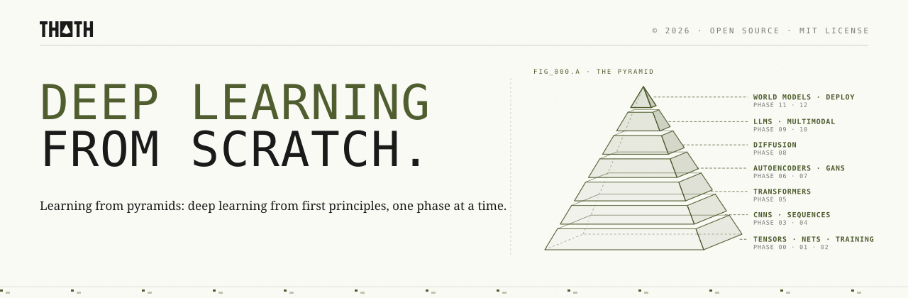

<p align="center">
  <picture>
    <source media="(prefers-color-scheme: dark)" srcset="assets/readme/header-dark.svg">
    
  </picture>
</p>

Build modern deep learning yourself. Start from tensors and a hand-written autodiff engine, implement every architecture from scratch, from MLPs and CNNs to transformers, diffusion models and a small GPT, then check your answer against PyTorch.

> 89 lessons. 13 phases. Python and PyTorch.

<p align="center">
  <a href="LICENSE"></a>
  <a href="#contents"></a>
  <a href="#contents"></a>
</p>

## Phases

| # | Phase | Lessons | What it is about |
|---|---|---|---|
| 00 | [Tensors and Autodiff](phases/00-tensors-and-autodiff/) | 6 | Every deep learning framework is two ideas: arrays that move fast, and numbers that remember how they were made. |
| 01 | [Neural Networks](phases/01-neural-networks/) | 8 | A neuron draws a line. Stack them with a bend in between, send the error back, and they learn any shape. |
| 02 | [Training Deep Nets](phases/02-training-deep-nets/) | 8 | Knowing how to compute a gradient is the easy part. Making a deep network actually learn is a craft. |
| 03 | [CNNs](phases/03-cnns/) | 8 | Look locally, share the weights, shrink the image, deepen the features. |
| 04 | [Sequence Models](phases/04-sequence-models/) | 6 | Read one token at a time, carry a memory forward, and learn what to keep. |
| 05 | [Transformers](phases/05-transformers/) | 7 | Drop the recurrence. Let every token look at every other token, stack the same block, and scale. |
| 06 | [Autoencoders and Self-Supervised Learning](phases/06-autoencoders-and-self-supervised/) | 6 | No labels? Make the data its own teacher. |
| 07 | [GANs](phases/07-gans/) | 6 | Two networks, one game: a forger that learns only from a detective's mistakes. |
| 08 | [Diffusion Models](phases/08-diffusion-models/) | 7 | Learn to remove a little noise, then do it a thousand times. |
| 09 | [LLMs](phases/09-llms/) | 8 | A large language model is a next-token predictor, scaled up, tuned to follow instructions, and served efficiently. |
| 10 | [Multimodal](phases/10-multimodal/) | 6 | Every modality is just another way to make vectors. Align them, attend across them, or turn them all into tokens. |
| 11 | [World Models and RL](phases/11-world-models-and-rl/) | 7 | Learn to act from reward, then learn how the world works so you can practice in your head. |
| 12 | [Efficient and Deployed DL](phases/12-efficient-and-deployed-dl/) | 6 | A model is only as useful as the place it can run: measure it, shrink it, freeze it, and serve it. |

## Every lesson has the same shape

```
NN-lesson-name/
├── code/main.py   from-scratch implementation, runnable from the repo root
├── docs/en.md     The Problem · The Concept · Build It · Use It · Exercises · Key Terms
└── quiz.json      questions to check yourself before and after
```

## Local setup

```bash
git clone https://github.com/Fer14/deep-learning-from-scratch.git
cd deep-learning-from-scratch
uv sync
uv run python phases/00-tensors-and-autodiff/01-tensors-and-broadcasting/code/main.py
```

No uv? `python -m venv .venv && source .venv/bin/activate && pip install -r requirements.txt` works too.

Check that every lesson runs: `uv run python scripts/check.py`

<a id="contents"></a>

## Contents

<a id="phase-00"></a>
<details>
<summary><strong>Phase 00 · Tensors and Autodiff</strong> · 6 lessons</summary>

> Every deep learning framework is two ideas: arrays that move fast, and numbers that remember how they were made.

| # | Lesson |
|---|---|
| 01 | [Tensors and Broadcasting](phases/00-tensors-and-autodiff/01-tensors-and-broadcasting/) |
| 02 | [Computational Graphs](phases/00-tensors-and-autodiff/02-computational-graphs/) |
| 03 | [Autograd from Scratch](phases/00-tensors-and-autodiff/03-autograd-from-scratch/) |
| 04 | [A Vectorized Autodiff Engine](phases/00-tensors-and-autodiff/04-vectorized-autodiff-engine/) |
| 05 | [PyTorch Tensors and Autograd](phases/00-tensors-and-autodiff/05-pytorch-tensors-and-autograd/) |
| 06 | [Devices and GPU Basics](phases/00-tensors-and-autodiff/06-devices-and-gpu-basics/) |

</details>

<a id="phase-01"></a>
<details>
<summary><strong>Phase 01 · Neural Networks</strong> · 8 lessons</summary>

> A neuron draws a line. Stack them with a bend in between, send the error back, and they learn any shape.

| # | Lesson |
|---|---|
| 01 | [The Perceptron](phases/01-neural-networks/01-the-perceptron/) |
| 02 | [Multilayer Perceptrons](phases/01-neural-networks/02-multilayer-perceptrons/) |
| 03 | [Activation Functions](phases/01-neural-networks/03-activation-functions/) |
| 04 | [Loss Functions for Networks](phases/01-neural-networks/04-loss-functions-for-networks/) |
| 05 | [Backpropagation by Hand](phases/01-neural-networks/05-backpropagation-by-hand/) |
| 06 | [An MLP from Scratch in NumPy](phases/01-neural-networks/06-an-mlp-from-scratch-in-numpy/) |
| 07 | [Universal Approximation Intuition](phases/01-neural-networks/07-universal-approximation-intuition/) |
| 08 | [PyTorch nn.Module](phases/01-neural-networks/08-pytorch-nn-module/) |

</details>

<a id="phase-02"></a>
<details>
<summary><strong>Phase 02 · Training Deep Nets</strong> · 8 lessons</summary>

> Knowing how to compute a gradient is the easy part. Making a deep network actually learn is a craft.

| # | Lesson |
|---|---|
| 01 | [SGD, Momentum and Adam](phases/02-training-deep-nets/01-sgd-momentum-and-adam/) |
| 02 | [Learning Rate Schedules](phases/02-training-deep-nets/02-learning-rate-schedules/) |
| 03 | [Weight Initialization](phases/02-training-deep-nets/03-weight-initialization/) |
| 04 | [Batch and Layer Normalization](phases/02-training-deep-nets/04-batch-and-layer-normalization/) |
| 05 | [Dropout and Weight Decay](phases/02-training-deep-nets/05-dropout-and-weight-decay/) |
| 06 | [Data Loading and Augmentation](phases/02-training-deep-nets/06-data-loading-and-augmentation/) |
| 07 | [Debugging Training](phases/02-training-deep-nets/07-debugging-training/) |
| 08 | [Mixed Precision and Checkpointing](phases/02-training-deep-nets/08-mixed-precision-and-checkpointing/) |

</details>

<a id="phase-03"></a>
<details>
<summary><strong>Phase 03 · CNNs</strong> · 8 lessons</summary>

> Look locally, share the weights, shrink the image, deepen the features.

| # | Lesson |
|---|---|
| 01 | [Convolution from Scratch](phases/03-cnns/01-convolution-from-scratch/) |
| 02 | [Padding, Stride and Pooling](phases/03-cnns/02-padding-stride-and-pooling/) |
| 03 | [LeNet](phases/03-cnns/03-lenet/) |
| 04 | [Deeper CNNs: VGG](phases/03-cnns/04-deeper-cnns-vgg/) |
| 05 | [Residual Networks](phases/03-cnns/05-residual-networks/) |
| 06 | [Visualizing Features and Receptive Fields](phases/03-cnns/06-visualizing-features-and-receptive-fields/) |
| 07 | [Transfer Learning](phases/03-cnns/07-transfer-learning/) |
| 08 | [Detection and Segmentation Intuition](phases/03-cnns/08-detection-and-segmentation-intuition/) |

</details>

<a id="phase-04"></a>
<details>
<summary><strong>Phase 04 · Sequence Models</strong> · 6 lessons</summary>

> Read one token at a time, carry a memory forward, and learn what to keep.

| # | Lesson |
|---|---|
| 01 | [Word Embeddings](phases/04-sequence-models/01-word-embeddings/) |
| 02 | [RNN from Scratch](phases/04-sequence-models/02-rnn-from-scratch/) |
| 03 | [Backprop Through Time and Vanishing Gradients](phases/04-sequence-models/03-backprop-through-time-and-vanishing-gradients/) |
| 04 | [LSTM and GRU](phases/04-sequence-models/04-lstm-and-gru/) |
| 05 | [Seq2Seq](phases/04-sequence-models/05-seq2seq/) |
| 06 | [Attention (Bahdanau)](phases/04-sequence-models/06-attention-bahdanau/) |

</details>

<a id="phase-05"></a>
<details>
<summary><strong>Phase 05 · Transformers</strong> · 7 lessons</summary>

> Drop the recurrence. Let every token look at every other token, stack the same block, and scale.

| # | Lesson |
|---|---|
| 01 | [Self-Attention from Scratch](phases/05-transformers/01-self-attention-from-scratch/) |
| 02 | [Multi-Head Attention](phases/05-transformers/02-multi-head-attention/) |
| 03 | [Positional Encodings](phases/05-transformers/03-positional-encodings/) |
| 04 | [The Transformer Block](phases/05-transformers/04-the-transformer-block/) |
| 05 | [Encoders vs Decoders](phases/05-transformers/05-encoders-vs-decoders/) |
| 06 | [Vision Transformer](phases/05-transformers/06-vision-transformer/) |
| 07 | [Efficient Attention](phases/05-transformers/07-efficient-attention/) |

</details>

<a id="phase-06"></a>
<details>
<summary><strong>Phase 06 · Autoencoders and Self-Supervised Learning</strong> · 6 lessons</summary>

> No labels? Make the data its own teacher.

| # | Lesson |
|---|---|
| 01 | [Autoencoders](phases/06-autoencoders-and-self-supervised/01-autoencoders/) |
| 02 | [Denoising Autoencoders](phases/06-autoencoders-and-self-supervised/02-denoising-autoencoders/) |
| 03 | [Variational Autoencoders](phases/06-autoencoders-and-self-supervised/03-variational-autoencoders/) |
| 04 | [Contrastive Learning](phases/06-autoencoders-and-self-supervised/04-contrastive-learning/) |
| 05 | [Representation Learning and Embeddings](phases/06-autoencoders-and-self-supervised/05-representation-learning-and-embeddings/) |
| 06 | [Masked Autoencoders](phases/06-autoencoders-and-self-supervised/06-masked-autoencoders/) |

</details>

<a id="phase-07"></a>
<details>
<summary><strong>Phase 07 · GANs</strong> · 6 lessons</summary>

> Two networks, one game: a forger that learns only from a detective's mistakes.

| # | Lesson |
|---|---|
| 01 | [A GAN from Scratch](phases/07-gans/01-a-gan-from-scratch/) |
| 02 | [Training Dynamics and Mode Collapse](phases/07-gans/02-training-dynamics-and-mode-collapse/) |
| 03 | [DCGAN](phases/07-gans/03-dcgan/) |
| 04 | [Wasserstein GAN](phases/07-gans/04-wasserstein-gan/) |
| 05 | [Conditional GANs](phases/07-gans/05-conditional-gans/) |
| 06 | [StyleGAN and Image-to-Image Intuition](phases/07-gans/06-stylegan-and-image-to-image-intuition/) |

</details>

<a id="phase-08"></a>
<details>
<summary><strong>Phase 08 · Diffusion Models</strong> · 7 lessons</summary>

> Learn to remove a little noise, then do it a thousand times.

| # | Lesson |
|---|---|
| 01 | [Forward Noising](phases/08-diffusion-models/01-forward-noising/) |
| 02 | [DDPM from Scratch](phases/08-diffusion-models/02-ddpm-from-scratch/) |
| 03 | [Score Matching Intuition](phases/08-diffusion-models/03-score-matching-intuition/) |
| 04 | [Faster Sampling with DDIM](phases/08-diffusion-models/04-faster-sampling-ddim/) |
| 05 | [Classifier-Free Guidance](phases/08-diffusion-models/05-classifier-free-guidance/) |
| 06 | [Latent Diffusion](phases/08-diffusion-models/06-latent-diffusion/) |
| 07 | [Flow Matching](phases/08-diffusion-models/07-flow-matching/) |

</details>

<a id="phase-09"></a>
<details>
<summary><strong>Phase 09 · LLMs</strong> · 8 lessons</summary>

> A large language model is a next-token predictor, scaled up, tuned to follow instructions, and served efficiently.

| # | Lesson |
|---|---|
| 01 | [Tokenization and BPE](phases/09-llms/01-tokenization-and-bpe/) |
| 02 | [Language Modeling and N-grams](phases/09-llms/02-language-modeling-and-n-grams/) |
| 03 | [GPT from Scratch](phases/09-llms/03-gpt-from-scratch/) |
| 04 | [Scaling Laws and Training at Scale](phases/09-llms/04-scaling-laws-and-training-at-scale/) |
| 05 | [Sampling and Decoding](phases/09-llms/05-sampling-and-decoding/) |
| 06 | [Fine-Tuning and LoRA](phases/09-llms/06-fine-tuning-and-lora/) |
| 07 | [RLHF and DPO](phases/09-llms/07-rlhf-and-dpo/) |
| 08 | [Inference: The KV Cache](phases/09-llms/08-inference-kv-cache/) |

</details>

<a id="phase-10"></a>
<details>
<summary><strong>Phase 10 · Multimodal</strong> · 6 lessons</summary>

> Every modality is just another way to make vectors. Align them, attend across them, or turn them all into tokens.

| # | Lesson |
|---|---|
| 01 | [Image-Text Embeddings (CLIP)](phases/10-multimodal/01-image-text-embeddings-clip/) |
| 02 | [Image Captioning](phases/10-multimodal/02-image-captioning/) |
| 03 | [Vision-Language Models](phases/10-multimodal/03-vision-language-models/) |
| 04 | [Text-to-Image Conditioning](phases/10-multimodal/04-text-to-image-conditioning/) |
| 05 | [Audio and Speech Models](phases/10-multimodal/05-audio-and-speech-models/) |
| 06 | [Any-to-Any Models](phases/10-multimodal/06-any-to-any-models/) |

</details>

<a id="phase-11"></a>
<details>
<summary><strong>Phase 11 · World Models and RL</strong> · 7 lessons</summary>

> Learn to act from reward, then learn how the world works so you can practice in your head.

| # | Lesson |
|---|---|
| 01 | [RL Basics: Markov Decision Processes](phases/11-world-models-and-rl/01-rl-basics-mdps/) |
| 02 | [Q-Learning and DQN](phases/11-world-models-and-rl/02-q-learning-and-dqn/) |
| 03 | [Policy Gradients](phases/11-world-models-and-rl/03-policy-gradients/) |
| 04 | [Model-Based RL](phases/11-world-models-and-rl/04-model-based-rl/) |
| 05 | [World Models (VAE + RNN)](phases/11-world-models-and-rl/05-world-models-vae-rnn/) |
| 06 | [Dreamer Intuition](phases/11-world-models-and-rl/06-dreamer-intuition/) |
| 07 | [JEPA and Video Prediction](phases/11-world-models-and-rl/07-jepa-and-video-prediction/) |

</details>

<a id="phase-12"></a>
<details>
<summary><strong>Phase 12 · Efficient and Deployed DL</strong> · 6 lessons</summary>

> A model is only as useful as the place it can run: measure it, shrink it, freeze it, and serve it.

| # | Lesson |
|---|---|
| 01 | [Profiling](phases/12-efficient-and-deployed-dl/01-profiling/) |
| 02 | [Quantization](phases/12-efficient-and-deployed-dl/02-quantization/) |
| 03 | [Knowledge Distillation](phases/12-efficient-and-deployed-dl/03-knowledge-distillation/) |
| 04 | [Pruning](phases/12-efficient-and-deployed-dl/04-pruning/) |
| 05 | [Export and Serving](phases/12-efficient-and-deployed-dl/05-export-and-serving/) |
| 06 | [Batching and Inference Optimization](phases/12-efficient-and-deployed-dl/06-batching-and-inference-optimization/) |

</details>

## Contributing

New lessons follow [LESSON_TEMPLATE.md](LESSON_TEMPLATE.md). Run `uv run python scripts/check.py` before opening a pull request.

## License

[MIT](LICENSE). Part of the THOTH series, alongside [Classic ML from Scratch](https://github.com/Fer14/classic-ml-from-scratch). Structure inspired by [AI Engineering from Scratch](https://github.com/rohitg00/ai-engineering-from-scratch).
