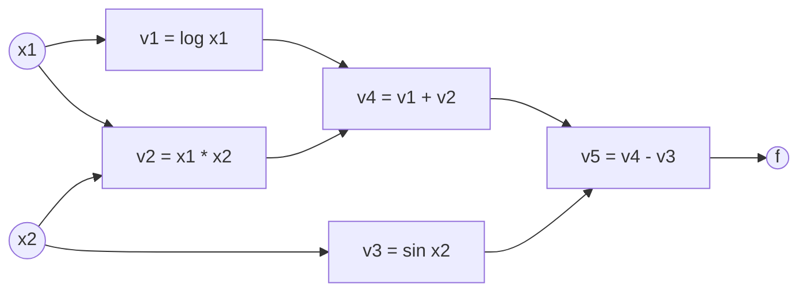

# Computational Graphs

> Any formula is a graph of tiny operations. Know the derivative of each tiny operation and the chain rule does the rest.

**Type:** Learn
**Languages:** Python
**Prerequisites:** Tensors and Broadcasting, [Classic ML from Scratch](https://github.com/Fer14/classic-ml-from-scratch) Phase 02 (Calculus and Optimization: derivatives and the chain rule)
**Time:** ~60 minutes

## Learning Objectives

- Break a formula into a computational graph and write its evaluation trace
- Compute derivatives on the graph with forward mode (tangents) and reverse mode (adjoints)
- Explain why reverse mode costs one sweep for all inputs and forward mode one sweep per input
- Verify a gradient against central finite differences
- Read the graph that PyTorch records through `grad_fn` and `next_functions`

## The Problem

A neural network is a function with millions of inputs (its weights) and one output (the loss). Training needs the derivative of that loss with respect to every weight, at every step. You have three options.

Symbolic differentiation (what you do on paper or with a computer algebra system) produces an expression for each derivative. For deep networks those expressions explode in size, because the same subexpressions get repeated over and over.

Numerical differentiation nudges each weight and measures how the loss changes. It needs two forward passes per weight: with a million weights that is two million forward passes for a single gradient step, and the result is only approximate.

Automatic differentiation (autodiff) is the third way, and the one every deep learning framework uses. It is exact up to floating point and, in reverse mode, costs about as much as one extra forward pass, regardless of how many weights you have. It all rests on one idea: the computational graph.

## The Concept

### A formula as a graph

Take the function (a standard example from the autodiff literature):

```
f(x1, x2) = log(x1) + x1 * x2 - sin(x2)
```

Split it into primitive operations, each with a name:



Running the nodes in order (a **topological order**: every node after its parents) gives the **evaluation trace**. At `(x1, x2) = (2, 5)`:

```
v1 = log(2)    =  0.6931
v2 = 2 * 5     = 10.0000
v3 = sin(5)    = -0.9589
v4 = v1 + v2   = 10.6931
v5 = v4 - v3   = 11.6521
```

### Local derivatives

Each primitive knows its own derivatives with respect to its inputs, and nothing else:

| Operation | Output | Local derivatives |
|-----------|--------|-------------------|
| add | `a + b` | `1, 1` |
| sub | `a - b` | `1, -1` |
| mul | `a * b` | `b, a` |
| log | `log a` | `1/a` |
| sin | `sin a` | `cos a` |

The chain rule says the derivative of the output with respect to an input is the **sum over all paths** from the input to the output of the **product of local derivatives** along each path. `x1` reaches `f` through two paths (via `log` and via `mul`), so:

```
df/dx1 = (1/x1) * 1 * 1  +  x2 * 1 * 1  = 0.5 + 5 = 5.5
```

### Forward mode: push tangents forward

Pick one input, set its **tangent** (derivative with respect to itself) to 1 and all others to 0. Walk the graph forward, and at each node compute

```
tangent(node) = sum over parents p of  local_derivative(node, p) * tangent(p)
```

At the end, the output's tangent is `df/d(chosen input)`. One sweep gives the derivative with respect to **one input**.

### Reverse mode: pull adjoints backward

Set the output's **adjoint** (`df/df`) to 1. Walk the graph in reverse order, and at each node send its adjoint to each parent, multiplied by the local derivative:

```
adjoint(p) += adjoint(node) * local_derivative(node, p)
```

The `+=` matters: a node used by several children (like `x1` here) collects contributions from all of them. That is the "sum over paths" of the chain rule. At the end every input holds `df/d(input)`. One sweep gives the derivative with respect to **all inputs**.

### Why reverse mode wins for deep learning

```
                       inputs n     outputs m     sweeps needed
forward mode           any          any           n
reverse mode           any          any           m
neural net training    millions     1 (loss)      reverse: 1
```

The price of reverse mode is memory: the backward sweep needs the values computed during the forward sweep (here `x1` for `1/x1`, `x2` for `cos x2`), so they must be stored until the backward pass is done. This is exactly why training uses more memory than inference.

## Build It

### Step 1: The graph and the forward pass

A node stores its operation, its parents and, after the forward pass, its value. Two tables give each primitive its forward function and its local derivatives:

```python
LOCAL_DERIVATIVES = {
    "add": lambda a, b: (1.0, 1.0),
    "sub": lambda a, b: (1.0, -1.0),
    "mul": lambda a, b: (b, a),
    "log": lambda a: (1.0 / a,),
    "sin": lambda a: (math.cos(a),),
    "square": lambda a: (2.0 * a,),
}
```

Nodes are appended as they are created, so the list `graph.nodes` is already in topological order:

```python
def build_example():
    graph = Graph()
    x1 = graph.input("x1")
    x2 = graph.input("x2")
    v1 = graph.apply("log", x1)
    v2 = graph.apply("mul", x1, x2)
    v3 = graph.apply("sin", x2)
    v4 = graph.apply("add", v1, v2)
    graph.apply("sub", v4, v3)
    return graph
```

`graph.forward((2.0, 5.0))` fills in every value and returns 11.6521, the same as the direct formula.

### Step 2: Forward mode

```python
def forward_mode(self, seed_input):
    tangent = {id(node): 0.0 for node in self.nodes}
    tangent[id(seed_input)] = 1.0
    for node in self.nodes:
        if node.op == "input":
            continue
        partials = LOCAL_DERIVATIVES[node.op](*[p.value for p in node.parents])
        tangent[id(node)] = sum(d * tangent[id(p)] for d, p in zip(partials, node.parents))
    return tangent[id(self.nodes[-1])]
```

Calling it once per input gives `df/dx1 = 5.5` and `df/dx2 = 1.7163`.

### Step 3: Reverse mode

```python
def reverse_mode(self):
    adjoint = {id(node): 0.0 for node in self.nodes}
    adjoint[id(self.nodes[-1])] = 1.0
    for node in reversed(self.nodes):
        if node.op == "input":
            continue
        partials = LOCAL_DERIVATIVES[node.op](*[p.value for p in node.parents])
        for d, parent in zip(partials, node.parents):
            adjoint[id(parent)] += adjoint[id(node)] * d
    return [adjoint[id(node)] for node in self.inputs]
```

One call returns both derivatives, matching the hand-derived `1/x1 + x2` and `x1 - cos(x2)`.

### Step 4: Gradient check

```python
def numerical_gradient(f, point, eps=1e-6):
    grads = []
    for i in range(len(point)):
        plus = list(point)
        minus = list(point)
        plus[i] += eps
        minus[i] -= eps
        grads.append((f(*plus) - f(*minus)) / (2 * eps))
    return grads
```

The central difference has error of order `eps^2`; the reverse-mode gradient agrees to about `1e-10`. You will use this check every time you write a new backward function.

### Step 5: The cost difference

`build_sum_of_squares(n)` builds `x0^2 + x1^2 + ... ` with `n` inputs. The script times all `n` forward-mode sweeps against one reverse sweep:

```
  10 inputs | forward mode   10 sweeps  ...
 100 inputs | forward mode  100 sweeps  ...
 400 inputs | forward mode  400 sweeps  ...
```

Both give identical gradients, but forward mode grows with the number of inputs (quadratically here, since the graph also grows), while reverse mode stays at a single pass.

## Use It

PyTorch builds this graph for you while your code runs. Every tensor produced by an operation on a tensor with `requires_grad=True` has a `grad_fn`, and each `grad_fn` points to its parents through `next_functions`:

```python
x1 = torch.tensor(2.0, requires_grad=True)
x2 = torch.tensor(5.0, requires_grad=True)
f = torch.log(x1) + x1 * x2 - torch.sin(x2)
f.backward()
```

Walking `f.grad_fn` prints the same graph you built by hand:

```
SubBackward0
  AddBackward0
    LogBackward0
      AccumulateGrad
    MulBackward0
      AccumulateGrad
      AccumulateGrad
  SinBackward0
    AccumulateGrad
```

`AccumulateGrad` is the leaf: it adds the incoming adjoint into `x1.grad` or `x2.grad`, which is the `+=` from your reverse sweep. `f.backward()` is reverse mode, and `x1.grad`, `x2.grad` are 5.5 and 1.7163.

## Exercises

1. **Easy.** Add `exp` and `div` to both tables and build `f(x, y) = exp(x) / (x + y)`. Check the gradient against finite differences.
2. **Medium.** Implement forward mode with **dual numbers**: a class holding `(value, tangent)` whose `__add__`, `__mul__`, `log` and `sin` propagate both. Show it gives the same `df/dx1` as the graph version without building any graph.
3. **Hard.** Build a function with 1 input and 50 outputs (for example `y_k = sin(k * x)`). Count sweeps and time forward mode against reverse mode to obtain the full Jacobian. Explain which one wins now and why.

## Key Terms

| Term | What people say | What it actually means |
|------|----------------|----------------------|
| Computational graph | "The network diagram" | A directed acyclic graph whose nodes are primitive operations and whose edges carry intermediate values |
| Evaluation trace | "The forward pass" | The ordered list of intermediate values computed from the inputs to the output |
| Topological order | "Running it in order" | Any order of the nodes in which every node comes after all its parents |
| Local derivative | "The small gradient" | The derivative of one primitive's output with respect to one of its inputs |
| Forward mode | "Dual numbers" | Autodiff that propagates derivatives with respect to one input forward, one sweep per input |
| Reverse mode | "Backprop" | Autodiff that propagates derivatives of one output backward to all inputs in one sweep |
| Adjoint | "The gradient at a node" | The derivative of the final output with respect to an intermediate value |
| Gradient check | "Testing the backward" | Comparing an analytic gradient with a finite-difference estimate |

## Further Reading

- [Baydin et al., Automatic Differentiation in Machine Learning: a Survey (2018)](https://arxiv.org/abs/1502.05767) - the reference paper on forward and reverse mode; the example function in this lesson comes from it
- [Christopher Olah, Calculus on Computational Graphs: Backpropagation](https://colah.github.io/posts/2015-08-Backprop/) - the clearest short explanation of sum over paths and why reverse mode is efficient
- [3Blue1Brown: Backpropagation calculus](https://www.youtube.com/watch?v=tIeHLnjs5U8) - the chain rule on a network, visualized
- [PyTorch: A Gentle Introduction to torch.autograd](https://pytorch.org/tutorials/beginner/blitz/autograd_tutorial.html) - how `grad_fn` and the dynamic graph work in practice
