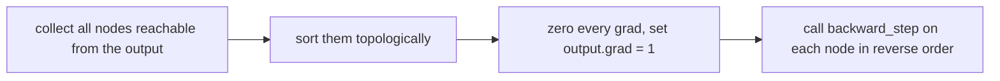

# Autograd from Scratch

> Wrap every number in an object that remembers where it came from. Then backpropagation is just a loop over that memory in reverse.

**Type:** Build
**Languages:** Python
**Prerequisites:** Computational Graphs
**Time:** ~90 minutes

## Learning Objectives

- Implement a scalar `Value` class that records the graph as you compute, with a closure for its local backward step
- Write the backward rule of `+`, `*`, `**`, `exp`, `log`, `tanh` and `relu` and derive the rest (`-`, `/`) from them
- Order the graph topologically and run reverse-mode autodiff with gradient accumulation
- Verify the engine against finite differences and against `torch.autograd`
- Build neurons, layers and an MLP on top of the engine and train it with gradient descent

## The Problem

In the previous lesson you built the graph by hand, node by node, and then ran the reverse sweep. That works for one formula. It does not work for a neural network, whose graph has thousands of nodes and changes every time the code takes a different branch.

What you want is to write ordinary Python, such as `loss = (model(x) - y) ** 2`, and have the graph build itself as a side effect of the arithmetic. Then a single call, `loss.backward()`, fills in the gradient of every parameter. That is what `torch.autograd` does, and in this lesson you write a complete version of it for scalars in about 150 lines.

The engine is deliberately small: every number is its own Python object, so it is slow. That is the point. Every mechanism in PyTorch's autograd is here in plain sight, and the next lesson makes it fast by switching from scalars to arrays.

## The Concept

### A number that remembers

Each `Value` holds four things:

```
Value
  data           the number computed in the forward pass
  grad           d(final output) / d(this value), filled in by backward()
  parents        the Values this one was computed from
  backward_step  a function that pushes self.grad into the parents' grads
```

Operator overloading builds the graph. When you write `c = a * b`, `Value.__mul__` computes `a.data * b.data`, creates `c` with `parents = (a, b)`, and attaches a `backward_step` that knows the local derivatives of multiplication:

```
c = a * b
  a.grad += b.data * c.grad
  b.grad += a.data * c.grad
```

### The backward rules

| Forward | Backward contribution to each input |
|---------|-------------------------------------|
| `out = a + b` | `a.grad += out.grad`, `b.grad += out.grad` |
| `out = a * b` | `a.grad += b * out.grad`, `b.grad += a * out.grad` |
| `out = a ** k` | `a.grad += k * a^(k-1) * out.grad` |
| `out = exp(a)` | `a.grad += out * out.grad` |
| `out = log(a)` | `a.grad += out.grad / a` |
| `out = tanh(a)` | `a.grad += (1 - out^2) * out.grad` |
| `out = relu(a)` | `a.grad += (a > 0) * out.grad` |

Subtraction, negation and division need no rules of their own: `a - b = a + (-1 * b)` and `a / b = a * b ** -1`. Composing primitives gives you their derivatives for free.

### Running backward



The reverse topological order guarantees that when a node's `backward_step` runs, its `grad` is complete: every child that uses it has already pushed its contribution. And because every rule uses `+=`, a value used several times (like `x` in `x * x + x`) collects the sum of all its paths.

### From numbers to networks

Once the engine exists, a neuron is a few lines on top of it:

```
neuron(x) = tanh(w1*x1 + w2*x2 + ... + b)
layer     = a list of neurons that see the same inputs
MLP       = layers applied one after another
```

Every weight is a `Value`, so the loss graph reaches all of them, and one `loss.backward()` gives every weight its gradient. Gradient descent is then `p.data -= learning_rate * p.grad`.

## Build It

### Step 1: The Value class and its first operations

```python
class Value:
    def __init__(self, data, parents=(), op=""):
        self.data = float(data)
        self.grad = 0.0
        self.parents = parents
        self.op = op
        self.backward_step = lambda: None

    def __add__(self, other):
        other = other if isinstance(other, Value) else Value(other)
        out = Value(self.data + other.data, (self, other), "+")

        def backward_step():
            self.grad += out.grad
            other.grad += out.grad

        out.backward_step = backward_step
        return out

    def __mul__(self, other):
        other = other if isinstance(other, Value) else Value(other)
        out = Value(self.data * other.data, (self, other), "*")

        def backward_step():
            self.grad += other.data * out.grad
            other.grad += self.data * out.grad

        out.backward_step = backward_step
        return out
```

The closure captures `self`, `other` and `out`, so the backward rule has access to the forward values it needs. Plain Python numbers are wrapped automatically, so `a * b + 10.0` works. `__radd__` and `__rmul__` handle `10.0 + a`.

### Step 2: Nonlinear operations

```python
def tanh(self):
    t = math.tanh(self.data)
    out = Value(t, (self,), "tanh")

    def backward_step():
        self.grad += (1.0 - t * t) * out.grad

    out.backward_step = backward_step
    return out
```

`exp`, `log`, `relu` and `**` follow the same pattern. Then the derived operations:

```python
def __neg__(self):
    return self * -1.0

def __sub__(self, other):
    return self + (-other)

def __truediv__(self, other):
    return self * other ** -1
```

### Step 3: Topological sort and backward

```python
def backward(self):
    order = self.topological_order()
    for node in order:
        node.grad = 0.0
    self.grad = 1.0
    for node in reversed(order):
        node.backward_step()
```

`topological_order` is a depth-first search that appends a node only after all its parents. The script uses an explicit stack instead of recursion, because a network's graph is deep enough to hit Python's recursion limit.

Check it on small cases:

```
c = a*b + 10     with a=2, b=-3   ->  dc/da = -3, dc/db = 2
y = x*x + x      with x=3         ->  dy/dx = 7
```

The second one only works because of `+=`: `x` receives `3 + 3` from the multiplication and `1` from the addition.

### Step 4: Gradient check

```python
def example_expression(a, b):
    c = a * b + b ** 3
    d = (c / a).tanh() - (a + 1.0).log()
    return d * d.exp() + (a - b).relu()
```

This mixes every operation. The engine and a central finite difference agree to six decimals: `d/da = 0.681760`, `d/db = -0.375330`.

### Step 5: Neurons, layers and an MLP

```python
class Neuron:
    def __init__(self, n_inputs, nonlinear, rng):
        self.weights = [Value(rng.uniform(-2.0, 2.0)) for _ in range(n_inputs)]
        self.bias = Value(0.0)
        self.nonlinear = nonlinear

    def __call__(self, inputs):
        activation = sum((w * x for w, x in zip(self.weights, inputs)), self.bias)
        return activation.tanh() if self.nonlinear else activation
```

`Layer` holds a list of neurons and `MLP` a list of layers; both expose `parameters()`. The last layer is linear, so the network outputs a raw score.

### Step 6: Train on two moons

Labels are `+1` and `-1`, and the loss is the logistic loss `log(1 + exp(-y * score))`, which is binary cross-entropy written for `+-1` labels:

```python
for step in range(150):
    scores = [model([Value(x0), Value(x1)]) for x0, x1 in X]
    data_loss = sum(logistic_loss(s, t) for s, t in zip(scores, labels)) * (1.0 / len(labels))
    l2 = sum(p * p for p in params) * 1e-4
    loss = data_loss + l2
    loss.backward()
    for p in params:
        p.data -= learning_rate * p.grad
```

A 2-16-1 network (65 parameters) on 80 points goes from about 29% to about 99% training accuracy. The wide uniform initialization spreads the tanh units across the input space; you will learn principled initialization in Phase 02 (Training Deep Nets). Look at the timing line: each step builds a graph of almost 10,000 `Value` objects and the whole run takes tens of seconds for a model PyTorch would train in milliseconds. That cost is the motivation for the next lesson.

## Use It

`torch.autograd` is the same machine, operating on tensors and implemented in C++:

```python
ta = torch.tensor(1.5, dtype=torch.float64, requires_grad=True)
tb = torch.tensor(0.7, dtype=torch.float64, requires_grad=True)
tc = ta * tb + tb ** 3
td = torch.tanh(tc / ta) - torch.log(ta + 1.0)
tout = td * torch.exp(td) + torch.relu(ta - tb)
tout.backward()
```

The output and both gradients match your engine exactly. The correspondences are direct: `requires_grad=True` marks a leaf you want gradients for, `grad_fn` is your `backward_step`, `.backward()` is your `backward()`, and `.grad` is your `.grad`. One difference: PyTorch does **not** zero gradients for you, it keeps accumulating into `.grad` across calls, which is why training loops call `optimizer.zero_grad()`.

## Exercises

1. **Easy.** Add a `sigmoid` method with its own backward rule (`s * (1 - s)`), then check it against `1 / (1 + (-x).exp())` built from existing operations.
2. **Medium.** Replace the logistic loss with the hinge loss `relu(1 - y * score)` and compare the training curves. Then switch the hidden activation to `relu` and explain any difference in how fast it trains.
3. **Hard.** Write `draw_graph(value)` that prints every node with its operation, data and grad, indented by depth, and use it on `example_expression`. Then count how many `Value` objects one training step creates and estimate how that number scales with hidden width and dataset size.

## Key Terms

| Term | What people say | What it actually means |
|------|----------------|----------------------|
| Autograd | "Automatic gradients" | Reverse-mode autodiff that records the graph while ordinary code runs |
| Dynamic graph | "Define by run" | The graph is built fresh on every forward pass by the operations that actually execute |
| Leaf | "An input" | A value created directly rather than by an operation; parameters are leaves |
| backward_step / grad_fn | "The backward function" | The closure attached to an output that pushes its gradient into its parents |
| Gradient accumulation | "Adding up gradients" | Using `+=` so a value used several times gets the sum of all its contributions |
| Topological sort | "Ordering the graph" | Listing nodes so each comes after its parents; reversed, it is the backward order |
| Logistic loss | "Log loss for +-1 labels" | `log(1 + exp(-y * score))`, equivalent to binary cross-entropy on a sigmoid |

## Further Reading

- [Andrej Karpathy, micrograd](https://github.com/karpathy/micrograd) - the tiny scalar autograd engine that inspired this lesson; read it after writing your own and compare the design choices
- [Andrej Karpathy, The spelled-out intro to neural networks and backpropagation: building micrograd](https://www.youtube.com/watch?v=VMj-3S1tku0) - a 2.5 hour walkthrough that builds a scalar engine live
- [PyTorch: Autograd mechanics](https://pytorch.org/docs/stable/notes/autograd.html) - how the real engine records graphs, accumulates gradients and frees saved tensors
- [Dive into Deep Learning: Automatic Differentiation](https://d2l.ai/chapter_preliminaries/autograd.html) - the same ideas in PyTorch with exercises
