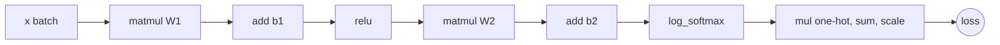

# A Vectorized Autodiff Engine

> Same engine, bigger numbers: let each node hold a whole array, and one Python call does the work of thousands.

**Type:** Build
**Languages:** Python
**Prerequisites:** Tensors and Broadcasting, Autograd from Scratch
**Time:** ~90 minutes

## Learning Objectives

- Turn the scalar `Value` engine into a `Tensor` engine whose nodes hold NumPy arrays
- Derive the backward rules for broadcast `add` and `mul`, `matmul`, `sum` and `mean`
- Build `log_softmax` and cross-entropy as compositions of primitives, with the max-shift for numerical stability
- Gradient-check every operation with finite differences on small random tensors
- Train an MLP on 8x8 digit images in under a second and match `torch.autograd` gradients to machine precision

## The Problem

The scalar engine from the last lesson trained a 65-parameter network on 80 points, and each step created about 10,000 Python objects. A modest image classifier has millions of parameters and sees thousands of images per second. Scaling the scalar engine to that is hopeless: the bottleneck is not the math, it is the Python overhead of one object and one closure per number.

The fix is the same idea that made broadcasting fast in the first lesson: move the loops into NumPy. If a node holds a `(64, 64)` matrix instead of a single number, then `x @ W` is one node, one closure and one call into optimized C code, no matter how many multiplications it hides. The graph for a whole MLP shrinks from tens of thousands of nodes to a couple of dozen.

The catch is that the backward rules now have to respect shapes. A gradient must always have the same shape as the thing it is a gradient of, and broadcasting, matrix products and reductions all change shapes. Getting those rules right is the content of this lesson.

## The Concept

### The shape rule

For every tensor `t` in the graph:

```
t.grad.shape == t.data.shape
```

Each entry of `t.grad` is the derivative of the scalar loss with respect to the matching entry of `t`. Every backward rule below is the scalar rule from the previous lesson, rearranged so this holds.

### Elementwise operations with broadcasting

For `out = a * b` the scalar rule still applies entry by entry: `grad_a = b * grad_out`. But if `b` had shape `(3,)` and was broadcast across `(5, 3)`, the product `a * grad_out` has shape `(5, 3)`, and each entry of `b` was used 5 times. Sum over the broadcast axes:

```
grad_a = unbroadcast(b * grad_out, a.shape)
grad_b = unbroadcast(a * grad_out, b.shape)
```

### Matrix multiplication

For `out = A @ B` with `A` of shape `(n, k)` and `B` of shape `(k, m)`:

```
out[i, j] = sum_p A[i, p] * B[p, j]

grad_A = grad_out @ B.T      (n, m) @ (m, k) = (n, k)
grad_B = A.T @ grad_out      (k, n) @ (n, m) = (k, m)
```

You do not need to memorize these. Write the shapes and there is only one way to combine `grad_out` with the other operand that produces the right shape.

### Reductions

`out = a.sum(axis)` has one fewer axis. Every entry of `a` contributed with derivative 1 to exactly one output entry, so the gradient is `grad_out` copied back along the summed axis:

```
grad_a = broadcast_to(expand_dims(grad_out, axis), a.shape)
```

`mean` is `sum` times `1 / count`, so it needs no rule of its own.

### Cross-entropy as a composition

For logits `z` of shape `(batch, classes)`:

```
log_softmax(z) = (z - m) - log( sum_j exp(z_j - m) )      m = max_j z_j
cross_entropy  = -mean over the batch of log_softmax(z)[true class]
```

Subtracting the row max `m` keeps `exp` from overflowing and does not change the result, because it cancels between the two terms. That cancellation also means `m` can be treated as a constant with no gradient. With one-hot targets, picking the true class is a multiply and a sum, so the whole loss is built from `sub`, `exp`, `sum`, `log` and `mul`, all of which already have backward rules.



## Build It

### Step 1: The Tensor class and broadcast-aware add

```python
class Tensor:
    def __init__(self, data, parents=(), op=""):
        self.data = np.asarray(data, dtype=np.float64)
        self.grad = np.zeros_like(self.data)
        self.parents = parents
        self.op = op
        self.backward_step = lambda: None

    def __add__(self, other):
        other = Tensor.lift(other)
        out = Tensor(self.data + other.data, (self, other), "add")

        def backward_step():
            self.grad += unbroadcast(out.grad, self.shape)
            other.grad += unbroadcast(out.grad, other.shape)

        out.backward_step = backward_step
        return out
```

The structure is identical to `Value`; only the arithmetic inside the closures changes. Adding a zero bias `(3,)` to a `(5, 3)` input and summing gives `bias.grad = [5, 5, 5]`.

### Step 2: matmul, sum and the elementwise functions

```python
def __matmul__(self, other):
    out = Tensor(self.data @ other.data, (self, other), "matmul")

    def backward_step():
        self.grad += out.grad @ other.data.T
        other.grad += self.data.T @ out.grad

    out.backward_step = backward_step
    return out

def sum(self, axis=None, keepdims=False):
    out = Tensor(self.data.sum(axis=axis, keepdims=keepdims), (self,), "sum")

    def backward_step():
        grad = out.grad
        if axis is not None and not keepdims:
            grad = np.expand_dims(grad, axis)
        self.grad += np.broadcast_to(grad, self.shape)

    out.backward_step = backward_step
    return out
```

`exp`, `log`, `relu`, `tanh` and `**` are elementwise, so their rules are the scalar rules applied to arrays. The script checks that `A.grad` for `(A @ B).sum()` equals `ones @ B.T`.

### Step 3: Loss functions

```python
def log_softmax(logits):
    shifted = logits - logits.max_constant(axis=1)
    return shifted - shifted.exp().sum(axis=1, keepdims=True).log()


def cross_entropy(logits, targets_one_hot):
    return -(log_softmax(logits) * targets_one_hot).sum() * (1.0 / logits.shape[0])
```

`max_constant` returns a fresh `Tensor` with no parents, so no gradient flows through the max, as justified above.

### Step 4: Gradient check

```python
def numerical_grad(f, array, eps=1e-6):
    grad = np.zeros_like(array)
    for index in np.ndindex(array.shape):
        original = array[index]
        array[index] = original + eps
        plus = f()
        array[index] = original - eps
        minus = f()
        array[index] = original
        grad[index] = (plus - minus) / (2 * eps)
    return grad
```

The check builds one expression that uses broadcasting, `tanh`, `matmul`, `relu`, `**`, `mean`, division, `exp` and cross-entropy, then compares every input's gradient with finite differences. All errors are around `1e-10`. Always run a check like this when you add an operation: a wrong backward rule does not crash, it just trains badly.

### Step 5: Train on digits

```python
class Linear:
    def __init__(self, n_in, n_out, rng):
        self.W = Tensor(rng.normal(size=(n_in, n_out)) * np.sqrt(2.0 / n_in))
        self.b = Tensor(np.zeros(n_out))

    def __call__(self, x):
        return x @ self.W + self.b
```

A 64-64-10 MLP (4,810 parameters) trains with minibatch gradient descent, batch size 64, learning rate 0.1:

```python
for i in range(0, len(order), batch_size):
    batch = order[i:i + batch_size]
    logits = model(Tensor(X_train[batch]))
    loss = cross_entropy(logits, np.eye(10)[y_train[batch]])
    loss.backward()
    for p in params:
        p.data -= learning_rate * p.grad
```

Test accuracy reaches about 95% after 30 epochs, and the whole run takes about half a second. The graph of each step has 27 nodes. The scalar engine would need millions of `Value` objects for the same step.

## Use It

To prove the engine is right, copy its weights into PyTorch tensors and compute the same loss with `torch.nn.functional.cross_entropy`:

```python
torch_params = [torch.tensor(p.data, requires_grad=True) for p in params]
W1, b1, W2, b2 = torch_params
torch_logits = torch.relu(torch.from_numpy(X_batch) @ W1 + b1) @ W2 + b2
torch_loss = torch.nn.functional.cross_entropy(torch_logits, torch.from_numpy(y_batch))
torch_loss.backward()
```

The losses match to six decimals and every gradient differs by less than `1e-16`, which is float64 rounding. PyTorch's `cross_entropy` takes integer class indices instead of one-hot vectors and fuses `log_softmax` and the negative log-likelihood into one kernel, but the math is exactly what you wrote. From the next lesson on you will use `torch.autograd` directly, knowing what it does under the hood.

## Exercises

1. **Easy.** Add a `transpose` operation (its backward is the transpose of the gradient) and use it to write `A @ B` as `(B.T @ A.T).T`. Gradient-check that both give the same gradients.
2. **Medium.** Add `sigmoid` and a `binary_cross_entropy` loss, then train the engine on `sklearn.datasets.make_moons` with a 2-32-1 network. Compare the run time with the scalar engine of the previous lesson on the same data.
3. **Hard.** Implement a fused `softmax_cross_entropy` operation with its own backward rule, `grad_logits = (softmax(z) - one_hot) / batch`, instead of composing primitives. Gradient-check it, then measure how many fewer graph nodes and how much faster a training epoch is.

## Key Terms

| Term | What people say | What it actually means |
|------|----------------|----------------------|
| Vectorization | "Using NumPy" | Replacing Python loops over numbers with single calls on whole arrays |
| Shape rule | "Grads look like weights" | Every gradient has exactly the shape of the tensor it differentiates |
| Unbroadcast | "Summing over the batch" | Reducing a gradient over axes that were broadcast in the forward pass |
| matmul backward | "Transpose and multiply" | `grad_A = grad_out @ B.T`, `grad_B = A.T @ grad_out` |
| Log-sum-exp trick | "Subtract the max" | Shifting logits by their max before `exp` to avoid overflow, without changing the result |
| Cross-entropy | "The classification loss" | Mean negative log-probability of the correct class under the softmax |
| Minibatch | "A batch" | A random subset of training examples used for one gradient step |

## Further Reading

- [Andrej Karpathy: Building makemore Part 4, Becoming a Backprop Ninja](https://www.youtube.com/watch?v=q8SA3rM6ckI) - derives tensor-level backward rules (including cross-entropy and broadcasting) by hand
- [Stanford CS231n: Backpropagation notes](https://cs231n.github.io/optimization-2/) - gradients of matrix products via shape matching
- [Dive into Deep Learning: Softmax Regression Implementation](https://d2l.ai/chapter_linear-classification/softmax-regression-scratch.html) - softmax and cross-entropy from scratch, with the numerical stability discussion
- [Baydin et al., Automatic Differentiation in Machine Learning: a Survey (2018)](https://arxiv.org/abs/1502.05767) - section on implementation strategies, including operator overloading
