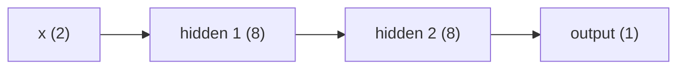

# Multilayer Perceptrons

> One line cannot solve XOR. Two layers of lines, with a bend in between, can.

**Type:** Build
**Languages:** Python
**Prerequisites:** Phase 00 (Tensors and Autodiff), The Perceptron
**Time:** ~50 minutes

## Learning Objectives

- Solve XOR with a hand-wired two-layer network and explain what the hidden layer computes
- Prove numerically that stacked linear layers collapse into one linear layer without a nonlinearity
- Write the batched forward pass of a multilayer perceptron and track tensor shapes layer by layer
- Count parameters of an MLP and match your NumPy forward pass against `torch.nn.Sequential`

## The Problem

The previous lesson ended at a wall: a single neuron draws one line, and XOR needs two. Real problems are worse. Pixels of a handwritten 3 and an 8 are not separated by any hyperplane in pixel space, and neither are fraudulent and honest transactions.

You could hand-engineer features until a linear model works, which is what classic ML did for decades. A multilayer perceptron (MLP) instead learns its own features: the first layer turns the input into a new representation, and the next layer draws lines in that new space. This lesson builds that idea by hand before you learn, in the following lessons, how to train it.

## The Concept

### Layers of neurons

An MLP is a chain of fully connected layers. Each layer applies a linear map and then an elementwise nonlinearity:

```
h1 = f(x  W1 + b1)
h2 = f(h1 W2 + b2)
y  = g(h2 W3 + b3)
```



With a batch of `n` inputs as rows of `X`, everything is a matrix product:

| Tensor | Shape |
|--------|-------|
| `X` | `(n, 2)` |
| `W1`, `b1` | `(2, 8)`, `(8,)` |
| `h1` | `(n, 8)` |
| `W2`, `b2` | `(8, 8)`, `(8,)` |
| `h2` | `(n, 8)` |
| `W3`, `b3` | `(8, 1)`, `(1,)` |
| `y` | `(n, 1)` |

The bias is broadcast across the batch dimension, exactly as you practiced in Phase 00.

### XOR as OR-but-not-AND

XOR is true when at least one input is on, but not both. So:

```
h_or  = step(x1 + x2 - 0.5)
h_and = step(x1 + x2 - 1.5)
xor   = step(h_or - h_and - 0.5)
```

The hidden layer maps the four corners into a new space where they become separable:

| x | h_or | h_and | xor |
|---|------|-------|-----|
| (0, 0) | 0 | 0 | 0 |
| (0, 1) | 1 | 0 | 1 |
| (1, 0) | 1 | 0 | 1 |
| (1, 1) | 1 | 1 | 0 |

In `(h_or, h_and)` space the points `(0,0)` and `(1,1)` are class 0 and `(1,0)` is class 1: a line separates them. That is the whole point of hidden layers: learn a representation in which the problem becomes linear.

### Why the nonlinearity is essential

Without `f`, two layers are

```
(x W1 + b1) W2 + b2 = x (W1 W2) + (b1 W2 + b2) = x W' + b'
```

which is again one linear layer. Depth without nonlinearity adds parameters but no expressive power. Every activation function you meet in the next lesson exists to break this collapse.

### Counting parameters

A layer from `d_in` to `d_out` has `d_in * d_out` weights plus `d_out` biases. A `784-512-512-10` MNIST classifier has

```
784*512 + 512 + 512*512 + 512 + 512*10 + 10 = 669,706
```

parameters. Fully connected layers grow quickly with input size, which is why images later get convolutions (Phase 03).

## Build It

### Step 1: XOR by hand

```python
def xor_by_hand(X):
    W1 = np.array([[1.0, 1.0], [1.0, 1.0]])
    b1 = np.array([-0.5, -1.5])
    W2 = np.array([1.0, -1.0])
    b2 = -0.5
    hidden = step(X @ W1 + b1)
    output = step(hidden @ W2 + b2)
    return hidden, output
```

The two columns of `W1` are the OR and AND neurons. Running it prints the truth table above.

### Step 2: The collapse of linear layers

```python
two_layers = (X @ W1 + b1) @ W2 + b2
W_combined = W1 @ W2
b_combined = b1 @ W2 + b2
one_layer = X @ W_combined + b_combined
```

The maximum difference is around `4e-16`, pure floating-point noise.

### Step 3: A general forward pass

```python
def init_mlp(layer_sizes, seed):
    rng = np.random.default_rng(seed)
    params = []
    for fan_in, fan_out in zip(layer_sizes[:-1], layer_sizes[1:]):
        W = rng.normal(0.0, 1.0, size=(fan_in, fan_out))
        b = np.zeros(fan_out)
        params.append((W, b))
    return params


def mlp_forward(X, params):
    activation = X
    shapes = [activation.shape]
    for index, (W, b) in enumerate(params):
        z = activation @ W + b
        activation = sigmoid(z) if index == len(params) - 1 else np.tanh(z)
        shapes.append(activation.shape)
    return activation, shapes
```

Hidden layers use `tanh`; the last layer uses a sigmoid so the output reads as a probability. For the 2-8-8-1 network the shapes are `[(4, 2), (4, 8), (4, 8), (4, 1)]`. The untrained outputs are arbitrary; training comes in lesson 06.

### Step 4: Count parameters

```python
def count_parameters(layer_sizes):
    return sum(fan_in * fan_out + fan_out for fan_in, fan_out in zip(layer_sizes[:-1], layer_sizes[1:]))
```

```
  [2, 8, 8, 1]: 105 parameters
  [784, 128, 10]: 101,770 parameters
  [784, 512, 512, 10]: 669,706 parameters
```

## Use It

```python
torch_mlp = torch.nn.Sequential(
    torch.nn.Linear(2, 8), torch.nn.Tanh(),
    torch.nn.Linear(8, 8), torch.nn.Tanh(),
    torch.nn.Linear(8, 1), torch.nn.Sigmoid(),
)
with torch.no_grad():
    for layer, (W, b) in zip([m for m in torch_mlp if isinstance(m, torch.nn.Linear)], params):
        layer.weight.copy_(torch.tensor(W.T))
        layer.bias.copy_(torch.tensor(b))
```

Copy your weights into the torch layers (transposed, because `nn.Linear` stores `(out, in)`) and the outputs match to about `1e-8`, the float32 rounding level. `sum(p.numel() for p in torch_mlp.parameters())` gives the same 105 parameters. `nn.Sequential` is just your `for` loop over layers with the bookkeeping done for you.

## Exercises

1. **Easy.** Change the hand-wired XOR network to compute XNOR (1 when the inputs are equal) by changing only `W2` and `b2`.
2. **Medium.** Replace `np.tanh` with the identity in `mlp_forward` for a 2-8-8-1 network and show that the output equals a single affine map `x W' + b'` followed by the sigmoid. Compute `W'` and `b'` explicitly.
3. **Hard.** Build a hand-wired network with one hidden layer of step units that outputs 1 inside the triangle with corners `(0, 0)`, `(1, 0)`, `(0, 1)` and 0 outside. Hint: one hidden unit per edge, and an output unit that fires only when all three agree.

## Key Terms

| Term | What people say | What it actually means |
|------|----------------|----------------------|
| MLP | "A basic neural net" | A stack of fully connected layers, each a linear map followed by an elementwise nonlinearity |
| Hidden layer | "The black box part" | Any layer between input and output; it produces a learned representation of the input |
| Fully connected (dense) layer | "Linear layer" | `x W + b`: every output depends on every input |
| Representation | "Features the net learns" | The activations of a hidden layer, a new coordinate system for the data |
| Depth | "Number of layers" | How many nonlinear layers the input passes through |
| Width | "Layer size" | Number of neurons in a layer |
| Parameter count | "Model size" | Total number of weights and biases, `sum(d_in * d_out + d_out)` for an MLP |

## Further Reading

- [3Blue1Brown: But what is a neural network?](https://www.youtube.com/watch?v=aircAruvnKk) - layers as successive feature detectors on MNIST
- [Dive into Deep Learning, Section 5.1: Multilayer Perceptrons](https://d2l.ai/chapter_multilayer-perceptrons/mlp.html) - hidden layers, the collapse argument and activation functions
- [Minsky and Papert, Perceptrons (1969)](https://mitpress.mit.edu/9780262630221/perceptrons/) - the book whose XOR analysis shaped two decades of research
- [PyTorch docs: torch.nn.Sequential](https://pytorch.org/docs/stable/generated/torch.nn.Sequential.html) - the container you just reimplemented
