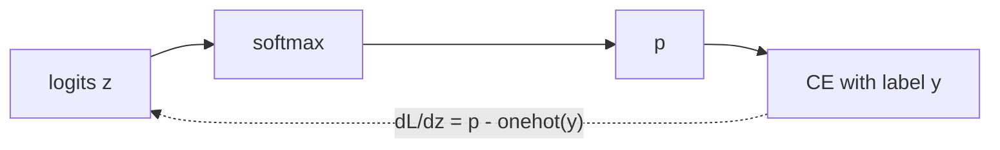

# Loss Functions for Networks

> The loss is the only thing your network ever hears about the task. Pick it to match the output, and compute it from logits.

**Type:** Build
**Languages:** Python
**Prerequisites:** Phase 00 (Tensors and Autodiff), Activation Functions
**Time:** ~45 minutes

## Learning Objectives

- Implement MSE, MAE, Huber, binary cross-entropy and softmax cross-entropy in NumPy
- Explain why classification losses should be computed from logits with log-sum-exp, not from probabilities
- Derive and verify that cross-entropy after softmax (or sigmoid) has gradient `p - y` with respect to the logits
- Match every loss and its gradient against `torch.nn.functional`

## The Problem

A network does not know what you want. It only sees a single number, the loss, and the gradient of that number with respect to its weights. If the loss does not reflect the task, the network will optimize the wrong thing very efficiently. If the loss is numerically unstable, it will produce `inf` or `nan` and training will silently die.

Both mistakes are common. People train classifiers with MSE on one-hot targets and wonder why learning is slow. People write `-log(sigmoid(z))` and get `inf` the first time the model is confidently wrong. This lesson builds the standard losses, shows how outliers and overconfidence affect them, and derives the beautifully simple gradient that makes cross-entropy the default for classification.

## The Concept

### Losses come from the output distribution

Each standard loss is the negative log-likelihood of an assumed distribution over targets:

| Task | Output layer | Assumed distribution | Loss |
|------|--------------|----------------------|------|
| Regression | identity | Gaussian | MSE |
| Robust regression | identity | Laplace | MAE |
| Binary classification | sigmoid | Bernoulli | binary cross-entropy |
| Multiclass classification | softmax | Categorical | cross-entropy |

### Regression losses

```
MSE   = mean( (y_hat - y)^2 )
MAE   = mean( |y_hat - y| )
Huber = mean( 0.5 e^2            if |e| <= delta
              delta (|e| - delta/2) otherwise )      e = y_hat - y
```

MSE squares the error, so one large outlier dominates the average and its gradient. MAE grows linearly and is robust, but its gradient has constant magnitude, which makes the final approach to the minimum jumpy. Huber is quadratic near zero and linear far away: the best of both.

### Cross-entropy from logits

For a binary label `y` and a logit `z` with `p = sigmoid(z)`:

```
BCE = -[ y log p + (1 - y) log(1 - p) ]
```

Computing `p` first and then `log p` breaks when `z` is large: `sigmoid(200)` is exactly `1.0` in float64, so `log(1 - p) = log 0 = -inf`. Rewrite in terms of the logit with `log sigmoid(z) = -log(1 + e^-z)`:

```
BCE = -[ y log_sigmoid(z) + (1 - y) log_sigmoid(-z) ]
log_sigmoid(z) = -logaddexp(0, -z)
```

`logaddexp` never overflows. The multiclass version uses log-softmax:

```
log_softmax(z)_k = z_k - log sum_j e^(z_j)      (subtract max(z) first)
CE = -mean( log_softmax(z)[y] )
```

For random logits over `K` classes, CE is close to `log K`; that is a handy sanity check on the first iteration of any classifier (`log 10 = 2.30` for digits).

### The gradient is prediction minus target

Differentiate cross-entropy through the softmax with respect to the logits and almost everything cancels:

```
dCE/dz_k = p_k - 1[k = y]          (divide by n for a mean over the batch)
```

The same holds for sigmoid plus BCE (`p - y`) and for identity plus MSE (`2 (y_hat - y)`, up to the constant). This is not a coincidence: each pair is a canonical link of an exponential family. In practice it means:

- the gradient never vanishes because of the output activation, unlike sigmoid followed by MSE
- the backward pass of the last layer is one subtraction



## Build It

### Step 1: Regression losses and an outlier

```python
def huber(prediction, target, delta=1.0):
    error = prediction - target
    small = np.abs(error) <= delta
    return np.mean(np.where(small, 0.5 * error ** 2, delta * (np.abs(error) - 0.5 * delta)))
```

Replace one prediction with 15 when the target is 5:

```
  MSE   clean=0.0220  with outlier=20.0200
  MAE   clean=0.1400  with outlier=2.1200
  Huber clean=0.0110  with outlier=1.9100
```

MSE jumps to 20 because the single error of 10 is squared and then averaged over five points. MAE and Huber stay around 2, roughly the outlier's error divided by the batch size, so one bad point cannot dominate the gradient.

### Step 2: Binary cross-entropy from logits

```python
def log_sigmoid(z):
    return -np.logaddexp(0.0, -z)


def bce_with_logits(logits, target):
    return -np.mean(target * log_sigmoid(logits) + (1 - target) * log_sigmoid(-logits))
```

Correct confident logits give 0.088, all-zero logits give `log 2 = 0.693`, and confidently wrong logits give 2.59. For logits of `+-200` with the wrong labels, the naive formula returns `inf`, the logit version returns the correct 200.

### Step 3: Softmax cross-entropy

```python
def log_softmax(logits):
    shifted = logits - logits.max(axis=1, keepdims=True)
    return shifted - np.log(np.exp(shifted).sum(axis=1, keepdims=True))


def cross_entropy(logits, labels):
    return -np.mean(log_softmax(logits)[np.arange(len(labels)), labels])
```

Random logits for 4 classes give 1.445, close to `log 4 = 1.386`.

### Step 4: Verify the `p - y` gradient

```python
def cross_entropy_grad(logits, labels):
    probs = np.exp(log_softmax(logits))
    probs[np.arange(len(labels)), labels] -= 1
    return probs / len(labels)
```

A central finite difference agrees to about `1e-10` for softmax CE, BCE and MSE. Whenever you write a new loss, run this check before training anything with it.

## Use It

```python
F.cross_entropy(logits, labels)
F.binary_cross_entropy_with_logits(logits, targets)
F.mse_loss(prediction, target)
F.huber_loss(prediction, target)
```

All four match your values to six decimals, and `loss.backward()` on `F.cross_entropy` gives the same `(p - onehot) / n` gradient. Two practical rules:

- `F.cross_entropy` expects raw logits and integer class indices. Do not apply softmax first; you would compute softmax twice and get a weaker gradient.
- Prefer `binary_cross_entropy_with_logits` over `sigmoid` plus `binary_cross_entropy`. It is the stable formula you just wrote.

Both functions also take `reduction="sum"` or `"none"`, `weight` for class imbalance, and `label_smoothing` (for `cross_entropy`), which you will meet in later phases.

## Exercises

1. **Easy.** Compute the cross-entropy of a 10-class classifier that outputs uniform probabilities. Confirm it equals `log 10` and explain why this is the expected loss at initialization.
2. **Medium.** Derive `dBCE/dz = sigmoid(z) - y` by hand from `BCE = -[y log sigmoid(z) + (1 - y) log sigmoid(-z)]`, then compare it with the gradient of MSE applied after a sigmoid, `2 (sigmoid(z) - y) sigmoid(z)(1 - sigmoid(z))`. Evaluate both at `z = -8, y = 1` and explain which one trains faster.
3. **Hard.** Implement label smoothing: replace the one-hot target with `(1 - eps) * onehot + eps / K` and derive the gradient (still `p - target`). Verify it against `F.cross_entropy(..., label_smoothing=eps)`.

## Key Terms

| Term | What people say | What it actually means |
|------|----------------|----------------------|
| Loss function | "The error" | A scalar that measures how wrong the predictions are; its gradient drives training |
| MSE | "Squared error" | Mean of squared residuals; the Gaussian negative log-likelihood up to constants |
| Huber loss | "Smooth L1" | Quadratic for small errors, linear for large ones; robust to outliers |
| Cross-entropy | "Log loss" | `-log p(correct class)`, the categorical negative log-likelihood |
| Logits | "Raw scores" | Pre-softmax or pre-sigmoid outputs; losses should be computed from them directly |
| Log-sum-exp trick | "Subtract the max" | Computing `log sum e^z` as `m + log sum e^(z - m)` to avoid overflow |
| Canonical link | "Why the gradient is so clean" | Pairing an output activation with its matching likelihood so the gradient w.r.t. logits is `prediction - target` |

## Further Reading

- [Dive into Deep Learning, Section 4.1: Softmax Regression](https://d2l.ai/chapter_linear-classification/softmax-regression.html) - softmax, cross-entropy and the `p - y` gradient
- [Goodfellow, Bengio and Courville, Deep Learning, Section 6.2](https://www.deeplearningbook.org/contents/mlp.html) - cost functions and output units as maximum likelihood
- [PyTorch docs: CrossEntropyLoss](https://pytorch.org/docs/stable/generated/torch.nn.CrossEntropyLoss.html) - expected inputs, weights and label smoothing
- [PyTorch docs: BCEWithLogitsLoss](https://pytorch.org/docs/stable/generated/torch.nn.BCEWithLogitsLoss.html) - why the fused version is numerically stable
