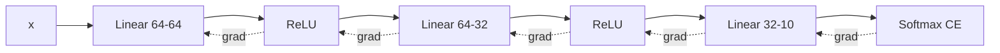

# An MLP from Scratch in NumPy

> Every layer knows two things: how to go forward and how to send the gradient back. Stack them and you have a framework.

**Type:** Build
**Languages:** Python
**Prerequisites:** Phase 00 (Tensors and Autodiff), Backpropagation by Hand
**Time:** ~75 minutes

## Learning Objectives

- Design modular `Linear`, `ReLU` and `SoftmaxCrossEntropy` layers, each with its own `forward` and `backward`
- Compose them into an MLP whose backward pass is a loop over layers in reverse order
- Train it with minibatch stochastic gradient descent on the 8x8 digits dataset and reach about 97% test accuracy
- Reproduce the same model and training loop in PyTorch and compare results

## The Problem

In the last lesson you wrote one backward function for one specific network. Add a layer and you rewrite it. Change an activation and you rewrite it again. That does not scale to the networks in the rest of this course, which have dozens or hundreds of layers.

The fix is the idea every framework is built on: make each layer responsible only for its own local derivative. A `Linear` layer does not need to know what comes after it; it receives `dL/d(output)` and returns `dL/d(input)`, storing its parameter gradients on the way. Then a network is just a list, and the backward pass is the same loop no matter how deep the list is. You will build that, train it on real handwritten digits, and see it match PyTorch.

## The Concept

### The layer contract

```
forward(x)          -> output            (cache what backward will need)
backward(grad_out)  -> grad_in           (and store dW, db for parameters)
```



| Layer | forward | backward | cache |
|-------|---------|----------|-------|
| Linear | `x W + b` | `dW = x^T g`, `db = sum(g)`, return `g W^T` | `x` |
| ReLU | `x * (x > 0)` | `g * (x > 0)` | mask |
| Softmax CE | `-mean log softmax(z)[y]` | `(softmax(z) - onehot(y)) / n` | probabilities, labels |

### Minibatch SGD

The full training set gives the exact gradient but is slow; one sample is cheap but noisy. A minibatch of `B` samples is the compromise used everywhere:

```
for each epoch:
    shuffle the training set
    for each batch of B samples:
        forward  -> loss
        backward -> gradients
        W <- W - lr * dW   for every parameter
```

One epoch is one pass over the data. With 1347 training images and `B = 32` you get 43 updates per epoch.

### Initialization

The `Linear` layer draws weights from `N(0, 2 / fan_in)`. This He initialization keeps activation variance roughly constant through ReLU layers, as you saw in the activation functions lesson. Biases start at zero. Phase 02 (Training Deep Nets) covers this properly; for now it is the line that makes a deep ReLU network start training immediately.

### The data

`sklearn.datasets.load_digits` ships 1797 grayscale 8x8 images of digits, bundled with scikit-learn, so no download is needed. Each image becomes a 64-dimensional vector. You standardize every pixel with the training mean and standard deviation, using the same statistics for the test set.

## Build It

### Step 1: The layers

```python
class Linear:
    def __init__(self, fan_in, fan_out, rng):
        self.W = rng.normal(0.0, np.sqrt(2.0 / fan_in), size=(fan_in, fan_out))
        self.b = np.zeros(fan_out)
        self.dW = np.zeros_like(self.W)
        self.db = np.zeros_like(self.b)

    def forward(self, x):
        self.x = x
        return x @ self.W + self.b

    def backward(self, grad_out):
        self.dW = self.x.T @ grad_out
        self.db = grad_out.sum(axis=0)
        return grad_out @ self.W.T

    def params_and_grads(self):
        return [(self.W, self.dW), (self.b, self.db)]


class ReLU:
    def forward(self, x):
        self.mask = x > 0
        return x * self.mask

    def backward(self, grad_out):
        return grad_out * self.mask

    def params_and_grads(self):
        return []
```

`SoftmaxCrossEntropy` uses the stable log-softmax from the loss functions lesson and returns `(probs - onehot) / n` from `backward`.

### Step 2: The network

```python
class MLP:
    def __init__(self, layer_sizes, seed):
        rng = np.random.default_rng(seed)
        self.layers = []
        for index, (fan_in, fan_out) in enumerate(zip(layer_sizes[:-1], layer_sizes[1:])):
            self.layers.append(Linear(fan_in, fan_out, rng))
            if index < len(layer_sizes) - 2:
                self.layers.append(ReLU())
        self.loss_fn = SoftmaxCrossEntropy()

    def forward(self, x):
        for layer in self.layers:
            x = layer.forward(x)
        return x

    def backward(self):
        grad = self.loss_fn.backward()
        for layer in reversed(self.layers):
            grad = layer.backward(grad)

    def step(self, learning_rate):
        for layer in self.layers:
            for param, grad in layer.params_and_grads():
                param -= learning_rate * grad
```

The update uses `param -= ...`, an in-place operation, so it modifies the arrays the layers hold. Writing `param = param - ...` would create a new array and silently leave the layer untouched.

### Step 3: Gradient check the stack

Before training, build a tiny 5-6-3 network and compare the first-layer weight gradient with finite differences. The maximum absolute difference is about `3e-10`. If you change a layer later, rerun this.

### Step 4: Train

```python
for epoch in range(epochs):
    order = rng.permutation(len(y_train))
    for start in range(0, len(order), batch_size):
        batch = order[start:start + batch_size]
        logits = model.forward(X_train[batch])
        loss = model.loss_fn.forward(logits, y_train[batch])
        model.backward()
        model.step(learning_rate)
```

```
  epoch  0 | train loss 1.5268 | test acc 0.8111
  epoch  5 | train loss 0.1226 | test acc 0.9467
  epoch 15 | train loss 0.0327 | test acc 0.9644
  epoch 29 | train loss 0.0117 | test acc 0.9689
```

About 97% test accuracy after 30 epochs, a few seconds on a CPU. Per-class accuracy shows the hardest digits are 4 and 8. The script saves `training_curve.png` with the loss and test accuracy per epoch.

## Use It

```python
model = torch.nn.Sequential(
    torch.nn.Linear(64, 64), torch.nn.ReLU(),
    torch.nn.Linear(64, 32), torch.nn.ReLU(),
    torch.nn.Linear(32, 10),
)
optimizer = torch.optim.SGD(model.parameters(), lr=0.05)
for batch in batches:
    loss = F.cross_entropy(model(Xt[batch]), yt[batch])
    optimizer.zero_grad()
    loss.backward()
    optimizer.step()
```

Same architecture, learning rate, batch size and epochs: the torch model reaches about 96.7% against your 96.9%. The small difference comes from initialization (PyTorch's `Linear` uses a uniform distribution scaled by `1/sqrt(fan_in)`) and shuffling order, not from the math. Map the pieces:

| Your code | PyTorch |
|-----------|---------|
| `Linear`, `ReLU` classes | `nn.Linear`, `nn.ReLU` |
| `self.layers` list | `nn.Sequential` |
| `SoftmaxCrossEntropy` | `F.cross_entropy` |
| `model.backward()` | `loss.backward()` (autograd, no hand-written layer backward) |
| `model.step(lr)` | `optimizer.step()` |
| overwriting `dW` each step | `optimizer.zero_grad()` (torch accumulates gradients) |

## Exercises

1. **Easy.** Train with `batch_size=1` and `batch_size=len(y_train)` and compare final accuracy and wall-clock time with `batch_size=32`. Keep the number of epochs fixed and explain the trade-off.
2. **Medium.** Add a `Tanh` layer class (forward, backward, empty `params_and_grads`), swap it for `ReLU`, rerun the gradient check, and compare test accuracy.
3. **Hard.** Add momentum to `MLP.step`: keep a velocity `v` per parameter and update `v = 0.9 v + dW`, `W -= lr * v`. Plot both training curves and report how many epochs each needs to pass 95% test accuracy. Phase 02 builds this and Adam properly.

## Key Terms

| Term | What people say | What it actually means |
|------|----------------|----------------------|
| Layer | "A block of the network" | An object with `forward` and `backward` that maps inputs to outputs and gradients back |
| Minibatch | "A batch" | A small random subset of the training set used for one gradient step |
| SGD | "Gradient descent" | Updating parameters with gradients estimated on minibatches instead of the full dataset |
| Epoch | "One round of training" | One full pass over the training set |
| He initialization | "Kaiming init" | Drawing weights with variance `2 / fan_in` so ReLU activations keep a stable scale |
| Standardization | "Normalizing the inputs" | Subtracting the training mean and dividing by the training standard deviation per feature |
| In-place update | "param -= lr * grad" | Modifying the parameter array itself so every reference to it sees the new value |

## Further Reading

- [Karpathy: Neural Networks: Zero to Hero](https://karpathy.ai/zero-to-hero.html) - builds networks and their backward passes from scratch, step by step
- [Dive into Deep Learning, Section 5.3: Forward Propagation, Backward Propagation, and Computational Graphs](https://d2l.ai/chapter_multilayer-perceptrons/backprop.html) - the layer-by-layer derivation
- [CS231n: Neural Networks Part 1](https://cs231n.github.io/neural-networks-1/) - modular layer design and the biological analogy
- [PyTorch tutorial: Learning PyTorch with Examples](https://pytorch.org/tutorials/beginner/pytorch_with_examples.html) - the same network written in NumPy, raw tensors, autograd and nn
