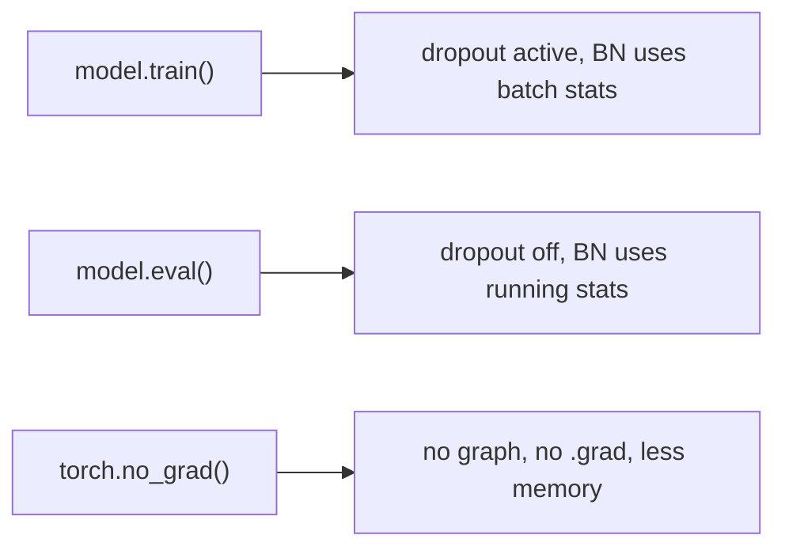

# PyTorch nn.Module

> A module is a tree of parameters with a forward method. Everything else, from optimizers to checkpoints, just walks that tree.

**Type:** Build
**Languages:** Python
**Prerequisites:** Phase 00 (Tensors and Autodiff), An MLP from Scratch in NumPy
**Time:** ~50 minutes

## Learning Objectives

- Build a minimal module system in NumPy that registers parameters and submodules automatically through `__setattr__`
- Implement `named_parameters`, `zero_grad`, `train`/`eval` and `state_dict`/`load_state_dict` yourself
- Write a custom `torch.nn.Module` with submodules, buffers and dropout, and train it with an optimizer
- Save and restore a model's `state_dict` and explain the difference between parameters and buffers

## The Problem

Your NumPy MLP worked, but look at what it took: a list of layers, a `params_and_grads` method on every layer, a hand-written `step` that loops over all of them. Now imagine a transformer with nested blocks, each with attention, normalization and feed-forward layers. You need to find every parameter for the optimizer, zero every gradient, switch dropout off at evaluation time, and save all the weights to disk with names that still make sense when you load them next week.

`torch.nn.Module` solves exactly this bookkeeping. Most PyTorch code you will read is a set of `nn.Module` subclasses, and most PyTorch bugs (a layer that is never trained, dropout left on during evaluation, a checkpoint that fails to load) are misunderstandings of how modules track their state. The fastest way to understand it is to build a small version yourself.

## The Concept

### A module is a tree

```
MoonNet
├── fc1      Linear   weight (32, 2)   bias (32)
├── fc2      Linear   weight (32, 32)  bias (32)
├── head     Linear   weight (2, 32)   bias (2)
├── dropout  Dropout  (no parameters)
└── buffers  input_mean (2), input_std (2)
```

When you write `self.fc1 = nn.Linear(2, 32)` inside `__init__`, `Module.__setattr__` notices the value is a module and records it under the name `fc1`. Parameters (`nn.Parameter`) are recorded the same way. Walking the tree produces dotted names like `fc1.weight`, which become the keys of the `state_dict`.

### What the tree gives you

| Method | What it does |
|--------|-------------|
| `parameters()` / `named_parameters()` | Every trainable tensor in the tree, for the optimizer |
| `zero_grad()` | Reset every `.grad` |
| `train()` / `eval()` | Set a `training` flag on every submodule (dropout and batch norm read it) |
| `state_dict()` / `load_state_dict()` | A name-to-tensor dictionary for saving and loading |
| `to(device)` | Move every parameter and buffer (Phase 00, devices and GPU basics) |
| `__call__` | Runs hooks, then your `forward` |

### Parameters vs buffers

A parameter is learned by gradient descent. A buffer is state that belongs to the model but is not trained: running statistics in batch norm, a fixed positional encoding, or here, input normalization constants. `register_buffer` puts a tensor in the `state_dict` and moves it with `.to(device)`, but hides it from `parameters()`, so the optimizer never touches it.

### train vs eval

Some layers behave differently while training. Dropout zeroes random activations during training and is the identity during evaluation. Batch norm uses batch statistics during training and stored running averages during evaluation. `model.eval()` flips the flag; it does not disable gradients. For inference you also use `torch.no_grad()` to stop building the graph.



## Build It

### Step 1: Automatic registration

```python
class Parameter:
    def __init__(self, value):
        self.value = value
        self.grad = np.zeros_like(value)


class MiniModule:
    def __init__(self):
        object.__setattr__(self, "_parameters", {})
        object.__setattr__(self, "_modules", {})
        object.__setattr__(self, "training", True)

    def __setattr__(self, name, value):
        if isinstance(value, Parameter):
            self._parameters[name] = value
        elif isinstance(value, MiniModule):
            self._modules[name] = value
        object.__setattr__(self, name, value)

    def named_parameters(self, prefix=""):
        for name, param in self._parameters.items():
            yield prefix + name, param
        for name, module in self._modules.items():
            yield from module.named_parameters(prefix + name + ".")
```

`__setattr__` is the trick: every assignment `self.something = ...` goes through it, so the module can sort values into parameters and children without you calling any registration function. `named_parameters` recurses through children, building dotted names. This is also why you must call `super().__init__()` first in a PyTorch module: the dictionaries must exist before you assign anything.

### Step 2: The rest of the API

```python
    def state_dict(self):
        return {name: param.value.copy() for name, param in self.named_parameters()}

    def load_state_dict(self, state):
        for name, param in self.named_parameters():
            param.value[...] = state[name]

    def train(self, mode=True):
        object.__setattr__(self, "training", mode)
        for module in self._modules.values():
            module.train(mode)
        return self

    def zero_grad(self):
        for param in self.parameters():
            param.grad[...] = 0.0
```

`MiniLinear` subclasses it with a `weight` of shape `(out, in)` like PyTorch, and its `backward` accumulates into `.grad` with `+=`, also like PyTorch. `MiniMLP` holds `fc1` and `fc2`:

```
  fc1.weight (16, 2)
  fc1.bias   (16,)
  fc2.weight (2, 16)
  fc2.bias   (2,)
  total parameters: 82
```

### Step 3: Train and round-trip

```python
for epoch in range(epochs):
    model.zero_grad()
    loss, grad = softmax_cross_entropy(model(X), y)
    model.backward(grad)
    for param in model.parameters():
        param.value -= learning_rate * param.grad
```

The training loop no longer knows anything about the architecture; it only asks for `parameters()`. The mini network reaches about 96% on two moons. Loading its `state_dict` into a freshly built `MiniMLP` with a different seed reproduces the outputs exactly.

## Use It

```python
class MoonNet(torch.nn.Module):
    def __init__(self, hidden=32, dropout=0.1):
        super().__init__()
        self.fc1 = torch.nn.Linear(2, hidden)
        self.fc2 = torch.nn.Linear(hidden, hidden)
        self.head = torch.nn.Linear(hidden, 2)
        self.dropout = torch.nn.Dropout(dropout)
        self.register_buffer("input_mean", torch.zeros(2))
        self.register_buffer("input_std", torch.ones(2))

    def forward(self, x):
        x = (x - self.input_mean) / self.input_std
        x = self.dropout(F.relu(self.fc1(x)))
        x = self.dropout(F.relu(self.fc2(x)))
        return self.head(x)
```

The data is deliberately shifted (`x * 3 + 5`) so normalization matters; the buffers store the training mean and standard deviation inside the model, so whoever loads the checkpoint gets the preprocessing too. Training with `torch.optim.Adam(model.parameters(), lr=0.01)` for 400 full-batch steps reaches 98% accuracy. Then:

```
  eval accuracy = 0.980, eval is deterministic: True
  train mode with dropout is deterministic: False
  restored model matches: True
  state_dict keys: ['input_mean', 'input_std', 'fc1.weight', 'fc1.bias', ...]
```

Saving uses `torch.save(model.state_dict(), path)` and loading uses `model.load_state_dict(torch.load(path))` on a freshly constructed model. Save the `state_dict`, not the whole model object: the dictionary of tensors survives refactors of your code, a pickled object does not. The buffers appear in the `state_dict` but not in `parameters()`, so the 1218 trainable parameters do not include them.

## Exercises

1. **Easy.** Store a submodule in a plain Python list (`self.layers = [nn.Linear(2, 2)]`) and print `list(model.parameters())`. Explain the result, then fix it with `nn.ModuleList`.
2. **Medium.** Add `named_modules()` and a `__repr__` to `MiniModule` that prints the tree like PyTorch's `print(model)` does.
3. **Hard.** Freeze `fc1` in `MoonNet` (`requires_grad_(False)` on its parameters), build the optimizer only from parameters that require gradients, and confirm with `torch.equal` that `fc1.weight` is unchanged after training while the rest moved. This is the basis of transfer learning in Phase 03 (CNNs).

## Key Terms

| Term | What people say | What it actually means |
|------|----------------|----------------------|
| `nn.Module` | "A layer" or "a model" | A container that registers parameters, buffers and child modules, and defines `forward` |
| Parameter | "A weight" | A tensor registered on a module that is returned by `parameters()` and updated by the optimizer |
| Buffer | "Non-trainable state" | A tensor saved in the `state_dict` and moved by `.to()`, but not returned by `parameters()` |
| `state_dict` | "The checkpoint" | An ordered dictionary from dotted names (`fc1.weight`) to tensors |
| `model.eval()` | "Turn off gradients" | Sets `training = False` on every submodule so dropout and batch norm switch behavior; it does not disable autograd |
| `torch.no_grad()` | "Inference mode" | A context that stops autograd from recording operations |
| `__setattr__` registration | "PyTorch magic" | Module assignment hooks that sort attributes into parameters, buffers and submodules |

## Further Reading

- [PyTorch docs: torch.nn.Module](https://pytorch.org/docs/stable/generated/torch.nn.Module.html) - the full API, including hooks and `register_buffer`
- [PyTorch tutorial: Build the Neural Network](https://pytorch.org/tutorials/beginner/basics/buildmodel_tutorial.html) - the official introduction to defining modules
- [PyTorch tutorial: Saving and Loading Models](https://pytorch.org/tutorials/beginner/saving_loading_models.html) - why to save `state_dict` and how to resume training
- [Karpathy: micrograd](https://github.com/karpathy/micrograd) - a tiny engine whose `nn.py` shows the same `parameters()` and `zero_grad()` pattern in a few lines
