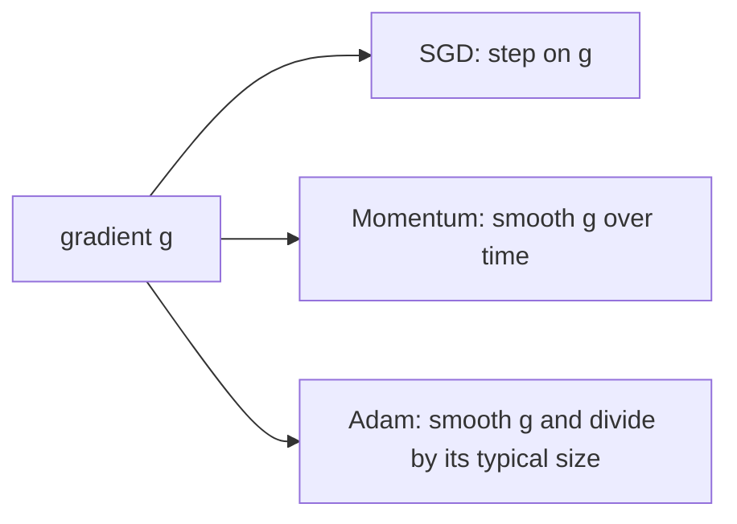

# SGD, Momentum and Adam

> The gradient tells you which way is down. The optimizer decides how far to step, and how much to trust the last few steps.

**Type:** Build
**Languages:** Python
**Prerequisites:** Phase 00 (Tensors and Autodiff), Phase 01 (Neural Networks: Backpropagation by Hand, An MLP from Scratch in NumPy)
**Time:** ~75 minutes

## Learning Objectives

- Explain why plain gradient descent zig-zags in ill-conditioned valleys and why its learning rate is capped by the steepest direction
- Implement SGD, SGD with momentum and Adam as small NumPy classes with a shared `step(params, grads)` interface
- Explain what Adam's two moving averages estimate and why it needs bias correction
- Match your optimizers against `torch.optim.SGD` and `torch.optim.Adam` to machine precision

## The Problem

In Phase 01 you trained networks with the simplest update there is: `w <- w - lr * grad`. It works on toy problems, but the moment the loss surface is steep in one direction and flat in another, it gets stuck in a trade-off you cannot win. A learning rate big enough to make progress along the flat direction makes you bounce off the walls of the steep one. A learning rate small enough to stay stable along the steep direction crawls along the flat one.

Real networks are full of these valleys. Different layers have gradients of very different scales, some parameters get a signal on every batch and others almost never, and minibatch noise jitters every step. Momentum and Adam are the two ideas that made deep learning trainable in practice: momentum averages out the zig-zag and builds speed along consistent directions, and Adam gives every parameter its own step size based on how large its gradients usually are. Nearly every model you will train in this course uses one of them.

## The Concept

### Gradient descent in a narrow valley

Take the quadratic bowl

```
f(x, y) = 0.5 * (1 * x^2 + 100 * y^2)
```

Its curvature is 1 along `x` and 100 along `y` (condition number 100). A gradient step multiplies each coordinate by `(1 - lr * curvature)`. Along `y` that factor must stay in `(-1, 1)`, so `lr < 2 / 100 = 0.02`. With that learning rate, `x` shrinks by only `1 - 0.02 = 0.98` per step: hundreds of steps to cross the flat direction.

```
 y
 |   \  /\  /\  /\
 |    \/  \/  \/  \/ ---> slowly along x
 +-------------------------------------- x
         plain SGD: zig-zag across, crawl along
```

The steepest direction caps the learning rate; the flattest direction decides how long you wait.

### Stochastic gradient descent

With a dataset of `n` examples you never compute the full gradient. You sample a minibatch `B` and use

```
g = (1/|B|) * sum_{i in B} grad loss_i(w)
w <- w - lr * g
```

`g` is an unbiased but noisy estimate of the true gradient. The noise is cheap (one batch instead of the whole dataset) and even helps escape sharp minima, but it adds more jitter to the zig-zag.

### Momentum: a heavy ball

Momentum keeps a running sum of past gradients, a velocity:

```
v <- beta * v + g
w <- w - lr * v
```

With `beta = 0.9`, the velocity is roughly the sum of the last 10 gradients. Components that flip sign every step (the zig-zag across the valley) cancel out. Components that point the same way every step (along the valley floor) add up, so the effective step there grows toward `lr / (1 - beta) = 10 * lr`.

```
 gradients across valley:  +  -  +  -  +   -> average ~ 0
 gradients along valley:   +  +  +  +  +   -> average grows
```

This is the form PyTorch uses. Some texts write `v <- beta * v + (1 - beta) * g`; it is the same algorithm with the learning rate rescaled by `1 - beta`.

### Adam: a per-parameter step size

Adam keeps two exponential moving averages per parameter:

```
m <- beta1 * m + (1 - beta1) * g          first moment: average gradient
v <- beta2 * v + (1 - beta2) * g^2        second moment: average squared gradient
```

and steps by

```
w <- w - lr * m_hat / (sqrt(v_hat) + eps)
```

The ratio `m / sqrt(v)` is roughly "average direction divided by typical size". A parameter whose gradients are huge gets a small step; a parameter whose gradients are tiny gets a big one. In the valley above, both `x` and `y` move at a speed close to `lr`, independent of the curvature. That is why Adam with its default settings works on a wide range of problems without much tuning.

### Bias correction

Both averages start at zero, so in the first steps they are biased toward zero. After `t` steps the weights on past gradients sum to `1 - beta^t`, so you divide by it:

```
m_hat = m / (1 - beta1^t)
v_hat = v / (1 - beta2^t)
```

With `beta2 = 0.999`, after 10 steps `v` has only accumulated 1% of its eventual mass. Without correction `sqrt(v)` would be ~10x too small and the first updates would be ~10x too big.

### Summary

| Optimizer | State per parameter | Update | Typical lr |
|-----------|--------------------|--------|-----------|
| SGD | none | `w -= lr * g` | 0.01 - 0.1 |
| SGD + momentum | `v` | `v = beta v + g; w -= lr v` | 0.01 - 0.1, beta 0.9 |
| Adam | `m`, `v`, step count | `w -= lr m_hat / (sqrt(v_hat) + eps)` | 1e-4 - 1e-3 |



Adam costs two extra arrays the size of the model. For a billion-parameter network that is 8 GB of extra float32 memory, which is why memory-light optimizers are an active research topic.

## Build It

### Step 1: A shared interface

Every optimizer takes a dictionary of parameters and a dictionary of gradients with the same keys and updates the parameters in place.

```python
class SGD:
    def __init__(self, lr):
        self.lr = lr

    def step(self, params, grads):
        for name in params:
            params[name] -= self.lr * grads[name]
```

### Step 2: Momentum

The velocity lives inside the optimizer, keyed by parameter name, and starts at zero.

```python
class Momentum:
    def __init__(self, lr, beta=0.9):
        self.lr = lr
        self.beta = beta
        self.velocity = {}

    def step(self, params, grads):
        for name in params:
            velocity = self.beta * self.velocity.get(name, np.zeros_like(params[name])) + grads[name]
            self.velocity[name] = velocity
            params[name] -= self.lr * velocity
```

### Step 3: Adam

```python
class Adam:
    def __init__(self, lr, beta1=0.9, beta2=0.999, eps=1e-8):
        self.lr, self.beta1, self.beta2, self.eps = lr, beta1, beta2, eps
        self.first_moment, self.second_moment, self.t = {}, {}, 0

    def step(self, params, grads):
        self.t += 1
        for name in params:
            grad = grads[name]
            m = self.beta1 * self.first_moment.get(name, np.zeros_like(grad)) + (1 - self.beta1) * grad
            v = self.beta2 * self.second_moment.get(name, np.zeros_like(grad)) + (1 - self.beta2) * grad**2
            self.first_moment[name] = m
            self.second_moment[name] = v
            m_hat = m / (1 - self.beta1**self.t)
            v_hat = v / (1 - self.beta2**self.t)
            params[name] -= self.lr * m_hat / (np.sqrt(v_hat) + self.eps)
```

### Step 4: Race them in the valley

```python
def run_on_quadratic(optimizer, steps):
    params = {"point": START.copy()}
    trajectory = [params["point"].copy()]
    for _ in range(steps):
        optimizer.step(params, {"point": quadratic_grad(params["point"])})
        trajectory.append(params["point"].copy())
    return np.array(trajectory)
```

Starting from `(-4, 1.5)` with 100 steps you should see:

```
sgd lr=0.019                | loss @10 1.91e+01 @25 3.65e+00 @50 1.18e+00 @100 1.73e-01
momentum lr=0.01 beta=0.9   | loss @10 6.54e+00 @25 4.39e+00 @50 3.05e-01 @100 2.61e-04
adam lr=0.1                 | loss @10 1.90e+01 @25 4.98e+00 @50 3.18e-01 @100 2.41e-03
```

SGD is already at its largest stable learning rate and is still far away after 100 steps. Bump it to 0.021 and the `y` coordinate explodes. Momentum and Adam both get two to three orders of magnitude lower. The script saves `optimizer_paths.png` so you can see SGD's zig-zag and momentum's overshoot-and-settle.

### Step 5: Train a real network

The same classes train a 2-32-32-2 ReLU MLP on `make_moons` with minibatches of 32. Backprop is the one you wrote in Phase 01, returning a dictionary of gradients:

```python
def train_mlp(optimizer, X, y, epochs, batch_size, seed):
    rng = np.random.default_rng(seed)
    params = init_mlp([2, 32, 32, 2], rng)
    history = []
    for _ in range(epochs):
        order = rng.permutation(len(y))
        for start in range(0, len(y), batch_size):
            batch = order[start:start + batch_size]
            _, grads = loss_and_grads(params, X[batch], y[batch])
            optimizer.step(params, grads)
        history.append(loss_and_grads(params, X, y)[0])
    return params, history
```

Momentum and Adam reach a loss around 0.09 by epoch 5-10; plain SGD needs about 30 epochs to get there. On an easy problem they all end at the same accuracy (~96%). The difference is how many steps it takes, which on a large model is the difference between a day and a week.

## Use It

PyTorch ships all three. Run them on the same bowl with autograd and compare final positions after 60 steps:

```python
point = torch.tensor(START, dtype=torch.float64, requires_grad=True)
optimizer = torch.optim.Adam([point], lr=0.1)
for _ in range(60):
    optimizer.zero_grad()
    loss = 0.5 * (curvatures * point**2).sum()
    loss.backward()
    optimizer.step()
```

```
SGD           | max diff 3.5e-18
SGD momentum  | max diff 6.2e-17
Adam          | max diff 5.6e-17
```

They agree to float64 rounding, so your classes are the real algorithms. In practice:

- `torch.optim.SGD(params, lr, momentum=0.9, nesterov=True)` is still the go-to for convolutional image classifiers trained for many epochs.
- `torch.optim.AdamW(params, lr=3e-4, weight_decay=0.01)` is the default for transformers and most everything else. The "W" is about weight decay, covered in the Dropout and Weight Decay lesson.
- Always call `optimizer.zero_grad()` before `backward()`: PyTorch accumulates gradients by default.

## Exercises

1. **Easy.** Rerun Step 4 with momentum `beta` in `{0.5, 0.9, 0.99}` at `lr=0.01`. Which one overshoots the most, and why does a larger `beta` need a smaller `lr`?
2. **Medium.** Implement Nesterov momentum (evaluate the gradient at the look-ahead point `w - lr * beta * v`) and check it against `torch.optim.SGD(..., momentum=0.9, nesterov=True)`. PyTorch uses a reformulation; read its docs to match it exactly.
3. **Hard.** Remove bias correction from Adam and plot the size of the first 20 updates with and without it on the moons MLP. Then implement RMSProp (Adam without the first moment and without bias correction) and compare all three.

## Key Terms

| Term | What people say | What it actually means |
|------|----------------|----------------------|
| SGD | "Gradient descent on batches" | Gradient descent using an unbiased minibatch estimate of the gradient |
| Learning rate | "Step size" | Scalar multiplying the update; capped by the largest curvature for stability |
| Condition number | "How stretched the bowl is" | Ratio of largest to smallest curvature; large values make plain SGD slow |
| Momentum | "Adds inertia" | A velocity `v = beta v + g` that averages gradients over ~`1/(1-beta)` steps |
| Adam | "The default optimizer" | Momentum on `g` divided by the root of a moving average of `g^2`, with bias correction |
| Bias correction | "Adam warmup trick" | Dividing the moving averages by `1 - beta^t` to undo their zero initialization |
| Optimizer state | "Adam's memory" | Extra per-parameter arrays (`v`, or `m` and `v`) that must be saved in checkpoints |

## Further Reading

- [Kingma and Ba, Adam: A Method for Stochastic Optimization (2014)](https://arxiv.org/abs/1412.6980) - the original paper, short and readable, with the bias-correction derivation
- [Goh, Why Momentum Really Works (Distill, 2017)](https://distill.pub/2017/momentum/) - interactive explanation of momentum on quadratics
- [Dive into Deep Learning, Chapter 12: Optimization Algorithms](https://d2l.ai/chapter_optimization/index.html) - SGD, momentum, AdaGrad, RMSProp and Adam with code
- [PyTorch docs: torch.optim](https://pytorch.org/docs/stable/optim.html) - exact update formulas each optimizer implements
