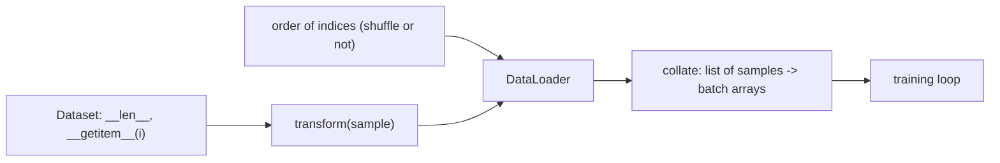

# Data Loading and Augmentation

> The model only knows what the data loader shows it. Augmentation is how you show it things the dataset forgot to include.

**Type:** Build
**Languages:** Python
**Prerequisites:** Phase 01 (Neural Networks: An MLP from Scratch in NumPy, PyTorch nn.Module), Phase 02 lesson Dropout and Weight Decay
**Time:** ~60 minutes

## Learning Objectives

- Build a `Dataset` / `DataLoader` pair in plain Python with shuffling, batching, `drop_last` and a collate function
- Compute normalization statistics on the training set only and reuse them everywhere else
- Write composable, random image augmentations and apply them per sample, per epoch, on the training set only
- Show that augmentation builds invariances a small dataset cannot teach, and that the wrong augmentation hurts
- Use `torch.utils.data.Dataset`, `DataLoader` and `torchvision.transforms.v2`

## The Problem

So far every training loop in this course sliced NumPy arrays with a permutation. That works while the whole dataset fits in memory as one array, there is no preprocessing, and every example has the same shape. Real data is a folder of JPEGs, a list of sentences of different lengths, or a stream that does not fit in RAM. You need a clean boundary between "how to get example `i`" and "how to group examples into batches", so the training loop never has to care.

The second problem is subtler. With 300 handwritten digits, every training image happens to be centered. A plain MLP has no built-in notion that a digit shifted one pixel to the right is the same digit, and on such shifted images its accuracy drops from 96% to 42%. You could collect more data. Or you could generate it: shift, flip, crop, rotate and add noise to the images you already have, with labels that you know are unchanged. That is data augmentation, and for vision models it often matters as much as the architecture.

## The Concept

### Dataset, sampler, loader



- A **dataset** knows how many examples exist and how to load example `i`, applying a per-sample transform.
- A **loader** decides the order (a fresh permutation every epoch if `shuffle=True`), slices it into batches, fetches each sample and collates them into arrays.
- `drop_last=True` discards the final partial batch, useful when batch statistics (batch norm) or a fixed shape matter.

Because transforms run inside `__getitem__`, every epoch sees a new random version of every image. You never store the augmented dataset.

### Normalization and leakage

Standardizing inputs (`(x - mean) / std`) helps optimization. The mean and std must come from the training set only and then be applied unchanged to validation and test data. Computing them on all data leaks test information into training; computing them separately on the test set makes the two sets live on different scales.

### Augmentation

An augmentation is a random transformation `t` such that the label of `t(x)` is the same as the label of `x`. Training on `t(x)` teaches the model to be invariant to `t`:

| Augmentation | Teaches | Bad idea when |
|--------------|---------|---------------|
| Small shifts / random crops | position invariance | position carries meaning |
| Horizontal flip | mirror invariance | digits, text (a flipped 2 is not a 2) |
| Small rotations | orientation invariance | 6 vs 9, very low resolution |
| Color jitter | lighting invariance | color is the label |
| Gaussian noise | robustness to sensor noise | noise level exceeds the signal |

```
original      shifted       shifted       noisy
 .##.          ..##          .##.          .#%.
 #..#          .#..          #..#          #.:#
 ..#.          ...#          ..#.          ..#,
 .#..          ..#.          .#..          .#..
 ####          .###          ####          ##%#
```

Rules that keep you out of trouble:

1. Augment the training set only. Validation and test data get the deterministic preprocessing (normalization) and nothing else.
2. Apply random augmentations before normalization, in the raw pixel space where they make sense.
3. Match augmentations to invariances that are actually true for your task. Augmentation is a prior; a wrong prior hurts.

## Build It

### Step 1: Dataset and DataLoader

```python
class ArrayDataset:
    def __init__(self, images, labels, transform=None):
        self.images, self.labels, self.transform = images, labels, transform

    def __len__(self):
        return len(self.labels)

    def __getitem__(self, index):
        image = self.images[index]
        if self.transform is not None:
            image = self.transform(image)
        return image, self.labels[index]


def collate(samples):
    images, labels = zip(*samples)
    return np.stack(images), np.array(labels)
```

The loader shuffles indices once per epoch and yields collated batches:

```python
def __iter__(self):
    order = self.rng.permutation(len(self.dataset)) if self.shuffle else np.arange(len(self.dataset))
    for batch_index in range(len(self)):
        indices = order[batch_index * self.batch_size:(batch_index + 1) * self.batch_size]
        yield collate([self.dataset[i] for i in indices])
```

With 300 images and a batch size of 32 you get 10 batches, or 9 with `drop_last=True`. One epoch visits every example exactly once.

### Step 2: Training statistics only

```python
mean, std = train_images.mean(), train_images.std()
plain = Normalize(mean, std)
```

`plain` is the only transform the test set ever sees.

### Step 3: Composable random transforms

Each transform is a callable that takes an 8x8 image and returns one. They share a seeded generator so runs are reproducible:

```python
class RandomShift:
    def __call__(self, image):
        padded = np.pad(image, self.max_shift)
        dy, dx = self.rng.integers(0, 2 * self.max_shift + 1, size=2)
        return padded[dy:dy + image.shape[0], dx:dx + image.shape[1]]


augment = Compose([RandomApply(RandomShift(1, aug_rng), 0.5, aug_rng), AddNoise(0.1, aug_rng), Normalize(mean, std)])
```

Pad-then-crop is how random crops work on CIFAR and ImageNet too. `RandomApply` applies the shift to half of the samples so the model still sees plenty of centered digits. `augmentations.png` shows a few random draws.

### Step 4: Does it help?

A 64-128-10 MLP, 150 epochs on the 300 training images, evaluated on the 1497 remaining images and on the same images shifted one pixel to the right:

```
no augmentation  | train acc 1.000 | test acc 0.956 | test acc, images shifted 1 px 0.420
shift + noise    | train acc 1.000 | test acc 0.965 | test acc, images shifted 1 px 0.931
rotation 15 deg  | train acc 0.987 | test acc 0.925 | test acc, images shifted 1 px 0.433
```

Three lessons in three lines:

- Augmentation improves the clean test set a bit (more varied training data acts as a regularizer).
- It massively improves robustness to the shift it was trained on: 42% to 93%.
- A badly chosen augmentation hurts. Rotating an 8x8 image with interpolation blurs strokes the model needs, and it buys no shift invariance.

Augmentation also costs time: the augmented run is several times slower because every sample goes through Python transforms every epoch. On real datasets this is why loaders use multiple worker processes.

## Use It

PyTorch splits the same responsibilities across `Dataset`, `DataLoader` and transforms:

```python
class TorchDigits(torch.utils.data.Dataset):
    def __init__(self, images, labels, transform=None):
        self.images = torch.tensor(images, dtype=torch.float32).unsqueeze(1)
        self.labels = torch.tensor(labels)
        self.transform = transform

    def __len__(self):
        return len(self.labels)

    def __getitem__(self, index):
        image = self.images[index]
        if self.transform is not None:
            image = self.transform(image)
        return image, self.labels[index]


torch_augment = v2.Compose([
    v2.RandomApply([v2.RandomAffine(degrees=0, translate=(0.125, 0.125))], p=0.5),
    v2.Lambda(lambda image: image + 0.1 * torch.randn_like(image)),
    v2.Normalize([mean], [std]),
])
generator = torch.Generator().manual_seed(seed)
loader = torch.utils.data.DataLoader(dataset, batch_size=32, shuffle=True, generator=generator)
```

`translate=(0.125, 0.125)` means up to 1 pixel of an 8-pixel image. The default collate function stacks tensors into a `(32, 1, 8, 8)` batch. The PyTorch version shows the same pattern:

```
torch no augmentation  | test acc 0.956 | shifted test acc 0.438
torch shift + noise    | test acc 0.961 | shifted test acc 0.921
```

Practical settings you will meet:

- `num_workers=k` loads batches in `k` background processes. Essential for JPEG decoding and heavy augmentation; with `k > 0`, seed each worker (`worker_init_fn`) if your transforms use NumPy randomness.
- `pin_memory=True` speeds up host-to-GPU copies.
- A custom `collate_fn` pads variable-length sequences (Phase 04).
- Pass a seeded `generator` for reproducible shuffling.

## Exercises

1. **Easy.** Add a horizontal flip to the augmentation pipeline and measure the test accuracy. Which digits suffer most? Print a per-class accuracy.
2. **Medium.** Implement mixup: for each batch, sample `lam ~ Beta(0.2, 0.2)`, mix images `lam * x_i + (1 - lam) * x_j` and labels the same way (soft labels in the cross-entropy). Compare test loss with plain augmentation.
3. **Hard.** Write a loader that prefetches the next batch in a background thread (`threading` and `queue.Queue`) while the current batch trains, and measure the speedup when the transform includes a deliberate `time.sleep(0.001)` per sample.

## Key Terms

| Term | What people say | What it actually means |
|------|----------------|----------------------|
| Dataset | "The data" | An object with `__len__` and `__getitem__(i)` returning one (optionally transformed) example |
| DataLoader | "The batch iterator" | Shuffles indices, groups them into batches, fetches samples and collates them |
| Collate | "Stacking" | Turning a list of samples into batch arrays, padding if needed |
| `drop_last` | "Skip the small batch" | Discard the final batch if it is smaller than `batch_size` |
| Data leakage | "Cheating by accident" | Using information from validation or test data, such as their statistics, during training |
| Data augmentation | "Making more data" | Label-preserving random transforms applied on the fly to training samples |
| Invariance | "The model doesn't care about X" | The prediction does not change when the input is transformed by X |

## Further Reading

- [PyTorch tutorial: Datasets and DataLoaders](https://pytorch.org/tutorials/beginner/basics/data_tutorial.html) - custom datasets, transforms and loader options
- [torchvision: Transforming images, videos, boxes and more (transforms.v2)](https://pytorch.org/vision/stable/transforms.html) - the full list of augmentations
- [Shorten and Khoshgoftaar, A survey on Image Data Augmentation for Deep Learning (2019)](https://journalofbigdata.springeropen.com/articles/10.1186/s40537-019-0197-0) - an overview from flips to learned augmentation
- [Zhang et al., mixup: Beyond Empirical Risk Minimization (2017)](https://arxiv.org/abs/1710.09412) - the mixup paper from Exercise 2
