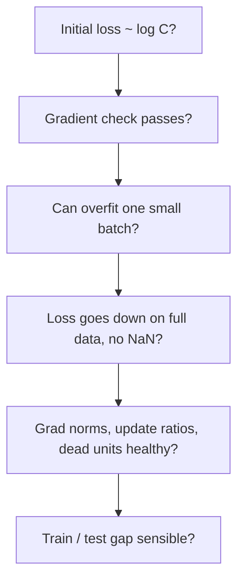

# Debugging Training

> Neural networks fail silently. A bug rarely crashes; it just makes the loss go down a little slower. You need checks that turn silent failures into loud ones.

**Type:** Build
**Languages:** Python
**Prerequisites:** Phase 00 (Tensors and Autodiff), Phase 01 (Neural Networks: Backpropagation by Hand), Phase 02 lessons SGD, Momentum and Adam through Data Loading and Augmentation
**Time:** ~75 minutes

## Learning Objectives

- Predict the loss at initialization and use it to catch bad output scaling
- Write a finite-difference gradient checker and use it to find bugs in a hand-written backward pass
- Use "overfit one batch" as a smoke test and understand what it does and does not prove
- Recognize the signatures of a too-high learning rate, dead ReLUs and misaligned labels from simple statistics
- Use `torch.autograd.gradcheck`, `detect_anomaly`, gradient hooks and `clip_grad_norm_`

## The Problem

A sorting function with a bug returns the wrong order and a test catches it. A neural network with a bug still trains. Forget a ReLU mask in backprop and your 3-layer MLP still reaches 100% on a small batch. Shuffle labels separately from inputs and the model still fits the training set to 86%. Pick a learning rate that is too high and the loss may settle at exactly chance level without a single NaN. Nothing crashes; you just get a model that is worse than it should be, and you might spend a week tuning hyperparameters around a bug.

Experienced practitioners do not find these bugs by staring at code. They run a short list of cheap checks, each of which turns one family of silent failures into an obvious number. This lesson builds that list. It is the most practical lesson in the phase: every check here takes seconds to run and will save you hours.

## The Concept

### The checklist



Run them in order. Each one assumes the previous ones passed.

### 1. Loss at initialization

With `C` balanced classes and a network that knows nothing, the best prediction is uniform, so the cross-entropy should start near `-log(1/C)`. For 10 classes that is `log 10 = 2.303`. A much higher initial loss means the network starts out confidently wrong, usually because the last layer's outputs are too large. You waste the first part of training just shrinking them. Scaling the last layer's init down (or zeroing it) fixes it.

### 2. Gradient check

Compare your analytic gradient with central finite differences:

```
dL/dw  ~=  (L(w + eps) - L(w - eps)) / (2 eps)
relative error = ||g_analytic - g_numeric|| / (||g_analytic|| + ||g_numeric||)
```

In float64 with `eps = 1e-5`, a correct backward gives `1e-7` or less; a bug gives `1e-2` to `1`. Practical details:

- Use float64, a tiny network and a tiny batch: you need two forward passes per parameter.
- Kinks (ReLU at exactly 0, max-pooling ties) break finite differences. If a unit's pre-activation is exactly 0, the numeric derivative is 0.5 and the check fails spuriously. Random nonzero biases avoid that.
- Check each parameter separately so the report tells you where the bug is.

### 3. Overfit one batch

Take 10-20 examples, turn off regularization, and train until the loss is near zero. If the model cannot memorize 20 examples, something is broken in the pipeline: labels, loss, optimizer step, or a gradient that is not flowing. Passing it is necessary but not sufficient. A wrong but "close enough" gradient can still memorize a batch, which is why the gradient check comes first.

### 4. Learning rate failures

```
loss                                    loss
 |  lr too high: diverges to NaN         |  lr too high: units die,
 |        /                              |  loss stuck at log C
 |   /\  /                               | \____________________
 |  /  \/                                |
 +----------- step                       +------------------- step
```

Divergence is easy to spot if you check `np.isfinite(loss)` every step. The second failure is sneakier: a huge first update pushes ReLU pre-activations negative for every input, the network outputs a constant, and the loss sits at `log C` forever.

### 5. Health statistics

Three numbers per layer, logged every few hundred steps, catch most remaining problems:

| Statistic | Healthy | Problem |
|-----------|---------|---------|
| Gradient norm | similar order of magnitude across layers | orders of magnitude smaller in early layers (vanishing) or huge (exploding) |
| Update / weight ratio `lr * ||g|| / ||W||` | around `1e-3` | `1e-1` (lr too high), `1e-6` (lr too low or no gradient) |
| Dead ReLU fraction | near 0% | units that are `<= 0` for every input in the batch never learn |

### 6. Data sanity

Look at the data the model actually receives, after the loader and transforms. The most common bug is inputs and labels getting out of sync (shuffling one but not the other, sorting by filename). Its signature: training accuracy climbs slowly (the network is memorizing noise) while test accuracy stays at chance.

## Build It

### Step 1: Initial loss

```python
for output_scale in (1.0, 0.01, 10.0):
    params = init_mlp(sizes, np.random.default_rng(0), output_scale)
    print(loss_only(params, X_train, y_train))
```

```
last-layer init scale x1.0   | initial loss 3.050
last-layer init scale x0.01  | initial loss 2.303
last-layer init scale x10.0  | initial loss 20.247
```

Even He init on the last layer gives a loss above `log 10`. Shrinking the last layer by 100x lands exactly on 2.303.

### Step 2: A gradient checker

```python
def gradient_check(params, X, y, bug=None, eps=1e-5):
    _, analytic = loss_and_grads(params, X, y, bug)
    worst = {}
    for name, value in params.items():
        numeric = np.zeros_like(value)
        for index in np.ndindex(value.shape):
            original = value[index]
            value[index] = original + eps
            plus = loss_only(params, X, y)
            value[index] = original - eps
            minus = loss_only(params, X, y)
            value[index] = original
            numeric[index] = (plus - minus) / (2 * eps)
        worst[name] = np.linalg.norm(analytic[name] - numeric) / max(
            np.linalg.norm(analytic[name]) + np.linalg.norm(numeric), 1e-12)
    return worst
```

`loss_and_grads` takes an optional `bug` argument that injects two realistic mistakes: forgetting the ReLU mask, and scrambling the first bias gradient. On a 5-6-6-3 network with 8 examples:

```
backward=None               | W0 6e-11 b0 6e-11 W1 6e-11 b1 4e-11 W2 6e-11 b2 1e-11 -> OK
backward=missing_relu_mask  | W0 8e-01 b0 9e-01 W1 6e-01 b1 6e-01 W2 6e-11 b2 1e-11 -> BUG
backward=transposed_bias    | W0 6e-11 b0 8e-01 W1 6e-11 b1 4e-11 W2 6e-11 b2 1e-11 -> BUG
```

The report localizes each bug: the missing mask corrupts everything below the last layer, the bias bug touches only `b0`.

### Step 3: Overfit one batch

```
backward=None               | loss 2.655 -> 0.0021 | batch acc 1.00
backward=missing_relu_mask  | loss 2.655 -> 0.0018 | batch acc 1.00
```

The buggy network memorizes 20 examples just as well. Without the gradient check you would never know: the network without masks is effectively being trained with a wrong but still descent-ish direction.

### Step 4: Learning rate failures

```python
if not np.isfinite(loss):
    return losses, step
```

```
lr 0.1  | max loss seen      2.999 | final loss 0.056
lr 2.0  | max loss seen     55.376 | final loss 2.312
lr 3.0  | max loss seen    636.809 | loss became NaN/inf at step 14
```

At `lr = 2.0` no NaN ever appears, but the final loss is 2.31: the network died and predicts a constant. Always compare the final loss against `log C`.

### Step 5: Health statistics

```python
ratio = lr * np.linalg.norm(grads[name]) / (np.linalg.norm(params[name]) + 1e-12)
dead = np.mean((pre_activations[i] <= 0).all(axis=0))
```

The healthy run shows update ratios settling around `1e-3` and 0% dead units, and reaches 97.7% test accuracy. The same network with first-layer biases pushed to -3 starts with 61% dead units in layer 1; they slowly recover to 44% but test accuracy only reaches 80% in the same number of steps.

### Step 6: Misaligned labels

```
aligned labels              | train acc 1.000 | test acc 0.975
labels shuffled separately  | train acc 0.861 | test acc 0.081
```

High-ish training accuracy with chance-level test accuracy is the fingerprint of labels that do not belong to their inputs: the network can memorize random labels, it just cannot generalize them.

## Use It

PyTorch ships tools for the same checks:

```python
torch.autograd.gradcheck(scaled_softplus, inputs)
with torch.autograd.detect_anomaly(check_nan=True):
    torch.sqrt(x).sum().backward()
parameter.register_hook(lambda grad: log(grad.norm()))
total_norm = torch.nn.utils.clip_grad_norm_(model.parameters(), max_norm=0.5)
```

```
torch.autograd.gradcheck(scaled_softplus) -> True
detect_anomaly caught: Function 'SqrtBackward0' returned nan values in its 0th output.
initial loss 2.326 (expect ~2.303)
gradient norms from hooks: 2.bias 0.074, 2.weight 0.605, 0.bias 0.067, 0.weight 0.608
clip_grad_norm_: total norm before 0.864, after 0.500
```

- `gradcheck` is your Step 2 for custom `autograd.Function`s. Inputs must be float64.
- `detect_anomaly` names the backward op that first produced a NaN (here, the derivative of `sqrt` at a negative number) and prints the forward traceback. It is slow; enable it only while hunting.
- Tensor hooks let you log gradient norms per parameter without touching the training loop.
- `clip_grad_norm_` returns the total norm before clipping, which is a free health statistic to log every step. Clipping itself is a standard guard against occasional gradient spikes in RNNs and transformers.

## Exercises

1. **Easy.** Add a third bug to `loss_and_grads`: forget to divide the softmax gradient by `n`. Does the gradient check catch it? Does overfitting one batch? What does it do to the effective learning rate?
2. **Medium.** Write `check_initial_loss(model, loader, num_classes)` and `overfit_one_batch(model, batch, steps)` for PyTorch models and run them on the `nn.Module` MLP from Phase 01.
3. **Hard.** Implement a gradient checker for the batch norm layer from the Batch and Layer Normalization lesson, then deliberately drop one of the three terms in its backward formula. Which term's absence does the overfit-one-batch test still pass with?

## Key Terms

| Term | What people say | What it actually means |
|------|----------------|----------------------|
| Gradient check | "Numerical gradient test" | Comparing analytic gradients with central finite differences, via a relative error |
| Overfit one batch | "Sanity check" | Training on a handful of examples until loss ~ 0 to verify the pipeline can learn at all |
| Initial loss | "Loss at step 0" | Should be about `log C` for `C` balanced classes; much higher means overconfident outputs |
| Dead ReLU | "Dead neurons" | A unit whose pre-activation is negative for every input, so it gets zero gradient |
| Update / weight ratio | "Step size relative to weights" | `lr * ||g|| / ||W||`; around `1e-3` is a healthy rule of thumb |
| Anomaly detection | "Finding the NaN" | Autograd mode that checks each backward op for NaN and reports the culprit |
| Gradient clipping | "Clip grads" | Rescaling the gradient when its global norm exceeds a threshold |

## Further Reading

- [Karpathy, A Recipe for Training Neural Networks (2019)](https://karpathy.github.io/2019/04/25/recipe/) - the canonical checklist, from "become one with the data" to "overfit one batch"
- [Stanford CS231n: Neural Networks Part 3, gradient checks and babysitting the learning process](https://cs231n.github.io/neural-networks-3/) - relative error thresholds, kinks and update ratios
- [Google Research, Deep Learning Tuning Playbook](https://github.com/google-research/tuning_playbook) - a systematic process for tuning and diagnosing training runs
- [PyTorch docs: Autograd mechanics and anomaly detection](https://pytorch.org/docs/stable/autograd.html) - gradcheck, detect_anomaly and hooks
