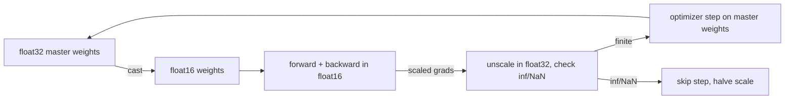

# Mixed Precision and Checkpointing

> Do the heavy math in 16 bits, keep the bookkeeping in 32, and save everything you would need to pick up exactly where you left off.

**Type:** Build
**Languages:** Python
**Prerequisites:** Phase 00 (Tensors and Autodiff: Devices and GPU Basics), Phase 02 lessons SGD, Momentum and Adam, Learning Rate Schedules and Debugging Training
**Time:** ~75 minutes

## Learning Objectives

- Compare float32, float16 and bfloat16 in range and precision and predict which values each one destroys
- Explain the three ingredients of mixed precision training: low-precision compute, float32 master weights and loss scaling
- Implement dynamic loss scaling and mixed precision training of an MLP in NumPy
- Save and restore a complete training state (weights, optimizer, scaler, RNG, epoch) and verify a bit-identical resume
- Use `torch.autocast`, `torch.amp.GradScaler`, `torch.save` / `torch.load` and activation checkpointing

## The Problem

Modern GPUs do 16-bit matrix multiplications several times faster than 32-bit ones, and 16-bit activations take half the memory. For a large model that is the difference between fitting on one GPU or not, and between a run that takes a week or two days. But naively casting everything to float16 breaks training: small gradients round to zero, weight updates smaller than the weight's precision disappear, and a single large activation overflows to infinity and turns everything into NaN.

The second problem of long runs is that they get interrupted. Machines crash, jobs get preempted, you want to change the schedule halfway. If your checkpoint only stores the weights, resuming silently resets Adam's moment estimates, the learning rate schedule and the data order, and the resumed run is a different (often worse) run. This lesson covers how to make training both cheaper and restartable.

## The Concept

### Three formats

```
float32   [s][ 8 exponent ][        23 mantissa        ]
float16   [s][ 5 exp ][ 10 mantissa ]
bfloat16  [s][ 8 exponent ][ 7 mant ]
```

| Format | Max | Precision (eps) | Smallest normal |
|--------|-----|-----------------|-----------------|
| float32 | 3.4e38 | 1.2e-7 | 1.2e-38 |
| float16 | 65504 | 9.8e-4 | 6.1e-5 |
| bfloat16 | 3.4e38 | 7.8e-3 | 1.2e-38 |

- **float16** has decent precision but a tiny range: anything above 65504 overflows, gradients below about 6e-8 become 0.
- **bfloat16** keeps float32's exponent, so it has float32's range but only about 2-3 significant digits. It rarely overflows or underflows, which is why it is the default on TPUs and recent GPUs and needs no loss scaling.

### Ingredient 1: low precision where it is safe

Matrix multiplications and convolutions run in 16 bits (hardware accumulates the sums in float32 internally). Reductions that are sensitive to precision, like softmax, layer norm statistics and the loss, stay in float32. `torch.autocast` keeps a list of which ops go where.

### Ingredient 2: float32 master weights

An update is `w + delta`. If `delta` is smaller than half the spacing between representable numbers around `w`, the sum rounds back to `w`. Around 1.0, float16 spacing is about 1e-3, so a learning rate of 1e-3 times a small gradient often does nothing at all. The fix: keep the real weights (and the optimizer state) in float32, cast a 16-bit copy for the forward and backward pass, and apply the update to the float32 copy.



### Ingredient 3: loss scaling

Many gradients are tiny (1e-6 to 1e-9). In float16 they flush to zero. Multiply the loss by a large scale `S` before backprop and every gradient is multiplied by `S` too (backprop is linear), moving them into float16's representable range. Divide by `S` in float32 before the optimizer step.

Picking `S` by hand is fragile, so dynamic loss scaling adapts it:

```
start with S = 2^16
each step:
    if any gradient is inf or NaN: skip the step, S = S / 2
    else: apply the step; after N good steps in a row, S = S * 2
```

Skipped steps are normal and rare; they are the price of always using the largest safe scale.

### What a checkpoint must contain

| Piece | Why |
|-------|-----|
| Model weights | obviously |
| Optimizer state (Adam `m`, `v`, step count) | without it Adam restarts its bias correction and moment estimates |
| Scheduler state / step | otherwise the learning rate jumps back to the start of the schedule |
| Loss scaler state | otherwise the first steps after resume overflow or underflow |
| RNG states | data order, dropout masks and augmentations continue identically |
| Epoch / step counters, config | to know where you are and what you were running |

Save to a temporary file and rename it, so a crash during saving never corrupts your last good checkpoint.

### Activation checkpointing (a different "checkpointing")

Backprop stores every intermediate activation from the forward pass. Activation (gradient) checkpointing stores only some of them and recomputes the rest during the backward pass, trading roughly one extra forward pass for a large memory saving. Same name, different idea: it saves memory, not training progress.

## Build It

### Step 1: Emulate bfloat16

NumPy has float16 but not bfloat16. Since bfloat16 is the top 16 bits of a float32, you can emulate it by rounding away the low 16 bits:

```python
def to_bfloat16(x):
    bits = np.asarray(x, dtype=np.float32).view(np.uint32).astype(np.uint64)
    rounding = 0x7FFF + ((bits >> 16) & 1)
    return (((bits + rounding) >> 16) << 16).astype(np.uint32).view(np.float32)
```

```
70000        -> float16 inf          bfloat16 70144        float32 70000
1.001        -> float16 1.0009766    bfloat16 1            float32 1.001
1e-08        -> float16 0            bfloat16 1.0011718e-08 float32 9.9999999e-09
```

float16 loses 70000 and 1e-8 entirely; bfloat16 keeps both but cannot tell 1.001 from 1.

### Step 2: Underflow and loss scaling

Sample 100,000 gradient magnitudes log-uniformly between 1e-10 and 1e-2 and cast them to float16:

```
loss scale        1 | fraction of gradients that become exactly 0 in float16: 30.8%
loss scale     1024 | fraction of gradients that become exactly 0 in float16: 0.0%
```

### Step 3: Why master weights

```python
for _ in range(1000):
    weight16 = np.float16(weight16 + np.float16(1e-4))
    weight32 = np.float32(weight32 + np.float32(1e-4))
```

The float16 weight stays at exactly 1.0000 after 1000 updates; float32 reaches 1.1000.

### Step 4: Mixed precision training

The forward and backward pass cast the master weights to float16 and do every matmul as "float16 in, float32 accumulate, float16 out", like a tensor core. The softmax and loss are computed in float32, and the output gradient is multiplied by the loss scale before going back in float16:

```python
def half_matmul(a, b):
    return (a.astype(np.float32) @ b.astype(np.float32)).astype(np.float16)

grad = (grad * loss_scale / n).astype(dtype)
```

The scaler unscales in float32 and decides whether to step:

```python
def unscale_or_skip(self, grads):
    unscaled = {name: grad.astype(np.float32) / self.scale for name, grad in grads.items()}
    if not all(np.isfinite(g).all() for g in unscaled.values()):
        self.scale /= 2.0
        self.good_steps = 0
        self.skipped += 1
        return None
    self.good_steps += 1
    if self.good_steps == self.growth_interval:
        self.scale *= 2.0
        self.good_steps = 0
    return unscaled
```

Ten epochs on digits, 64-128-128-10, Adam:

```
float32    | test acc 0.977
mixed fp16 | test acc 0.977 | final loss scale 262144, skipped steps 2
```

Same accuracy. The scaler grew from 65536 to 262144 and skipped two steps where the scaled gradients overflowed.

### Step 5: Checkpoint and resume

`save_checkpoint` writes weights, both Adam moments, Adam's step count, the epoch, the scaler's scale and counter, and the generator state (as JSON) into one `.npz` file. The test: train 6 epochs straight, versus 3 epochs, save, throw the state away, load into a freshly built state with a different seed, and train 3 more.

```
saved after epoch 3: checkpoint.npz, 312 KiB
resumed to epoch 6 | max |uninterrupted - resumed| = 0.0e+00
restoring weights only (fresh Adam state and RNG) | max diff = 7.8e-02
```

The full checkpoint resumes bit for bit. Restoring only the weights gives a different model: Adam's state and the data order were lost.

## Use It

```python
device = "cuda" if torch.cuda.is_available() else "cpu"
amp_dtype = torch.float16 if device == "cuda" else torch.bfloat16
scaler = torch.amp.GradScaler(device, enabled=device == "cuda")

with torch.autocast(device_type=device, dtype=amp_dtype):
    loss = torch.nn.functional.cross_entropy(model(x), y)
optimizer.zero_grad()
scaler.scale(loss).backward()
scaler.step(optimizer)
scaler.update()
```

```
device cuda, autocast dtype torch.float16: weights torch.float32, logits torch.float16, loss torch.float32
autocast training, 10 epochs | test acc 0.977 | GradScaler enabled: True
```

On CPU the script uses bfloat16 and disables the scaler (bfloat16 has float32's range, so no scaling is needed); the same code runs either way. Note the dtypes: parameters stay float32 (master weights), the linear layers produce 16-bit outputs, and the loss is float32. `scaler.step` unscales, skips the step on inf/NaN, and `scaler.update` adjusts the scale, exactly like your `DynamicLossScaler`.

Checkpointing in PyTorch is a dictionary of `state_dict()`s:

```python
torch.save({"model": model.state_dict(), "optimizer": optimizer.state_dict(),
            "scaler": scaler.state_dict(), "epoch": epoch}, path)
checkpoint = torch.load(path, map_location=device)
model.load_state_dict(checkpoint["model"])
optimizer.load_state_dict(checkpoint["optimizer"])
```

Add `scheduler.state_dict()` and `torch.get_rng_state()` for a full resume. And activation checkpointing:

```python
out = torch.utils.checkpoint.checkpoint(block, x, use_reentrant=False)
```

gives the same gradients as a normal backward while storing fewer activations. The script verifies that.

## Exercises

1. **Easy.** Run Step 4 with the scaler disabled (`loss_scale=1.0`, no unscaling). How many gradient entries are exactly zero after the first step compared with the scaled version?
2. **Medium.** Implement Step 4 with bfloat16 instead of float16 using `to_bfloat16` for every intermediate, and no loss scaling. Does it match float32 accuracy?
3. **Hard.** Add atomic saving (write to `checkpoint.tmp`, then `os.replace`) and keep only the last 3 checkpoints. Simulate a crash by raising an exception halfway through `np.savez` and show the previous checkpoint still loads.

## Key Terms

| Term | What people say | What it actually means |
|------|----------------|----------------------|
| Mixed precision | "fp16 training" | 16-bit compute for matmuls with float32 master weights, optimizer state and sensitive reductions |
| bfloat16 | "brain float" | 16-bit format with float32's 8 exponent bits and 7 mantissa bits: big range, low precision |
| Master weights | "fp32 copy" | The float32 parameters the optimizer actually updates |
| Loss scaling | "GradScaler" | Multiplying the loss by `S` so small gradients survive float16, then dividing them by `S` |
| Dynamic loss scale | "Auto scaling" | Halve `S` on overflow (skip the step), double it after a run of good steps |
| Checkpoint | "Saving the model" | All state needed to resume exactly: weights, optimizer, scheduler, scaler, RNG, counters |
| Activation checkpointing | "Gradient checkpointing" | Recomputing activations during backward to save memory |

## Further Reading

- [Micikevicius et al., Mixed Precision Training (2017)](https://arxiv.org/abs/1710.03740) - master weights and loss scaling, the recipe every framework implements
- [Kalamkar et al., A Study of BFLOAT16 for Deep Learning Training (2019)](https://arxiv.org/abs/1905.12322) - why bfloat16 trains without loss scaling
- [Chen et al., Training Deep Nets with Sublinear Memory Cost (2016)](https://arxiv.org/abs/1604.06174) - activation checkpointing
- [PyTorch docs: Automatic Mixed Precision examples](https://pytorch.org/docs/stable/notes/amp_examples.html) - autocast, GradScaler, gradient clipping and checkpointing with AMP
