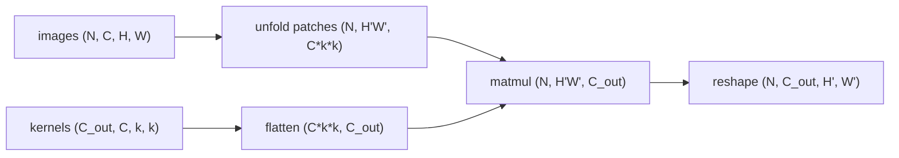

# Convolution from Scratch

> Slide one small stencil over the whole image. The same nine numbers find the same edge everywhere.

**Type:** Build
**Languages:** Python
**Prerequisites:** Phase 01 (Neural Networks), Phase 02 (Training Deep Nets)
**Time:** ~60 minutes

## Learning Objectives

- Compute a 2D convolution (strictly, a cross-correlation) with explicit loops and explain every index
- Extend it to batches, multiple input channels and multiple output channels
- Rewrite the loops as a single matrix multiply with im2col and match `F.conv2d` to floating-point precision
- Explain weight sharing and translation equivariance, and why they make convolution so much cheaper than a dense layer

## The Problem

An MLP sees an image as a flat vector. For an 8x8 digit that is 64 numbers, and every hidden unit gets its own weight for every pixel. Two things go wrong. First, the parameter count explodes with resolution: a single dense layer from a 224x224x3 image to 1000 hidden units needs 150 million weights. Second, the network has no idea that pixel (3, 4) is next to pixel (3, 5). If it learns to detect a stroke in the top-left corner, it has to learn the same detector again, from scratch, for every other position.

Images have structure you can exploit. Useful patterns (edges, corners, strokes) are local, so a detector only needs to look at a small neighborhood. And they can appear anywhere, so the same detector should be reused at every position. A convolution builds both assumptions into the layer. In this lesson you write it three ways: as nested loops you can read, as a batched multi-channel version, and as one big matrix multiply that is fast enough to train with.

## The Concept

### Sliding a kernel

A kernel `K` of size `k x k` slides over the image `X`. At each position you multiply the overlapping numbers elementwise and add them up:

```
Y[i, j] = sum_{u=0}^{k-1} sum_{v=0}^{k-1} X[i + u, j + v] * K[u, v]
```

With no padding, an `H x W` image and a `k x k` kernel give an `(H - k + 1) x (W - k + 1)` output.

```
input 5x5                 kernel 3x3        output 3x3
+---+---+---+---+---+
| a | b | c | . | . |     +---+---+---+     +---+---+---+
+---+---+---+---+---+     | 1 | 0 |-1 |     | y | . | . |
| d | e | f | . | . |  *  +---+---+---+  =  +---+---+---+
+---+---+---+---+---+     | 2 | 0 |-2 |     | . | . | . |
| g | h | i | . | . |     +---+---+---+     +---+---+---+
+---+---+---+---+---+     | 1 | 0 |-1 |     | . | . | . |
| . | . | . | . | . |     +---+---+---+     +---+---+---+
+---+---+---+---+---+
y = a - c + 2d - 2f + g - i
```

The formula above is technically **cross-correlation**. True mathematical convolution flips the kernel first (`K[k-1-u, k-1-v]`). Deep learning libraries skip the flip because the kernel is learned anyway: a network that needs the flipped version simply learns it. Everyone still calls it convolution.

### Channels

Real inputs have channels (RGB, or the 64 feature maps of a previous layer). A kernel then has shape `C_in x k x k` and sums over all input channels at once. You stack `C_out` such kernels to get `C_out` output maps:

```
Y[n, o, i, j] = b[o] + sum_c sum_u sum_v X[n, c, i + u, j + v] * K[o, c, u, v]
```

The weight tensor has shape `(C_out, C_in, k, k)`, which is exactly what `nn.Conv2d` stores.

### Weight sharing and equivariance

The same `K` is used at every `(i, j)`. That is **weight sharing**. Mapping 8x8 to 6x6 with a dense layer costs `64 * 36 = 2304` weights; with one 3x3 kernel it costs 9.

Because the same kernel is applied everywhere, shifting the input shifts the output by the same amount. That property is **translation equivariance**: `conv(shift(x)) = shift(conv(x))`. A stroke detector that fires in one corner fires in every corner.

### im2col: convolution as a matrix multiply

Loops over pixels are slow in Python. The trick used by early GPU libraries is **im2col**: copy every `C_in x k x k` patch into a row of a matrix, flatten each kernel into a column, and do one matrix multiply.



The patches overlap, so im2col duplicates memory (each pixel appears up to `k^2` times), but matrix multiplies are what hardware is best at. Modern libraries (cuDNN) choose among im2col, FFT and Winograd algorithms for you.

## Build It

### Step 1: The single-channel loop

The whole operation is two loops over output positions and an elementwise product.

```python
def conv2d_loops(image, kernel):
    image_height, image_width = image.shape
    kernel_height, kernel_width = kernel.shape
    out_height = image_height - kernel_height + 1
    out_width = image_width - kernel_width + 1
    output = torch.zeros(out_height, out_width)
    for row in range(out_height):
        for col in range(out_width):
            patch = image[row:row + kernel_height, col:col + kernel_width]
            output[row, col] = (patch * kernel).sum()
    return output
```

Run it on the first digit (a zero) with a Sobel kernel, which responds to vertical edges. The left side of the zero gives strong positive responses (dark to bright) and the right side strong negative ones (bright to dark):

```
3x3 kernel on 8x8 image -> output shape (6, 6)
tensor([[ 2.9000,  2.6000, -1.1000, -0.2000, -0.7000, -2.6000],
        [ 3.4000,  0.6000, -2.8000,  1.6000,  1.2000, -2.8000],
        ...
```

The script also saves `convolution_filters.png` with the input, both Sobel responses and a blur.

### Step 2: Batches and channels

Add loops over images and output channels, and let each patch span all input channels:

```python
def conv2d_multichannel_loops(images, kernels, bias):
    batch, in_channels, height, width = images.shape
    out_channels, _, kernel_height, kernel_width = kernels.shape
    out_height = height - kernel_height + 1
    out_width = width - kernel_width + 1
    output = torch.zeros(batch, out_channels, out_height, out_width)
    for n in range(batch):
        for o in range(out_channels):
            for row in range(out_height):
                for col in range(out_width):
                    patch = images[n, :, row:row + kernel_height, col:col + kernel_width]
                    output[n, o, row, col] = (patch * kernels[o]).sum() + bias[o]
    return output
```

### Step 3: im2col with `unfold`

`Tensor.unfold(dim, size, step)` creates sliding windows without loops. Unfolding height and then width gives a `(N, C, H', W', k, k)` view; permute so the channel and kernel dimensions are last, flatten them, and multiply:

```python
def im2col(images, kernel_height, kernel_width):
    batch, channels, height, width = images.shape
    out_height = height - kernel_height + 1
    out_width = width - kernel_width + 1
    patches = images.unfold(2, kernel_height, 1).unfold(3, kernel_width, 1)
    patches = patches.permute(0, 2, 3, 1, 4, 5)
    return patches.reshape(batch, out_height * out_width, channels * kernel_height * kernel_width), out_height, out_width


def conv2d_im2col(images, kernels, bias):
    out_channels, _, kernel_height, kernel_width = kernels.shape
    columns, out_height, out_width = im2col(images, kernel_height, kernel_width)
    flat_kernels = kernels.reshape(out_channels, -1)
    output = columns @ flat_kernels.T + bias
    return output.permute(0, 2, 1).reshape(images.shape[0], out_channels, out_height, out_width)
```

The order of the flattened patch (channel, then row, then column) must match how `kernels.reshape(out_channels, -1)` flattens the weights. That is why the permute puts the channel axis before the two kernel axes.

### Step 4: Check against PyTorch and time it

```
Loop conv vs im2col conv max diff:   9.54e-07
im2col conv vs F.conv2d max diff:    9.54e-07
3-channel input (8, 3, 32, 32) with 16 kernels of shape (3, 5, 5) -> (8, 16, 28, 28)
Time for 64 images: loops 170.9 ms, im2col 0.230 ms, F.conv2d 0.107 ms
```

The three implementations agree to about `1e-6` (floating-point summation order). im2col is roughly 700 times faster than the loops, and only about twice as slow as the optimized library kernel.

### Step 5: Weight sharing and equivariance

The script prints the parameter comparison (2304 dense weights vs 9 shared ones) and verifies equivariance: rolling the digit one pixel to the right and convolving gives the same response, shifted one column.

## Use It

In practice you never write the loop. `F.conv2d(input, weight, bias)` is the functional form, and `nn.Conv2d(in_channels, out_channels, kernel_size)` wraps the weight and bias as parameters:

```python
import torch.nn as nn
import torch.nn.functional as F

layer = nn.Conv2d(in_channels=1, out_channels=4, kernel_size=3)
print(layer.weight.shape)
output = F.conv2d(batch, kernels, bias)
```

`layer.weight` has shape `(4, 1, 3, 3)`, the same `(C_out, C_in, k, k)` layout you used. Because your im2col version is built from differentiable tensor ops, autograd can already backpropagate through it; the next lessons use exactly this to train a network with a hand-written convolution.

## Exercises

1. **Easy.** Design a 3x3 kernel that detects diagonal strokes going from top-left to bottom-right. Apply it to a few digits (a 7, a 1) and plot the responses.
2. **Medium.** Implement the backward pass of `conv2d_loops` by hand: the gradient with respect to the kernel is a cross-correlation of the input with the output gradient, and the gradient with respect to the input is a full convolution of the output gradient with the flipped kernel. Check both against `torch.autograd.grad`.
3. **Hard.** Implement convolution with the FFT (`torch.fft.rfft2`): zero-pad image and kernel to the same size, multiply in the frequency domain, invert, and crop. Remember that the FFT computes true convolution, so flip the kernel. Compare speed against im2col for kernel sizes 3, 7 and 15.

## Key Terms

| Term | What people say | What it actually means |
|------|----------------|----------------------|
| Convolution | "Sliding a filter over the image" | In deep learning, a cross-correlation: at each position, the sum of an elementwise product between a patch and a learned kernel |
| Kernel / filter | "The feature detector" | A learned weight tensor of shape `(C_in, k, k)`; a layer has `C_out` of them |
| Feature map | "The output image" | One output channel: the response of one kernel at every spatial position |
| Weight sharing | "Reusing weights" | The same kernel parameters are applied at every spatial location, so parameters do not grow with image size |
| Translation equivariance | "Shift in, shift out" | `conv(shift(x)) = shift(conv(x))`: moving the input moves the feature map by the same amount |
| Cross-correlation | "Convolution without the flip" | The operation libraries actually compute; true convolution flips the kernel first |
| im2col | "Unrolling the image" | Copying every patch into a matrix row so the whole convolution becomes one matrix multiply |

## Further Reading

- [Dumoulin and Visin, A guide to convolution arithmetic for deep learning (2016)](https://arxiv.org/abs/1603.07285) -- the reference for every shape and index in a convolution, with clear animations
- [Dive into Deep Learning, Chapter 7: Convolutional Neural Networks](https://d2l.ai/chapter_convolutional-neural-networks/index.html) -- builds cross-correlation by hand, then channels, padding and pooling
- [CS231n: Convolutional Neural Networks for Visual Recognition](https://cs231n.github.io/convolutional-networks/) -- the classic notes, including the im2col implementation
- [PyTorch docs: torch.nn.Conv2d](https://pytorch.org/docs/stable/generated/torch.nn.Conv2d.html) -- the exact formula and shape conventions the library uses
