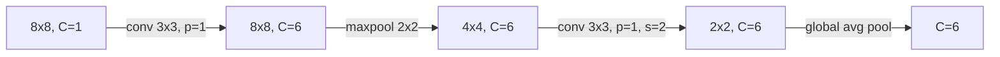

# Padding, Stride and Pooling

> Padding decides what happens at the border, stride decides how far you jump, pooling decides what you keep.

**Type:** Build
**Languages:** Python
**Prerequisites:** Phase 02 (Training Deep Nets), Convolution from Scratch
**Time:** ~45 minutes

## Learning Objectives

- Derive and use the output-size formula `floor((n + 2p - k) / s) + 1`, including dilation
- Implement zero padding, strided convolution, max pooling, average pooling and global average pooling with tensor ops
- Explain why padding keeps deep networks from shrinking and why borders are under-sampled without it
- Describe how max pooling routes gradients and what kind of shift robustness it actually buys

## The Problem

In the previous lesson every 3x3 convolution shrank the image by two pixels. An 8x8 digit becomes 6x6, then 4x4, then 2x2. After three layers there is almost nothing left, and you have not even built a deep network yet. Pixels on the border are also treated unfairly: a corner pixel takes part in one kernel position, a center pixel in nine.

You also want the opposite effect on purpose. Deep networks need to see larger and larger regions while keeping computation affordable, so they reduce resolution step by step: 224 to 112 to 56 and so on. Three tools control all of this. **Padding** adds a frame around the input so the size is preserved. **Stride** skips positions to shrink the output. **Pooling** summarizes each small window with a single number. Getting their arithmetic right is the difference between a network that builds and one that crashes with a shape mismatch.

## The Concept

### The output-size formula

For input size `n`, kernel `k`, padding `p` and stride `s`:

```
out = floor((n + 2p - k) / s) + 1
```

Padding adds `p` pixels on each side, the kernel fits in `n + 2p - k + 1` positions, and the stride keeps every `s`-th of them.

| n | k | p | s | out | typical use |
|---|---|---|---|-----|-------------|
| 8 | 3 | 0 | 1 | 6 | "valid" convolution |
| 8 | 3 | 1 | 1 | 8 | "same" convolution |
| 8 | 3 | 1 | 2 | 4 | downsampling convolution |
| 32 | 5 | 0 | 1 | 28 | LeNet's first layer |
| 224 | 7 | 3 | 2 | 112 | ResNet's stem |

For an odd kernel, `p = (k - 1) / 2` with stride 1 gives "same" output size. That is why almost every modern CNN uses odd kernels.

### Padding

Zero padding surrounds the image with zeros:

```
original 3x3        padded (p=1) 5x5
                    0 0 0 0 0
a b c               0 a b c 0
d e f      -->      0 d e f 0
g h i               0 g h i 0
                    0 0 0 0 0
```

Now a 3x3 kernel can be centered on every original pixel, including corners. Other modes exist (reflect, replicate, circular), but zeros are the default in `nn.Conv2d`.

### Stride

A stride of 2 moves the kernel two pixels at a time. The output is roughly half the size in each dimension, and the cost drops by four. A stride-2 convolution is a learned downsampler.

### Dilation

A dilated kernel spreads its taps apart. With dilation `d`, a `k x k` kernel covers `d(k - 1) + 1` pixels per side without adding weights. Replace `k` by that effective size in the formula.

### Pooling

Pooling has no parameters. It slides a window (usually 2x2 with stride 2) and keeps one summary per window:

```
input 4x4            max pool 2x2      avg pool 2x2
1 3 | 2 0
4 2 | 1 1            4 2               2.50 1.00
----+----     -->
0 1 | 5 6            2 8               1.25 6.50
2 2 | 7 8
```

**Max pooling** keeps the strongest response: "was this feature present anywhere in the window?" **Average pooling** keeps the mean. **Global average pooling** averages each whole channel to a single number, turning `(N, C, H, W)` into `(N, C)`. It replaced the huge dense layers at the end of networks like VGG.

### How max pooling backpropagates

The max is a selector. During the backward pass the whole gradient of each window goes to the input that won, and the other three get zero. With 2x2 windows, only a quarter of the inputs receive gradient on each step.

### What pooling buys you

Pooling makes small shifts matter less: if the strongest response moves by one pixel but stays in the same window, the pooled value does not change. It does not make a network fully shift invariant. A one-pixel shift that crosses a window boundary still changes the output, which is why CNNs remain surprisingly sensitive to small translations.



## Build It

### Step 1: The formula

```python
def output_size(input_size, kernel_size, padding, stride, dilation=1):
    effective_kernel = dilation * (kernel_size - 1) + 1
    return (input_size + 2 * padding - effective_kernel) // stride + 1
```

### Step 2: Padding and strided patches

Padding is just writing the image into the middle of a bigger zero tensor. `unfold` already supports a step, so strided patch extraction is one line per axis:

```python
def zero_pad(images, padding):
    batch, channels, height, width = images.shape
    padded = torch.zeros(batch, channels, height + 2 * padding, width + 2 * padding)
    padded[:, :, padding:padding + height, padding:padding + width] = images
    return padded


def extract_patches(images, kernel_size, stride):
    batch, channels, height, width = images.shape
    out_height = (height - kernel_size) // stride + 1
    out_width = (width - kernel_size) // stride + 1
    patches = images.unfold(2, kernel_size, stride).unfold(3, kernel_size, stride)
    return patches.reshape(batch, channels, out_height, out_width, kernel_size * kernel_size)
```

### Step 3: Convolution with padding and stride

Pad, extract patches, move the channel axis next to the kernel values, flatten and multiply:

```python
def conv2d(images, kernels, bias, padding=0, stride=1):
    out_channels, in_channels, kernel_size, _ = kernels.shape
    padded = zero_pad(images, padding) if padding else images
    patches = extract_patches(padded, kernel_size, stride)
    patches = patches.permute(0, 2, 3, 1, 4).reshape(*patches.shape[0:1], *patches.shape[2:4], -1)
    output = patches @ kernels.reshape(out_channels, -1).T + bias
    return output.permute(0, 3, 1, 2)
```

Every configuration matches `F.conv2d`:

```
padding=0 stride=1: shape (32, 6, 6, 6), max diff 9.5e-07
padding=1 stride=1: shape (32, 6, 8, 8), max diff 9.5e-07
padding=1 stride=2: shape (32, 6, 4, 4), max diff 7.2e-07
padding=2 stride=3: shape (32, 6, 4, 4), max diff 4.8e-07
```

### Step 4: Pooling

Pooling reuses the same patch extractor and replaces the dot product with a reduction:

```python
def max_pool2d(images, kernel_size, stride):
    return extract_patches(images, kernel_size, stride).max(dim=-1).values


def avg_pool2d(images, kernel_size, stride):
    return extract_patches(images, kernel_size, stride).mean(dim=-1)


def global_avg_pool(images):
    return images.mean(dim=(2, 3))
```

Both match `F.max_pool2d` and `F.avg_pool2d` exactly.

### Step 5: Gradient routing and shift robustness

Calling `.backward()` through your max pool shows that only 25% of the inputs receive a gradient. Rolling the feature maps one pixel shows what pooling does for shifts:

```
Shift feature maps by 1 pixel: raw maps change by 70%, max-pooled maps change by 48%
Max pool backward: only 25% of inputs receive gradient (one winner per window)
```

Pooling cuts the change roughly in half. Helpful, but far from invariance.

### Step 6: Two ways to downsample

A stride-2 convolution and a conv followed by 2x2 pooling both take 8x8 to 4x4. The strided convolution does four times fewer multiply-adds (864 vs 3456 per image here) and learns how to downsample. Many modern architectures (ResNet's later stages, most of ConvNeXt) use strided convolutions instead of pooling.

## Use It

PyTorch exposes everything as layer arguments:

```python
nn.Conv2d(16, 32, kernel_size=3, padding=1)
nn.Conv2d(16, 32, kernel_size=3, padding=1, stride=2)
nn.Conv2d(16, 32, kernel_size=3, padding="same")
nn.Conv2d(16, 32, kernel_size=3, padding=2, dilation=2)
nn.MaxPool2d(kernel_size=2, stride=2)
nn.AvgPool2d(2)
nn.AdaptiveAvgPool2d(1)
```

`padding="same"` computes the padding for you (only for stride 1). `nn.AdaptiveAvgPool2d(output_size)` picks the window size so the output has a fixed size whatever the input resolution, which is how torchvision models accept images of different sizes. When a shape error appears, write the formula next to every layer; it is almost always an off-by-one in padding.

## Exercises

1. **Easy.** Compute by hand the output sizes of a network on 32x32 inputs: conv 5x5 (p=0), maxpool 2, conv 5x5 (p=0), maxpool 2. Check with the `output_size` function. (You will meet this network in the next lesson.)
2. **Medium.** Implement reflect padding (mirror the image at the border) and compare its effect with zero padding on a Sobel filter applied to a digit. Which one produces fake edges at the border?
3. **Hard.** Implement the backward pass of `max_pool2d` by hand: record the argmax of each window in the forward pass and scatter the output gradient to those positions. Verify against autograd, including the case where two values in a window tie.

## Key Terms

| Term | What people say | What it actually means |
|------|----------------|----------------------|
| Padding | "Adding a border" | Extending the input with `p` pixels per side (zeros by default) so the kernel can be centered on edge pixels |
| Same padding | "Keeps the size" | `p = (k - 1) / 2` with stride 1, so output size equals input size |
| Stride | "Step size" | The number of pixels the kernel moves between positions; stride `s` divides the output size by about `s` |
| Dilation | "Atrous convolution" | Spacing kernel taps `d` pixels apart, enlarging coverage to `d(k - 1) + 1` without extra weights |
| Max pooling | "Downsampling" | Keeping the maximum of each window; gradient flows only to the winning input |
| Global average pooling | "GAP" | Averaging each channel over all positions, giving one number per channel |
| Shift robustness | "Pooling makes CNNs invariant" | Pooling reduces sensitivity to small shifts inside a window, but shifts across window boundaries still change the output |

## Further Reading

- [Dumoulin and Visin, A guide to convolution arithmetic for deep learning (2016)](https://arxiv.org/abs/1603.07285) -- every padding, stride and dilation case with diagrams
- [Dive into Deep Learning, Section 7.3: Padding and Stride](https://d2l.ai/chapter_convolutional-neural-networks/padding-and-strides.html) and [7.5: Pooling](https://d2l.ai/chapter_convolutional-neural-networks/pooling.html) -- short, runnable explanations
- [Zhang, Making Convolutional Networks Shift-Invariant Again (2019)](https://arxiv.org/abs/1904.11486) -- why pooling and striding break shift invariance and how blurring before downsampling helps
- [PyTorch docs: torch.nn.MaxPool2d](https://pytorch.org/docs/stable/generated/torch.nn.MaxPool2d.html) -- the exact shape formula, including dilation and ceil mode
