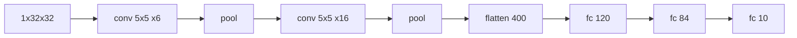

# LeNet

> Convolve, squash, shrink, repeat, then classify. The 1998 recipe still sits inside every CNN.

**Type:** Build
**Languages:** Python
**Prerequisites:** Phase 02 (Training Deep Nets), Convolution from Scratch, Padding, Stride and Pooling
**Time:** ~60 minutes

## Learning Objectives

- Trace the shape of a tensor through LeNet-5 layer by layer and count its parameters
- Build a trainable convolution layer from tensor ops (`unfold` + matmul) wrapped in `nn.Module`
- Train LeNet-5 on digits with your own convolution and match the `nn.Conv2d` version
- Compare a CNN with an MLP of similar size and explain what the convolutional structure buys

## The Problem

You now have convolution, padding and pooling as separate operations. A working image classifier needs them arranged into a network and trained end to end, with gradients flowing back through every convolution.

In the late 1980s and 1990s Yann LeCun and colleagues did exactly that for handwritten digits on bank checks and zip codes. Their LeNet-5 (1998) read millions of checks per day. Its layout (convolution and pooling blocks that shrink the image while adding channels, followed by a few dense layers) is the template that AlexNet, VGG and ResNet all extend. Building it yourself is the fastest way to understand why every later CNN looks the way it does.

## The Concept

### The architecture

LeNet-5 expects a 32x32 grayscale image. The scikit-learn digits are 8x8, so the script upsamples them to 28x28 and pads to 32x32, mimicking how MNIST was fed to the original network.

```
input        1 x 32 x 32
conv 5x5     6 x 28 x 28     (32 - 5 + 1 = 28)
maxpool 2    6 x 14 x 14
conv 5x5    16 x 10 x 10     (14 - 5 + 1 = 10)
maxpool 2   16 x  5 x  5
flatten           400
dense             120
dense              84
dense              10
```



Two trends define it: the spatial size shrinks (32, 28, 14, 10, 5) while the number of channels grows (1, 6, 16). Early layers keep many positions and few features; later layers keep few positions and many features.

### Counting parameters

| Layer | Weights | Biases | Total |
|-------|---------|--------|-------|
| conv1 | 6 x 1 x 5 x 5 = 150 | 6 | 156 |
| conv2 | 16 x 6 x 5 x 5 = 2,400 | 16 | 2,416 |
| fc1 | 400 x 120 = 48,000 | 120 | 48,120 |
| fc2 | 120 x 84 = 10,080 | 84 | 10,164 |
| fc3 | 84 x 10 = 840 | 10 | 850 |
| **total** | | | **61,706** |

The two convolutions hold 4% of the parameters but do most of the computation. That imbalance gets even more extreme in VGG (next lesson).

### What changed since 1998

The original used tanh-like activations, average-pooling "subsampling" layers with learned coefficients, a sparse connection table between conv1 and conv2, and Gaussian RBF output units. The modern version keeps the shapes but uses ReLU, max pooling, full channel connectivity and a softmax with cross-entropy. That is what you build here.

## Build It

### Step 1: A convolution layer with parameters

Wrap the im2col convolution from the first lesson in an `nn.Module`. Registering the kernel and bias as `nn.Parameter` makes them visible to the optimizer, and autograd differentiates through `unfold` and the matrix multiply for free:

```python
class ScratchConv2d(nn.Module):
    def __init__(self, in_channels, out_channels, kernel_size):
        super().__init__()
        fan_in = in_channels * kernel_size * kernel_size
        bound = (1.0 / fan_in) ** 0.5
        self.kernel_size = kernel_size
        self.weight = nn.Parameter(torch.empty(out_channels, in_channels, kernel_size, kernel_size).uniform_(-bound, bound))
        self.bias = nn.Parameter(torch.empty(out_channels).uniform_(-bound, bound))

    def forward(self, images):
        batch, channels, height, width = images.shape
        k = self.kernel_size
        out_height, out_width = height - k + 1, width - k + 1
        patches = images.unfold(2, k, 1).unfold(3, k, 1)
        patches = patches.permute(0, 2, 3, 1, 4, 5).reshape(batch, out_height, out_width, -1)
        output = patches @ self.weight.reshape(self.weight.shape[0], -1).T + self.bias
        return output.permute(0, 3, 1, 2)
```

The initialization `U(-1/sqrt(fan_in), 1/sqrt(fan_in))` is the same default `nn.Conv2d` uses, so the comparison later is fair.

### Step 2: Max pooling with a reshape

For non-overlapping 2x2 windows you do not even need `unfold`. Split each spatial axis into `(blocks, 2)` and take the max over the two small axes:

```python
def scratch_max_pool(images, size=2):
    batch, channels, height, width = images.shape
    windows = images.reshape(batch, channels, height // size, size, width // size, size)
    return windows.amax(dim=(3, 5))
```

### Step 3: Assemble LeNet-5

```python
class ScratchLeNet5(nn.Module):
    def __init__(self, num_classes=10):
        super().__init__()
        self.conv1 = ScratchConv2d(1, 6, 5)
        self.conv2 = ScratchConv2d(6, 16, 5)
        self.fc1 = nn.Linear(16 * 5 * 5, 120)
        self.fc2 = nn.Linear(120, 84)
        self.fc3 = nn.Linear(84, num_classes)

    def forward(self, images):
        x = scratch_max_pool(torch.relu(self.conv1(images)))
        x = scratch_max_pool(torch.relu(self.conv2(x)))
        x = x.flatten(1)
        x = torch.relu(self.fc1(x))
        x = torch.relu(self.fc2(x))
        return self.fc3(x)
```

The script prints the shape trace, which should match the table above exactly, and checks that `ScratchConv2d` with copied weights gives the same output as `nn.Conv2d` (difference 0.0).

### Step 4: Train it

A standard minibatch loop with Adam and cross-entropy, 15 epochs on 1,437 training images:

```python
def train(model, train_images, train_labels, test_images, test_labels, epochs=15, batch_size=64, lr=2e-3):
    optimizer = torch.optim.Adam(model.parameters(), lr=lr)
    generator = torch.Generator().manual_seed(1)
    for epoch in range(epochs):
        model.train()
        order = torch.randperm(len(train_labels), generator=generator).to(train_labels.device)
        for start in range(0, len(order), batch_size):
            batch = order[start:start + batch_size]
            loss = F.cross_entropy(model(train_images[batch]), train_labels[batch])
            optimizer.zero_grad()
            loss.backward()
            optimizer.step()
```

### Step 5: Compare with `nn.Conv2d` and an MLP

The script trains three models and also evaluates them on test digits shifted by 3 pixels:

```
model                      params  test acc  shifted 3px  seconds
LeNet-5 (scratch conv)     61,706     0.983        0.511      2.2
LeNet-5 (nn.Conv2d)        61,706     0.978        0.381      0.6
MLP baseline               66,250     0.972        0.267      0.2
```

Your convolution trains to the same accuracy as the library one (small differences come from the random batch order and GPU nondeterminism); it is just slower because `nn.Conv2d` calls cuDNN. On centered digits the MLP is nearly as good: this dataset is small and easy. The difference shows up when you move the digits. Shifting by 3 pixels drops the MLP to 27% while the CNNs keep 38-51%. The CNN's local, shared filters still fire on a shifted stroke; the MLP's pixel-specific weights do not. (Neither is fully robust, as you saw with pooling. Data augmentation from Phase 02 is the usual fix.) Exact numbers vary slightly between runs on GPU.

## Use It

The same network in idiomatic PyTorch is ten lines:

```python
def torch_lenet5(num_classes=10):
    return nn.Sequential(
        nn.Conv2d(1, 6, 5), nn.ReLU(), nn.MaxPool2d(2),
        nn.Conv2d(6, 16, 5), nn.ReLU(), nn.MaxPool2d(2),
        nn.Flatten(),
        nn.Linear(16 * 5 * 5, 120), nn.ReLU(),
        nn.Linear(120, 84), nn.ReLU(),
        nn.Linear(84, num_classes),
    )
```

When you design your own CNN, the hard part is the `nn.Linear(16 * 5 * 5, ...)`: you must know the flattened size. Either compute it with the formula, run a dummy tensor through the convolutional part and read `.shape`, or use `nn.LazyLinear(120)`, which infers its input size on the first forward pass.

## Exercises

1. **Easy.** Replace ReLU with tanh and max pooling with average pooling (closer to the 1998 original). How do accuracy and training speed change?
2. **Medium.** Train both LeNet and the MLP with random-shift augmentation (shift each training image by up to 3 pixels). Re-measure accuracy on shifted test digits. Which model benefits more?
3. **Hard.** Skip the upsampling and design a LeNet-style network that works directly on 8x8 inputs (hint: 3x3 kernels with padding). Match the accuracy of the 32x32 version with fewer than 10,000 parameters.

## Key Terms

| Term | What people say | What it actually means |
|------|----------------|----------------------|
| LeNet-5 | "The first CNN" | LeCun et al.'s 1998 network: two conv/pool stages and three dense layers, about 60k parameters, trained with backprop on digits |
| Feature hierarchy | "Layers learn more abstract features" | Each stage sees a larger region and combines earlier features, while spatial size shrinks and channel count grows |
| Flatten | "Turning the image into a vector" | Reshaping `(N, C, H, W)` to `(N, C*H*W)` so dense layers can consume it |
| nn.Parameter | "A trainable tensor" | A tensor registered on a module so `model.parameters()` returns it and the optimizer updates it |
| Inductive bias | "Built-in assumptions" | Structure that favors some solutions over others; for CNNs, locality and weight sharing |
| LazyLinear | "Linear without the input size" | A dense layer whose input dimension is inferred from the first batch it sees |

## Further Reading

- [LeCun, Bottou, Bengio and Haffner, Gradient-Based Learning Applied to Document Recognition (1998)](http://yann.lecun.com/exdb/publis/pdf/lecun-01a.pdf) -- the LeNet-5 paper; Section II describes the architecture
- [Dive into Deep Learning, Section 7.6: LeNet](https://d2l.ai/chapter_convolutional-neural-networks/lenet.html) -- a modern re-implementation with training curves
- [3Blue1Brown, But what is a convolution?](https://www.youtube.com/watch?v=KuXjwB4LzSA) -- visual intuition for what each filter computes
- [PyTorch tutorial: Training a Classifier](https://pytorch.org/tutorials/beginner/blitz/cifar10_tutorial.html) -- the same LeNet-style network trained on CIFAR-10
