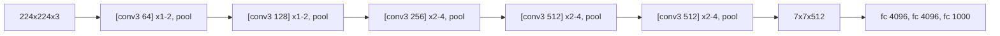

# Deeper CNNs: VGG

> Stop choosing kernel sizes. Stack 3x3 convolutions, halve the resolution, double the channels, repeat.

**Type:** Build
**Languages:** Python
**Prerequisites:** Phase 02 (Training Deep Nets), LeNet
**Time:** ~50 minutes

## Learning Objectives

- Explain why two stacked 3x3 convolutions see as much as one 5x5 while using fewer weights and adding a nonlinearity
- Compute the receptive field of a stack of convolutions and pools, and verify it with gradients
- Build any VGG variant from a configuration list and reproduce torchvision's VGG-11 parameter count exactly
- Describe where VGG's parameters and compute live, and why that motivated global average pooling

## The Problem

After LeNet, the obvious way to get better accuracy was to go bigger. AlexNet (2012) did it with a hand-tuned mix of 11x11, 5x5 and 3x3 kernels, strides of 4, and layer sizes chosen by experiment. Every new architecture was a new set of magic numbers, and it was unclear which choices mattered.

Simonyan and Zisserman (2014) asked a cleaner question: what if you fix every design choice except depth? VGG uses only 3x3 convolutions with padding 1 and 2x2 max pooling, and simply stacks more of them. VGG-16 and VGG-19 took second place in ImageNet 2014, and their uniform design made them the default feature extractor for years. The ideas you take away (small kernels, blocks, doubling channels after each downsampling) are still how CNNs are designed.

## The Concept

### Two 3x3 equal one 5x5 (but cheaper)

A unit after one 3x3 convolution sees a 3x3 patch. A unit after a second 3x3 convolution sees a 3x3 patch of the first layer, each of which saw 3x3 input pixels: 5x5 in total. Three layers see 7x7.

```
layer 2 unit           sees 3x3 of layer 1     which see 5x5 of the input
    o                  o o o                    . . . . .
                       o o o                    . . . . .
                       o o o                    . . . . .
                                                . . . . .
                                                . . . . .
```

With `C` input and output channels:

| Option | Receptive field | Weights | Nonlinearities |
|--------|-----------------|---------|----------------|
| one 5x5 | 5x5 | 25 C^2 | 1 |
| two 3x3 | 5x5 | 18 C^2 | 2 |
| one 7x7 | 7x7 | 49 C^2 | 1 |
| three 3x3 | 7x7 | 27 C^2 | 3 |

The stack is 28% (5x5) or 45% (7x7) cheaper and has more ReLUs between input and output, so it can represent more complex functions of the same patch.

### Receptive field arithmetic

Track two numbers layer by layer: the receptive field `r` and the jump `j` (the distance in input pixels between neighboring units). Start with `r = 1, j = 1`. For a layer with kernel `k` and stride `s`:

```
r <- r + (k - 1) * j
j <- j * s
```

A 2x2 pool with stride 2 adds 1 * j to the field and doubles the jump, so every layer after it grows the field twice as fast. That is how pooling lets deep networks see the whole image with small kernels.

### The VGG recipe



Each stage halves the resolution and doubles the channels (until 512), so the cost per layer stays roughly constant. The variants (11, 13, 16, 19 layers) differ only in how many convolutions each stage has, which is why the whole family fits in a configuration list like:

```python
VGG11_CONFIG = [64, "M", 128, "M", 256, 256, "M", 512, 512, "M", 512, 512, "M"]
```

### Where the parameters are

VGG's convolutions do almost all the computation, but the three dense layers hold almost all the parameters. The first one alone maps `7 * 7 * 512 = 25,088` features to 4096 units: 102 million weights. Later networks (Network-in-Network, GoogLeNet, ResNet) replaced the flatten with global average pooling and a single linear layer, cutting the parameter count by an order of magnitude.

## Build It

### Step 1: A configuration-driven feature extractor

Numbers mean "3x3 conv with this many output channels, then ReLU"; `"M"` means a 2x2 max pool:

```python
def make_features(config, in_channels, kernel_size=3):
    layers = []
    channels = in_channels
    for item in config:
        if item == "M":
            layers.append(nn.MaxPool2d(2))
        else:
            layers += [nn.Conv2d(channels, item, kernel_size=kernel_size, padding=kernel_size // 2), nn.ReLU(inplace=True)]
            channels = item
    return nn.Sequential(*layers), channels
```

### Step 2: The full VGG

Features, an adaptive average pool to a fixed spatial size, and the dense classifier with dropout:

```python
class VGG(nn.Module):
    def __init__(self, config, in_channels, num_classes, pooled_size, hidden, kernel_size=3):
        super().__init__()
        self.features, channels = make_features(config, in_channels, kernel_size)
        self.pool = nn.AdaptiveAvgPool2d(pooled_size)
        self.classifier = nn.Sequential(
            nn.Flatten(),
            nn.Linear(channels * pooled_size * pooled_size, hidden), nn.ReLU(inplace=True), nn.Dropout(0.5),
            nn.Linear(hidden, hidden), nn.ReLU(inplace=True), nn.Dropout(0.5),
            nn.Linear(hidden, num_classes),
        )

    def forward(self, images):
        return self.classifier(self.pool(self.features(images)))
```

### Step 3: Receptive fields, by formula and by gradient

```python
def receptive_field(config):
    field, jump = 1, 1
    for item in config:
        if item == "M":
            field += (2 - 1) * jump
            jump *= 2
        else:
            field += (3 - 1) * jump
    return field
```

To measure it, backpropagate from one output unit to the input and count which pixels get a nonzero gradient. With random weights some ReLUs are off and hide pixels, so the script makes all weights positive and uses a positive input, which keeps every path active:

```
1 stacked 3x3 convs: formula 3, gradient 3
2 stacked 3x3 convs: formula 5, gradient 5
3 stacked 3x3 convs: formula 7, gradient 7
4 stacked 3x3 convs: formula 9, gradient 9
tiny VGG [16, 16, 'M', 32, 32, 'M', 64, 64, 'M']: formula 36
```

### Step 4: Train a tiny VGG on digits

The digits are upsampled to 16x16. Each model trains for 20 epochs with Adam. Three models: a tiny VGG with 3x3 kernels, the same layout with 5x5 kernels, and a single wide 7x7 layer:

```
model                        params  test acc
tiny VGG, 3x3 kernels        93,050     0.967
same layout, 5x5 kernels    220,282     0.967
wide shallow 7x7 net         10,090     0.986
```

Two honest lessons. First, the 5x5 version needs 2.4 times the parameters for the same accuracy, as the table in the Concept section predicts. Second, on 16x16 digits depth does not pay off: a single layer already sees most of the digit, and the deep plain network trains more slowly (no normalization, dropout in the head). VGG's depth wins on 224x224 natural images with a thousand classes, where you need a large receptive field and many levels of features. Always try a small baseline before reaching for depth.

### Step 5: Rebuild VGG-11 exactly

```
VGG-11: mine 132,863,336 params, torchvision 132,863,336 params
  convolutional features: 9,220,480 (7%)
  fully connected head:   123,642,856 (93%)
```

Your configuration builder with the VGG-11 list, 3 input channels, a 7x7 adaptive pool and 4096 hidden units reproduces torchvision's model parameter for parameter. 93% of those parameters are in the dense head.

## Use It

torchvision ships all variants, with and without batch normalization:

```python
from torchvision.models import vgg11, vgg16_bn

model = vgg11(weights=None)
model = vgg16_bn(weights=None, num_classes=10)
```

`weights=None` gives random initialization (this repo never downloads weights). With `weights="DEFAULT"` you would get ImageNet-trained weights, which is how VGG is still used today: as a pretrained feature extractor, for example in perceptual losses for style transfer and super-resolution. For a new model trained from scratch, prefer the `_bn` variants or a ResNet: without normalization, deep VGGs are slow and fragile to train, which the original authors worked around by initializing deeper nets from shallower trained ones.

## Exercises

1. **Easy.** Use `receptive_field` to compute the receptive field of the last convolution in VGG-16 (`[64, 64, "M", 128, 128, "M", 256, 256, 256, "M", 512, 512, 512, "M", 512, 512, 512, "M"]`). Is it larger than 224?
2. **Medium.** Add `nn.BatchNorm2d` after every convolution in `make_features` and retrain the tiny VGG. How many epochs does it need to reach 97% compared with the plain version?
3. **Hard.** Replace the dense classifier with global average pooling followed by a single `nn.Linear`. Rebuild VGG-11 this way and compare parameter counts. Then train both heads on digits and compare accuracy.

## Key Terms

| Term | What people say | What it actually means |
|------|----------------|----------------------|
| VGG | "The very deep network" | Simonyan and Zisserman's 2014 family of CNNs built only from 3x3 convs and 2x2 max pools, 11 to 19 layers |
| Receptive field | "How much of the image a neuron sees" | The set of input pixels that can affect a unit; grows by `(k - 1) * jump` per layer |
| Jump | "Effective stride" | Distance in input pixels between adjacent units of a layer, the product of all previous strides |
| Block / stage | "A group of layers" | Several convolutions at the same resolution followed by a downsampling step |
| Configuration list | "Architecture as data" | A list like `[64, "M", 128, ...]` from which the network is generated |
| Adaptive average pooling | "Fixed-size pooling" | Pooling whose window adapts so the output has a requested spatial size, whatever the input size |

## Further Reading

- [Simonyan and Zisserman, Very Deep Convolutional Networks for Large-Scale Image Recognition (2014)](https://arxiv.org/abs/1409.1556) -- the VGG paper; Section 2.3 has the 3x3 stacking argument
- [Krizhevsky, Sutskever and Hinton, ImageNet Classification with Deep Convolutional Neural Networks (2012)](https://papers.nips.cc/paper/2012/hash/c399862d3b9d6b76c8436e924a68c45b-Abstract.html) -- AlexNet, the network VGG simplified
- [Dive into Deep Learning, Section 8.2: Networks Using Blocks (VGG)](https://d2l.ai/chapter_convolutional-modern/vgg.html) -- the same configuration-driven implementation
- [Araujo et al., Computing Receptive Fields of Convolutional Neural Networks (Distill, 2019)](https://distill.pub/2019/computing-receptive-fields/) -- the receptive field formulas, derived carefully
