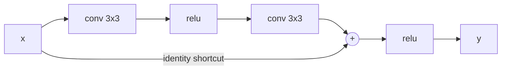

# Residual Networks

> Do not ask a layer to learn the whole mapping. Ask it to learn the correction, and give the signal a highway around it.

**Type:** Build
**Languages:** Python
**Prerequisites:** Phase 02 (Training Deep Nets), Deeper CNNs: VGG
**Time:** ~60 minutes

## Learning Objectives

- Reproduce the degradation problem: a deeper plain CNN that trains worse than a shallow one
- Implement a residual block `y = relu(x + F(x))` and explain why the identity path keeps gradients alive
- Measure per-layer gradient norms in plain and residual networks of the same depth
- Build the ResNet basic block with batch normalization and a projection shortcut, and use torchvision's `resnet18`

## The Problem

VGG showed that depth helps. So why not 30, 50 or 150 layers? In 2015 He et al. tried it and found something surprising: a 56-layer plain CNN had higher *training* error than a 20-layer one. This is not overfitting (the training error is worse) and it is not only vanishing gradients (they used batch normalization). The deeper network simply could not find a solution that the shallower one trivially could: copy the 20-layer network and make the extra 36 layers identity functions.

That observation is the key. If learning the identity is hard for a stack of conv + ReLU layers, make the identity free. A residual network adds the input of each block back to its output, so the block only has to learn the difference. ResNets won ImageNet 2015 with 152 layers, and the residual connection is now in almost every deep architecture, including every transformer in Phase 05.

## The Concept

### The residual block

A plain block computes `y = H(x)`. A residual block computes:

```
y = relu(x + F(x))
```

where `F` is two 3x3 convolutions with a ReLU in between. If the best thing for the block to do is nothing, it only has to push `F`'s weights toward zero, which weight decay and small initialization already favor.



### Why gradients survive

Ignore the final ReLU for a moment, so `x_{l+1} = x_l + F(x_l)`. Unrolling from block `l` to block `L`:

```
x_L = x_l + sum_{i=l}^{L-1} F(x_i)

dLoss/dx_l = dLoss/dx_L * (1 + d/dx_l sum F(x_i))
```

The `1` is the shortcut: the gradient at the top reaches every lower block directly, without being multiplied by a chain of weight matrices. In a plain network the gradient is a product of `L` Jacobians, and if each one shrinks the signal a little, the product shrinks exponentially.

### Seeing it in numbers

The script builds a 30-layer plain CNN and a 30-layer residual CNN (15 blocks) with no normalization and PyTorch's default initialization, then backpropagates one batch:

```
 layer   plain grad   resid grad
     1     7.42e-14     3.64e-02
    10     3.87e-11     4.45e-02
    20     8.45e-07     5.51e-02
    30     1.74e-02     6.86e-02
```

In the plain network the first layer's gradient is twelve orders of magnitude smaller than the last layer's. Nothing below layer 20 will learn. In the residual network every layer gets a gradient of the same order.

### Projection shortcuts

The addition `x + F(x)` needs matching shapes. When a block downsamples (stride 2) or changes the channel count, the shortcut becomes a 1x1 convolution with the same stride, followed by batch norm:

```
shortcut(x) = BN(conv1x1_stride2(x))     (C_in, H, W) -> (C_out, H/2, W/2)
```

The full ResNet basic block is `conv-BN-ReLU-conv-BN`, add the shortcut, then ReLU. ResNet-50 and deeper use a "bottleneck" block (1x1 down, 3x3, 1x1 up) to save compute.

## Build It

### Step 1: A plain deep network

A stem convolution, `num_layers` identical 3x3 convolutions with ReLU, global average pooling and a linear head:

```python
class PlainNet(nn.Module):
    def __init__(self, num_layers, width=16, num_classes=10):
        super().__init__()
        self.stem = nn.Conv2d(1, width, 3, padding=1)
        self.layers = nn.ModuleList(nn.Conv2d(width, width, 3, padding=1) for _ in range(num_layers))
        self.head = nn.Linear(width, num_classes)

    def forward(self, images):
        x = torch.relu(self.stem(images))
        for layer in self.layers:
            x = torch.relu(layer(x))
        return self.head(x.mean(dim=(2, 3)))
```

### Step 2: The residual version

Same convolutions, grouped in pairs, with the input added back:

```python
class ResidualBlock(nn.Module):
    def __init__(self, width):
        super().__init__()
        self.conv1 = nn.Conv2d(width, width, 3, padding=1)
        self.conv2 = nn.Conv2d(width, width, 3, padding=1)

    def forward(self, x):
        return torch.relu(x + self.conv2(torch.relu(self.conv1(x))))
```

A `ResidualNet(num_layers)` stacks `num_layers // 2` of these, so plain and residual networks of the same depth have exactly the same number of parameters. The only difference is one addition per block.

### Step 3: Gradient norms

```python
def gradient_norms(model, images, labels):
    model.zero_grad()
    F.cross_entropy(model(images), labels).backward()
    return [layer.weight.grad.norm().item() for layer in model.layers]
```

This produced the table in the Concept section.

### Step 4: The degradation problem on digits

Train both families at several depths on 8x8 digits for 12 epochs with Adam:

```
 depth  plain loss  plain acc  resid loss  resid acc
     6      0.6071      0.817      0.5652      0.881
    16      0.8950      0.672      0.3056      0.900
    30      2.3027      0.078      0.2354      0.958
```

At depth 6 the two are close. As depth grows, the plain network gets worse and at 30 layers it does not train at all: a loss of 2.30 is `ln(10)`, the loss of uniform guessing over ten classes. The residual network gets *better* with depth. This is the degradation problem and its fix in one table, with no normalization tricks involved.

### Step 5: The real basic block

```python
class BasicBlock(nn.Module):
    def __init__(self, in_channels, out_channels, stride):
        super().__init__()
        self.conv1 = nn.Conv2d(in_channels, out_channels, 3, stride=stride, padding=1, bias=False)
        self.bn1 = nn.BatchNorm2d(out_channels)
        self.conv2 = nn.Conv2d(out_channels, out_channels, 3, padding=1, bias=False)
        self.bn2 = nn.BatchNorm2d(out_channels)
        self.shortcut = nn.Identity()
        if stride != 1 or in_channels != out_channels:
            self.shortcut = nn.Sequential(nn.Conv2d(in_channels, out_channels, 1, stride=stride, bias=False),
                                          nn.BatchNorm2d(out_channels))

    def forward(self, x):
        out = torch.relu(self.bn1(self.conv1(x)))
        out = self.bn2(self.conv2(out))
        return torch.relu(out + self.shortcut(x))
```

Convolutions before batch norm have `bias=False` because BN's own shift makes the bias redundant. A block with `stride=2` maps `(4, 16, 8, 8)` to `(4, 32, 4, 4)`.

## Use It

torchvision's ResNets are built from exactly this block:

```python
from torchvision.models import resnet18

model = resnet18(weights=None, num_classes=10)
model.conv1 = nn.Conv2d(1, 64, kernel_size=3, stride=1, padding=1, bias=False)
model.maxpool = nn.Identity()
```

The default stem (7x7 stride 2 conv plus a max pool) is designed for 224x224 images and would reduce a 32x32 input to 8x8 before the first block. For small images the standard change, as in the CIFAR ResNets, is a 3x3 stride-1 stem and no max pool. The script swaps the stem for one input channel, prints the 11.2 million parameters, and on a GPU trains it for three epochs on 32x32 digits (about 95% test accuracy); without a GPU it only runs a forward pass, because 11 million parameters is a lot for a CPU.

Residual connections are not only for CNNs. Every transformer block in Phase 05 computes `x + attention(norm(x))` and `x + mlp(norm(x))`: the same highway, for the same reason.

## Exercises

1. **Easy.** Remove the final ReLU in `ResidualBlock` (so `y = x + F(x)`, the "pre-activation" style). Does the 30-layer network still train? Do the gradient norms change?
2. **Medium.** Add `nn.BatchNorm2d` after every convolution of `PlainNet`. Does batch norm alone fix the 30-layer plain network? Compare with He et al.'s claim that degradation persists even with BN.
3. **Hard.** Initialize the second convolution of every residual block to zero (as in "Fixup" and in the `zero_init_residual=True` option of torchvision's ResNet), so every block starts as the identity. Train 60-layer residual networks with and without this trick and compare their first-epoch losses.

## Key Terms

| Term | What people say | What it actually means |
|------|----------------|----------------------|
| Residual connection | "Skip connection" | Adding a block's input to its output, `y = x + F(x)`, so the block learns a correction |
| Degradation problem | "Deeper nets overfit" | Deeper plain networks reach higher *training* error than shallower ones; it is an optimization problem, not overfitting |
| Identity shortcut | "The highway" | The path that carries `x` unchanged around the block, giving gradients a direct route to early layers |
| Projection shortcut | "1x1 conv shortcut" | A strided 1x1 convolution (plus BN) that matches shapes when a block changes resolution or channels |
| Basic block | "ResNet block" | conv3x3-BN-ReLU-conv3x3-BN, add shortcut, ReLU; used in ResNet-18 and 34 |
| Bottleneck block | "1x1-3x3-1x1" | A cheaper block that reduces channels with 1x1, applies 3x3, and expands again; used in ResNet-50 and deeper |

## Further Reading

- [He, Zhang, Ren and Sun, Deep Residual Learning for Image Recognition (2015)](https://arxiv.org/abs/1512.03385) -- the ResNet paper; Figure 1 is the degradation problem
- [He et al., Identity Mappings in Deep Residual Networks (2016)](https://arxiv.org/abs/1603.05027) -- why a clean identity path matters, and the pre-activation block
- [Veit, Wilber and Belongie, Residual Networks Behave Like Ensembles of Relatively Shallow Networks (2016)](https://arxiv.org/abs/1605.06431) -- a different way to see why residual nets train well
- [Dive into Deep Learning, Section 8.6: Residual Networks (ResNet)](https://d2l.ai/chapter_convolutional-modern/resnet.html) -- the basic block and a full ResNet-18 implementation
