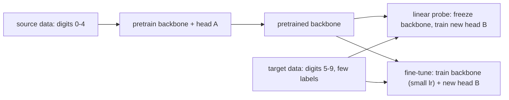

# Transfer Learning

> Features learned on one task are a head start on the next. The fewer labels you have, the more that head start is worth.

**Type:** Build
**Languages:** Python
**Prerequisites:** Phase 02 (Training Deep Nets), Residual Networks, Visualizing Features and Receptive Fields
**Time:** ~50 minutes

## Learning Objectives

- Pretrain a CNN on a source task and reuse its backbone on a target task with new classes
- Implement the two main transfer strategies, linear probing (frozen backbone) and fine-tuning (all layers, smaller learning rate)
- Measure how the benefit of pretraining depends on the number of target labels, against both a from-scratch model and a random-feature baseline
- Apply the same recipe to a torchvision model: freeze, replace the head, use parameter groups

## The Problem

You have to build a classifier for a new set of categories, and you have a handful of labeled images per class: maybe 1, maybe 10. Training a CNN from scratch on 10 images is mostly memorization. The network has to learn edge detectors, stroke detectors and invariance to small rotations and shifts from almost no data.

But those low-level features are not specific to your classes. A network trained on a different but related task has already learned them. Transfer learning reuses that network: keep the backbone, replace the classifier, and train on your small dataset. This is how almost every practical vision system starts (from an ImageNet-pretrained backbone), and the same idea, under the name "pretraining and fine-tuning", is the foundation of large language models in Phase 09.

## The Concept

### Backbone and head

Split a classifier into two parts:

```
image -> [ backbone: conv layers -> feature vector ] -> [ head: linear -> class scores ]
          general, reusable                               task specific
```

The backbone maps images to features. The head maps features to the classes of one task. Transfer learning keeps the backbone and throws away the head.



### Linear probing

Freeze every backbone parameter and train only a new linear head. It is cheap (here 1,285 trainable parameters out of 24,805), cannot overfit much, and measures how good the pretrained features are: a linear classifier on top can only use what is already there.

### Fine-tuning

Start from the pretrained backbone, attach a new head, and train everything. Use a smaller learning rate for the backbone than for the head (here 3e-4 vs 3e-3): the head starts random and needs big steps, the backbone is already good and big steps would destroy it ("catastrophic forgetting").

### When it helps

| Target labels | Typical winner |
|---------------|----------------|
| very few | linear probe or fine-tune, far ahead of scratch |
| moderate | fine-tune |
| many | fine-tune and scratch converge |

The gain also depends on how related the tasks are. Features from digits 0-4 transfer well to digits 5-9; features from digits would help much less on photographs of animals.

### The experiment in this lesson

No pretrained weights are downloaded, so you create your own source task. The **source** task is digits 0-4, trained with random rotations, scales and shifts so the backbone learns some invariance. The **target** task is digits 5-9: new classes the backbone has never seen, with randomly transformed images, and only `n` labels per class for training. You compare four models:

1. **Scratch**: random backbone, everything trained on the few target labels
2. **Random probe**: random frozen backbone, only the head trained (are the pretrained features better than random features?)
3. **Linear probe**: pretrained frozen backbone, new head
4. **Fine-tune**: pretrained backbone and new head, both trained

## Build It

### Step 1: Backbone, classifier and augmentation

```python
class Backbone(nn.Module):
    def __init__(self):
        super().__init__()
        self.layers = nn.Sequential(
            nn.Conv2d(1, 16, 3, padding=1), nn.BatchNorm2d(16), nn.ReLU(), nn.MaxPool2d(2),
            nn.Conv2d(16, 32, 3, padding=1), nn.BatchNorm2d(32), nn.ReLU(), nn.MaxPool2d(2),
            nn.Conv2d(32, 64, 3, padding=1), nn.BatchNorm2d(64), nn.ReLU(),
            nn.AdaptiveAvgPool2d(2), nn.Flatten(),
        )
        self.out_features = 256

    def forward(self, images):
        return self.layers(images)


class Classifier(nn.Module):
    def __init__(self, backbone, num_classes):
        super().__init__()
        self.backbone = backbone
        self.head = nn.Linear(backbone.out_features, num_classes)

    def forward(self, images):
        return self.head(self.backbone(images))
```

`random_affine` builds a random rotation/scale/shift matrix per image and applies it with `F.affine_grid` and `F.grid_sample`, the differentiable warping functions also used in spatial transformer networks.

### Step 2: Pretrain on the source task

```python
def pretrain(images, labels, epochs, generator, batch_size=64):
    model = Classifier(Backbone(), 5).to(images.device)
    optimizer = torch.optim.Adam(model.parameters(), lr=3e-3)
    for _ in range(epochs):
        model.train()
        augmented = random_affine(images, generator)
        order = torch.randperm(len(labels), generator=generator).to(labels.device)
        for start in range(0, len(order), batch_size):
            batch = order[start:start + batch_size]
            loss = F.cross_entropy(model(augmented[batch]), labels[batch])
            optimizer.zero_grad()
            loss.backward()
            optimizer.step()
    return model
```

A fresh augmentation of the 901 source images every epoch. The model reaches over 99% on transformed digits 0-4.

### Step 3: Linear probe

Copy the backbone, freeze it, and train only the head:

```python
def set_frozen(module, frozen):
    for parameter in module.parameters():
        parameter.requires_grad = not frozen
    if frozen:
        module.eval()


def linear_probe(pretrained, images, labels, epochs):
    model = Classifier(copy.deepcopy(pretrained), 5).to(images.device)
    set_frozen(model.backbone, True)
    optimizer = torch.optim.Adam(model.head.parameters(), lr=1e-2)
    for _ in range(epochs):
        model.head.train()
        loss = F.cross_entropy(model.head(model.backbone(images)), labels)
        optimizer.zero_grad()
        loss.backward()
        optimizer.step()
    return model
```

Two details matter. `copy.deepcopy` keeps the original backbone untouched for the next experiment. And `module.eval()` is part of freezing: batch norm layers update their running statistics in training mode even when their parameters have `requires_grad=False`.

### Step 4: Fine-tune with parameter groups

```python
def fine_tune(pretrained, images, labels, epochs):
    model = Classifier(copy.deepcopy(pretrained), 5).to(images.device)
    parameter_groups = [{"params": model.backbone.parameters(), "lr": 3e-4},
                        {"params": model.head.parameters(), "lr": 3e-3}]
    train(model, images, labels, epochs, lr=3e-4, parameters=parameter_groups)
    return model
```

An optimizer accepts a list of dictionaries, each with its own learning rate (or weight decay, or momentum).

### Step 5: The label-budget sweep

For each budget, sample `n` labeled images per target class with three different seeds, train all four models, and test on the remaining target images:

```
 labels/class   scratch  random probe  linear probe  fine-tune
            1     0.445         0.440         0.587      0.599
            3     0.641         0.626         0.724      0.739
           10     0.809         0.732         0.860      0.876
           30     0.935         0.810         0.897      0.925
```

Read it column by column. With one label per class, pretraining adds about 15 points over scratch. The random probe is about as good as scratch with few labels and falls far behind as data grows, so the linear probe's advantage really comes from what the backbone learned, not from the probe setup. As labels grow, scratch catches up: at 30 per class it ties fine-tuning and beats the frozen probe, whose features were tuned for digits 0-4 and cannot adapt. That crossover is the general pattern: pretraining matters most when target data is scarce.

## Use It

With torchvision the recipe is identical: freeze, replace the head, choose what to train.

```python
from torchvision.models import resnet18

model = resnet18(weights=None)
for parameter in model.parameters():
    parameter.requires_grad = False
model.fc = nn.Linear(model.fc.in_features, 5)
```

A freshly created `nn.Linear` has `requires_grad=True`, so only the new head (2,565 of 11.2 million parameters) is trainable. For fine-tuning, unfreeze everything and use parameter groups, often with a smaller learning rate for earlier layers ("discriminative learning rates").

In real projects you would write `resnet18(weights="DEFAULT")` to download ImageNet weights, and normalize inputs with the same mean and standard deviation used in pretraining (`ResNet18_Weights.DEFAULT.transforms()` gives you the exact preprocessing). Grayscale inputs are usually repeated to three channels, as the script does, so the pretrained first layer can be reused unchanged. This repository never downloads weights, which is why you pretrained your own backbone.

## Exercises

1. **Easy.** Fine-tune with the same learning rate (3e-3) for backbone and head. Does accuracy at 1 and 3 labels per class drop? Why?
2. **Medium.** Pretrain the source model without augmentation (plain digits 0-4). Rerun the sweep. How much of the transfer benefit came from the invariance learned through augmentation?
3. **Hard.** Implement "gradual unfreezing": train only the head for a few epochs, then unfreeze the last conv block, then the whole backbone. Compare with plain fine-tuning at 3 labels per class over 10 seeds, and report the mean and standard deviation.

## Key Terms

| Term | What people say | What it actually means |
|------|----------------|----------------------|
| Transfer learning | "Reusing a pretrained model" | Initializing a model for a target task with parameters learned on a different source task |
| Backbone | "Feature extractor" | The part of the network that maps inputs to a feature vector; reused across tasks |
| Head | "The classifier" | The task-specific final layer(s) that map features to outputs; replaced for each new task |
| Linear probe | "Frozen features + logistic regression" | Training only a linear head on a frozen backbone; also a standard way to evaluate representation quality |
| Fine-tuning | "Training the whole thing again" | Updating all parameters starting from pretrained weights, usually with a small backbone learning rate |
| Parameter groups | "Different learning rates per layer" | Lists of parameters given to one optimizer, each with its own hyperparameters |
| Catastrophic forgetting | "The model forgets what it knew" | Large updates overwriting useful pretrained features, often caused by a too-large learning rate |
| Few-shot | "Learning from a handful of examples" | A setting with only a few labeled examples per class |

## Further Reading

- [Yosinski, Clune, Bengio and Lipson, How transferable are features in deep neural networks? (2014)](https://arxiv.org/abs/1411.1792) -- which layers transfer and how relatedness of tasks matters
- [Kornblith, Shlens and Le, Do Better ImageNet Models Transfer Better? (2018)](https://arxiv.org/abs/1805.08974) -- a careful study of linear probing vs fine-tuning across many datasets
- [PyTorch tutorial: Transfer Learning for Computer Vision](https://pytorch.org/tutorials/beginner/transfer_learning_tutorial.html) -- the freeze-and-replace recipe with a real pretrained ResNet
- [Dive into Deep Learning, Section 14.2: Fine-Tuning](https://d2l.ai/chapter_computer-vision/fine-tuning.html) -- fine-tuning with a smaller backbone learning rate
