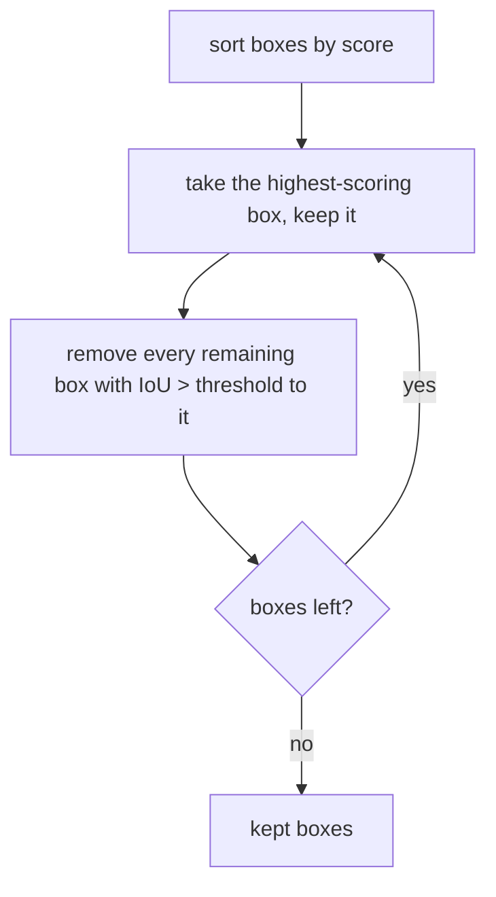

# Detection and Segmentation Intuition

> Classification asks "what?". Detection asks "what, and where?". Segmentation asks "what, at every pixel?".

**Type:** Build
**Languages:** Python
**Prerequisites:** Phase 02 (Training Deep Nets), Residual Networks, Visualizing Features and Receptive Fields
**Time:** ~75 minutes

## Learning Objectives

- Turn a CNN into a single-stage, grid-based object detector that predicts objectness, a box and a class per cell
- Implement intersection over union and non-maximum suppression by hand and match `torchvision.ops`
- Evaluate a detector with precision and recall at an IoU threshold
- Build a tiny U-Net for semantic segmentation and evaluate it with pixel accuracy and mean IoU

## The Problem

Every CNN so far produced one label per image. Real images contain several objects, and many applications need to know where they are: a self-driving car must know where the pedestrian is, not only that there is one; a medical model must outline the tumor, not only flag the scan.

Two task families answer this. **Object detection** outputs a list of boxes, each with a class and a confidence. **Semantic segmentation** outputs a class for every pixel. Production systems (Faster R-CNN, YOLO, DETR, Mask R-CNN, U-Net, DeepLab) are large and full of engineering, but their core ideas fit in a page. In this lesson you build tiny versions of both on synthetic scenes made from digits, so you can train them in seconds and see every moving part.

## The Concept

### The dataset

Each scene is a 32x32 canvas with one to three digits (resized to 10-14 pixels) placed at random, non-overlapping positions. For each scene you know the boxes `(x1, y1, x2, y2)`, the classes, and a per-pixel mask (0 for background, `digit + 1` for digit pixels).

### Detection as dense prediction on a grid

A CNN already produces a grid of feature vectors: after three 2x2 pools a 32x32 image becomes a 4x4 grid, and each cell's feature has a receptive field covering a large part of the image. The YOLO idea is to let **each cell predict the object whose center falls inside it**:

```
32x32 image, 4x4 grid of 8x8 cells          each cell predicts 15 numbers
+----+----+----+----+
|    |    |    |    |                        [objectness logit,
+----+----+----+----+                         x offset in cell, y offset in cell,
|    | 7* |    |    |   * = object center      width / 32, height / 32,
+----+----+----+----+                         10 class logits]
|    |    |    | 3* |
+----+----+----+----+
|    |    |    |    |
+----+----+----+----+
```

The head is a 1x1 convolution with `5 + 10` output channels on top of the backbone, so the whole detector is fully convolutional. The loss has three parts:

```
loss = BCE(objectness, has_object)                      over all cells
     + 5 * MSE(box params, target box params)           over cells with an object
     + CE(class logits, target class)                   over cells with an object
```

### Intersection over union

To judge a predicted box against a true box you use IoU:

```
IoU(A, B) = area(A intersect B) / area(A union B)
          = inter / (area_A + area_B - inter)
```

1 means a perfect match, 0 means no overlap. A detection usually counts as correct when IoU >= 0.5 and the class matches.

### Non-maximum suppression

A detector often fires several times on the same object (neighboring cells, or several anchors). NMS keeps only the best one:



### Precision and recall

- **Precision**: of the boxes you predicted, how many are correct?
- **Recall**: of the true objects, how many did you find?

Lowering the score threshold raises recall and lowers precision. Sweeping it gives a precision-recall curve, and the area under it, averaged over classes, is the **mean average precision (mAP)** used in detection benchmarks.

### Segmentation with an encoder-decoder

Segmentation needs a full-resolution output, but CNNs downsample to see context. A **U-Net** does both: an encoder shrinks the image while increasing channels, a decoder upsamples back with transposed convolutions, and **skip connections** concatenate encoder features into the decoder so fine spatial detail is not lost.

```
32x32x1 -> enc1 32x32x16 ------------------------------> concat -> dec1 32x32x16 -> 1x1 conv -> 32x32x11
              | pool                                        ^ up
              v                                             |
           enc2 16x16x32 ----------------> concat -> dec2 16x16x32
              | pool                          ^ up
              v                               |
           bottleneck 8x8x64 -----------------+
```

The loss is ordinary cross-entropy applied at every pixel. Because most pixels are background, **pixel accuracy** is misleading (predicting all background already scores about 89% here). **Mean IoU** computes IoU per class over all pixels and averages, so every class counts equally.

## Build It

### Step 1: Encode boxes into grid targets

```python
def encode_grid_targets(scenes):
    targets = torch.zeros(len(scenes), GRID, GRID, 6)
    for index, objects in enumerate(scenes):
        for box, label in objects:
            center_x = (box[0] + box[2]) / 2
            center_y = (box[1] + box[3]) / 2
            col, row = int(center_x // CELL), int(center_y // CELL)
            targets[index, row, col] = torch.tensor([
                1.0, center_x / CELL - col, center_y / CELL - row,
                (box[2] - box[0]) / CANVAS, (box[3] - box[1]) / CANVAS, float(label)])
    return targets
```

All box parameters are in `[0, 1]`, so the network predicts them through a sigmoid.

### Step 2: The detector and its loss

```python
class GridDetector(nn.Module):
    def __init__(self):
        super().__init__()
        self.backbone = nn.Sequential(
            nn.Conv2d(1, 16, 3, padding=1), nn.BatchNorm2d(16), nn.ReLU(), nn.MaxPool2d(2),
            nn.Conv2d(16, 32, 3, padding=1), nn.BatchNorm2d(32), nn.ReLU(), nn.MaxPool2d(2),
            nn.Conv2d(32, 64, 3, padding=1), nn.BatchNorm2d(64), nn.ReLU(), nn.MaxPool2d(2),
            nn.Conv2d(64, 64, 3, padding=1), nn.BatchNorm2d(64), nn.ReLU(),
        )
        self.head = nn.Conv2d(64, 5 + NUM_CLASSES, 1)

    def forward(self, images):
        return self.head(self.backbone(images)).permute(0, 2, 3, 1)


def detection_loss(predictions, targets):
    objectness = targets[..., 0]
    has_object = objectness > 0
    object_loss = F.binary_cross_entropy_with_logits(predictions[..., 0], objectness)
    box_loss = F.mse_loss(torch.sigmoid(predictions[..., 1:5][has_object]), targets[..., 1:5][has_object])
    class_loss = F.cross_entropy(predictions[..., 5:][has_object], targets[..., 5][has_object].long())
    return object_loss + 5.0 * box_loss + class_loss
```

The receptive field of the last layer (38 pixels by the formula from the VGG lesson) covers the whole 32x32 canvas, so every cell can see its object completely.

### Step 3: Decode, IoU and NMS

Decoding inverts the encoding: cell index plus sigmoid offset gives the center, sigmoid times 32 gives the size, and the score is `sigmoid(objectness) * max class probability`. IoU and NMS are short:

```python
def iou_matrix(boxes_a, boxes_b):
    top_left = torch.maximum(boxes_a[:, None, :2], boxes_b[None, :, :2])
    bottom_right = torch.minimum(boxes_a[:, None, 2:], boxes_b[None, :, 2:])
    intersection = (bottom_right - top_left).clamp(min=0).prod(dim=-1)
    area_a = (boxes_a[:, 2:] - boxes_a[:, :2]).prod(dim=-1)
    area_b = (boxes_b[:, 2:] - boxes_b[:, :2]).prod(dim=-1)
    return intersection / (area_a[:, None] + area_b[None, :] - intersection)


def non_max_suppression(boxes, scores, iou_threshold):
    order = scores.argsort(descending=True)
    keep = []
    while len(order) > 0:
        best = order[0]
        keep.append(best.item())
        if len(order) == 1:
            break
        overlaps = iou_matrix(boxes[best][None], boxes[order[1:]])[0]
        order = order[1:][overlaps <= iou_threshold]
    return torch.tensor(keep, dtype=torch.long)
```

The `clamp(min=0)` handles boxes that do not overlap: a negative width means zero intersection.

### Step 4: Train and evaluate the detector

After 20 epochs on 2,500 scenes:

```
Test precision 0.948, recall 0.919 at IoU >= 0.5, mean IoU of hits 0.835
Score threshold 0.05: 1143 boxes, precision 0.816, recall 0.956
  after your NMS (IoU 0.3): 976 boxes, precision 0.954, recall 0.954 (matches torchvision.ops.nms on all 500 images)
```

At the default threshold of 0.5 the detector finds about 92% of the digits with 95% precision. Dropping the threshold to 0.05 finds more objects but adds duplicates and false positives; NMS removes most of the duplicates (neighboring cells firing on the same digit) and recovers the precision while keeping the higher recall. Your NMS keeps exactly the same boxes as `torchvision.ops.nms`.

### Step 5: A tiny U-Net

```python
class TinyUNet(nn.Module):
    def __init__(self, num_outputs=NUM_CLASSES + 1):
        super().__init__()
        self.encode1 = nn.Sequential(nn.Conv2d(1, 16, 3, padding=1), nn.BatchNorm2d(16), nn.ReLU())
        self.encode2 = nn.Sequential(nn.Conv2d(16, 32, 3, padding=1), nn.BatchNorm2d(32), nn.ReLU())
        self.bottleneck = nn.Sequential(nn.Conv2d(32, 64, 3, padding=1), nn.BatchNorm2d(64), nn.ReLU(),
                                        nn.Conv2d(64, 64, 3, padding=1), nn.BatchNorm2d(64), nn.ReLU())
        self.up2 = nn.ConvTranspose2d(64, 32, 2, stride=2)
        self.decode2 = nn.Sequential(nn.Conv2d(64, 32, 3, padding=1), nn.BatchNorm2d(32), nn.ReLU())
        self.up1 = nn.ConvTranspose2d(32, 16, 2, stride=2)
        self.decode1 = nn.Sequential(nn.Conv2d(32, 16, 3, padding=1), nn.BatchNorm2d(16), nn.ReLU())
        self.classify = nn.Conv2d(16, num_outputs, 1)

    def forward(self, images):
        skip1 = self.encode1(images)
        skip2 = self.encode2(F.max_pool2d(skip1, 2))
        x = self.bottleneck(F.max_pool2d(skip2, 2))
        x = self.decode2(torch.cat([self.up2(x), skip2], dim=1))
        x = self.decode1(torch.cat([self.up1(x), skip1], dim=1))
        return self.classify(x)
```

`nn.ConvTranspose2d(c_in, c_out, 2, stride=2)` doubles the resolution with learned weights. `F.cross_entropy` accepts logits of shape `(N, C, H, W)` and targets of shape `(N, H, W)` directly. After 10 epochs:

```
Test pixel accuracy 0.984 (all-background baseline 0.889), mIoU 0.800
```

`detection_segmentation.png` shows detections (boxes with class and score) and the predicted segmentation masks for four test scenes.

## Use It

`torchvision.ops` has the building blocks you just wrote: `box_iou`, `nms`, `batched_nms` (per-class NMS), `generalized_box_iou_loss`, and `roi_align`. The script checks that `iou_matrix` and `non_max_suppression` agree with them exactly.

`torchvision.models.detection` contains full detectors. With `weights=None, weights_backbone=None` nothing is downloaded:

```python
from torchvision.models.detection import fasterrcnn_mobilenet_v3_large_fpn

detector = fasterrcnn_mobilenet_v3_large_fpn(weights=None, weights_backbone=None, num_classes=11)
detector.eval()
outputs = detector([image_3x32x32])
```

It takes a list of images and returns, per image, a dict with `boxes`, `labels` and `scores`. Its 19 million parameters do the same job as your 61,551, with a two-stage design (a region proposal network, then per-region classification) and feature pyramids for objects of many sizes. For segmentation, `torchvision.models.segmentation` offers FCN, DeepLabV3 and LRASPP with the same `weights=None` convention.

## Exercises

1. **Easy.** Change the IoU threshold for counting a detection as correct from 0.5 to 0.75. How much do precision and recall drop? What does that say about the box quality?
2. **Medium.** Implement per-class NMS (run NMS separately for each predicted class) and average precision for one class: sort detections by score, compute precision and recall after each one, and integrate the precision-recall curve. Compute mAP over the ten digits.
3. **Hard.** Make two digits overlap often (allow their boxes to intersect). How does the one-object-per-cell grid design fail? Fix it by letting each cell predict two boxes (as in YOLOv1) and assigning each target to the predictor whose box has the higher IoU.

## Key Terms

| Term | What people say | What it actually means |
|------|----------------|----------------------|
| Object detection | "Finding objects" | Predicting a set of boxes, each with a class label and a confidence score |
| Single-stage detector | "YOLO-style" | A detector that predicts boxes densely from a feature grid in one pass, without a separate proposal step |
| Objectness | "Is there something here?" | The predicted probability that a cell or anchor contains an object |
| IoU | "Overlap" | Intersection area divided by union area of two boxes (or masks), between 0 and 1 |
| NMS | "Removing duplicates" | Greedily keeping the highest-scoring box and discarding others that overlap it above a threshold |
| Precision / recall | "Accuracy for detection" | Fraction of predicted boxes that are correct / fraction of true objects that were found |
| mAP | "The detection score" | Mean over classes of the area under the precision-recall curve, at one or several IoU thresholds |
| Semantic segmentation | "Pixel classification" | Assigning a class to every pixel of an image |
| U-Net | "Encoder-decoder with skips" | A segmentation network that downsamples, upsamples, and concatenates encoder features into the decoder |
| Transposed convolution | "Deconvolution" | A learned upsampling layer; with kernel 2 and stride 2 it doubles the resolution |

## Further Reading

- [Redmon et al., You Only Look Once: Unified, Real-Time Object Detection (2015)](https://arxiv.org/abs/1506.02640) -- the grid-based single-stage detector this lesson simplifies
- [Ren et al., Faster R-CNN: Towards Real-Time Object Detection with Region Proposal Networks (2015)](https://arxiv.org/abs/1506.01497) -- the two-stage design behind torchvision's detectors
- [Ronneberger, Fischer and Brox, U-Net: Convolutional Networks for Biomedical Image Segmentation (2015)](https://arxiv.org/abs/1505.04597) -- the encoder-decoder with skip connections
- [Dive into Deep Learning, Chapter 14: Computer Vision](https://d2l.ai/chapter_computer-vision/index.html) -- anchor boxes, NMS, SSD and semantic segmentation implemented step by step
