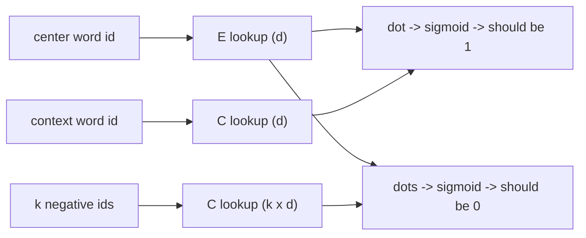

# Word Embeddings

> You shall know a word by the company it keeps. Train a vector to predict its neighbors and meaning falls out.

**Type:** Build
**Languages:** Python
**Prerequisites:** Phase 01 (Neural Networks), Phase 02 (Training Deep Nets)
**Time:** ~50 minutes

## Learning Objectives

- Explain why one-hot vectors carry no notion of similarity and how dense embeddings fix that
- Generate skip-gram training pairs from a corpus with a context window
- Implement skip-gram with negative sampling (word2vec) with plain tensors and train it
- Inspect the learned space with nearest neighbors, group similarities and vector analogies, and connect it to `nn.Embedding`

## The Problem

Neural networks take numbers, and words are symbols. The simplest encoding gives each of the `V` words in the vocabulary its own position: a one-hot vector of length `V` with a single 1. It works, but it says that "king" is exactly as different from "queen" as it is from "bread": every pair of one-hot vectors is orthogonal, cosine similarity 0. A model has to learn from scratch, for every word separately, everything it knows. With a 50,000-word vocabulary the vectors are also huge and almost entirely zeros.

What you want is a short, dense vector per word where similar words are close. Every sequence model in this phase and every language model in Phase 09 starts by looking up such a vector. This lesson shows where those vectors come from: train them to predict which words appear near which other words. That is word2vec (Mikolov et al., 2013), and its core idea, learning representations from context, is the same one that drives modern language models.

## The Concept

### The distributional hypothesis

Words that appear in similar contexts tend to have similar meanings. In "the ___ rides his horse" the blank is probably a person; in "the cat eats ___" it is probably food. If you train a vector for each word so that it predicts its context, words with similar contexts end up with similar vectors.

### Skip-gram

Slide a window over every sentence. Each word is a **center** word; every word within `window` positions of it is a **context** word. Each (center, context) pair is a training example.

```
sentence:  the  king  lives  in  the  palace        window = 2
center "lives" -> context: the, king, in, the
pairs: (lives, the) (lives, king) (lives, in) (lives, the)
```

The model has two embedding tables: `E` for center words and `C` for context words, each `V x d`. The score of a pair is the dot product `E[center] . C[context]`.

### Negative sampling

The original skip-gram used a softmax over the whole vocabulary to predict the context word, which costs `O(V)` per pair. Negative sampling turns it into binary classification: real pairs should score high, and `k` random "negative" words should score low.

```
loss = -log sigmoid(E[w] . C[c]) - sum_{n=1..k} log sigmoid(-E[w] . C[n_k])
```

The negatives are drawn from the unigram distribution raised to the power 0.75, which samples frequent words often but not overwhelmingly so.



### Geometry of the result

After training, cosine similarity between rows of `E` measures how interchangeable two words are in context. Directions can also carry meaning: if gender and royalty are encoded as roughly separate directions, then `king - man + woman` lands near `queen`. That analogy property is real but fragile; it holds only as far as the corpus supports it.

### An embedding layer is a matrix lookup

Multiplying a one-hot vector by a `V x d` matrix selects one row. An embedding layer is exactly that, implemented as an index lookup instead of a wasteful matrix multiply. Its gradient only touches the rows that were looked up.

## Build It

### Step 1: A corpus with structure

No downloads, so the script writes its own corpus from templates: royal people (king, queen, prince, princess) live in palaces and castles, common people (man, woman, boy, girl) live in villages and farms, everyone has a gender reflected in "he/she" and "his/her", and animals and foods appear in their own patterns:

```
the cat sleeps near the throne
the cow eats rice with her girl
the horse eats apple with his prince
```

4,000 sentences give about 28,000 tokens and 39 distinct words.

### Step 2: Skip-gram pairs

```python
def skipgram_pairs(sentences, word_to_index, window):
    centers, contexts = [], []
    for sentence in sentences:
        ids = [word_to_index[w] for w in sentence]
        for position, center in enumerate(ids):
            for offset in range(-window, window + 1):
                neighbor = position + offset
                if offset != 0 and 0 <= neighbor < len(ids):
                    centers.append(center)
                    contexts.append(ids[neighbor])
    return torch.tensor(centers), torch.tensor(contexts)
```

The window size matters. With `window=2`, "palace" in "the king lives in the palace" is four positions away from "king" and never pairs with it, so the model cannot learn that palaces go with royals. The script uses `window=4`.

### Step 3: The model and its loss

Two plain tensors with `requires_grad=True`; indexing them with a tensor of ids is the lookup:

```python
class SkipGramNegativeSampling:
    def __init__(self, vocab_size, dim, generator):
        self.center_vectors = (torch.randn(vocab_size, dim, generator=generator) * 0.1).requires_grad_(True)
        self.context_vectors = torch.zeros(vocab_size, dim, requires_grad=True)

    def parameters(self):
        return [self.center_vectors, self.context_vectors]

    def loss(self, centers, contexts, negatives):
        center = self.center_vectors[centers]
        positive = self.context_vectors[contexts]
        negative = self.context_vectors[negatives]
        positive_score = (center * positive).sum(dim=-1)
        negative_score = torch.einsum("bd,bkd->bk", center, negative)
        return -(F.logsigmoid(positive_score) + F.logsigmoid(-negative_score).sum(dim=-1)).mean()
```

`F.logsigmoid` is the numerically stable `log(sigmoid(x))`. Context vectors start at zero, as in the original word2vec code.

### Step 4: Train

Negatives come from `counts ** 0.75`, normalized, sampled with `torch.multinomial`. Fifteen epochs of Adam with batches of 512 pairs and 5 negatives per pair take a few seconds.

### Step 5: Inspect the space

```
king     -> prince (1.00), man (0.78), boy (0.76)
girl     -> woman (1.00), queen (0.76), princess (0.75)
cat      -> dog (1.00), cow (1.00), sheep (1.00)
bread    -> apple (0.99), rice (0.99), soup (0.98)
palace   -> throne (1.00), castle (0.99), village (0.60)
```

Average cosine similarity between groups:

```
                 royal  common animals foods
royal people     0.84   0.60   0.50   0.11
common people    0.60   0.83   0.52   0.11
animals          0.50   0.52   1.00   0.04
foods            0.11   0.11   0.04   0.99
```

Animals and foods are tight clusters. People split into royal and common, and within each group by gender. Analogies:

```
king - man + woman = princess (1.00)
princess - girl + boy = king (0.99)
queen - king + prince = princess (0.99)
```

The arithmetic works: it moves along the gender direction while staying royal. The answer is "princess" rather than "queen" because the corpus never distinguishes a king from a prince. They appear in exactly the same templates, so their vectors are identical (similarity 1.00). Embeddings can only encode distinctions that exist in the data.

## Use It

`nn.Embedding(num_embeddings, embedding_dim)` is the lookup table you built, as a module:

```python
layer = nn.Embedding(len(words), 16)
vectors = layer(torch.tensor([3, 17]))
```

The script copies the trained vectors into an `nn.Embedding` and confirms that `layer(ids)` equals `one_hot(ids) @ layer.weight`. In modern networks you rarely pretrain embeddings with word2vec: the embedding layer is simply the first layer of the model and is trained end to end with everything else (every RNN and transformer in the next lessons does this). Pretrained vectors such as word2vec, GloVe or fastText are still useful as features for small models, and `nn.Embedding.from_pretrained(tensor, freeze=True)` loads them. For very large vocabularies, `nn.Embedding(..., sparse=True)` produces sparse gradients that only update the rows used in a batch.

## Exercises

1. **Easy.** Change the window back to 2 and retrain. Print the group similarity table. What happens to the separation between royal and common people, and why?
2. **Medium.** Implement the count-based alternative: build the `V x V` co-occurrence matrix with the same window, convert it to positive pointwise mutual information (PPMI), and take the top 16 singular vectors with `torch.linalg.svd`. Compare nearest neighbors with skip-gram.
3. **Hard.** Add templates that distinguish age (for example "the young prince plays", "the old king rests") so that king and prince differ. Retrain and test whether `king - man + woman` now returns "queen". How many sentences of the new templates do you need?

## Key Terms

| Term | What people say | What it actually means |
|------|----------------|----------------------|
| One-hot encoding | "Words as indices" | A `V`-dimensional vector with a single 1; all pairs are orthogonal, so it encodes no similarity |
| Word embedding | "Word vector" | A dense, learned `d`-dimensional vector per word, with `d` much smaller than `V` |
| Distributional hypothesis | "Context is meaning" | Words that occur in similar contexts tend to have similar meanings |
| Skip-gram | "word2vec" | Training word vectors to predict the words within a window around each center word |
| Negative sampling | "Fake pairs" | Replacing the full softmax with a binary task: real (center, context) pairs vs `k` random words |
| Cosine similarity | "How close two words are" | `a . b / (||a|| ||b||)`, the cosine of the angle between two vectors |
| Embedding layer | "Lookup table" | A trainable `V x d` matrix indexed by token ids; equivalent to multiplying by one-hot vectors |

## Further Reading

- [Mikolov et al., Efficient Estimation of Word Representations in Vector Space (2013)](https://arxiv.org/abs/1301.3781) -- the skip-gram and CBOW models
- [Mikolov et al., Distributed Representations of Words and Phrases and their Compositionality (2013)](https://arxiv.org/abs/1310.4546) -- negative sampling, subsampling and the 0.75 noise exponent
- [Levy and Goldberg, Neural Word Embedding as Implicit Matrix Factorization (2014)](https://papers.nips.cc/paper/2014/hash/feab05aa91085b7a8012516bc3533958-Abstract.html) -- why skip-gram with negative sampling is factorizing a PMI matrix
- [Dive into Deep Learning, Section 15.1: Word Embedding (word2vec)](https://d2l.ai/chapter_natural-language-processing-pretraining/word2vec.html) -- derivations of skip-gram and its training
