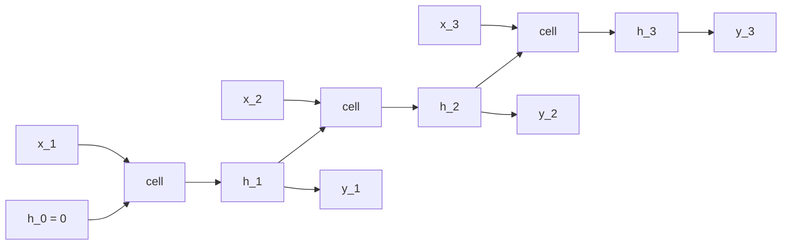

# RNN from Scratch

> One cell, one set of weights, applied at every step. The hidden state is the only thing that remembers.

**Type:** Build
**Languages:** Python
**Prerequisites:** Phase 02 (Training Deep Nets), Word Embeddings
**Time:** ~50 minutes

## Learning Objectives

- Write the recurrence `h_t = tanh(x_t W_xh + h_{t-1} W_hh + b)` and unroll it over a sequence
- Train a character-level language model with truncated sequences, cross-entropy at every step and gradient clipping
- Generate text autoregressively and control it with sampling temperature
- Map your weights onto `nn.RNN` and reproduce its outputs exactly

## The Problem

An MLP or a CNN takes an input of fixed size. Text, audio, sensor streams and time series do not have a fixed size, and the order of their elements matters: "dog bites man" and "man bites dog" have the same words. You could pad everything to a maximum length and feed it to an MLP, but then the network would need separate weights for "a word at position 3" and "a word at position 4", and it could never handle a longer input.

A recurrent neural network solves this the same way a CNN solved images: by sharing weights. Instead of sharing a kernel across space, it shares one cell across time. The cell reads one element and updates a fixed-size **hidden state** that summarizes everything seen so far. Before transformers (Phase 05), RNNs and their gated variants were the standard model for language, speech and translation, and the way they generate text one token at a time is exactly how GPT generates text today.

## The Concept

### The recurrence

At each time step `t` the cell combines the current input `x_t` and the previous hidden state `h_{t-1}`:

```
h_t = tanh(x_t W_xh + h_{t-1} W_hh + b_h)
y_t = h_t W_hy + b_y
```

`W_xh`, `W_hh`, `W_hy` and the biases are the same at every step. The number of parameters does not depend on the sequence length.

### Unrolling

You can draw an RNN as a loop, or unroll it into a deep feedforward network with one layer per time step and tied weights:



Training an RNN means backpropagating through this unrolled graph. That is called backpropagation through time, and the next lesson does it by hand.

### Character-level language modeling

The task: given the characters so far, predict the next one. Input `"the mil"`, targets `"he mill"`, shifted by one. The loss is cross-entropy at every position:

```
inputs:   t  h  e  _  m  i  l
targets:  h  e  _  m  i  l  l
```

A model that knows nothing predicts the uniform distribution over the vocabulary, with loss `ln(V)`. For 24 characters that is 3.178.

### Generation and temperature

To generate, feed a prompt, take the distribution over the next character, sample one, feed it back as the next input, and repeat. This is **autoregressive** generation. Dividing the logits by a **temperature** `T` before the softmax controls randomness:

```
p_i = exp(z_i / T) / sum_j exp(z_j / T)
T -> 0: always the most likely character (greedy)
T = 1:  the model's own distribution
T > 1:  flatter, more random
```

### Truncated sequences and clipping

You do not backpropagate through the entire text at once. Each training example is a random window of 48 characters starting from a zero hidden state. Because gradients pass through the same `W_hh` many times, they can grow very large; clipping the total gradient norm to 1.0 keeps a single bad batch from wrecking the weights.

## Build It

### Step 1: A tiny text and a character vocabulary

The text is ten original sentences about a river and a mill (741 characters, 24 distinct characters). `CharVocabulary` maps characters to ids and back.

### Step 2: The cell

```python
class ScratchRNN:
    def __init__(self, vocab_size, hidden_size, generator):
        scale_x = 1.0 / math.sqrt(vocab_size)
        scale_h = 1.0 / math.sqrt(hidden_size)
        self.W_xh = (torch.randn(vocab_size, hidden_size, generator=generator) * scale_x).requires_grad_(True)
        self.W_hh = (torch.randn(hidden_size, hidden_size, generator=generator) * scale_h).requires_grad_(True)
        self.b_h = torch.zeros(hidden_size, requires_grad=True)
        self.W_hy = (torch.randn(hidden_size, vocab_size, generator=generator) * scale_h).requires_grad_(True)
        self.b_y = torch.zeros(vocab_size, requires_grad=True)
        self.hidden_size = hidden_size

    def step(self, x_t, h):
        return torch.tanh(x_t @ self.W_xh + h @ self.W_hh + self.b_h)
```

The `1/sqrt(fan_in)` scaling keeps pre-activations around unit variance so `tanh` does not start saturated.

### Step 3: Unroll over a batch

```python
    def forward(self, inputs, h):
        batch, steps = inputs.shape
        x = F.one_hot(inputs, self.W_xh.shape[0]).float()
        hidden_states = []
        for t in range(steps):
            h = self.step(x[:, t], h)
            hidden_states.append(h)
        hidden = torch.stack(hidden_states, dim=1)
        return hidden @ self.W_hy + self.b_y, h
```

The time loop is sequential (step `t` needs `h_{t-1}`), but the batch dimension is processed in parallel. The output projection runs once on all stacked hidden states.

### Step 4: Train

```python
for step in range(1, 1201):
    inputs, targets = sample_batch(data, 32, 48, generator)
    logits, _ = model.forward(inputs, model.initial_state(32))
    loss = F.cross_entropy(logits.reshape(-1, logits.shape[-1]), targets.reshape(-1))
    optimizer.zero_grad()
    loss.backward()
    torch.nn.utils.clip_grad_norm_(model.parameters(), 1.0)
    optimizer.step()
```

Autograd builds the unrolled graph during the forward loop and backpropagates through all 48 steps. The loss drops from about 3.18 to about 0.10:

```
step  200  loss 0.188
  sample: 'the stones under it are round and smooth. in the evening the miller sttres cheer ai '
step 1200  loss 0.100
  sample: 'the old mill has stood by the river for a hundred years and it will stand for a hund'
```

A 22,680-parameter model has essentially memorized a 741-character text. That is expected (there is nothing else to learn from so little data) and still instructive: to reproduce a sentence the hidden state has to carry where it is in the sentence across dozens of characters.

### Step 5: Temperature

```
Temperature 0.3:
  the miller smiles and the children run to the river to watch the water. the old mill has stood by ...
Temperature 1.0:
  the miller walks to the river every morning and listens to the water. the water is cold and clear ...
Temperature 1.5:
  the miller walks to the river every morning and lilte a toteh. whe rlder sndrs and willstund the ...
```

Low temperature reproduces the most likely continuation. High temperature makes rare characters likely enough to be chosen, and once a wrong character is sampled, the model is in a context it never saw and errors snowball.

## Use It

`nn.RNN` implements the same cell with fused, optimized kernels:

```python
library_rnn = nn.RNN(vocab_size, 128, batch_first=True, nonlinearity="tanh")
library_rnn.weight_ih_l0.copy_(model.W_xh.T)
library_rnn.weight_hh_l0.copy_(model.W_hh.T)
library_rnn.bias_ih_l0.copy_(model.b_h)
library_rnn.bias_hh_l0.zero_()
outputs, h_n = library_rnn(one_hot_inputs)
```

Three details to remember. PyTorch stores weights as `(out, in)`, so yours must be transposed. It has two bias vectors (`b_ih` and `b_hh`) that are simply added, so setting one to zero reproduces a single bias. And it returns two things: `outputs` with the hidden state at every step `(batch, steps, hidden)`, and `h_n` with only the last one `(num_layers, batch, hidden)`. The script confirms the hidden states match yours to about `1e-6`. In practice you would also replace the one-hot input with an `nn.Embedding`, which is the same computation done more efficiently.

## Exercises

1. **Easy.** Train with hidden sizes 16, 32 and 128. At what size does the model stop being able to memorize the text? Compare parameter counts.
2. **Medium.** Instead of resetting the hidden state for every batch, train on consecutive windows and carry `h` from one window to the next, calling `h.detach()` between them (truncated backpropagation through time). Does the model learn faster?
3. **Hard.** Hold out the last two sentences as a validation set and write a longer original training text (or concatenate several of your own paragraphs). Track training and validation loss and find the point where the RNN starts to overfit. Add dropout on the hidden-to-output path and see whether it helps.

## Key Terms

| Term | What people say | What it actually means |
|------|----------------|----------------------|
| Recurrent neural network | "A network with memory" | A cell applied at every time step with shared weights, passing a hidden state from one step to the next |
| Hidden state | "The memory" | A fixed-size vector `h_t` that is the network's only summary of the inputs up to step `t` |
| Unrolling | "Flattening the loop" | Viewing the RNN over `T` steps as a `T`-layer feedforward network with tied weights |
| Language model | "Predicts the next word" | A model of `p(next token | previous tokens)`, trained with cross-entropy on shifted sequences |
| Autoregressive generation | "Feeding outputs back in" | Sampling one token, appending it to the input, and repeating |
| Temperature | "Creativity knob" | Dividing logits by `T` before softmax: low `T` sharpens the distribution, high `T` flattens it |
| Gradient clipping | "Capping the gradient" | Rescaling all gradients when their total norm exceeds a threshold, to prevent explosive updates |

## Further Reading

- [Karpathy, The Unreasonable Effectiveness of Recurrent Neural Networks (2015)](https://karpathy.github.io/2015/05/21/rnn-effectiveness/) -- character-level RNNs generating code, math and Shakespeare, plus the min-char-rnn script
- [Elman, Finding Structure in Time (1990)](https://onlinelibrary.wiley.com/doi/10.1207/s15516709cog1402_1) -- the simple recurrent network this lesson implements
- [Dive into Deep Learning, Chapter 9: Recurrent Neural Networks](https://d2l.ai/chapter_recurrent-neural-networks/index.html) -- language models, RNNs from scratch and gradient clipping
- [PyTorch docs: torch.nn.RNN](https://pytorch.org/docs/stable/generated/torch.nn.RNN.html) -- the exact equations and weight layout
