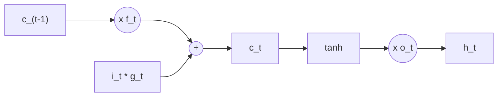

# LSTM and GRU

> Give memory its own lane, and let learned gates decide what to write, what to keep and what to read.

**Type:** Build
**Languages:** Python
**Prerequisites:** RNN from Scratch, Backprop Through Time and Vanishing Gradients
**Time:** ~60 minutes

## Learning Objectives

- Write the LSTM equations (input, forget and output gates, candidate, cell state) and the GRU equations (reset and update gates) as tensor code
- Explain why the additive cell-state update lets gradients survive many more steps than a vanilla RNN
- Reproduce `nn.LSTM` and `nn.GRU` outputs exactly by mapping your weights onto PyTorch's gate layout
- Show that gate bias initialization (forget bias for LSTM, update bias for GRU) decides whether long dependencies can be learned at all

## The Problem

The previous lesson showed that a vanilla RNN multiplies its gradient by `diag(1 - h^2) W_hh^T` at every step, so the signal from 40 steps back is effectively zero. The problem is structural: the only way information can survive in the hidden state is to be pushed through a matrix and a squashing nonlinearity at every step.

Hochreiter and Schmidhuber's answer (1997) was the Long Short-Term Memory: add a second state, the **cell**, that is updated by addition instead of matrix multiplication, and control it with **gates**, small sigmoid layers that output numbers between 0 and 1. If the forget gate is 1 and the input gate is 0, the cell carries its content forward unchanged, and so does the gradient. LSTMs powered speech recognition, machine translation and handwriting recognition for two decades. The GRU (Cho et al., 2014) is a simpler variant with two gates and no separate cell, and it often works just as well.

## The Concept

### The LSTM cell

```
i_t = sigmoid(x_t W_xi + h_{t-1} W_hi + b_i)        input gate: how much to write
f_t = sigmoid(x_t W_xf + h_{t-1} W_hf + b_f)        forget gate: how much to keep
g_t = tanh(x_t W_xg + h_{t-1} W_hg + b_g)           candidate: what to write
o_t = sigmoid(x_t W_xo + h_{t-1} W_ho + b_o)        output gate: how much to read

c_t = f_t * c_{t-1} + i_t * g_t                      cell state: additive update
h_t = o_t * tanh(c_t)                                hidden state: what the rest of the network sees
```



All four pre-activations come from the same `[x_t, h_{t-1}]`, so in code you compute them with one matrix multiply into `4 * hidden` columns and split.

### Why the gradient survives

The gradient along the cell path is

```
dc_t / dc_{t-1} = diag(f_t)
```

No weight matrix, no tanh derivative: just the forget gate. If the network keeps `f_t` close to 1, the gradient flows back through hundreds of steps almost unchanged. This is the "constant error carousel" of the original paper, and it is the same idea as the residual connection in ResNets, applied across time instead of depth.

### The GRU cell

```
r_t = sigmoid(x_t W_xr + b_xr + h_{t-1} W_hr + b_hr)        reset gate
z_t = sigmoid(x_t W_xz + b_xz + h_{t-1} W_hz + b_hz)        update gate
n_t = tanh(x_t W_xn + b_xn + r_t * (h_{t-1} W_hn + b_hn))   candidate
h_t = (1 - z_t) * n_t + z_t * h_{t-1}
```

The update gate interpolates between keeping the old state (`z = 1`) and replacing it with the candidate (`z = 0`). There is no separate cell and no output gate. Three blocks of weights instead of four make it about 25% smaller than an LSTM of the same width.

### Gate biases decide the starting memory

With biases near 0, every sigmoid gate starts at about 0.5. Then the LSTM cell keeps about half of its content per step, and after 30 steps `0.5^30 = 1e-9` of it is left: no better than a vanilla RNN. Two standard fixes:

- **LSTM forget bias.** Initialize `b_f` to 1 or more, so `f` starts near `sigmoid(1) = 0.73` or `sigmoid(3) = 0.95`. Jozefowicz et al. (2015) found a forget bias of 1 helps on almost every task.
- **GRU update bias.** Same idea: a positive bias on `z` makes the cell start by copying its state forward.

| initial gate value | fraction kept after 30 steps | after 80 steps |
|--------------------|------------------------------|----------------|
| 0.50 (bias 0) | 1e-9 | 1e-24 |
| 0.73 (bias 1) | 8e-5 | 1e-11 |
| 0.95 (bias 3) | 0.21 | 0.017 |

## Build It

### Step 1: LSTM cell

```python
class LSTMCell(nn.Module):
    def __init__(self, input_size, hidden_size, forget_bias=1.0):
        super().__init__()
        bound = 1.0 / math.sqrt(hidden_size)
        self.W_x = uniform_parameter(input_size, 4 * hidden_size, bound=bound)
        self.W_h = uniform_parameter(hidden_size, 4 * hidden_size, bound=bound)
        self.b = uniform_parameter(4 * hidden_size, bound=bound)
        with torch.no_grad():
            self.b[hidden_size:2 * hidden_size] += forget_bias
        self.hidden_size = hidden_size

    def forward(self, x, state):
        h, c = state
        gates = x @ self.W_x + h @ self.W_h + self.b
        input_gate, forget_gate, candidate, output_gate = gates.chunk(4, dim=1)
        input_gate = torch.sigmoid(input_gate)
        forget_gate = torch.sigmoid(forget_gate)
        candidate = torch.tanh(candidate)
        output_gate = torch.sigmoid(output_gate)
        c = forget_gate * c + input_gate * candidate
        h = output_gate * torch.tanh(c)
        return h, c
```

The order of the four chunks (input, forget, candidate, output) is the order PyTorch uses, which makes the comparison in Step 3 a direct copy.

### Step 2: GRU cell

```python
class GRUCell(nn.Module):
    def forward(self, x, h):
        x_reset, x_update, x_new = (x @ self.W_x + self.b_x).chunk(3, dim=1)
        h_reset, h_update, h_new = (h @ self.W_h + self.b_h).chunk(3, dim=1)
        reset = torch.sigmoid(x_reset + h_reset)
        update = torch.sigmoid(x_update + h_update)
        candidate = torch.tanh(x_new + reset * h_new)
        return (1 - update) * candidate + update * h
```

The GRU needs separate input and hidden biases: the reset gate multiplies `h_{t-1} W_hn + b_hn` but not `x_t W_xn + b_xn`, so the two cannot be merged.

### Step 3: Match PyTorch

Copy the weights (transposed, since PyTorch stores `(out, in)`) into `nn.LSTM` and `nn.GRU` and run 7 steps:

```
LSTM hidden states max diff 6.0e-08, final cell state max diff 1.2e-07
GRU hidden states max diff  8.9e-08
```

Parameter counts for input 8 and hidden 32: RNN 1,312, GRU 4,032, LSTM 5,248.

### Step 4: Does the gradient reach the start?

The same memory task as last lesson: remember the first of four symbols across `delay` noise symbols. At initialization, the ratio between the gradient at the first input and at the last input:

```
model           delay 30  delay 80
RNN              3.7e-08   1.5e-19
GRU z-bias 0     1.0e-06   3.0e-15
GRU z-bias 3     2.5e-01   2.9e-02
LSTM f-bias 1    5.2e-03   2.2e-06
LSTM f-bias 3    7.3e-01   1.0e+00
```

The gates help only when they start in "remember" mode. A GRU with update bias 0 is barely better than a vanilla RNN; with bias 3 it passes a quarter of the gradient across 30 steps. The LSTM with forget bias 3 passes essentially all of it, even across 80.

### Step 5: Train on a 60-step dependency

Each model trains for 400 Adam steps with clipping, using your hand-written cells and a Python loop over time:

```
model           accuracy
RNN                0.235
GRU z-bias 0       0.251
GRU z-bias 3       1.000
LSTM f-bias 1      0.246
LSTM f-bias 3      1.000
```

The ranking follows the gradient table exactly. The architecture makes long memory possible; the initialization decides whether training can find it within a reasonable budget.

## Use It

```python
lstm = nn.LSTM(input_size, hidden_size, num_layers=2, batch_first=True, dropout=0.1)
output, (h_n, c_n) = lstm(x)

gru = nn.GRU(input_size, hidden_size, batch_first=True, bidirectional=True)
output, h_n = gru(x)
```

`output` holds the top layer's hidden state at every step; `h_n` and `c_n` hold the final states of every layer, shape `(num_layers * directions, batch, hidden)`. Stacking layers (`num_layers`) feeds each layer's outputs to the next; `bidirectional=True` runs a second RNN backwards in time and concatenates both, which you will use as an encoder in the attention lesson.

PyTorch initializes all biases uniformly around 0, so its LSTM starts with forget gates at about 0.5. For long dependencies, set the forget bias yourself:

```python
hidden = lstm.hidden_size
for name, parameter in lstm.named_parameters():
    if name.startswith("bias_ih"):
        parameter.data[hidden:2 * hidden].fill_(1.0)
```

The fused library kernels (cuDNN on GPU) are many times faster than a Python loop over a hand-written cell. Write your own cell only when you need to change the equations.

## Exercises

1. **Easy.** Train the LSTM with forget bias 0, 1, 2 and 3 at delay 60 for 400 steps. Plot accuracy against the bias.
2. **Medium.** Log the mean forget gate value over time for a trained LSTM (bias 3) on a test sequence. Does it stay high everywhere, or does the network learn to close the gate at specific moments?
3. **Hard.** Implement a peephole LSTM, where the gates also see the previous cell state (`i_t = sigmoid(... + c_{t-1} * w_ci)`), and a "coupled" LSTM where `i_t = 1 - f_t`. Compare both with the standard LSTM on the memory task and on the character model from RNN from Scratch.

## Key Terms

| Term | What people say | What it actually means |
|------|----------------|----------------------|
| LSTM | "RNN with long memory" | A recurrent cell with an additive cell state controlled by input, forget and output gates |
| Cell state | "The conveyor belt" | `c_t = f_t * c_{t-1} + i_t * g_t`; its gradient is scaled only by the forget gate |
| Gate | "A learned switch" | A sigmoid layer producing values in (0, 1) that multiply another vector elementwise |
| Forget gate | "What to erase" | Fraction of each cell unit kept from the previous step; near 1 means remember |
| GRU | "Simplified LSTM" | A cell with reset and update gates and no separate cell state; about 25% fewer parameters |
| Update gate | "Keep or replace" | `z_t` in the GRU, interpolating between the old state and the new candidate |
| Forget bias | "Initialize to remember" | A positive initial bias on the forget (or update) gate so information and gradients survive early in training |
| Constant error carousel | "Gradient highway in time" | The original LSTM name for the cell path, where gradients flow back without being squashed |

## Further Reading

- [Hochreiter and Schmidhuber, Long Short-Term Memory (1997)](https://www.bioinf.jku.at/publications/older/2604.pdf) -- the original LSTM paper
- [Cho et al., Learning Phrase Representations using RNN Encoder-Decoder for Statistical Machine Translation (2014)](https://arxiv.org/abs/1406.1078) -- introduces the GRU
- [Olah, Understanding LSTM Networks (2015)](https://colah.github.io/posts/2015-08-Understanding-LSTMs/) -- the clearest visual explanation of the gates
- [Jozefowicz, Zaremba and Sutskever, An Empirical Exploration of Recurrent Network Architectures (2015)](https://proceedings.mlr.press/v37/jozefowicz15.html) -- thousands of variants compared, and why a forget bias of 1 matters
