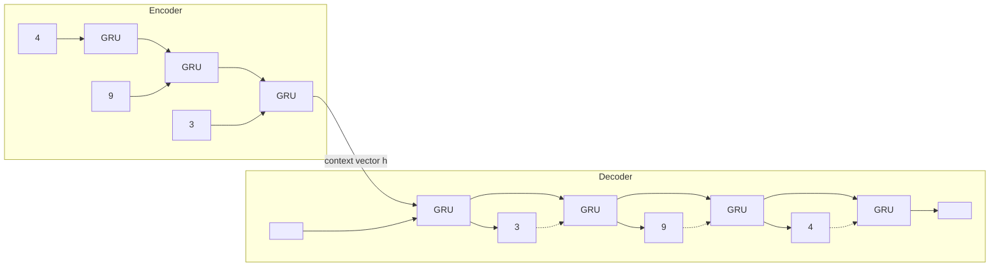

# Seq2Seq

> Read the whole input into one vector, then write the output from that vector, one token at a time.

**Type:** Build
**Languages:** Python
**Prerequisites:** Word Embeddings, RNN from Scratch, LSTM and GRU
**Time:** ~50 minutes

## Learning Objectives

- Build an encoder-decoder model that maps a variable-length input sequence to a variable-length output sequence
- Train it with teacher forcing using `<sos>` and `<eos>` tokens, and decode greedily at test time
- Measure how accuracy depends on sequence length and identify the fixed-size bottleneck as the cause
- Handle batches of sequences with different lengths using padding and `pack_padded_sequence`

## The Problem

The RNNs so far produced either one output per input step (the character model) or one output for the whole sequence (the memory task). Many problems need something else: an output sequence whose length differs from the input. Translation turns a 7-word English sentence into a 9-word French one. Summarization turns 500 words into 50. Speech recognition turns 300 audio frames into 12 characters.

Sutskever, Vinyals and Le (2014) and Cho et al. (2014) proposed the sequence-to-sequence (seq2seq) architecture: one RNN reads the input and compresses it into its final hidden state, and a second RNN generates the output starting from that state. It beat phrase-based translation systems that had been engineered for years, and the encoder-decoder pattern it introduced lives on in the original transformer (Phase 05). It also has a famous weakness, which this lesson exposes and the next lesson fixes.

## The Concept

### Encoder and decoder



- The **encoder** reads the source tokens and returns its last hidden state, the **context vector**.
- The **decoder** is a conditional language model: it starts from the context vector, reads the previous output token, and predicts the next one.
- Special tokens frame the output: `<sos>` (start of sequence) is the first decoder input, and `<eos>` (end of sequence) is the token the decoder must emit to stop.

### The task: reversal

To keep everything small and checkable, the task is to reverse a sequence of digits:

```
encoder input    [4, 9, 3, 0, 3, 9]
decoder input    [<sos>, 9, 3, 0, 3, 9, 4]
decoder target   [9, 3, 0, 3, 9, 4, <eos>]
```

Reversal is hard for a seq2seq model in an instructive way. The first digit to output is the last one read (easy, it is fresh in the state), but the last digit to output is the first one read, which the context vector has to preserve through the entire encoding.

### Teacher forcing

During training the decoder input at each step is the **true** previous token, not the model's own prediction. All decoder steps can then run in one call to the GRU, and errors early in the sequence do not derail learning of later positions. At test time the true tokens are unknown, so the decoder feeds back its own predictions. The mismatch between the two regimes is called **exposure bias**: the model was never trained to recover from its own mistakes.

### Greedy decoding

At test time, start with `<sos>`, take the argmax token at each step, feed it back, and stop at `<eos>` (or a maximum length). Beam search keeps the `k` best partial sequences instead of one; greedy is beam search with `k = 1`.

### The bottleneck

Whatever the input length, the decoder only sees one vector of size 128. A sequence of 4 digits fits easily. A sequence of 20 digits contains `20 * log2(10) = 66` bits of information, and the network must pack them all, in a form the decoder can unpack in reverse order, into the same 128 numbers produced by a GRU that was never pushed to do this for sequences longer than 12.

## Build It

### Step 1: Batches with special tokens

```python
PAD, SOS, EOS = 10, 11, 12
VOCAB_SIZE = 13


def make_batch(batch_size, length, generator, device):
    source = torch.randint(0, 10, (batch_size, length), generator=generator)
    target = source.flip(dims=[1])
    decoder_input = torch.cat([torch.full((batch_size, 1), SOS), target], dim=1)
    decoder_target = torch.cat([target, torch.full((batch_size, 1), EOS)], dim=1)
    return source.to(device), decoder_input.to(device), decoder_target.to(device)
```

Each batch uses one length, chosen at random between 3 and 12, so no padding is needed during training.

### Step 2: Encoder and decoder

```python
class Encoder(nn.Module):
    def __init__(self, embed_size, hidden_size):
        super().__init__()
        self.embed = nn.Embedding(VOCAB_SIZE, embed_size)
        self.rnn = nn.GRU(embed_size, hidden_size, batch_first=True)

    def forward(self, source):
        outputs, last = self.rnn(self.embed(source))
        return outputs, last


class Decoder(nn.Module):
    def __init__(self, embed_size, hidden_size):
        super().__init__()
        self.embed = nn.Embedding(VOCAB_SIZE, embed_size)
        self.rnn = nn.GRU(embed_size, hidden_size, batch_first=True)
        self.out = nn.Linear(hidden_size, VOCAB_SIZE)

    def forward(self, decoder_input, hidden):
        outputs, hidden = self.rnn(self.embed(decoder_input), hidden)
        return self.out(outputs), hidden
```

The encoder and decoder have separate embeddings and weights. The only connection between them is `hidden`.

### Step 3: Teacher-forced training and greedy decoding

```python
class Seq2Seq(nn.Module):
    def forward(self, source, decoder_input):
        _, context = self.encoder(source)
        logits, _ = self.decoder(decoder_input, context)
        return logits

    @torch.no_grad()
    def greedy_decode(self, source, max_length):
        _, hidden = self.encoder(source)
        token = torch.full((source.shape[0], 1), SOS, device=source.device)
        outputs = []
        for _ in range(max_length):
            logits, hidden = self.decoder(token, hidden)
            token = logits.argmax(dim=-1)
            outputs.append(token)
        return torch.cat(outputs, dim=1)
```

Training feeds the whole teacher-forced `decoder_input` at once; decoding runs one step at a time and carries `hidden` forward. The loss is cross-entropy over all output positions including `<eos>`. 2,500 Adam steps take a few seconds on a GPU.

### Step 4: Accuracy versus length

```
length  token acc  exact match
     4      1.000        1.000
     8      0.989        0.952
    12      0.762        0.226
    16      0.418        0.000  (longer than any training sequence)
    20      0.314        0.000  (longer than any training sequence)
```

Exact match (every token and the `<eos>` correct) collapses as sequences get longer, even within the training range. The per-position accuracy at length 12 shows where it fails:

```
1.00 0.97 0.90 0.81 0.73 0.65 0.61 0.66 0.73 0.74 0.72 0.74
```

The first outputs (the last digits read) are nearly perfect. Accuracy then falls toward the middle of the sequence, the part that is neither fresh in the state nor at a distinctive position. That is the bottleneck: one fixed vector cannot hold a long sequence precisely.

## Use It

Real batches contain sequences of different lengths. You pad them to the same length, and tell the RNN where each sequence really ends so it does not process padding:

```python
from torch.nn.utils.rnn import pack_padded_sequence, pad_packed_sequence

padded = nn.utils.rnn.pad_sequence(sequences, batch_first=True, padding_value=PAD)
packed = pack_padded_sequence(embed(padded), lengths, batch_first=True, enforce_sorted=False)
packed_outputs, last = rnn(packed)
outputs, _ = pad_packed_sequence(packed_outputs, batch_first=True)
```

With packing, `last` contains each sequence's state at its true final step, not after the padding. The script checks that the packed final states equal running each sequence alone, and that padded output positions are zeros. For the decoder loss, pass `ignore_index=PAD` to `F.cross_entropy` so padded targets do not count.

PyTorch has no `Seq2Seq` module: the encoder-decoder is a pattern you assemble from `nn.Embedding`, `nn.GRU` or `nn.LSTM` and `nn.Linear`, exactly as here. The one high-level encoder-decoder in `torch.nn` is `nn.Transformer`, which you will meet in Phase 05.

## Exercises

1. **Easy.** Double the hidden size to 256 and retrain. How much does exact match at length 12 improve? Does it help at length 20?
2. **Medium.** Feed the source to the encoder reversed (Sutskever et al. found this helped translation). For the reversal task the target then becomes the source itself in order. Explain why accuracy changes so much, in terms of the distance between each input token and the output token that depends on it.
3. **Hard.** Implement beam search with beam width 3 in `greedy_decode`: keep the 3 best partial outputs by summed log-probability, expand each with all tokens, and keep the top 3. Compare exact match with greedy decoding at length 12.

## Key Terms

| Term | What people say | What it actually means |
|------|----------------|----------------------|
| Seq2seq | "Encoder-decoder" | An encoder RNN that compresses the input and a decoder RNN that generates the output from that compression |
| Context vector | "The thought vector" | The encoder's final hidden state, the only information the decoder receives about the input |
| `<sos>` / `<eos>` | "Start and stop tokens" | Special tokens that start decoding and signal the end of the output |
| Teacher forcing | "Feeding the right answer" | Using the ground-truth previous token as decoder input during training |
| Exposure bias | "Train/test mismatch" | The decoder never sees its own errors during teacher-forced training, so it cannot recover from them at test time |
| Greedy decoding | "Argmax decoding" | Choosing the most likely token at every step and feeding it back |
| Beam search | "Keeping several hypotheses" | Tracking the `k` highest-scoring partial outputs at every step instead of one |
| Packed sequence | "Skipping padding" | A representation that lets an RNN process a padded batch while stopping each sequence at its true length |

## Further Reading

- [Sutskever, Vinyals and Le, Sequence to Sequence Learning with Neural Networks (2014)](https://arxiv.org/abs/1409.3215) -- the LSTM encoder-decoder for translation, including the input-reversal trick
- [Cho et al., Learning Phrase Representations using RNN Encoder-Decoder for Statistical Machine Translation (2014)](https://arxiv.org/abs/1406.1078) -- the GRU encoder-decoder
- [PyTorch tutorial: NLP From Scratch: Translation with a Sequence to Sequence Network and Attention](https://pytorch.org/tutorials/intermediate/seq2seq_translation_tutorial.html) -- a full seq2seq translation model
- [Dive into Deep Learning, Section 10.7: Sequence-to-Sequence Learning](https://d2l.ai/chapter_recurrent-modern/seq2seq.html) -- encoder-decoder, masking and BLEU
