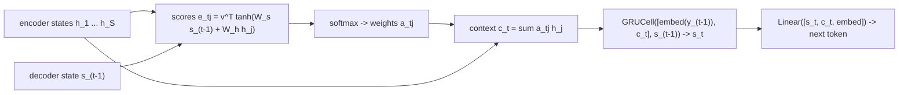

# Attention (Bahdanau)

> Stop compressing the input into one vector. At every output step, look back at all of it and take what you need.

**Type:** Build
**Languages:** Python
**Prerequisites:** LSTM and GRU, Seq2Seq
**Time:** ~60 minutes

## Learning Objectives

- Explain how attention removes the fixed-size bottleneck of seq2seq by giving the decoder a new context vector at every step
- Implement additive (Bahdanau) attention: scores, softmax weights and the weighted sum of encoder states
- Build an attention decoder around `nn.GRUCell` with a bidirectional encoder and compare it with plain seq2seq on long sequences
- Read an attention matrix as an alignment, and connect additive attention to the scaled dot-product attention of transformers

## The Problem

The seq2seq model in the previous lesson reversed 8-digit sequences almost perfectly but got only a quarter of 12-digit sequences exactly right, and the errors piled up in the middle of the output. The cause was structural: the decoder sees the input only through one 128-dimensional vector, however long the input is.

Bahdanau, Cho and Bengio (2014) asked why the decoder should be limited to that one vector when the encoder has already computed a hidden state for every input position. Their model lets the decoder, at each output step, compute a set of weights over all encoder states and use their weighted average as a fresh context. The weights are learned and differentiable, so the network learns where to look. This mechanism, attention, made neural translation work on long sentences, and three years later it became the only mechanism in the transformer.

## The Concept

### A context vector per output step

Let the encoder produce states `h_1, ..., h_S` (one per input token) and let `s_{t-1}` be the decoder state before output step `t`. Attention computes:

```
e_{t,j}  = score(s_{t-1}, h_j)               how relevant is input j now?
a_{t,j}  = softmax_j(e_{t,j})                weights over input positions, sum to 1
c_t      = sum_j a_{t,j} h_j                 context for this step
```

The decoder then uses `c_t` together with the previous token to update its state and predict the next token. Because `c_t` changes at every step, the decoder can read a different part of the input each time.



### Additive scoring

Bahdanau's score is a one-hidden-layer network:

```
score(s, h) = v^T tanh(W_s s + W_h h)
```

`W_h h_j` does not depend on the decoder step, so you compute it once for all input positions and reuse it. Luong et al. (2015) proposed the simpler multiplicative score `s^T W h` (or just `s^T h`), and the transformer uses a scaled version of that: `q . k / sqrt(d)`.

### Bidirectional encoder

If `h_j` came from a left-to-right RNN, it would summarize only tokens `1..j`. A bidirectional GRU runs a second RNN from right to left and concatenates both states, so each `h_j` describes token `j` in the context of the whole sequence. Bahdanau's model used one, and so does this lesson.

### Attention as alignment

The weights `a_{t,j}` form a matrix with one row per output step and one column per input position. For translation it shows which source words each target word was produced from. For reversal it should be an anti-diagonal: output step 1 reads input position S, output step 2 reads position S-1, and so on. Nobody tells the model this; it discovers it because it is the easiest way to lower the loss.

## Build It

### Step 1: Additive attention

```python
class AdditiveAttention(nn.Module):
    def __init__(self, decoder_size, encoder_size, attention_size):
        super().__init__()
        self.query_proj = nn.Linear(decoder_size, attention_size, bias=False)
        self.key_proj = nn.Linear(encoder_size, attention_size, bias=False)
        self.score = nn.Linear(attention_size, 1, bias=False)

    def forward(self, decoder_state, encoder_outputs, projected_keys):
        energy = torch.tanh(self.query_proj(decoder_state)[:, None, :] + projected_keys)
        weights = torch.softmax(self.score(energy).squeeze(-1), dim=1)
        context = torch.bmm(weights[:, None, :], encoder_outputs).squeeze(1)
        return context, weights
```

Shapes for a batch of `B` with `S` input positions: `decoder_state (B, H)`, `projected_keys (B, S, A)`, `energy (B, S, A)`, `weights (B, S)`, and `context (B, H)` from a batched `(B, 1, S) x (B, S, H)` matrix product.

### Step 2: The attention decoder

```python
class AttentionSeq2Seq(nn.Module):
    def __init__(self, embed_size=32, hidden_size=128):
        super().__init__()
        self.embed_source = nn.Embedding(VOCAB_SIZE, embed_size)
        self.encoder = nn.GRU(embed_size, hidden_size // 2, batch_first=True, bidirectional=True)
        self.init_state = nn.Linear(hidden_size, hidden_size)
        self.embed_target = nn.Embedding(VOCAB_SIZE, embed_size)
        self.attention = AdditiveAttention(hidden_size, hidden_size, 64)
        self.cell = nn.GRUCell(embed_size + hidden_size, hidden_size)
        self.out = nn.Linear(hidden_size + hidden_size + embed_size, VOCAB_SIZE)

    def encode(self, source):
        encoder_outputs, _ = self.encoder(self.embed_source(source))
        state = torch.tanh(self.init_state(encoder_outputs.mean(dim=1)))
        return encoder_outputs, self.attention.key_proj(encoder_outputs), state

    def step(self, token, state, encoder_outputs, projected_keys):
        embedded = self.embed_target(token)
        context, weights = self.attention(state, encoder_outputs, projected_keys)
        state = self.cell(torch.cat([embedded, context], dim=1), state)
        logits = self.out(torch.cat([state, context, embedded], dim=1))
        return logits, state, weights
```

Two halves of 64 make the bidirectional states 128 wide. Because the context depends on the decoder state, the decoder can no longer run as one `nn.GRU` call over the whole target: `forward` loops over output steps with `nn.GRUCell`, still using teacher forcing.

### Step 3: Train both models on lengths 3-15

Both models get 2,000 Adam steps with a linearly decaying learning rate:

```
length  no attention  attention
     5         1.000      1.000
    10         0.896      1.000
    15         0.082      0.998
    20         0.000      0.088  (unseen length)
```

At length 15, the plain model gets 8% of sequences exactly right and the attention model gets essentially all of them. Neither generalizes well to length 20, which never appeared in training: the decoder has never had to produce 20 tokens, and the attention pattern for positions beyond 15 was never learned. (Small differences between runs are normal on GPU.)

### Step 4: Look at the alignment

For the input `[3, 1, 4, 1, 5, 9, 2, 6, 5, 3]` the model outputs `[3, 5, 6, 2, 9, 5, 1, 4, 1, 3, <eos>]` and its attention weights are:

```
0.00 0.00 0.00 0.00 0.00 0.00 0.00 0.01 0.17 0.80
0.00 0.00 0.00 0.00 0.00 0.00 0.01 0.09 0.58 0.31
0.00 0.00 0.00 0.00 0.00 0.01 0.05 0.64 0.26 0.04
...
0.73 0.21 0.02 0.01 0.01 0.01 0.01 0.00 0.00 0.00
Most attended input position per output step: [9, 8, 7, 6, 5, 4, 3, 2, 1, 0]
```

A clean anti-diagonal. Some weight spills onto the neighbor, because each bidirectional encoder state also contains information about adjacent tokens. `attention.png` shows the same matrix as a heatmap.

## Use It

PyTorch has no `nn.BahdanauAttention`; additive attention is a few lines, as you saw. What PyTorch does provide is the dot-product form that transformers use:

```python
weights = torch.softmax(queries @ keys.transpose(1, 2) / d ** 0.5, dim=-1)
manual = weights @ values
library = F.scaled_dot_product_attention(queries, keys, values)
```

The script checks they agree (difference about `5e-7`). Map the vocabulary onto what you built: the decoder state is the **query**, the encoder states are the **keys** (what you score against) and also the **values** (what you average). Additive and dot-product attention differ only in the score function. Dot-product attention is a single batched matrix multiply, which is why it won: it runs at full speed on GPUs and, in fused kernels like `scaled_dot_product_attention`, never materializes the full weight matrix in memory. Phase 05 takes this one step further and removes the RNN entirely.

## Exercises

1. **Easy.** Replace the additive score with a dot product: `score = (W_s s) . h_j / sqrt(d)`. Does the model still learn the reversal? Does the attention matrix look the same?
2. **Medium.** Use a unidirectional encoder (`bidirectional=False`, hidden 128). Does the attention become sharper or blurrier? Explain using what each encoder state summarizes.
3. **Hard.** Change the task to sorting the digits instead of reversing them. Train the attention model and plot the attention matrix for one example. What alignment does the model learn, and what happens when a digit appears twice?

## Key Terms

| Term | What people say | What it actually means |
|------|----------------|----------------------|
| Attention | "Focusing on parts of the input" | A learned, differentiable weighted average over a set of vectors, with weights from a softmax over scores |
| Additive attention | "Bahdanau attention" | Scores computed by a small network, `v^T tanh(W_s s + W_h h)` |
| Multiplicative attention | "Luong / dot-product attention" | Scores computed as `s^T W h` or `s . h`; scaled by `1/sqrt(d)` in transformers |
| Attention weights | "Alignment" | The softmax output `a_{t,j}`, one distribution over input positions per output step |
| Context vector | "What the decoder reads" | `c_t = sum_j a_{t,j} h_j`, recomputed at every decoder step |
| Query, key, value | "Q, K, V" | The vector doing the looking (decoder state), the vectors scored (encoder states), and the vectors averaged (also encoder states here) |
| Bidirectional RNN | "Reads both ways" | Two RNNs, left-to-right and right-to-left, with concatenated states so each position sees the whole sequence |

## Further Reading

- [Bahdanau, Cho and Bengio, Neural Machine Translation by Jointly Learning to Align and Translate (2014)](https://arxiv.org/abs/1409.0473) -- the paper that introduced attention for seq2seq
- [Luong, Pham and Manning, Effective Approaches to Attention-based Neural Machine Translation (2015)](https://arxiv.org/abs/1508.04025) -- multiplicative scores and global vs local attention
- [Olah and Carter, Attention and Augmented Recurrent Neural Networks (Distill, 2016)](https://distill.pub/2016/augmented-rnns/) -- interactive visualizations of attention alignments
- [Dive into Deep Learning, Section 11.4: The Bahdanau Attention Mechanism](https://d2l.ai/chapter_attention-mechanisms-and-transformers/bahdanau-attention.html) -- the same decoder with additive attention
