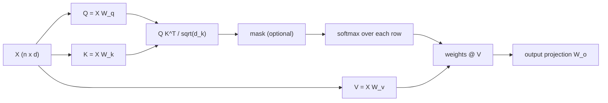

# Self-Attention from Scratch

> Every token asks a question, every token offers an answer, and each one takes a weighted average of what it finds.

**Type:** Build
**Languages:** Python
**Prerequisites:** Phase 04 (Sequence Models), especially Attention (Bahdanau)
**Time:** ~50 minutes

## Learning Objectives

- Derive queries, keys and values from the same sequence and compute scaled dot-product self-attention with tensor ops
- Explain why scores are divided by `sqrt(d)` and demonstrate softmax saturation without it
- Apply causal masks and match `F.scaled_dot_product_attention` with and without `is_causal`
- Show that self-attention is permutation equivariant and that it moves information between positions, which a per-token MLP cannot do

## The Problem

Bahdanau attention let a decoder look back at encoder states, but the model was still an RNN: it processed tokens one at a time, so training could not be parallelized across the sequence, and information from far away still had to be carried through recurrent state inside the encoder.

Vaswani et al. (2017) asked what happens if attention is all there is. Let every position of a sequence attend to every other position of the same sequence: **self-attention**. One matrix multiplication relates all pairs of tokens at once, so a whole sequence is processed in parallel, and any two tokens are one step apart no matter how far they are in the text. That one operation is the core of the transformer, and therefore of every modern language model, vision transformer and diffusion transformer in the rest of this course.

## The Concept

### Queries, keys and values

Start with a sequence of `n` vectors `X` (shape `n x d_model`). Three learned linear maps produce three views of each token:

```
Q = X W_q      what each token is looking for          (n x d_k)
K = X W_k      what each token can be matched on        (n x d_k)
V = X W_v      what each token passes along if matched  (n x d_v)
```

In Bahdanau attention the decoder state was the query and the encoder states were the keys and values. In self-attention all three come from the same sequence.

### Scaled dot-product attention

```
Attention(Q, K, V) = softmax(Q K^T / sqrt(d_k)) V
```

```
Q K^T          n x n     score of every query against every key
/ sqrt(d_k)              keep the scores at unit scale
softmax rows   n x n     each row is a distribution over positions
@ V            n x d_v   each output is a weighted average of values
```



### Why `sqrt(d_k)`

If the entries of `q` and `k` have unit variance, their dot product is a sum of `d_k` products and has variance `d_k`. With `d_k = 256` the scores have a standard deviation of 16, the softmax puts almost all its weight on the largest score, and its gradient almost vanishes. Dividing by `sqrt(d_k)` brings the standard deviation back to 1, whatever the head size.

### Masks

A mask sets some scores to `-inf` before the softmax, so those positions get exactly zero weight. A **causal** mask lets position `t` see only positions `<= t`, which is what a language model needs (it must not peek at the token it is predicting). A **padding** mask hides padding tokens in batches of different lengths.

```
causal mask (1 = allowed)
1 0 0 0 0
1 1 0 0 0
1 1 1 0 0
1 1 1 1 0
1 1 1 1 1
```

### Permutation equivariance

Nothing in the formula refers to positions. If you shuffle the input tokens, the outputs are shuffled the same way and otherwise unchanged. Self-attention treats its input as a **set**. That is a feature (it generalizes across positions) and a problem (word order matters); positional encodings, two lessons from now, fix it.

## Build It

### Step 1: The attention function

```python
def scaled_dot_product_attention(queries, keys, values, mask=None):
    scores = queries @ keys.transpose(-2, -1) / math.sqrt(queries.shape[-1])
    if mask is not None:
        scores = scores.masked_fill(~mask, float("-inf"))
    weights = torch.softmax(scores, dim=-1)
    return weights @ values, weights
```

`transpose(-2, -1)` swaps only the last two axes, so the same function works for any number of leading batch (and later, head) dimensions.

### Step 2: A self-attention layer

```python
class SelfAttention(nn.Module):
    def __init__(self, d_model, d_head):
        super().__init__()
        self.query = nn.Linear(d_model, d_head, bias=False)
        self.key = nn.Linear(d_model, d_head, bias=False)
        self.value = nn.Linear(d_model, d_head, bias=False)
        self.output = nn.Linear(d_head, d_model, bias=False)

    def forward(self, x, mask=None):
        attended, weights = scaled_dot_product_attention(self.query(x), self.key(x), self.value(x), mask)
        return self.output(attended), weights
```

For `x` of shape `(2, 5, 16)` and `d_head = 8`: Q, K and V are `(2, 5, 8)`, the weights are `(2, 5, 5)`, and the output is back to `(2, 5, 16)` so it can be added to the input.

### Step 3: Check against PyTorch, causal mask included

```
Yours vs F.scaled_dot_product_attention: 1.2e-07, causal: 1.2e-07
Causal attention weights for one sequence (row t can only see positions <= t):
  1.00 0.00 0.00 0.00 0.00
  0.59 0.41 0.00 0.00 0.00
  0.35 0.36 0.29 0.00 0.00
  0.34 0.15 0.34 0.16 0.00
  0.19 0.26 0.20 0.22 0.13
```

The first position can only attend to itself, so its weight is exactly 1.

### Step 4: The scaling experiment

With random unit-variance `q` and 16 keys, the average largest softmax weight:

```
    d   std(q.k)  max weight unscaled  max weight scaled
    4       1.99                0.419              0.233
   16       4.00                0.678              0.241
   64       8.00                0.846              0.247
  256      16.03                0.931              0.252
 1024      32.15                0.962              0.246
```

The standard deviation of the raw score is exactly `sqrt(d)`. Without scaling, the softmax becomes nearly one-hot as `d` grows; with scaling it behaves the same at every width.

### Step 5: Information has to move between tokens

The task: for every token, output how many times it appears in the sequence (12 tokens, 6 symbols). The answer for a token depends on all the other tokens, so a model that processes each position independently cannot solve it. Two models with the same embedding and MLP, one with a self-attention layer and residual connection in between:

```
per-token MLP, no attention: accuracy 0.296
one self-attention layer:    accuracy 0.811
```

The baseline can only guess the most common count. With attention, each token learns to put its weight on the other copies of itself: in the example `[0, 1, 0, 2, 2, 2, 3, 0, 4, 2, 5, 2]`, tokens with value 2 (which appears five times) put 0.73 of their attention on other 2s, tokens with value 0 (three times) put 0.55, and singletons put 0.1-0.2. The more copies, the more mass, and the MLP reads the count off that mixture. One layer gets most counts right and confuses some neighboring counts (4 vs 5); deeper models do better.

## Use It

PyTorch provides the whole operation as one fused function:

```python
output = F.scaled_dot_product_attention(q, k, v)
output = F.scaled_dot_product_attention(q, k, v, is_causal=True)
output = F.scaled_dot_product_attention(q, k, v, attn_mask=mask)
```

Use it in real code. It dispatches to memory-efficient kernels (FlashAttention on supported GPUs) that compute exactly the same result as your three lines without ever storing the `n x n` weight matrix. Two conventions to watch: a boolean `attn_mask` in `F.scaled_dot_product_attention` marks positions that are **allowed** (`True` = attend), like yours, while `nn.MultiheadAttention`'s boolean mask marks positions that are **blocked**. The next lesson shows the second one.

## Exercises

1. **Easy.** Remove the `/ math.sqrt(...)` from `scaled_dot_product_attention` and retrain the counting model with `d_model = 128`. Does it train slower? Inspect how peaked the attention weights are.
2. **Medium.** Add a padding mask: sequences of length 8-12 padded to 12 with a pad token, and the count must ignore padding. Build the mask so that no query attends to padding keys, and verify the outputs of non-padding positions do not change when the padding token changes.
3. **Hard.** Stack two attention layers and train on "for every token, output the token that appeared right after its previous occurrence" (an induction-style task; positions are needed, so add a learned position embedding). Can one layer solve it? Inspect what each layer attends to.

## Key Terms

| Term | What people say | What it actually means |
|------|----------------|----------------------|
| Self-attention | "Tokens attending to each other" | Attention where queries, keys and values are all computed from the same sequence |
| Query / key / value | "Q, K, V" | Three linear projections of each token: what it looks for, what it is matched on, what it contributes |
| Scaled dot-product attention | "The attention formula" | `softmax(Q K^T / sqrt(d_k)) V` |
| Attention weights | "The attention map" | The `n x n` row-stochastic matrix produced by the softmax |
| Causal mask | "No peeking" | A lower-triangular mask so position `t` attends only to positions `<= t` |
| Permutation equivariance | "Order does not matter" | Permuting the input permutes the output identically; attention alone has no notion of position |
| Softmax saturation | "Peaky attention" | Large score magnitudes make the softmax nearly one-hot and its gradients nearly zero |

## Further Reading

- [Vaswani et al., Attention Is All You Need (2017)](https://arxiv.org/abs/1706.03762) -- Section 3.2 defines scaled dot-product and multi-head attention
- [Karpathy, Let's build GPT: from scratch, in code, spelled out](https://www.youtube.com/watch?v=kCc8FmEb1nY) -- builds self-attention step by step, starting from averaging past tokens
- [3Blue1Brown, Attention in transformers, step-by-step](https://www.youtube.com/watch?v=eMlx5fFNoYc) -- a visual walk through queries, keys and values
- [PyTorch docs: torch.nn.functional.scaled_dot_product_attention](https://pytorch.org/docs/stable/generated/torch.nn.functional.scaled_dot_product_attention.html) -- the reference implementation and its mask conventions
