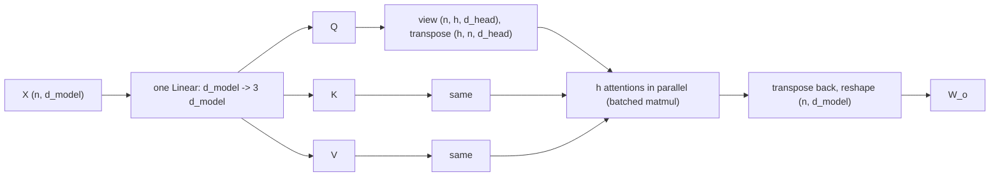

# Multi-Head Attention

> One softmax can only look one way at a time. Split the width into heads and let each one look somewhere else.

**Type:** Build
**Languages:** Python
**Prerequisites:** Self-Attention from Scratch
**Time:** ~45 minutes

## Learning Objectives

- Implement multi-head attention with one fused QKV projection, a head split with `view` and `transpose`, and an output projection
- Show that the parameter count does not depend on the number of heads, and that batched heads equal independent heads run in a loop
- Copy your weights into `nn.MultiheadAttention`, match its outputs and weights, and handle its opposite mask convention
- Train models with 1, 2 and 4 heads on a task that needs two different lookups and inspect what each head learns

## The Problem

A single attention layer produces, for each query, one probability distribution over positions. If a token needs two different things (the word before it and the word after it, or its subject and its object), one distribution has to cover both: it can split its weight between them, but then the output is a blend of both values that the next layer has to untangle.

Vaswani et al. proposed running several attention operations in parallel, each in a smaller subspace, and concatenating the results. Each **head** has its own queries, keys and values, so each can learn its own pattern: one head tracks the previous token, another the next, another the matching bracket. The trick costs nothing extra: the model width is split among the heads, so the parameter count and the compute stay the same. Every transformer since uses multi-head attention, and interpretability research has found heads with remarkably specific jobs.

## The Concept

### Split, attend, concatenate

With model width `d_model` and `h` heads, each head works in `d_head = d_model / h` dimensions:

```
Q, K, V = X W_q, X W_k, X W_v                    each (n, d_model)
split into h heads                                each (h, n, d_head)
head_i = softmax(Q_i K_i^T / sqrt(d_head)) V_i    (n, d_head) per head
concat(head_1, ..., head_h) W_o                   (n, d_model)
```



### Same parameters, different structure

`W_q`, `W_k`, `W_v` and `W_o` are all `d_model x d_model` whatever `h` is: splitting into heads only changes how the columns are grouped. So a 4-head layer has exactly the parameters of a 1-head layer (`4 d_model^2 + 4 d_model` with biases). What changes is that each head computes its own softmax, so one layer produces `h` different attention patterns.

### Why the reshape trick works

A head is just a slice of columns. `view(batch, n, h, d_head)` splits the last axis into `h` contiguous groups of `d_head` columns, and `transpose(1, 2)` moves the head axis next to the batch axis so that `q @ k.transpose(-2, -1)` runs all heads as one batched matrix multiply. Concatenation is the inverse: transpose back and `reshape` to `(batch, n, d_model)`.

## Build It

### Step 1: The module

```python
class MultiHeadAttention(nn.Module):
    def __init__(self, d_model, num_heads):
        super().__init__()
        assert d_model % num_heads == 0
        self.num_heads = num_heads
        self.d_head = d_model // num_heads
        self.qkv = nn.Linear(d_model, 3 * d_model)
        self.output = nn.Linear(d_model, d_model)

    def split_heads(self, x):
        batch, length, _ = x.shape
        return x.view(batch, length, self.num_heads, self.d_head).transpose(1, 2)

    def merge_heads(self, x):
        batch, _, length, _ = x.shape
        return x.transpose(1, 2).reshape(batch, length, self.num_heads * self.d_head)

    def forward(self, x, mask=None):
        queries, keys, values = self.qkv(x).chunk(3, dim=-1)
        queries, keys, values = self.split_heads(queries), self.split_heads(keys), self.split_heads(values)
        scores = queries @ keys.transpose(-2, -1) / math.sqrt(self.d_head)
        if mask is not None:
            scores = scores.masked_fill(~mask, float("-inf"))
        weights = torch.softmax(scores, dim=-1)
        return self.output(self.merge_heads(weights @ values)), weights
```

One `nn.Linear(d_model, 3 * d_model)` computes Q, K and V in a single matrix multiply, which is faster than three separate ones. `merge_heads` uses `reshape` instead of `view` because the tensor is no longer contiguous after `transpose`.

### Step 2: Shapes and parameters

```
d_model=32, heads=4, d_head=8
Input (2, 6, 32) -> per-head Q (2, 4, 6, 8) -> weights (2, 4, 6, 6) -> output (2, 6, 32)
Parameters: 4,224 (4 * d_model^2 + 4 * d_model = 4,224, independent of the number of heads)
```

### Step 3: Check it three ways

```
Yours vs nn.MultiheadAttention: output diff 8.9e-08, weights diff 6.0e-08
With a causal mask: output diff 8.9e-08
Batched heads vs a Python loop over 4 independent heads: diff 0.0e+00
```

The loop version slices columns `head * d_head : (head + 1) * d_head` from Q, K and V, runs plain attention on each slice, and concatenates. It is exactly equal to the batched version, which proves that a head is nothing more than a column slice.

### Step 4: A task with two lookups

Every position must output `(x[i-1] - x[i+1]) mod 10` (the sequence wraps around). The model needs both neighbors, in order. One attention layer with learned position embeddings and an MLP, `d_model = 32`, trained with 1, 2 and 4 heads:

```
heads d_head  accuracy
    1     32     1.000
    2     16     1.000
    4      8     1.000
```

All three solve it, and they converge at about the same speed. More heads are not automatically better. What differs is **how** they solve it. The single head, from position 5:

```
head 0: 0.00 0.00 0.00 0.00 0.34 0.03 0.61 0.01 0.00 0.00
```

It splits its weight unevenly between positions 4 and 6 (0.34 and 0.61). The output is a blend of both neighbors' values, and because the weights are unequal and the values include position information, the MLP can still tell which token came from which side. The 4-head model divides the work:

```
head 0: 0.00 0.00 0.00 0.00 0.15 0.01 0.84 0.00 0.00 0.00   argmax 6
head 1: 0.00 0.00 0.01 0.00 0.69 0.02 0.28 0.00 0.00 0.00   argmax 4
head 2: 0.00 0.00 0.00 0.00 0.98 0.01 0.01 0.00 0.00 0.00   argmax 4
head 3: 0.00 0.00 0.00 0.00 0.05 0.02 0.85 0.03 0.05 0.00   argmax 6
Most common offset (key position - query position, mod 10) per head: [1, 9, 9, 1]
```

Two heads became "next token" heads (offset +1) and two became "previous token" heads (offset -1 = 9 mod 10). Each delivers one clean value. In large models this specialization is what makes heads interpretable, and it matters more as the number of relations a token needs grows beyond what one blended average can encode.

## Use It

```python
attention = nn.MultiheadAttention(embed_dim=32, num_heads=4, batch_first=True)
output, weights = attention(x, x, x, average_attn_weights=False)
output, _ = attention(x, x, x, attn_mask=~causal)
```

Things to know about `nn.MultiheadAttention`:

- It takes `query, key, value` separately, so the same module does self-attention (`x, x, x`) and cross-attention (`decoder_states, encoder_states, encoder_states`).
- Its packed `in_proj_weight` is `(3 * d_model, d_model)` with Q, K and V stacked in that order, which is why your `qkv.weight` copies straight in.
- A boolean `attn_mask` uses `True` for positions that are **not allowed**, the opposite of `F.scaled_dot_product_attention` and of your mask. Mixing up the two conventions silently produces an anti-causal model; always test with a mask whose effect you can see.
- `batch_first=False` is the default for historical reasons. Set `batch_first=True` unless you want `(n, batch, d)` tensors.
- By default it returns weights averaged over heads; pass `average_attn_weights=False` to get them per head, or `need_weights=False` to let it use the fast fused kernel.

## Exercises

1. **Easy.** Train the neighbor task with `d_model = 8` and 1, 2 and 4 heads. With only 2 dimensions per head, which configuration still learns? Why might very small heads struggle?
2. **Medium.** Change the task to `(x[i-2] + 2 x[i-1] + 3 x[i+1]) mod 10`. One layer is not enough for the modular arithmetic; add a second block (attention + MLP with residuals) and find the minimal number of heads that solves it.
3. **Hard.** Implement grouped-query attention: `h` query heads share `g < h` key/value heads (each KV head serves `h / g` query heads). Count the parameters, check it against `F.scaled_dot_product_attention(..., enable_gqa=True)`, and measure accuracy on the neighbor task with `h = 4, g = 1`.

## Key Terms

| Term | What people say | What it actually means |
|------|----------------|----------------------|
| Multi-head attention | "Several attentions in parallel" | `h` attention operations on `d_model / h`-dimensional slices of Q, K and V, concatenated and projected by `W_o` |
| Head | "One attention pattern" | A column slice of the Q, K, V projections with its own softmax |
| d_head | "Head dimension" | `d_model / h`; the width each head attends in |
| Fused QKV projection | "in_proj" | One linear layer producing Q, K and V together, split afterwards |
| Output projection | "W_o" | The linear layer that mixes the concatenated head outputs back into `d_model` dimensions |
| Head specialization | "Previous-token heads, induction heads" | Different heads learning distinct, often interpretable attention patterns |
| Cross-attention | "Encoder-decoder attention" | Attention whose queries come from one sequence and keys/values from another |

## Further Reading

- [Vaswani et al., Attention Is All You Need (2017)](https://arxiv.org/abs/1706.03762) -- Section 3.2.2 introduces multi-head attention
- [Michel, Levy and Neubig, Are Sixteen Heads Really Better than One? (2019)](https://arxiv.org/abs/1905.10650) -- many heads can be pruned after training
- [Elhage et al., A Mathematical Framework for Transformer Circuits (2021)](https://transformer-circuits.pub/2021/framework/index.html) -- how individual heads read and write the residual stream
- [PyTorch docs: torch.nn.MultiheadAttention](https://pytorch.org/docs/stable/generated/torch.nn.MultiheadAttention.html) -- argument conventions, including masks and batch_first
