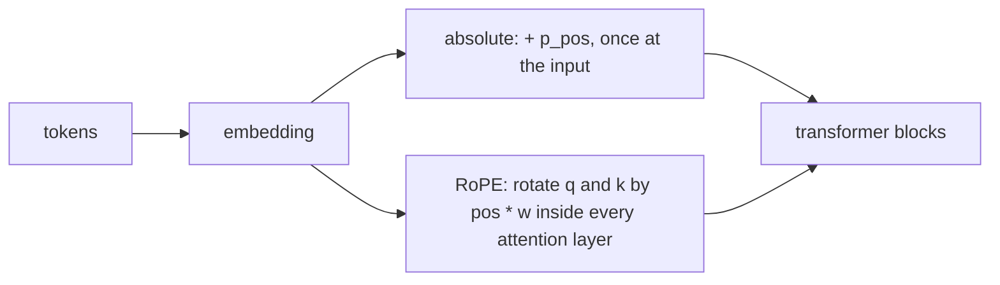

# Positional Encodings

> Attention sees a bag of tokens. Tell it where each one sits, by adding a position vector or by rotating queries and keys.

**Type:** Build
**Languages:** Python
**Prerequisites:** Self-Attention from Scratch, Multi-Head Attention
**Time:** ~50 minutes

## Learning Objectives

- Prove numerically that a transformer block without positional information is permutation equivariant, and see it fail on an order-dependent task
- Implement sinusoidal encodings and verify their two key properties: dot products depend only on offset, and a shift is a fixed rotation
- Compare no encoding, sinusoidal, learned absolute embeddings and rotary embeddings (RoPE) on sequence reversal
- Implement RoPE and show that the attention score between two positions depends only on their distance

## The Problem

Self-attention computes a weighted average where the weights depend on the content of queries and keys, never on where they are. Shuffle the input and the output is shuffled the same way. For a model of language that is a disaster: "the dog bit the man" and "the man bit the dog" contain the same tokens, and an attention layer would see the same set.

An RNN gets order for free because it reads tokens one at a time. A transformer reads them all at once, so order has to be injected explicitly. The original transformer added a fixed pattern of sines and cosines to each token embedding. BERT and GPT-2 learned a vector per position instead. Most modern language models (LLaMA, Mistral, Qwen and many others) use rotary embeddings, which encode position by rotating the query and key vectors so that attention scores depend on relative distance. This lesson builds all three and tests them on a task that is impossible without position.

## The Concept

### Absolute encodings: add a vector per position

The simplest scheme: `x_i = embed(token_i) + p_i`, where `p_i` is a vector that depends only on the position `i`. After that, the rest of the network is unchanged.

- **Learned**: `p` is an `n_max x d` parameter matrix, trained like any other weight. Simple and effective, but it cannot represent positions beyond `n_max`.
- **Sinusoidal**: a fixed function of the position.

### Sinusoidal encoding

For position `pos` and dimension pair `(2i, 2i + 1)`:

```
PE(pos, 2i)     = sin(pos / 10000^(2i/d))
PE(pos, 2i + 1) = cos(pos / 10000^(2i/d))
```

Each pair of dimensions is a clock hand rotating at its own speed: the first pair completes a turn every `2 pi` positions, the last one every `2 pi * 10000^((d-2)/d)` positions. Read together, the pairs give each position a unique code, like the digits of a number in a mixed base.

Two properties make this a good choice:

1. **Shift is linear.** Moving `k` positions rotates each pair by a fixed angle, so `PE(pos + k) = PE(pos) R_k` for a block-diagonal rotation matrix `R_k` that does not depend on `pos`. A linear layer can learn to "look `k` back".
2. **Dot products depend on distance.** `PE(p) . PE(p + k) = sum_i cos(k w_i)`, a function of `k` only.

### Rotary position embeddings (RoPE)

RoPE does not add anything to the embeddings. Inside every attention layer, it rotates each pair of dimensions of the query at position `m` by angle `m w_i`, and the key at position `n` by `n w_i`:

```
rope(x, m)[2i]     = x[2i] cos(m w_i) - x[2i+1] sin(m w_i)
rope(x, m)[2i + 1] = x[2i] sin(m w_i) + x[2i+1] cos(m w_i)
```

Because rotations compose, `rope(q, m) . rope(k, n) = q . R_{n-m} k`: the score depends on the content and the **relative** offset `n - m`, never on the absolute positions. Rotations also preserve norms, so they do not distort the scale of the scores.



### The test task

Reverse a sequence of 12 tokens: output position `i` must hold input token `11 - i`. Each output depends on one specific other position, so a model without position information can only output a function of the bag of tokens. The best it can do is guess the most frequent token in the sequence at every position.

## Build It

### Step 1: Sinusoidal encoding

```python
def sinusoidal_encoding(length, d_model, base=10000.0):
    positions = torch.arange(length, dtype=torch.float32)[:, None]
    frequencies = base ** (-torch.arange(0, d_model, 2, dtype=torch.float32) / d_model)
    angles = positions * frequencies
    encoding = torch.zeros(length, d_model)
    encoding[:, 0::2] = torch.sin(angles)
    encoding[:, 1::2] = torch.cos(angles)
    return encoding
```

The script checks both properties:

```
Dot product PE(p) . PE(p + k) depends only on k:
  k= 1: p=0 -> 15.314, p=10 -> 15.314, p=30 -> 15.314
  k= 4: p=0 -> 11.662, p=10 -> 11.662, p=30 -> 11.661
  k=16: p=0 -> 7.925, p=10 -> 7.925, p=30 -> 7.925
PE(p + 5) = PE(p) @ R_5 for a fixed rotation matrix R_5: max error 1.9e-06
```

`sinusoidal.png` shows the encoding as an image: fast stripes in the first dimensions, slow ones in the last.

### Step 2: RoPE

```python
def rope_angles(length, d_head, base=10000.0):
    frequencies = base ** (-torch.arange(0, d_head, 2, dtype=torch.float32) / d_head)
    return torch.arange(length, dtype=torch.float32)[:, None] * frequencies


def apply_rope(x, angles):
    even, odd = x[..., 0::2], x[..., 1::2]
    cos, sin = torch.cos(angles), torch.sin(angles)
    rotated = torch.empty_like(x)
    rotated[..., 0::2] = even * cos - odd * sin
    rotated[..., 1::2] = even * sin + odd * cos
    return rotated
```

Inside the attention module, `q` and `k` (shape `(batch, heads, n, d_head)`) are rotated after the head split; `v` is left alone. The relative-position property:

```
m= 3, n= 1, m-n=  2: score -0.6757
m=10, n= 8, m-n=  2: score -0.6757
m=25, n=23, m-n=  2: score -0.6757
m= 5, n= 9, m-n= -4: score 1.2502
m=20, n=24, m-n= -4: score 1.2502
```

### Step 3: One encoder, four position schemes

A 2-block pre-norm transformer (`d_model = 64`, 4 heads) with a switch for the position scheme: `"none"`, `"sinusoidal"` and `"learned"` add a vector to the embeddings; `"rope"` passes `use_rope=True` to every attention layer. First the problem:

```
Without positions, a transformer block is permutation equivariant: True
```

Then 800 training steps of reversal for each:

```
encoding     token accuracy
none                  0.270
sinusoidal            1.000
learned               1.000
rope                  0.994
```

Without positions the model is stuck at 27%: the accuracy of predicting the most common token of each sequence at every position. With any of the three schemes it solves the task.

RoPE solving it deserves a second look. Reversal needs absolute positions (position 0 maps to 11), but RoPE only encodes relative ones. The model recovers absolute position from the edges: the query at position 0 has keys only at positive offsets, the one at position 11 only at negative offsets, so attention can tell where in the sequence it is. Relative schemes generalize better to lengths not seen in training, which is one reason RoPE won in large language models.

## Use It

PyTorch has no built-in positional encoding module: you add a buffer (sinusoidal), an `nn.Parameter` or `nn.Embedding(max_length, d_model)` (learned), or rotate `q` and `k` before calling `F.scaled_dot_product_attention` (RoPE):

```python
positions = torch.arange(length, device=tokens.device)
x = token_embedding(tokens) + position_embedding(positions)

q, k = apply_rope(q, angles[:length]), apply_rope(k, angles[:length])
out = F.scaled_dot_product_attention(q, k, v, is_causal=True)
```

Precompute the angles (or their cosines and sines) once and register them as a buffer, as the `Attention` module here does, so they move with `.to(device)` and are not trained. Two practical notes: production RoPE implementations often rotate the two halves of the vector (`x[:d/2]`, `x[d/2:]`) instead of interleaved pairs, which is equivalent up to a fixed permutation of dimensions; and long-context models extend RoPE by rescaling its frequencies (position interpolation, NTK scaling, YaRN) rather than retraining from scratch.

## Exercises

1. **Easy.** Train the learned and sinusoidal models on length 12 and evaluate on length 8 (the first 8 positions only). Which one still works, and why?
2. **Medium.** Implement ALiBi: no position vectors at all, but add `-slope_h * |i - j|` to the attention scores of head `h`, with geometric slopes `2^(-8h/H)`. Train it on reversal and compare with RoPE.
3. **Hard.** Train a causal (decoder) version of the RoPE and learned models on a copy task of length 12, then test both on length 20 (extend the learned table with random vectors). Measure accuracy per position and explain the difference in length extrapolation.

## Key Terms

| Term | What people say | What it actually means |
|------|----------------|----------------------|
| Positional encoding | "Telling the model where tokens are" | Any mechanism that makes attention depend on token positions |
| Absolute encoding | "Position embeddings" | A vector per position added to the token embedding at the input |
| Sinusoidal encoding | "The sin/cos one" | Fixed absolute encoding with geometric frequencies; shifts are rotations and dot products depend only on offset |
| Learned position embedding | "BERT/GPT-2 style" | A trainable vector per position, limited to the maximum trained length |
| RoPE | "Rotary embeddings" | Rotating each dimension pair of `q` and `k` by a position-dependent angle so scores depend on relative offset |
| Relative position | "Distance between tokens" | Encoding `i - j` instead of `i` and `j`; generalizes better to unseen lengths |
| Length extrapolation | "Longer context than in training" | Running a model on sequences longer than any it was trained on |

## Further Reading

- [Vaswani et al., Attention Is All You Need (2017)](https://arxiv.org/abs/1706.03762) -- Section 3.5 introduces the sinusoidal encoding
- [Su et al., RoFormer: Enhanced Transformer with Rotary Position Embedding (2021)](https://arxiv.org/abs/2104.09864) -- the RoPE paper
- [Press, Smith and Lewis, Train Short, Test Long: Attention with Linear Biases (2021)](https://arxiv.org/abs/2108.12409) -- ALiBi and a careful study of length extrapolation
- [Dive into Deep Learning, Section 11.6: Self-Attention and Positional Encoding](https://d2l.ai/chapter_attention-mechanisms-and-transformers/self-attention-and-positional-encoding.html) -- sinusoidal encodings with plots
