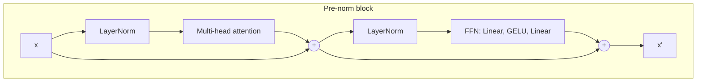

# The Transformer Block

> Attention mixes tokens, the MLP thinks about each one, residuals keep the signal, layer norm keeps the scale. Stack and repeat.

**Type:** Build
**Languages:** Python
**Prerequisites:** Phase 02 (Training Deep Nets), Multi-Head Attention, Positional Encodings
**Time:** ~55 minutes

## Learning Objectives

- Assemble a transformer block from layer normalization, multi-head attention, a position-wise feed-forward network, residual connections and dropout
- Implement both the original post-norm and the modern pre-norm arrangements, and match `nn.TransformerEncoderLayer` exactly for each
- Count where a block's parameters live and explain the role of each sub-layer
- Compare gradient flow through deep pre-norm and post-norm stacks and train a small transformer to sort sequences

## The Problem

Multi-head attention moves information between tokens, but on its own it is a weighted average followed by a linear map: stacking many of them without anything else gives a network that is close to linear and hard to train. The transformer wraps attention in a block with three more ingredients, each borrowed from earlier lessons: a per-token MLP to add nonlinearity and capacity, residual connections (from ResNets) so that deep stacks train, and layer normalization (from Phase 02) to keep activations at a stable scale.

That block, repeated `N` times with the same shape, is the entire architecture of GPT, BERT, ViT, Whisper and the diffusion transformers. Model sizes differ only in width, depth and number of heads. If you can write one block and stack it, you can read the source of any of them.

## The Concept

### The two sub-layers

```
attention sub-layer:     mixes information ACROSS positions
feed-forward sub-layer:  transforms each position INDEPENDENTLY
                         FFN(x) = W_2 GELU(W_1 x + b_1) + b_2,  hidden size usually 4 d_model
```

A useful mental model: every token has a **residual stream**, a `d_model` vector that flows through the whole network. Each sub-layer reads from it and adds its result back. Attention adds information gathered from other tokens; the MLP adds features computed from what the token already holds.

### Pre-norm and post-norm

```
post-norm (original 2017):   x = LayerNorm(x + Attention(x))
                             x = LayerNorm(x + FFN(x))

pre-norm (GPT-2 and later):  x = x + Attention(LayerNorm(x))
                             x = x + FFN(LayerNorm(x))
                             ... final LayerNorm after the last block
```



In pre-norm, the residual path from input to output contains only additions: it is the clean identity highway of a ResNet. In post-norm, every block ends with a LayerNorm on the residual path itself, so the gradient has to pass through `2N` normalizations. Post-norm can reach slightly better results when it trains, but it needs learning-rate warmup and becomes unstable as depth grows; nearly all modern large models use pre-norm (or its RMSNorm variant).

### Layer normalization

For each token separately, normalize its `d_model` features to zero mean and unit variance, then apply a learned scale and shift:

```
LN(x) = (x - mean(x)) / sqrt(var(x) + eps) * gamma + beta
```

Unlike batch norm, it does not depend on other examples in the batch or other positions in the sequence, so it behaves identically in training and inference and for any sequence length.

### Where the parameters are

| Sub-layer | Parameters (with biases) |
|-----------|--------------------------|
| attention | `4 d^2 + 4 d` |
| feed-forward (hidden `4d`) | `8 d^2 + 5 d` |
| two layer norms | `4 d` |

Two thirds of a block's parameters are in the MLP. In large language models the MLPs are also where most "knowledge" is thought to be stored.

## Build It

### Step 1: LayerNorm

```python
class LayerNorm(nn.Module):
    def __init__(self, d_model, eps=1e-5):
        super().__init__()
        self.weight = nn.Parameter(torch.ones(d_model))
        self.bias = nn.Parameter(torch.zeros(d_model))
        self.eps = eps

    def forward(self, x):
        mean = x.mean(dim=-1, keepdim=True)
        variance = x.var(dim=-1, keepdim=True, unbiased=False)
        return (x - mean) / torch.sqrt(variance + self.eps) * self.weight + self.bias
```

`unbiased=False` matters: layer norm uses the population variance. It matches `nn.LayerNorm` to `4e-7`.

### Step 2: Attention and feed-forward

The multi-head attention from the last lesson, with dropout on the attention weights, and a two-layer GELU MLP:

```python
class FeedForward(nn.Module):
    def __init__(self, d_model, d_hidden, dropout):
        super().__init__()
        self.up = nn.Linear(d_model, d_hidden)
        self.down = nn.Linear(d_hidden, d_model)
        self.dropout = nn.Dropout(dropout)

    def forward(self, x):
        return self.down(self.dropout(F.gelu(self.up(x))))
```

### Step 3: The block, both ways

```python
class TransformerBlock(nn.Module):
    def __init__(self, d_model, num_heads, d_hidden, dropout=0.0, pre_norm=True):
        super().__init__()
        self.norm1 = LayerNorm(d_model)
        self.attention = MultiHeadAttention(d_model, num_heads, dropout)
        self.norm2 = LayerNorm(d_model)
        self.feed_forward = FeedForward(d_model, d_hidden, dropout)
        self.dropout = nn.Dropout(dropout)
        self.pre_norm = pre_norm

    def forward(self, x, mask=None):
        if self.pre_norm:
            x = x + self.dropout(self.attention(self.norm1(x), mask))
            return x + self.dropout(self.feed_forward(self.norm2(x)))
        x = self.norm1(x + self.dropout(self.attention(x, mask)))
        return self.norm2(x + self.dropout(self.feed_forward(x)))
```

The input and output have the same shape `(batch, n, d_model)`, which is what makes blocks stackable.

### Step 4: Parameters and equivalence

```
One block (d_model=64, heads=4, d_ff=256): 49,984 parameters
  attention      16,640 (33%)
  feed-forward   33,088 (66%)
  layer norms       256 (1%)
pre-norm  block vs nn.TransformerEncoderLayer(norm_first=True): 4.8e-07, with causal mask 4.8e-07
post-norm block vs nn.TransformerEncoderLayer(norm_first=False): 7.2e-07, with causal mask 7.2e-07
```

`copy_into_library` maps every one of your tensors onto PyTorch's names (`self_attn.in_proj_weight`, `linear1`, `linear2`, `norm1`, `norm2`).

### Step 5: Gradient flow in a 12-block stack

The gradient norm of each block's attention weights at initialization:

```
block   pre-norm  post-norm
    1   1.40e-01   1.61e-01
    4   1.22e-01   1.88e-01
    8   1.29e-01   2.53e-01
   12   1.22e-01   2.36e-01
```

Pre-norm gives every block a gradient of the same size. Post-norm gives larger gradients to the blocks near the output than to those near the input, a mismatch that grows with depth and is why post-norm transformers need warmup: at full learning rate the top blocks take steps that are too big while the bottom ones barely move. At 12 small blocks the effect is mild; at 48 large ones it is the difference between training and diverging.

### Step 6: Train a sorter

Input: 10 random digits. Output at position `i`: the `i`-th smallest. Sorting needs every token to compare itself with all the others (how many are smaller?), which is exactly what attention provides:

```
model                   token acc   exact  final loss
1 block, pre-norm           1.000   0.999      0.0035
2 blocks, pre-norm          1.000   1.000      0.0022
2 blocks, post-norm         1.000   1.000      0.0016
```

At this scale both arrangements train fine. A single block already sorts almost perfectly.

## Use It

```python
layer = nn.TransformerEncoderLayer(d_model=64, nhead=4, dim_feedforward=256, dropout=0.1,
                                   activation="gelu", batch_first=True, norm_first=True)
encoder = nn.TransformerEncoder(layer, num_layers=6)
out = encoder(x, mask=causal_mask, is_causal=True)
```

`norm_first=True` gives the pre-norm block; the default is post-norm, matching the 2017 paper. `nn.TransformerEncoder` deep-copies the layer `num_layers` times. Note that its `mask` follows the `nn.MultiheadAttention` convention (`True` = blocked), and that with `norm_first=True` you should add your own final `nn.LayerNorm` after the stack (pass `norm=nn.LayerNorm(64)`).

In practice many codebases (nanoGPT, LLaMA implementations, timm's ViT) write their own block, exactly like yours, because it is short and they want to change details: RMSNorm instead of LayerNorm, SwiGLU instead of GELU, RoPE inside attention, no biases. Your block is the template for all of those.

## Exercises

1. **Easy.** Replace GELU with ReLU and the 4x MLP with a 2x MLP. How do parameter count and sorting accuracy change?
2. **Medium.** Implement RMSNorm (`x / sqrt(mean(x^2) + eps) * gamma`, no mean subtraction, no bias) and use it in the pre-norm block. Does sorting still train? Compare speed.
3. **Hard.** Train 12-block post-norm and pre-norm sorters with learning rate 3e-3 and no warmup, then with a linear warmup over the first 200 steps. Record the loss curves. Which configuration fails without warmup?

## Key Terms

| Term | What people say | What it actually means |
|------|----------------|----------------------|
| Transformer block | "A transformer layer" | Attention and feed-forward sub-layers, each with a residual connection and layer norm |
| Residual stream | "The highway" | The `d_model` vector per token that every sub-layer reads from and adds to |
| Feed-forward network | "The MLP" | A two-layer MLP applied to each position independently, usually with hidden size `4 d_model` |
| Layer normalization | "LayerNorm" | Normalizing each token's features to zero mean and unit variance, with learned scale and shift |
| Pre-norm | "norm_first" | Normalizing the input of each sub-layer, keeping the residual path a pure sum; standard in modern models |
| Post-norm | "The original transformer" | Normalizing after each residual addition; needs warmup and is harder to train deep |
| Warmup | "Ramping up the learning rate" | Starting with a small learning rate and increasing it over the first steps |

## Further Reading

- [Vaswani et al., Attention Is All You Need (2017)](https://arxiv.org/abs/1706.03762) -- Section 3.1 describes the encoder and decoder blocks
- [Xiong et al., On Layer Normalization in the Transformer Architecture (2020)](https://arxiv.org/abs/2002.04745) -- why post-norm needs warmup and pre-norm does not
- [Ba, Kiros and Hinton, Layer Normalization (2016)](https://arxiv.org/abs/1607.06450) -- the original layer norm paper
- [Karpathy, nanoGPT](https://github.com/karpathy/nanoGPT) -- a complete pre-norm GPT whose `Block` class is the same as yours
