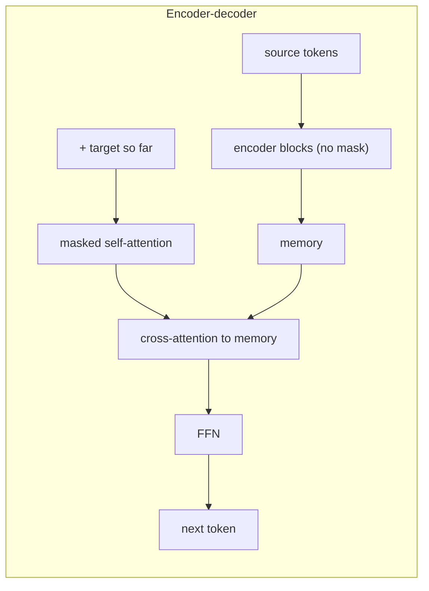

# Encoders vs Decoders

> Same blocks, different masks. An encoder lets every token see everything; a decoder only lets it see the past; an encoder-decoder does both and connects them with cross-attention.

**Type:** Build
**Languages:** Python
**Prerequisites:** The Transformer Block, Phase 04 (Sequence Models), especially Seq2Seq
**Time:** ~60 minutes

## Learning Objectives

- Explain the three transformer families (encoder-only, decoder-only, encoder-decoder) by what each position is allowed to attend to
- Verify the causal property of a decoder: changing future tokens never changes earlier outputs
- Implement cross-attention and build all three architectures from the same block
- Train all three, plus `nn.Transformer`, on two-digit addition and compare how each one produces the answer

## The Problem

The original transformer was an encoder-decoder for translation, but most famous models since use only half of it. BERT is an encoder. GPT, LLaMA and Claude-style chat models are decoders. T5 and Whisper keep both halves. Reading model cards and papers, you constantly need to know which one you are looking at, because it decides what the model can do: an encoder produces rich representations of a text but cannot generate one token at a time; a decoder generates but each position only knows the past; an encoder-decoder reads an input fully and then generates an output conditioned on it.

The surprising part is how small the difference is in code. All three use the block from the previous lesson. They differ in the attention mask, in whether there is a second attention layer that looks at another sequence, and in how training targets are arranged. This lesson builds all three on one task so you can compare them directly.

## The Concept

### Masks decide the family

```
encoder (bidirectional)      decoder (causal)
1 1 1 1 1                    1 0 0 0 0
1 1 1 1 1                    1 1 0 0 0
1 1 1 1 1                    1 1 1 0 0
1 1 1 1 1                    1 1 1 1 0
1 1 1 1 1                    1 1 1 1 1
```

- **Encoder-only** (BERT): no mask. Every output depends on the whole input. Trained by filling in masked or blank tokens. Good for classification, retrieval embeddings, tagging.
- **Decoder-only** (GPT): causal mask. Output `t` depends only on tokens `<= t`, so the model can be trained to predict token `t + 1` at every position in parallel, and at inference it generates one token at a time by feeding its outputs back.
- **Encoder-decoder** (original transformer, T5): an encoder reads the source bidirectionally; a causal decoder generates the target, and each decoder block has a **cross-attention** layer whose queries come from the decoder and keys/values from the encoder output.



### Cross-attention

The same attention formula, with queries and keys/values from different sequences:

```
CrossAttention(decoder_states, memory) = softmax(Q_dec K_mem^T / sqrt(d)) V_mem
```

It is exactly Bahdanau attention from Phase 04 in dot-product form, and it is the only path through which the decoder sees the source.

### The task: two-digit addition

```
problem:  6 0 + 4 4 =        answer: 1 0 4
```

All 10,000 pairs `a + b` with `0 <= a, b <= 99`, answers padded to three digits. 8,000 are used for training and 2,000 are held out, so the test measures whether the model learned addition rather than memorized the table. Each architecture frames the task in its own way:

| Model | Input | What it predicts |
|-------|-------|------------------|
| decoder-only | `60+44=104` shifted by one | the next token, loss only on the answer positions; at test time generates 3 tokens after `=` |
| encoder-only | `60+44=` followed by 3 blank tokens | all 3 answer digits at once at the blank positions |
| encoder-decoder | encoder: `60+44=`; decoder: `<start> 1 0` | the next answer digit; at test time generates 3 tokens |

## Build It

### Step 1: One attention module for self- and cross-attention

```python
class Attention(nn.Module):
    def __init__(self, d_model, num_heads):
        super().__init__()
        self.num_heads = num_heads
        self.d_head = d_model // num_heads
        self.query = nn.Linear(d_model, d_model)
        self.key_value = nn.Linear(d_model, 2 * d_model)
        self.output = nn.Linear(d_model, d_model)

    def forward(self, x, context=None, mask=None):
        context = x if context is None else context
        q = self.split(self.query(x))
        k, v = (self.split(t) for t in self.key_value(context).chunk(2, dim=-1))
        scores = q @ k.transpose(-2, -1) / math.sqrt(self.d_head)
        if mask is not None:
            scores = scores.masked_fill(~mask, float("-inf"))
        attended = torch.softmax(scores, dim=-1) @ v
        return self.output(attended.transpose(1, 2).reshape(x.shape[0], x.shape[1], -1))
```

With `context=None` it is self-attention. With `context=memory` the queries come from `x` and the keys and values from `memory`; the two sequences can have different lengths.

### Step 2: A block with optional cross-attention

```python
    def forward(self, x, mask=None, memory=None):
        x = x + self.self_attention(self.norm1(x), mask=mask)
        if self.cross_attention is not None:
            x = x + self.cross_attention(self.cross_norm(x), context=memory)
        return x + self.mlp(self.norm2(x))
```

`Stack` adds token and learned position embeddings, runs the blocks and a final LayerNorm. Each of the three models is a `Stack` (or two) plus a linear head.

### Step 3: Check the causal property

Take one sequence, change its last two tokens, and measure how much each position's output changes (untrained models, so the numbers are arbitrary but the zeros are not):

```
decoder: 0.00 0.00 0.00 0.00 0.00 0.00 0.00 1.10 1.09
encoder: 0.13 0.23 0.18 0.11 0.11 0.16 0.17 2.01 1.99
```

In the decoder, the first seven outputs are bit-for-bit identical: information cannot flow backward. In the encoder every output changes. This one property is what allows a decoder to be trained on all positions in parallel (each position's prediction cannot cheat by looking at the token it must predict) and then generate step by step at inference with identical behavior.

### Step 4: The three training losses

```python
class DecoderOnly(nn.Module):
    def loss(self, problems, answers):
        sequence = torch.cat([problems, answers], dim=1)
        logits = self(sequence[:, :-1])[:, PROBLEM_LENGTH - 1:]
        return F.cross_entropy(logits.reshape(-1, VOCAB_SIZE), answers.reshape(-1))
```

The decoder sees `60+44=10` and must predict `0+44=104` at every position; only the last three predictions (after `=`, after `1`, after `0`) are scored. The encoder fills blanks in one pass. The encoder-decoder feeds `<start>` plus the answer shifted right to its decoder, the same teacher forcing as in Phase 04.

### Step 5: Train and compare

1,000 AdamW steps each with warmup and linear decay:

```
architecture                        params  final loss  test exact
decoder-only (GPT-style)           102,478      0.0135       0.999
  generated: 80+52=132, 03+66=069, 90+79=169
encoder-only (BERT-style)          102,478      0.0047       1.000
encoder-decoder (yours)            237,070      0.0024       1.000
encoder-decoder (nn.Transformer)   236,174      0.0014       1.000
```

All four learn addition well enough to solve held-out problems, so they generalize rather than memorize. The decoder-only and encoder-only models have identical parameter counts: they are the same network, differing only in the mask and in how the answer positions are filled. The encoder-decoder has about twice the parameters (two stacks plus cross-attention) for the same quality here.

The interesting difference is in how the answer is produced. The encoder-only model must output the hundreds digit without knowing the tens digit; for addition that is fine because each digit is a function of the inputs. For open-ended text, where many outputs are valid and each word depends on the previous choices, predicting all positions independently does not work, which is why generation is done by decoders.

## Use It

`nn.Transformer` is the full encoder-decoder from the 2017 paper:

```python
transformer = nn.Transformer(d_model=64, nhead=4, num_encoder_layers=2, num_decoder_layers=2,
                             dim_feedforward=256, dropout=0.0, activation="gelu",
                             batch_first=True, norm_first=True)
mask = nn.Transformer.generate_square_subsequent_mask(target_length)
out = transformer(source_embeddings, target_embeddings, tgt_mask=mask, tgt_is_causal=True)
```

It does not include embeddings, positional encodings or the output head; you add those, as `LibraryEncoderDecoder` does. `generate_square_subsequent_mask` returns a float mask with `-inf` above the diagonal, which is added to the scores. For encoder-only or decoder-only models, use `nn.TransformerEncoder` (a decoder-only model is a `TransformerEncoder` with a causal mask; `nn.TransformerDecoder` is the cross-attending half of an encoder-decoder).

When choosing a pretrained model, the family tells you how to use it: take an encoder's hidden states (often the first token or the mean) as features for classification or search; prompt a decoder and sample from it; give an encoder-decoder an input sequence and decode an output sequence.

## Exercises

1. **Easy.** Remove the causal mask from `DecoderOnly` and train it with the same loss. The training loss drops much faster. Why, and what happens at test time when it generates?
2. **Medium.** Reverse the order of the answer digits (`60+44=401`) for the decoder-only model so it produces the ones digit first, as you do on paper. Does it learn faster? Measure accuracy after 300, 600 and 1,000 steps for both orders.
3. **Hard.** Extend to three-digit addition. Train the decoder-only model on problems with `a, b < 1000` but hold out every problem where both numbers are above 500. Does it generalize to that region? Try adding more blocks.

## Key Terms

| Term | What people say | What it actually means |
|------|----------------|----------------------|
| Encoder-only | "BERT-style" | A transformer with bidirectional attention; every output sees the whole input |
| Decoder-only | "GPT-style" | A transformer with a causal mask, trained to predict the next token at every position |
| Encoder-decoder | "Seq2seq transformer, T5-style" | An encoder over the source and a causal decoder with cross-attention to the encoder output |
| Causal mask | "Autoregressive mask" | Lower-triangular attention mask so position `t` sees only positions `<= t` |
| Cross-attention | "Encoder-decoder attention" | Attention with queries from the decoder and keys/values from the encoder output |
| Memory | "Encoder output" | The final encoder states that every decoder block attends to |
| Masked language modeling | "Fill in the blanks" | Training an encoder to predict hidden or blank tokens from both sides of context |

## Further Reading

- [Vaswani et al., Attention Is All You Need (2017)](https://arxiv.org/abs/1706.03762) -- the encoder-decoder transformer
- [Devlin et al., BERT: Pre-training of Deep Bidirectional Transformers for Language Understanding (2018)](https://arxiv.org/abs/1810.04805) -- the encoder-only family and masked language modeling
- [Radford et al., Language Models are Unsupervised Multitask Learners (GPT-2, 2019)](https://cdn.openai.com/better-language-models/language_models_are_unsupervised_multitask_learners.pdf) -- the decoder-only family
- [Raffel et al., Exploring the Limits of Transfer Learning with a Unified Text-to-Text Transformer (T5, 2019)](https://arxiv.org/abs/1910.10683) -- a systematic comparison of encoder-decoder and decoder-only designs
