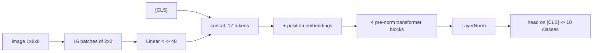

# Vision Transformer

> Cut the image into patches, treat each patch as a word, and run the same transformer you use for text.

**Type:** Build
**Languages:** Python
**Prerequisites:** Phase 03 (CNNs), The Transformer Block, Positional Encodings
**Time:** ~50 minutes

## Learning Objectives

- Turn an image into a sequence of patch tokens and show that the linear patch embedding is a strided convolution
- Build a ViT from scratch: patch embedding, `[CLS]` token, learned position embeddings, pre-norm blocks and a classification head
- Train it on 8x8 digits and compare it with torchvision's `VisionTransformer` and a small CNN, and explain the gap in terms of inductive bias
- Inspect what the trained model learned: `[CLS]` attention over patches and the structure of the position embeddings

## The Problem

For a decade, vision meant convolutions. CNNs build in two strong assumptions: features are local, and the same feature can appear anywhere (Phase 03). Those assumptions are why a CNN learns from a few thousand images. They are also limits: a convolution only relates distant parts of an image after many layers.

Dosovitskiy et al. (2020) asked whether the transformer, with no image-specific structure at all, could replace the CNN. Their recipe is almost embarrassingly simple: split the image into 16x16 patches, flatten each patch, project it to a vector, and feed the sequence to a standard transformer encoder. Trained on 300 million images it matched or beat the best CNNs; trained on ImageNet alone (1.3 million) it did worse. That trade-off (less built-in bias, more need for data) is the main lesson of the ViT, and you will reproduce it on a tiny scale. ViTs are now the image encoders inside CLIP, most vision-language models, and diffusion transformers.

## The Concept

### Patches as tokens

An `H x W` image with `C` channels and patch size `P` becomes `N = (H/P)(W/P)` patches, each flattened to `C P^2` numbers. A linear layer maps each to `d_model`:

```
8x8 digit, P = 2                     16 patches x 4 values -> Linear(4, 48) -> 16 tokens x 48
+--+--+--+--+
|p0|p1|p2|p3|                        p0 = [x00, x01, x10, x11]
+--+--+--+--+                        p1 = [x02, x03, x12, x13]
|p4|p5|p6|p7|                        ...
+--+--+--+--+
|..|..|..|..|
```

Applying the same linear map to every non-overlapping patch is exactly a convolution with kernel size and stride equal to `P`. That is how torchvision implements it (`conv_proj`), and the script checks the two are identical.

### `[CLS]` token and position embeddings

A learned vector, the `[CLS]` token (from BERT), is prepended to the patch sequence. It has no patch of its own; through attention it gathers information from all patches, and its final state is fed to the classifier. Learned position embeddings are added to all `N + 1` tokens, because attention alone does not know where a patch came from.



### Inductive bias

| | CNN | ViT |
|---|-----|-----|
| Locality | built in (small kernels) | must be learned (attention is global from layer 1) |
| Translation equivariance | built in (weight sharing) | only within patches; must be learned across patches |
| 2D structure | built in | only through learned position embeddings |
| Receptive field | grows with depth | whole image at every layer |

Less bias means a ViT can learn relations a CNN finds hard, but it has to learn locality and equivariance from data. With small datasets the CNN wins, often by a lot.

## Build It

### Step 1: Patchify

```python
def patchify(images, patch_size):
    batch, channels, height, width = images.shape
    patches = images.unfold(2, patch_size, patch_size).unfold(3, patch_size, patch_size)
    patches = patches.permute(0, 2, 3, 1, 4, 5)
    return patches.reshape(batch, (height // patch_size) * (width // patch_size), channels * patch_size * patch_size)
```

The same `unfold` you used for im2col in Phase 03, with step equal to the patch size so that patches do not overlap. Patches are ordered row by row.

### Step 2: The model

```python
class ScratchViT(nn.Module):
    def __init__(self, image_size=8, patch_size=2, channels=1, d_model=48, num_heads=4, num_layers=4, num_classes=10):
        super().__init__()
        self.patch_size = patch_size
        num_patches = (image_size // patch_size) ** 2
        self.patch_embed = nn.Linear(channels * patch_size * patch_size, d_model)
        self.cls_token = nn.Parameter(torch.zeros(1, 1, d_model))
        self.position = nn.Parameter(torch.randn(1, num_patches + 1, d_model) * 0.02)
        self.blocks = nn.ModuleList(Block(d_model, num_heads, 2 * d_model) for _ in range(num_layers))
        self.norm = nn.LayerNorm(d_model)
        self.head = nn.Linear(d_model, num_classes)

    def forward(self, images):
        tokens = self.patch_embed(patchify(images, self.patch_size))
        cls = self.cls_token.expand(tokens.shape[0], -1, -1)
        x = torch.cat([cls, tokens], dim=1) + self.position
        for block in self.blocks:
            x = block(x)
        return self.head(self.norm(x[:, 0]))
```

`Block` is the pre-norm transformer block from two lessons ago. `expand` gives every image in the batch a view of the same `[CLS]` parameter without copying it. The classifier only reads `x[:, 0]`, the `[CLS]` position.

### Step 3: Check the patch embedding

```
An 8x8 digit -> 16 patches of 2x2 = 4 values each
Linear patch embedding == Conv2d(kernel=stride=patch): max diff 0.0e+00
Sequence entering the encoder: 17 tokens (1 [CLS] + 16 patches) of width 48
```

### Step 4: Train three models

Each model gets 40 epochs of AdamW with a one-cycle learning rate schedule and random 1-pixel shifts as augmentation:

```
model                 params  test acc
ViT (yours)           77,530     0.942
ViT (torchvision)     77,914     0.858
small CNN             21,386     1.000
```

The CNN, with a quarter of the parameters, is perfect. Both ViTs are clearly worse: with 1,437 training images, the transformer cannot learn the spatial priors the CNN gets for free. Your ViT and torchvision's have the same architecture; the gap between them comes from initialization details (torchvision initializes its classification head to zero and its patch projection with a scaled truncated normal, and it sees the grayscale digit repeated over 3 channels) and shrinks with longer training. Neither ViT is near the CNN on this budget, which is the ViT paper's finding in miniature.

### Step 5: What did it learn?

Attention from `[CLS]` to the 16 patches in the last block, averaged over test digits:

```
0.017 0.042 0.096 0.045
0.016 0.068 0.105 0.085
0.020 0.041 0.126 0.108
0.027 0.056 0.071 0.047
```

The left column (often empty background in these digits) gets little attention; the center and right columns, where strokes that distinguish digits are, get the most. The learned position embeddings have also picked up 2D structure without being told the image is a grid. Cosine similarity of every position embedding to that of patch (1, 1):

```
 0.20  0.30  0.16  0.21
 0.57  1.00  0.31  0.17
-0.15 -0.18 -0.26 -0.10
-0.50 -0.51 -0.49 -0.21
```

Neighbors in the same row and the cell above are similar; patches in the bottom rows are dissimilar. With more data, ViT position embeddings show clean row and column patterns.

## Use It

```python
from torchvision.models import VisionTransformer, vit_b_16

model = VisionTransformer(image_size=8, patch_size=2, num_layers=4, num_heads=4,
                          hidden_dim=48, mlp_dim=96, num_classes=10)
logits = model(images.repeat(1, 3, 1, 1))

big = vit_b_16(weights=None)
```

torchvision's `VisionTransformer` expects 3-channel input, so the script repeats the grayscale channel. `vit_b_16` is the standard ViT-Base (86M parameters, 224x224 input, 16x16 patches); with `weights="DEFAULT"` it would download ImageNet weights, which is how ViTs are normally used: pretrained on a huge dataset, then fine-tuned (Phase 03's transfer learning lesson applies unchanged). The `timm` library has hundreds of ViT variants. When you must train a ViT from scratch on small data, the DeiT recipe (strong augmentation, regularization, distillation from a CNN) closes much of the gap.

## Exercises

1. **Easy.** Train with patch size 4 (4 tokens) and patch size 1 (64 tokens). How do accuracy and training time change? Why does patch size 1 cost much more?
2. **Medium.** Replace the `[CLS]` token with global average pooling over the patch tokens (`x[:, 1:].mean(dim=1)`) before the head. Compare accuracy. Many recent ViTs use pooling instead of `[CLS]`.
3. **Hard.** Build a hybrid: replace the linear patch embedding with a small convolutional stem (two 3x3 convs with stride 1, then a stride-2 conv) that produces a 4x4 grid of 48-dim tokens. Does the convolutional inductive bias close the gap with the CNN?

## Key Terms

| Term | What people say | What it actually means |
|------|----------------|----------------------|
| Vision Transformer (ViT) | "A transformer for images" | A transformer encoder applied to a sequence of linearly embedded image patches |
| Patch embedding | "Tokenizing the image" | A linear map of each flattened `P x P` patch to `d_model`; equivalent to a conv with kernel = stride = `P` |
| `[CLS]` token | "Class token" | A learned extra token whose final state summarizes the image for classification |
| Inductive bias | "Built-in assumptions" | Architectural preferences such as locality and translation equivariance; CNNs have many, ViTs few |
| Data efficiency | "How much data a model needs" | ViTs need far more data (or pretraining) than CNNs to reach the same accuracy |
| Hybrid ViT | "Conv stem + transformer" | A ViT whose tokens come from a convolutional feature map instead of raw patches |

## Further Reading

- [Dosovitskiy et al., An Image is Worth 16x16 Words: Transformers for Image Recognition at Scale (2020)](https://arxiv.org/abs/2010.11929) -- the ViT paper, including the data-scale experiments
- [Touvron et al., Training data-efficient image transformers and distillation through attention (DeiT, 2020)](https://arxiv.org/abs/2012.12877) -- how to train ViTs on ImageNet alone
- [Dive into Deep Learning, Section 11.8: Transformers for Vision](https://d2l.ai/chapter_attention-mechanisms-and-transformers/vision-transformer.html) -- a ViT built from the same pieces
- [PyTorch docs: torchvision.models.VisionTransformer](https://pytorch.org/vision/stable/models/vision_transformer.html) -- the reference implementation and pretrained variants
