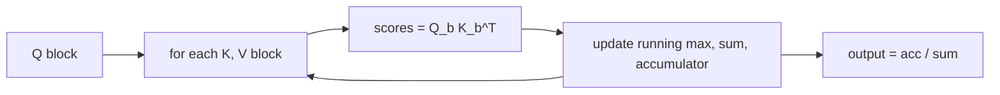

# Efficient Attention

> The n x n matrix is the problem. Compute it in tiles and never store it, look only nearby, or change the math so it never exists.

**Type:** Build
**Languages:** Python
**Prerequisites:** Self-Attention from Scratch, Multi-Head Attention, The Transformer Block
**Time:** ~55 minutes

## Learning Objectives

- Quantify the quadratic memory and compute cost of standard attention as sequence length grows
- Implement tiled attention with the online softmax (the core idea of FlashAttention) and show it is exact
- Implement sliding-window attention and kernelized linear attention, including a causal version with running sums, and explain what each one approximates or changes
- Benchmark naive attention, `F.scaled_dot_product_attention` and linear attention, and use grouped-query attention to shrink the key/value cache

## The Problem

Every attention layer computes a score for every pair of positions: `n^2` numbers per head. For a 1,000-token prompt that is a million scores, which is nothing. For a 32,000-token document it is a billion per head per layer, 4 GB in float32 just to hold one of them. Long documents, high-resolution images (a ViT on a 1024x1024 image with 16x16 patches has 4,096 tokens) and long audio all hit this wall.

There are three families of fixes. **Exact but smarter**: compute the same result without ever materializing the full matrix (FlashAttention). **Sparse**: let each token attend to only a subset of positions, such as a local window (Longformer, Mistral's sliding window). **Different math**: replace the softmax with a kernel so the computation can be reordered to cost `O(n)` (linear attention, and the ideas behind recurrent alternatives like RWKV and Mamba). Plus one more trick that targets inference memory rather than the score matrix: share keys and values across heads (multi-query and grouped-query attention).

## The Concept

### The cost of naive attention

```
S = Q K^T          n x n per head        O(n^2 d) compute, O(n^2) memory
P = softmax(S)     n x n per head
O = P V            n x d per head        O(n^2 d) compute
```

| n | scores per head | float32 |
|---|-----------------|---------|
| 1,024 | 1 M | 4 MB |
| 8,192 | 67 M | 256 MB |
| 32,768 | 1.07 B | 4 GB |
| 131,072 | 17 B | 64 GB |

On GPUs the compute is often fine; the bottleneck is moving `S` and `P` to and from slow GPU memory.

### Online softmax and tiling

Softmax needs the maximum and the sum of exponentials of a whole row, which seems to require the whole row. The **online softmax** removes that requirement. Process keys in blocks and keep, for each query, a running maximum `m`, a running sum `l`, and a running unnormalized output `acc`. When a new block arrives with scores `s`:

```
m_new = max(m, max(s))
c     = exp(m - m_new)                 rescale what you had
p     = exp(s - m_new)
l     = l * c + sum(p)
acc   = acc * c + p @ V_block
m     = m_new
...
output = acc / l
```

The result is exactly softmax attention, but each step only needs one block of `S`. FlashAttention runs this loop inside one GPU kernel with blocks sized to fit in fast on-chip memory, so the `n x n` matrix never touches main memory: memory becomes `O(n)` and the speed-up comes from far less memory traffic.



### Sliding-window attention

Each query attends only to the `w` most recent positions:

```
window 3, causal
1 0 0 0 0 0
1 1 0 0 0 0
1 1 1 0 0 0
0 1 1 1 0 0
0 0 1 1 1 0
0 0 0 1 1 1
```

Cost is `O(n w)`. A single layer is short-sighted, but stacking `L` layers gives an effective reach of `L w` positions, the same argument as receptive fields in CNNs. This is an approximation: outputs differ from full attention whenever relevant tokens fall outside the window.

### Linear attention

Write attention for one query as a weighted average with similarity `sim(q, k) = exp(q . k / sqrt(d))`. Replace that similarity by a dot product of feature maps, `phi(q) . phi(k)`, with `phi(x) = elu(x) + 1` (always positive). Then:

```
out_i = sum_j phi(q_i).phi(k_j) v_j / sum_j phi(q_i).phi(k_j)
      = phi(q_i) [sum_j phi(k_j)^T v_j] / phi(q_i) [sum_j phi(k_j)^T]
```

The brackets do not depend on `i`: compute the `d x d` matrix `phi(K)^T V` once and every query reuses it. Cost becomes `O(n d^2)`, linear in `n`. For causal attention, the brackets become running sums over `j <= i`, which is literally a recurrent network with a matrix-valued state. This is a different attention function, not an approximation of softmax attention, and it usually costs some quality.

### Grouped-query attention

During generation, every layer caches the keys and values of all previous tokens (Phase 09 builds the KV cache). With `h` heads that is `2 h d_head` numbers per token per layer. **Multi-query attention** shares one key/value head among all query heads; **grouped-query attention** (GQA) shares each key/value head among a group. LLaMA 2 70B and most recent open models use GQA.

## Build It

### Step 1: Naive reference

```python
def naive_attention(q, k, v, causal=False):
    scores = q @ k.transpose(-2, -1) / math.sqrt(q.shape[-1])
    if causal:
        length = q.shape[-2]
        mask = torch.ones(length, length, dtype=torch.bool, device=q.device).tril()
        scores = scores.masked_fill(~mask, float("-inf"))
    return torch.softmax(scores, dim=-1) @ v
```

### Step 2: Tiled attention with online softmax

```python
def tiled_attention(q, k, v, block_size):
    scale = 1.0 / math.sqrt(q.shape[-1])
    output = torch.zeros_like(q)
    for q_start in range(0, q.shape[-2], block_size):
        q_block = q[..., q_start:q_start + block_size, :] * scale
        running_max = torch.full(q_block.shape[:-1], float("-inf"), device=q.device)
        running_sum = torch.zeros(q_block.shape[:-1], device=q.device)
        accumulator = torch.zeros_like(q_block)
        for k_start in range(0, k.shape[-2], block_size):
            k_block = k[..., k_start:k_start + block_size, :]
            v_block = v[..., k_start:k_start + block_size, :]
            scores = q_block @ k_block.transpose(-2, -1)
            new_max = torch.maximum(running_max, scores.amax(dim=-1))
            correction = torch.exp(running_max - new_max)
            probabilities = torch.exp(scores - new_max[..., None])
            running_sum = running_sum * correction + probabilities.sum(dim=-1)
            accumulator = accumulator * correction[..., None] + probabilities @ v_block
            running_max = new_max
        output[..., q_start:q_start + block_size, :] = accumulator / running_sum[..., None]
    return output
```

On the first block `running_max` is `-inf`, so `correction = exp(-inf) = 0` and the empty accumulator is correctly discarded. The result matches naive attention for any block size, including one (100) that does not divide the length:

```
Tiled attention with online softmax, block  16: max diff from naive 4.8e-07
Tiled attention with online softmax, block  64: max diff from naive 5.4e-07
Tiled attention with online softmax, block 100: max diff from naive 5.7e-07
```

### Step 3: Sliding window

```python
def sliding_window_mask(length, window, device):
    positions = torch.arange(length, device=device)
    distance = positions[:, None] - positions[None, :]
    return (distance >= 0) & (distance < window)
```

With a window of 32 over 256 tokens each query sees at most 32 keys, 11.7% of the full matrix. The output differs from full causal attention (mean absolute difference about 0.15 on random inputs), which is the price of the approximation.

### Step 4: Linear attention, parallel and causal

```python
def linear_attention(q, k, v):
    q, k = feature_map(q), feature_map(k)
    key_value = k.transpose(-2, -1) @ v
    normalizer = q @ k.sum(dim=-2, keepdim=True).transpose(-2, -1)
    return (q @ key_value) / normalizer


def causal_linear_attention(q, k, v):
    q, k = feature_map(q), feature_map(k)
    key_value = torch.cumsum(k[..., :, :, None] * v[..., :, None, :], dim=-3)
    numerator = (q[..., :, :, None] * key_value).sum(dim=-2)
    normalizer = (q * torch.cumsum(k, dim=-2)).sum(dim=-1, keepdim=True)
    return numerator / normalizer
```

The script verifies that `phi(Q) (phi(K)^T V)` equals `(phi(Q) phi(K)^T) V` (associativity, the whole trick), and that the causal version with cumulative sums equals recomputing attention over each prefix. The causal version here materializes one `d x d` state per position for clarity; real implementations process chunks to save memory.

### Step 5: Benchmark

Batch 1, 8 heads, `d_head = 64`, on a GPU (your numbers will differ):

```
     n  naive ms  naive MB  tiled ms  sdpa ms  sdpa MB  linear ms  linear MB
   512      0.29      17.0      1.10     0.24      1.0       0.19        4.1
  1024      0.94      66.0      9.26     1.91      2.0       0.24        8.2
  2048      3.45     260.0     15.25     2.76      4.0       0.45       16.2
  4096     14.20    1032.0     60.01    11.91      8.0       2.32       32.2
```

Read the memory columns. Naive attention's extra memory grows 4x each time `n` doubles (quadratic): over 1 GB at 4,096 tokens for a single layer. `F.scaled_dot_product_attention` uses a fused FlashAttention-style kernel and its memory grows only 2x (linear), from 1 MB to 8 MB. Linear attention is also linear in memory and is the fastest at long lengths. Your Python `tiled_attention` is the slowest: it has the right memory behavior in principle, but the Python loops launch many small kernels. The point of FlashAttention is doing that same loop inside one kernel. On CPU the script measures shorter lengths and skips memory.

### Step 6: Grouped-query attention

```
KV memory per token per layer: multi-head 1024 values, grouped-query with 2 KV heads 256, multi-query 128
Grouped-query attention: repeated KV heads vs F.scaled_dot_product_attention(enable_gqa=True): 1.0e-06
```

With 8 query heads and 2 key/value heads, each KV head is repeated 4 times (`repeat_interleave`) to serve its group. The KV cache shrinks 4x while the query side keeps all 8 heads.

## Use It

In PyTorch, use `F.scaled_dot_product_attention` everywhere you would write attention by hand:

```python
out = F.scaled_dot_product_attention(q, k, v, is_causal=True)
out = F.scaled_dot_product_attention(q, k, v, attn_mask=sliding_window_mask(n, w, device))
out = F.scaled_dot_product_attention(q, k_grouped, v_grouped, enable_gqa=True)
```

It selects a backend automatically: FlashAttention or memory-efficient kernels on supported GPUs, a math fallback otherwise. Two practical rules: masks you pass as tensors can prevent the fastest backend from being used (prefer `is_causal=True` over an explicit causal mask), and the flash backend requires float16 or bfloat16 on most GPUs. `torch.nn.attention.sdpa_kernel` lets you force or exclude a backend when benchmarking. For more structured sparsity (sliding windows, document masks, ALiBi-style biases) with flash-level efficiency, PyTorch provides FlexAttention (`torch.nn.attention.flex_attention`).

## Exercises

1. **Easy.** Add a causal option to `tiled_attention`: skip key blocks that are entirely in the future, and mask the diagonal block. Verify against `naive_attention(..., causal=True)` and count how many block pairs you skip.
2. **Medium.** Replace the causal mask in the decoder-only addition model from Encoders vs Decoders with a sliding window of 3, 5 and 9. Which window sizes still solve two-digit addition, and why does the answer depend on where the digits it needs are?
3. **Hard.** Implement chunked causal linear attention: split the sequence into chunks of size `c`, use full (quadratic) attention with the linear kernel inside each chunk, and carry the running `phi(K)^T V` state between chunks. Verify against `causal_linear_attention` and measure peak memory as a function of `c`.

## Key Terms

| Term | What people say | What it actually means |
|------|----------------|----------------------|
| Quadratic attention | "Attention is O(n^2)" | Standard attention computes and stores `n^2` scores per head |
| Online softmax | "Streaming softmax" | Computing softmax-weighted sums block by block with a running max and sum, rescaling previous partial results |
| FlashAttention | "Fast exact attention" | A fused GPU kernel that tiles attention with the online softmax so the `n x n` matrix never leaves on-chip memory |
| Sliding-window attention | "Local attention" | Each token attends only to the `w` nearest (usually previous) positions; `O(n w)` cost |
| Linear attention | "Kernelized attention" | Replacing `exp(q.k)` with `phi(q).phi(k)` so outputs can be computed with `O(n)` cost via associativity |
| KV cache | "Cached keys and values" | Stored keys and values of past tokens reused at each generation step |
| Grouped-query attention | "GQA" | Several query heads share one key/value head, shrinking the KV cache |
| Multi-query attention | "MQA" | All query heads share a single key/value head |

## Further Reading

- [Dao et al., FlashAttention: Fast and Memory-Efficient Exact Attention with IO-Awareness (2022)](https://arxiv.org/abs/2205.14135) -- tiling, the online softmax and why memory traffic dominates
- [Katharopoulos et al., Transformers are RNNs: Fast Autoregressive Transformers with Linear Attention (2020)](https://arxiv.org/abs/2006.16236) -- linear attention with the `elu + 1` feature map and its recurrent form
- [Beltagy, Peters and Cohan, Longformer: The Long-Document Transformer (2020)](https://arxiv.org/abs/2004.05150) -- sliding-window plus global attention
- [Ainslie et al., GQA: Training Generalized Multi-Query Transformer Models from Multi-Head Checkpoints (2023)](https://arxiv.org/abs/2305.13245) -- grouped-query attention
