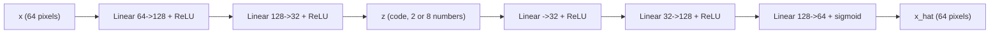

# Autoencoders

> Squeeze the input through a narrow pipe and ask the network to rebuild it. Whatever survives the squeeze is what the data is really about.

**Type:** Build
**Languages:** Python
**Prerequisites:** Phase 01 (Neural Networks: Multilayer Perceptrons, PyTorch nn.Module), Phase 02 (Training Deep Nets: SGD, Momentum and Adam)
**Time:** ~60 minutes

## Learning Objectives

- Build an encoder and a decoder from raw weight tensors and train them to reconstruct their own input
- Show that a linear autoencoder with squared error learns the same subspace as PCA
- Explain why a nonlinear bottleneck compresses better than PCA at the same code size
- Inspect a 2D latent code and see that digit classes cluster without ever seeing a label

## The Problem

Every supervised lesson so far needed labels. Labels are expensive: someone has to sit down and write "7" under every image. Unlabeled images, sentences and sounds are nearly free. If you could learn something useful from the raw data alone, you would have access to orders of magnitude more training signal.

The oldest trick for this is to make the data its own target. Take an 8x8 digit (64 numbers), force it through a layer with only 2 or 8 numbers, and ask the network to rebuild all 64 pixels from that tiny code. The network cannot memorize pixel by pixel; it has to discover the few factors (which digit, how slanted, how thick) that explain most of the image. That code is a compressed representation you can plot, cluster, search or feed to a classifier.

Autoencoders are also the first building block of the generative models in this phase and the next two: variational autoencoders, the decoder side of GANs, and the latent space that latent diffusion (Stable Diffusion) runs in.

## The Concept

### Encoder, bottleneck, decoder



The encoder `f` maps `x` to a code `z = f(x)`. The decoder `g` maps the code back, `x_hat = g(z)`. Training minimizes the reconstruction error

```
L = (1 / n) * sum_i || x_i - g(f(x_i)) ||^2
```

There are no labels anywhere in that loss. The only thing that stops the network from learning the identity function is the bottleneck: the code is much smaller than the input.

### The linear case is PCA

Drop every nonlinearity. Then `x_hat = x W_e W_d`, a rank-k linear map. The best rank-k reconstruction of a data matrix under squared error is given by its top-k principal components (the Eckart-Young theorem). So a linear autoencoder trained to convergence spans the same subspace as PCA, with the same reconstruction error. The weights are not necessarily the principal directions themselves (any invertible mix of them works equally well), but the subspace is.

```
linear AE:  x -> W_e (64 x k) -> W_d (k x 64) -> x_hat     reaches PCA's error
nonlinear:  x -> curved map -> z -> curved map -> x_hat    can beat PCA
```

### Why nonlinear helps

PCA can only project onto a flat k-dimensional plane. Real data sits on a curved surface (a manifold): the set of all "3"s is not a plane in pixel space. A nonlinear encoder can unroll that surface into the code, and a nonlinear decoder can roll it back up. With the same 8 numbers, it reconstructs better.

### The code is a representation

Because similar images need similar codes to be rebuilt similarly, the code space ends up organized. In a 2D code you can literally see the digit classes as blobs. Nobody told the network what a digit is; the structure came from the reconstruction objective alone. This is the seed idea of self-supervised learning, which the rest of the phase develops.

### What an autoencoder is not

A plain autoencoder is not a generative model. If you pick a random point in code space and decode it, you may land in a hole between clusters and get garbage. Making the code space "fillable" is what the variational autoencoder (lesson 03) adds.

## Build It

The code works on scikit-learn's `load_digits`: 1797 grayscale 8x8 images, scaled to `[0, 1]`. 1497 are used for training, 300 for testing.

### Step 1: Layers as raw tensors

No `nn.Linear`: each layer is a weight matrix and a bias, initialized with He scaling.

```python
def init_linear(n_in, n_out, generator):
    weight = torch.randn(n_in, n_out, generator=generator) * np.sqrt(2.0 / n_in)
    bias = torch.zeros(n_out)
    return [weight.requires_grad_(), bias.requires_grad_()]
```

### Step 2: The autoencoder

The decoder uses the reversed list of sizes, so `[64, 128, 32, 8]` gives an encoder 64->128->32->8 and a decoder 8->32->128->64. The last decoder layer goes through a sigmoid because pixels live in `[0, 1]`. Setting `nonlinear=False` removes every activation, which turns it into the linear autoencoder.

```python
class ScratchAutoencoder:
    def __init__(self, sizes, generator, nonlinear=True):
        self.nonlinear = nonlinear
        encoder_sizes = sizes
        decoder_sizes = sizes[::-1]
        self.encoder = [init_linear(a, b, generator) for a, b in zip(encoder_sizes[:-1], encoder_sizes[1:])]
        self.decoder = [init_linear(a, b, generator) for a, b in zip(decoder_sizes[:-1], decoder_sizes[1:])]

    def run(self, layers, h, last_activation):
        for index, (weight, bias) in enumerate(layers):
            h = h @ weight + bias
            is_last = index == len(layers) - 1
            if not is_last and self.nonlinear:
                h = torch.relu(h)
            if is_last and last_activation:
                h = torch.sigmoid(h)
        return h

    def encode(self, x):
        return self.run(self.encoder, x, last_activation=False)

    def decode(self, z):
        return self.run(self.decoder, z, last_activation=self.nonlinear)
```

### Step 3: Train on reconstruction

The loss is mean squared error between the input and its reconstruction. The input is also the target.

```python
for start in range(0, len(X_train), batch_size):
    batch = X_train[order[start:start + batch_size]]
    loss = ((model(batch) - batch) ** 2).mean()
    optimizer.zero_grad()
    loss.backward()
    optimizer.step()
```

### Step 4: Linear autoencoder vs PCA

```
code 2: linear AE test MSE 0.0529 | PCA test MSE 0.0529
code 8: linear AE test MSE 0.0244 | PCA test MSE 0.0242
```

The linear autoencoder lands on PCA's error, as the theory says. It took 150 epochs of Adam to get there, while PCA is a single SVD. If your autoencoder is linear, just use PCA.

### Step 5: Add nonlinearity

```
code 2: nonlinear AE test MSE 0.0329  (compression 64 -> 2)
code 8: nonlinear AE test MSE 0.0119  (compression 64 -> 8)
```

With 8 numbers the nonlinear model halves PCA's error (0.0119 vs 0.0242). With only 2 numbers it is 38% better than 2-component PCA. The saved `reconstructions.png` shows it: the PCA rows are blurry averages, the code-8 autoencoder keeps strokes sharp, and the code-2 autoencoder sometimes turns a digit into its most typical neighbor (a "4" becomes a "1"), because 2 numbers cannot hold every detail.

### Step 6: Look at the code

The script encodes the test set into 2D and saves `latent_2d.png`, colored by the true digit. To put a number on how organized it is, it computes the mean code of each digit and classifies every test point by its nearest mean:

```
nearest-centroid accuracy in the 2D code (labels never used in training): 0.713
```

Chance is 0.10. Two numbers learned purely from reconstruction already separate most of the classes.

## Use It

In practice you write the same model with `nn.Sequential`:

```python
encoder = nn.Sequential(nn.Linear(64, 128), nn.ReLU(), nn.Linear(128, 32), nn.ReLU(), nn.Linear(32, 8))
decoder = nn.Sequential(nn.Linear(8, 32), nn.ReLU(), nn.Linear(32, 128), nn.ReLU(), nn.Linear(128, 64), nn.Sigmoid())
library_model = nn.Sequential(encoder, decoder)
```

It reaches a test MSE of 0.0124, matching the scratch version (0.0119) up to initialization noise, with 25,480 parameters. Keep the encoder and decoder as separate modules: you will want to call the encoder alone to get embeddings and the decoder alone to generate.

For images larger than 8x8 you replace the linear layers with convolutions in the encoder and transposed convolutions in the decoder (Phase 03 and the DCGAN lesson in Phase 07). For binary-ish pixels, binary cross-entropy (`F.binary_cross_entropy`) is a common alternative to MSE.

## Exercises

1. **Easy.** Sweep the code size over 1, 2, 4, 8, 16, 32 for both PCA and the nonlinear autoencoder and plot test MSE against code size. At what size does the gap close?
2. **Medium.** Remove the bottleneck: make the code 64-dimensional with a 64->256->64 encoder. The test MSE becomes tiny, but is the code still useful? Measure nearest-centroid accuracy with a 2D PCA of the 64D code and compare it with the 2D bottleneck.
3. **Hard.** Train a convolutional autoencoder (Conv2d with stride 2 down to a 2x2 grid of channels, ConvTranspose2d back up) with the same number of code numbers as the 8D MLP. Does weight sharing help on 8x8 images?

## Key Terms

| Term | What people say | What it actually means |
|------|----------------|----------------------|
| Autoencoder | "A network that copies its input" | An encoder and a decoder trained so `g(f(x))` reconstructs `x`, through a constrained code |
| Encoder | "The compressor" | The function `f` mapping an input to its code `z` |
| Decoder | "The decompressor" | The function `g` mapping a code back to input space |
| Bottleneck / latent code | "The compressed version" | The small intermediate representation `z`; its size limits how much information gets through |
| Reconstruction loss | "How close the copy is" | A distance (MSE, BCE) between `x` and `x_hat`; the only training signal |
| Linear autoencoder | "Fancy PCA" | An autoencoder without activations; at optimum it spans the top-k principal subspace |
| Manifold | "Where the data lives" | A low-dimensional curved surface in input space near which real examples lie |
| Self-supervised | "No labels needed" | Learning from targets built from the data itself, here the input as its own target |

## Further Reading

- [Hinton and Salakhutdinov, Reducing the Dimensionality of Data with Neural Networks (Science, 2006)](https://www.cs.toronto.edu/~hinton/absps/science.pdf) - the paper that showed deep autoencoders beating PCA on images
- [Dive into Deep Learning](https://d2l.ai/) - the book's chapters on multilayer perceptrons and optimization cover everything this model is built from
- [Goodfellow, Bengio and Courville, Deep Learning, Chapter 14: Autoencoders](https://www.deeplearningbook.org/contents/autoencoders.html) - undercomplete, regularized and denoising autoencoders in one place
- [Baldi and Hornik, Neural networks and principal component analysis (1989)](https://doi.org/10.1016/0893-6080(89)90014-2) - the proof that linear autoencoders recover the PCA subspace
