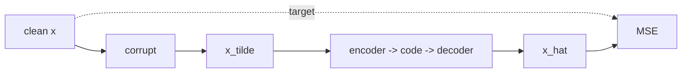

# Denoising Autoencoders

> Do not ask the network to copy. Break the input first and ask it to repair the damage.

**Type:** Build
**Languages:** Python
**Prerequisites:** Phase 06 Lesson 01 (Autoencoders), Phase 02 (Training Deep Nets: Dropout and Weight Decay)
**Time:** ~50 minutes

## Learning Objectives

- Train a denoising autoencoder that maps corrupted digits (Gaussian noise, masked pixels) back to clean ones
- Explain why a plain autoencoder with a wide code learns a near-identity and copies the noise through
- Show that the denoising objective works even when the code is larger than the input
- Visualize what a denoiser learns on 2D data: a vector field that points back toward the data, the idea behind diffusion models

## The Problem

The plain autoencoder of the previous lesson only learns something useful because the bottleneck is narrow. Make the code as wide as the input and it can learn to copy, reaching a tiny reconstruction error while learning nothing about the data. You are forced to tune the bottleneck size, and a tiny bottleneck throws away detail you might want.

Real inputs are also noisy: sensor noise, compression artifacts, missing pixels. You want a model that knows what clean data looks like well enough to fix it.

The denoising autoencoder (Vincent et al., 2008) solves both problems with one change: corrupt the input, keep the clean version as the target. Copying no longer works, because the input contains noise the target does not. The only way to lower the loss is to learn what real digits look like.

## The Concept

### The objective

```
x        clean image
x_tilde  ~ C(x_tilde | x)         corruption: add noise, drop pixels
loss     = || g(f(x_tilde)) - x ||^2
```



Common corruptions:

| Corruption | What it does | Teaches the model |
|---|---|---|
| Gaussian | `x + sigma * eps`, clipped | to smooth while keeping strokes |
| Masking | set a random 30% of pixels to 0 | to fill in missing parts from context |
| Salt and pepper | set random pixels to 0 or 1 | to ignore outliers |

### What the optimal denoiser computes

With squared error, the best possible denoiser outputs the average clean image among all clean images that could have produced this noisy one:

```
r*(x_tilde) = E[ x | x_tilde ]
```

For points far from the data, that average is pulled toward the data. For small Gaussian noise, Tweedie's formula makes this precise:

```
E[x | x_tilde] - x_tilde  =  sigma^2 * grad_x log p_sigma(x_tilde)
```

The residual `r(x_tilde) - x_tilde` is proportional to the score, the gradient of the log density. It is a vector field that points uphill in probability, toward where the data lives. Diffusion models (Phase 08) are exactly this idea: train denoisers at many noise levels and follow their arrows from pure noise to data.

### Why width stops being dangerous

A plain autoencoder with a 256-wide code can implement `x_hat = x` and win. A denoising autoencoder implementing the identity outputs the noisy input, which scores the full noise MSE. So the denoising loss is a regularizer that does not depend on a narrow bottleneck.

## Build It

The script reuses the digits split from lesson 01 (1497 train, 300 test, pixels in `[0, 1]`).

### Step 1: Corruptions

```python
def gaussian_noise(x, sigma, generator):
    return (x + sigma * torch.randn(x.shape, generator=generator)).clamp(0, 1)


def masking_noise(x, drop_prob, generator):
    keep = (torch.rand(x.shape, generator=generator) > drop_prob).float()
    return x * keep
```

A fresh corruption is drawn for every minibatch, so the model sees each digit with many different noise patterns.

### Step 2: The training loop

The only change from lesson 01 is two lines: corrupt the batch, then compare against the clean batch.

```python
clean = X_train[order[start:start + batch_size]]
noisy = corrupt(clean, generator)
loss = ((model(noisy) - clean) ** 2).mean()
```

The model is a scratch MLP `64 -> 128 -> 16 -> 128 -> 64` built from raw weight tensors, the same as in lesson 01.

### Step 3: Plain vs denoising, same architecture

With Gaussian noise `sigma = 0.35`, a noisy test image is at MSE 0.0672 from its clean version.

```
clean input  -> plain AE MSE 0.0109 | DAE MSE 0.0159
noisy input  -> plain AE MSE 0.0521 | DAE MSE 0.0243
```

On clean inputs the plain autoencoder is slightly better: it was trained for exactly that. On noisy inputs the denoiser cuts the error to a third of the noise level, while the plain autoencoder only removes a little noise, mostly by accident of its bottleneck.

### Step 4: Remove the bottleneck

Now both models are `64 -> 256 -> 64`, a code four times wider than the image.

```
plain AE (wide): clean MSE 0.0013 | noisy-in MSE 0.0484
DAE (wide):      clean MSE 0.0093 | noisy-in MSE 0.0200
```

The wide plain autoencoder reaches 0.0013 on clean data, which looks great but means it learned a near-identity: give it noise and it passes the noise straight through. The wide denoiser is still a good denoiser (0.0200, better than the narrow one). The corruption, not the bottleneck, did the regularizing.

### Step 5: Masking noise

Set 30% of the pixels to zero and train against the clean digit:

```
masked input MSE 0.0722 | plain AE 0.0416 | masking DAE 0.0205
```

The model has to fill in missing strokes from the pixels that remain. This "hide part of the input and predict it" objective is the ancestor of the masked autoencoders of lesson 06 and of BERT-style language model pretraining. `denoising.png` shows clean, noisy, plain AE, DAE, masked and masking-DAE rows.

### Step 6: The denoiser as a vector field

To see what a denoiser learns, train one on 2D points on a ring of radius 1 with noise 0.3, and probe it:

```
(+0.0, +0.0) |r|=0.00 -> (+0.03, -0.07) |r|=0.08
(+0.5, +0.0) |r|=0.50 -> (+0.85, -0.04) |r|=0.85
(+1.6, +0.0) |r|=1.60 -> (+0.94, +0.01) |r|=0.94
(+0.0, -0.4) |r|=0.40 -> (-0.02, -0.85) |r|=0.85
```

Points inside the ring get pushed out, points outside get pulled in. The center stays near the center: it is equally close to every part of the ring, so the average clean point is the ring's mean, the origin. Outputs land slightly inside radius 1 (0.85 to 0.94) because the optimal answer is a posterior average, and averages of points on a circle fall inside it. `ring_field.png` draws the arrows `denoiser(x) - x` over the plane: a field that flows toward the data. Keep this picture in mind for Phase 08.

## Use It

The masking corruption is what `nn.Dropout` does to its input during training, so you can put a dropout layer first and train on clean targets:

```python
library_dae = nn.Sequential(nn.Dropout(p=0.3), nn.Linear(64, 128), nn.ReLU(), nn.Linear(128, 16), nn.ReLU(),
                            nn.Linear(16, 128), nn.ReLU(), nn.Linear(128, 64), nn.Sigmoid())
```

It reaches MSE 0.0211 on masked test digits, matching the scratch masking DAE (0.0205). One detail: dropout multiplies the surviving pixels by `1 / (1 - p)` in training mode and does nothing in eval mode. To feed it a masked image at test time you rescale by `1 / 0.7` so it sees the same statistics it trained on. Writing the corruption yourself, as in the scratch version, avoids that trap and lets you use any noise you like.

Denoising is still a practical tool: image denoisers in phone cameras, speech enhancement, and the "denoising" pretraining of models like BART all train on corrupted-input, clean-target pairs.

## Exercises

1. **Easy.** Train denoisers with `sigma` in 0.1, 0.35, 0.6 and evaluate each one on all three noise levels. Does a denoiser trained on heavy noise handle light noise well?
2. **Medium.** Run the ring denoiser repeatedly: start from random points in the square and apply `x <- denoiser(x)` ten times. Where do the points end up, and why do they collapse instead of spreading over the ring? (This is why diffusion adds noise back between steps.)
3. **Hard.** Implement salt-and-pepper noise and train one denoiser on a random mix of all three corruptions. Compare its test MSE on each corruption with the specialists.

## Key Terms

| Term | What people say | What it actually means |
|------|----------------|----------------------|
| Denoising autoencoder | "An autoencoder that removes noise" | An autoencoder trained to map a corrupted input to the clean original |
| Corruption process | "Adding noise" | A random map `C(x_tilde | x)` applied to each input on the fly during training |
| Masking noise | "Dropout on the input" | Setting a random subset of input values to zero |
| Overcomplete code | "A bottleneck bigger than the input" | A code wider than the input; plain autoencoders then tend to learn the identity |
| Posterior mean | "The best guess" | `E[x | x_tilde]`, the output that minimizes squared error |
| Score | "Gradient of the data" | `grad_x log p(x)`, the direction in which data density increases fastest |
| Tweedie's formula | "Denoising equals score" | For Gaussian noise, `E[x | x_tilde] = x_tilde + sigma^2 * score(x_tilde)` |

## Further Reading

- [Vincent et al., Extracting and Composing Robust Features with Denoising Autoencoders (ICML 2008)](https://www.cs.toronto.edu/~larocheh/publications/icml-2008-denoising-autoencoders.pdf) - the original denoising autoencoder paper
- [Vincent, A Connection Between Score Matching and Denoising Autoencoders (2011)](https://www.iro.umontreal.ca/~vincentp/Publications/smdae_techreport.pdf) - the proof that denoising learns the score, the bridge to diffusion
- [Alain and Bengio, What Regularized Auto-Encoders Learn from the Data Generating Distribution (arXiv:1211.4246)](https://arxiv.org/abs/1211.4246) - shows the reconstruction residual estimates the score
- [Goodfellow, Bengio and Courville, Deep Learning, Chapter 14](https://www.deeplearningbook.org/contents/autoencoders.html) - Section 14.5 on denoising autoencoders and their vector fields
