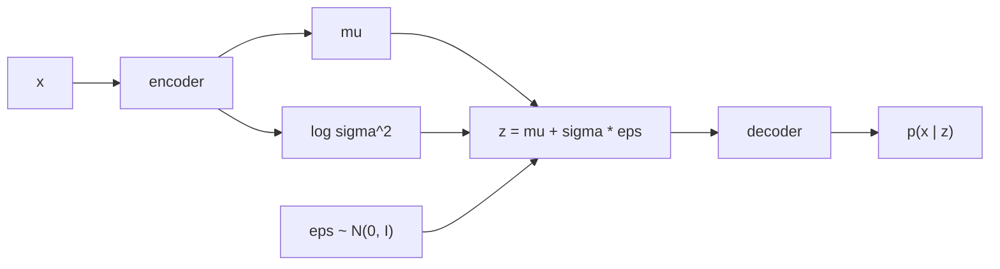

# Variational Autoencoders

> Encode each input as a small cloud instead of a point, and keep all the clouds close to a standard Gaussian. Then you can sample.

**Type:** Build
**Languages:** Python
**Prerequisites:** Phase 06 Lessons 01-02 (Autoencoders, Denoising Autoencoders), Phase 01 (Neural Networks: Loss Functions for Networks)
**Time:** ~75 minutes

## Learning Objectives

- Derive the VAE loss (the negative ELBO) as reconstruction error plus a KL divergence to the prior
- Implement the reparameterization trick and verify that gradients flow into the mean and the variance
- Compute the Gaussian KL divergence in closed form and check it against `torch.distributions`
- Generate new digits by decoding samples from `N(0, I)` and explain the role of `beta`, including posterior collapse

## The Problem

A plain autoencoder gives you a decoder that turns codes into images, which sounds like a generator. Try it: draw random codes and decode them. The script does that with a trained 8D autoencoder, and only 11% of the outputs look like a confident digit to a classifier, with the predicted classes piled up on 4s and 5s. The reason is that nothing told the encoder where to put codes. They ended up with a spread of about 1.7 per dimension and an arbitrary shape, full of holes. A random point usually lands in a hole.

To generate, you need a code space you know how to sample from. The variational autoencoder (Kingma and Welling, 2013) gets it by asking two things at once: the decoder must reconstruct the input, and the distribution of codes must stay close to a simple prior, `N(0, I)`. After training you sample `z ~ N(0, I)`, decode, and get a new image.

## The Concept

### A probabilistic autoencoder



The encoder no longer outputs a code. It outputs the parameters of a Gaussian `q(z | x) = N(mu(x), diag(sigma^2(x)))`: a small cloud of plausible codes for this input. The decoder defines `p(x | z)`, here a Bernoulli per pixel with probability `sigmoid(logits)`.

### The objective: the ELBO

You would like to maximize `log p(x)`, the likelihood of the data, but it requires integrating over all `z`. The evidence lower bound is a tractable stand-in:

```
log p(x) >= E_{z ~ q(z|x)} [ log p(x | z) ]  -  KL( q(z | x) || p(z) )
            \_________ reconstruction _______/    \_____ regularizer ______/
```

Training minimizes the negative ELBO:

```
L(x) = BCE(x, decoder(z))  +  beta * KL( N(mu, sigma^2) || N(0, I) ),     z ~ q(z | x)
```

with `beta = 1` for the true ELBO. The two terms pull in opposite directions. Reconstruction wants every `x` to get its own tight, distinct cloud. The KL wants every cloud to be the standard Gaussian. The compromise is a code space where clouds overlap and cover the prior, so there are no holes to fall into.

### KL between Gaussians in closed form

For a diagonal Gaussian against `N(0, I)`, summed over latent dimensions:

```
KL = 0.5 * sum_j ( mu_j^2 + sigma_j^2 - 1 - log sigma_j^2 )
```

It is zero only when `mu = 0` and `sigma = 1`. Predicting `log sigma^2` instead of `sigma` keeps the variance positive without constraints.

### The reparameterization trick

Sampling `z ~ N(mu, sigma^2)` is not differentiable with respect to `mu` and `sigma`. Rewrite the sample as a deterministic function of the parameters and an independent noise:

```
z = mu + sigma * eps,     eps ~ N(0, I)
dz/dmu = 1,   dz/dsigma = eps
```

The randomness now lives in `eps`, which has no parameters, and backpropagation goes straight through `mu` and `sigma`.

### beta and posterior collapse

| beta | Effect |
|---|---|
| < 1 | sharper reconstructions, codes spread out, prior samples less reliable |
| = 1 | the true ELBO |
| > 1 | smoother, more "disentangled" codes (beta-VAE), blurrier reconstructions |
| too large | the KL wins entirely: `q(z|x) = N(0, I)` for every x, the decoder ignores z |

The last row is called posterior collapse: the code carries zero information, and the decoder outputs the average digit.

## Build It

### Step 1: The reparameterization trick

```python
def reparameterize(mu, logvar, generator):
    eps = torch.randn(mu.shape, generator=generator)
    return mu + torch.exp(0.5 * logvar) * eps
```

The script checks it on one number with `L = z^2`:

```
z = 2.041, dL/dmu = 4.082, dL/dlogvar = 3.145
```

`dL/dmu = 2z`, and `dL/dlogvar = 2z * 0.5 * sigma * eps`, so gradients do reach both parameters.

### Step 2: The model and the loss

The encoder is `64 -> 128 -> 2 * latent_dim`, split into `mu` and `logvar`. The decoder is `latent_dim -> 128 -> 64` and returns logits. All weights are raw tensors, as in lesson 01.

```python
def gaussian_kl(mu, logvar):
    return 0.5 * (mu ** 2 + logvar.exp() - 1.0 - logvar).sum(dim=1)


def vae_terms(model, x, generator):
    mu, logvar = model.encode(x)
    z = reparameterize(mu, logvar, generator)
    logits = model.decode_logits(z)
    reconstruction = F.binary_cross_entropy_with_logits(logits, x, reduction="none").sum(dim=1)
    return reconstruction, gaussian_kl(mu, logvar)
```

Both terms are summed over pixels and latent dimensions, then averaged over the batch, so they are measured in the same units (nats per image). Averaging the BCE over pixels instead would silently multiply `beta` by 64.

```python
reconstruction, kl = vae_terms(model, batch, generator)
loss = (reconstruction + beta * kl).mean()
```

After 200 epochs with an 8D latent:

```
test: reconstruction 20.47 nats + KL 3.54 nats = negative ELBO 24.00
```

### Step 3: Sample from the prior

To judge samples without a human, a logistic regression is trained on real digits (96.7% test accuracy). On real test digits it is more than 90% confident 77% of the time. Now decode 500 draws of `z ~ N(0, I)`:

```
plain AE code std per dim: 1.68, mean |code|: 1.83 (not N(0, 1))
VAE      prior samples with confidence > 0.9: 0.20 | predicted class counts [47, 61, 55, 57, 45, 38, 37, 50, 54, 56]
plain AE prior samples with confidence > 0.9: 0.11 | predicted class counts [19, 4, 44, 48, 179, 116, 11, 58, 10, 11]
```

The VAE samples cover all ten digits almost evenly; the plain autoencoder's samples collapse onto a few classes because its codes do not live where `N(0, I)` puts its mass. VAE samples are still blurry (only 20% confident), a known weakness: the Gaussian smoothing in code space and the pixel-wise likelihood average over plausible images. GANs (Phase 07) and diffusion models (Phase 08) were invented largely to fix that blur. `vae_samples.png` shows 60 samples.

### Step 4: The beta tradeoff

```
beta 0.1: reconstruction  16.91 | KL 14.66 | confident samples 0.19
beta 1.0: reconstruction  20.92 | KL  3.29 | confident samples 0.16
beta 4.0: reconstruction  27.18 | KL  0.00 | confident samples 0.00
```

Low `beta` reconstructs better and pays more KL. At `beta = 4` the KL is exactly zero: posterior collapse. Every image is encoded as `N(0, I)`, the decoder learns to output the mean digit, and no sample looks like a specific digit.

### Step 5: A 2D latent you can walk through

With a 2D latent you can decode a grid of points. The grid uses Gaussian quantiles (5% to 95%) so it covers the prior evenly:

```python
quantiles = torch.tensor(np.linspace(0.05, 0.95, 12), dtype=torch.float32)
grid_values = Normal(0.0, 1.0).icdf(quantiles)
```

The test codes have mean close to `(0, 0)` and standard deviation close to 1 in each dimension, exactly what the KL asked for. `vae_manifold_2d.png` shows digits morphing smoothly into each other (3 into 2, 0 into 6, 9 into 4 into 1): every point of the plane decodes to something digit-like, which is the "no holes" property in one picture.

## Use It

`torch.distributions` gives you Gaussians with a differentiable `rsample()` (the reparameterization trick) and analytic KL divergences:

```python
posterior = Normal(mu, torch.exp(0.5 * logvar))
prior = Normal(torch.zeros_like(mu), torch.ones_like(mu))
library_kl = kl_divergence(posterior, prior).sum(dim=1)
```

```
scratch KL  [3.5401, 3.5831, 4.1415, 5.4566, 3.8931]
library KL  [3.5401, 3.5831, 4.1415, 5.4566, 3.8931]
```

In real projects VAEs are less often the final generator than a compression stage. The autoencoder inside Stable Diffusion is a VAE-style model (with a small KL weight plus perceptual and adversarial losses) that compresses 512x512 images into a 64x64x4 latent; diffusion then runs in that latent (Phase 08, Latent Diffusion). World models (Phase 11) use a VAE to compress game frames.

## Exercises

1. **Easy.** Encode two test digits, take their means `mu_a` and `mu_b`, and decode 10 points on the line between them. Compare with the same interpolation in the plain autoencoder.
2. **Medium.** Implement KL annealing: ramp `beta` from 0 to 1 over the first 50 epochs. Does it avoid collapse at a final `beta` of 2?
3. **Hard.** Estimate `log p(x)` more tightly with importance sampling: `log p(x) ~= logsumexp_k [log p(x|z_k) + log p(z_k) - log q(z_k|x)] - log K` for `K = 100` samples. How far is it above the ELBO?

## Key Terms

| Term | What people say | What it actually means |
|------|----------------|----------------------|
| VAE | "An autoencoder that can generate" | A latent-variable model trained by maximizing the ELBO with an amortized Gaussian encoder |
| Prior `p(z)` | "The latent distribution" | The distribution you sample codes from at generation time, here `N(0, I)` |
| Approximate posterior `q(z|x)` | "The encoder output" | A Gaussian over codes for one input, with predicted mean and log variance |
| ELBO | "The VAE loss" | `E_q[log p(x|z)] - KL(q(z|x) || p(z))`, a lower bound on `log p(x)` |
| Reparameterization trick | "Backprop through sampling" | Writing `z = mu + sigma * eps` so the sample is a differentiable function of the parameters |
| KL divergence | "Distance between distributions" | `E_q[log q - log p]`, nonnegative and zero only when the distributions match; not symmetric |
| beta-VAE | "Weighted KL" | Multiplying the KL term by `beta` to trade reconstruction against latent regularity |
| Posterior collapse | "The latent is ignored" | The KL is driven to zero, `q(z|x)` equals the prior, and the decoder stops using `z` |

## Further Reading

- [Kingma and Welling, Auto-Encoding Variational Bayes (arXiv:1312.6114)](https://arxiv.org/abs/1312.6114) - the original VAE paper
- [Kingma and Welling, An Introduction to Variational Autoencoders (arXiv:1906.02691)](https://arxiv.org/abs/1906.02691) - a longer tutorial by the same authors, with derivations
- [Higgins et al., beta-VAE (ICLR 2017)](https://openreview.net/forum?id=Sy2fzU9gl) - what changes when the KL weight goes above 1
- [PyTorch docs: torch.distributions](https://pytorch.org/docs/stable/distributions.html) - `rsample`, `log_prob` and `kl_divergence`
