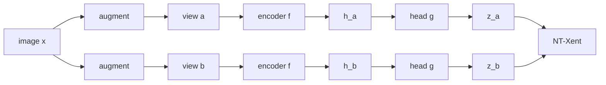

# Contrastive Learning

> Two views of the same thing should look alike to the network; views of different things should not. That rule alone teaches it what to ignore.

**Type:** Build
**Languages:** Python
**Prerequisites:** Phase 06 Lesson 01 (Autoencoders), Phase 02 (Training Deep Nets: Data Loading and Augmentation), Phase 03 (CNNs: Convolution from Scratch)
**Time:** ~75 minutes

## Learning Objectives

- Build a SimCLR-style pipeline: random augmentations, a convolutional encoder, a projection head and the NT-Xent loss
- Implement NT-Xent from scratch with a masked similarity matrix and `logsumexp`, and show it equals `F.cross_entropy` on similarity logits
- Evaluate representations with a linear probe on frozen features, with few and with all labels
- Explain why contrastive features are invariant to the augmentations, and why the layer before the projection head is the one you keep

## The Problem

Autoencoders learn by reconstructing every pixel. That spends capacity on details you may not care about: exact stroke position, brightness, noise. For recognizing a digit, a 1-pixel shift is irrelevant, yet to an autoencoder (and to raw pixels) a shifted "3" is a very different vector. Train a classifier on centered digits, show it digits shifted by one pixel, and accuracy collapses. The script measures it: a linear classifier on raw pixels drops from 97.3% to 33.3%.

Contrastive learning replaces "rebuild the input" with "recognize your own sibling". Take an image, make two random augmented versions (shift, contrast change, dropped pixels, noise), and train a network so the two versions get similar embeddings while embeddings of other images are pushed away. The network can only win by encoding what survives augmentation, which is the identity of the image, and ignoring what augmentation changes. You choose the augmentations, so you choose the invariances.

This recipe (SimCLR, MoCo, and their descendants) is how many vision backbones were pretrained without labels, and it is the core of CLIP (Phase 10), where the two "views" are an image and its caption.

## The Concept

### The pipeline



Both views go through the same encoder `f` (shared weights) and the same small MLP head `g`. The loss is computed on `z`. After training you throw the head away and keep `h = f(x)` as the representation.

### NT-Xent

Stack the `2N` projections of a batch of `N` images. Normalize them to unit length so a dot product is a cosine similarity. For view `i`, its positive is the other view of the same image, `p(i)`; the other `2N - 2` views are negatives. The loss is a softmax classification problem: "which of the other `2N - 1` vectors is my sibling?"

```
s_ij = z_i . z_j / tau                    (cosine similarity divided by a temperature)

l_i  = -log(  exp(s_{i,p(i)})  /  sum_{j != i} exp(s_ij)  )

L    = mean over all 2N views of l_i
```

```
            view a of img 1   view a of img 2   ...   view b of img 1   ...
view a 1       (masked)           negative               POSITIVE
view a 2       negative           (masked)               negative
...
```

Self-similarity on the diagonal is set to `-inf` so a vector cannot pick itself. If the network knows nothing, every candidate is equally likely and the loss is `log(2N - 1)`; with a batch of 256 that is 6.24.

### The temperature

`tau` controls how sharply the softmax focuses. Small `tau` (0.1 to 0.2) makes the loss dominated by the hardest negatives, the ones that look most like the positive. Too small and training becomes unstable; too large and all negatives count equally, which gives weaker features.

### Why a projection head

The loss forces `z` to be invariant to everything augmentations change. Some of that information (exact position, brightness) might be useful for other tasks. The head `g` gives the network a place to throw that information away, so `h` (before the head) can keep it. Empirically, `h` gives better downstream features, and the script reproduces that on clean data.

### Linear probe

To measure a representation without fine-tuning, freeze the encoder and train only a linear classifier (logistic regression) on top of the features. If a linear model does well, the information is there and easy to read.

## Build It

### Step 1: Augmentations

```python
def augment(x, generator):
    images = shift(x, generator).reshape(-1, 1, 8, 8)
    contrast = 0.7 + 0.6 * torch.rand(len(x), 1, 1, 1, generator=generator)
    keep = (torch.rand(images.shape, generator=generator) > 0.1).float()
    noise = 0.05 * torch.randn(images.shape, generator=generator)
    return (images * contrast * keep + noise).clamp(0, 1).reshape(len(x), 64)
```

`shift` pads the 8x8 image by one pixel and crops back at one of 9 offsets, a random translation of up to one pixel in each direction (the 8x8 equivalent of SimCLR's random crop). On raw pixels, two views of the same digit have a mean cosine similarity of only 0.538, barely above two different digits (0.504). The pixels say the views are unrelated; the network has to learn otherwise.

### Step 2: NT-Xent

```python
def nt_xent(z_a, z_b, temperature):
    z = torch.cat([z_a, z_b], dim=0)
    z = z / z.norm(dim=1, keepdim=True)
    similarity = z @ z.T / temperature
    n = len(z_a)
    similarity = similarity.masked_fill(torch.eye(2 * n, dtype=torch.bool), float("-inf"))
    positive_index = torch.cat([torch.arange(n, 2 * n), torch.arange(0, n)])
    positive = similarity[torch.arange(2 * n), positive_index]
    return (torch.logsumexp(similarity, dim=1) - positive).mean()
```

`-log softmax` is written as `logsumexp - positive`, which is numerically stable. A toy batch of 4 with `tau = 0.5` checks the scale:

```
perfect pairs loss 0.594 | random pairs loss 2.351 | chance level log(2N-1) = 1.946
```

Even perfect pairs (each view identical to its sibling and orthogonal to the rest) do not reach zero: with cosine 1 and `tau = 0.5` the positive logit is only 2, and the 6 negatives at logit 0 still take some probability. Lower temperatures make that floor smaller.

### Step 3: Encoder and head

The encoder is a three-layer convolutional network written with `F.conv2d` and raw weight tensors (8x8 -> 8x8 -> 4x4 -> 2x2, 128 channels), followed by global average pooling, so `h` has 128 numbers. The head is an MLP `128 -> 128 -> 32`.

```python
def represent(self, x):
    h = x.reshape(-1, 1, 8, 8)
    for index, (weight, bias) in enumerate(self.encoder):
        h = torch.relu(F.conv2d(h, weight, bias, stride=1 if index == 0 else 2, padding=1))
    return h.mean(dim=(2, 3))
```

### Step 4: Train

```python
view_a, view_b = augment(batch, generator), augment(batch, generator)
loss = nt_xent(model.project(view_a), model.project(view_b), temperature)
```

Batch 256, `tau = 0.2`, Adam with learning rate `1e-3`, 80 epochs. The loss drops from 6.1 (chance is 6.24) to about 3.55. No label is used.

### Step 5: Linear probe

Logistic regression on standardized frozen features. Three evaluations: 5 labels per class (50 labeled images), all 1497 labels, and all labels but testing on test digits shifted by up to one pixel.

```
features                    | clean, 5 labels/class | clean, all labels | shifted test, all labels
raw pixels                  |                 0.850 |             0.973 | 0.333
random conv encoder         |                 0.863 |             0.973 | 0.387
contrastive h               |                 0.893 |             0.990 | 0.713
contrastive z (after head)  |                 0.853 |             0.983 | 0.947
```

Read it column by column:

- With 50 labels, the contrastive `h` is the best (0.893), so pretraining did the work labels would otherwise do.
- With all labels everything is high, because 8x8 digits are easy. `h` still wins (0.990).
- On shifted test digits the difference is dramatic. Raw pixels collapse to 0.333. `h` keeps 0.713, and `z` keeps 0.947: the projection, which the loss directly forced to be invariant, barely notices the shift. This is the head discussion made concrete: `z` is more invariant, `h` keeps more information and is the better general-purpose feature on clean data.

`contrastive_embedding.png` shows the test set's `h` projected to 2D with PCA, colored by digit.

## Use It

NT-Xent is a cross-entropy over similarity logits where the target class is the index of the positive. That is how most implementations write it:

```python
z = F.normalize(torch.cat([z_a, z_b]), dim=1)
logits = (z @ z.T / 0.2).fill_diagonal_(float("-inf"))
targets = torch.cat([torch.arange(8, 16), torch.arange(0, 8)])
loss = F.cross_entropy(logits, targets)
```

```
scratch NT-Xent 3.39242 | F.cross_entropy 3.39242
```

Variants worth knowing:

- **MoCo** keeps a queue of embeddings from past batches as extra negatives, encoded by a slowly updated momentum copy of the encoder, so it does not need huge batches.
- **BYOL** and **SimSiam** drop negatives entirely; they avoid collapse with a predictor head and a stop-gradient.
- **CLIP** uses the same symmetric cross-entropy between image embeddings and text embeddings.

For real images, `torchvision.transforms.v2` provides the standard SimCLR augmentation stack (random resized crop, color jitter, grayscale, blur).

## Exercises

1. **Easy.** Train with `tau` in 0.05, 0.2, 1.0 and compare the 5-labels-per-class probe accuracy.
2. **Medium.** Remove the shift from the augmentations and retrain. What happens to the shifted-test column? This shows that invariances come from the augmentations you choose.
3. **Hard.** Implement a MoCo-style queue: keep the last 1024 `z_b` vectors (detached) as extra negatives and train with batch 64 instead of 256. Can you match the batch-256 probe?

## Key Terms

| Term | What people say | What it actually means |
|------|----------------|----------------------|
| Contrastive learning | "Pull together, push apart" | Learning embeddings where positive pairs are similar and negative pairs are dissimilar |
| Positive pair | "Two views of the same thing" | Two augmentations of one image (or an image and its caption) |
| Negatives | "Everything else" | Other examples in the batch (or a queue) that the anchor should not match |
| NT-Xent / InfoNCE | "The SimCLR loss" | Softmax cross-entropy over temperature-scaled cosine similarities, with the positive as the target |
| Temperature `tau` | "A scaling knob" | Divides similarities before the softmax; lower values focus on hard negatives |
| Projection head | "The extra MLP" | A small network between the representation and the loss, discarded after pretraining |
| Linear probe | "Freeze and fit a classifier" | A linear classifier on frozen features, used to measure representation quality |
| Invariance | "It ignores that change" | The representation stays the same under a transformation of the input |

## Further Reading

- [Chen et al., A Simple Framework for Contrastive Learning of Visual Representations (SimCLR, arXiv:2002.05709)](https://arxiv.org/abs/2002.05709) - the recipe this lesson follows, including the projection head ablations
- [He et al., Momentum Contrast for Unsupervised Visual Representation Learning (MoCo, arXiv:1911.05722)](https://arxiv.org/abs/1911.05722) - contrastive learning with a queue and a momentum encoder
- [van den Oord et al., Representation Learning with Contrastive Predictive Coding (arXiv:1807.03748)](https://arxiv.org/abs/1807.03748) - the InfoNCE loss and its link to mutual information
- [Grill et al., Bootstrap Your Own Latent (BYOL, arXiv:2006.07733)](https://arxiv.org/abs/2006.07733) - self-supervised learning without negatives
