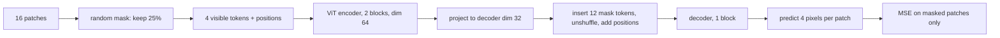

# Masked Autoencoders

> Hide most of the image and ask a transformer to paint the missing pieces back. To do it, it has to understand what it is looking at.

**Type:** Build
**Languages:** Python
**Prerequisites:** Phase 05 (Transformers: The Transformer Block, Vision Transformer), Phase 06 Lessons 01-02 (Autoencoders, Denoising Autoencoders)
**Time:** ~75 minutes

## Learning Objectives

- Turn images into a sequence of patches and back, and implement per-sample random masking with `argsort` and `gather`
- Build an asymmetric masked autoencoder: an encoder that sees only visible patches and a light decoder that fills in mask tokens
- Compute the loss only on masked patches and explain why
- Compare mask ratios and show that MAE pretraining makes fine-tuning with 50 labels much better than training from scratch

## The Problem

The denoising autoencoder of lesson 02 already hid pixels and asked for them back. With 30% of pixels missing, though, most gaps can be filled by averaging neighboring pixels. That is a low-level task: the network can solve it with local interpolation and never form a notion of "this is a 6".

Images are highly redundant. To force a model to reason about content, you have to remove so much that interpolation is impossible. The masked autoencoder (He et al., 2021) removes 75% of the image in whole patches, feeds only the remaining 25% to a Vision Transformer, and asks a small decoder to reconstruct the rest. It is the image counterpart of BERT's masked language modeling, and because the encoder only processes the visible quarter of the tokens, pretraining is also about three times cheaper than processing the whole image.

## The Concept

### Patches as tokens

A ViT (Phase 05) cuts an image into non-overlapping patches and treats each as a token. Here the 8x8 digit is cut into a 4x4 grid of 2x2 patches: 16 tokens with 4 pixel values each.

```
8x8 image                 16 patches (4 values each)
+--+--+--+--+
|p0|p1|p2|p3|             p0 p1 p2 ... p15
+--+--+--+--+      ->     each patch -> Linear(4 -> 64) + position embedding
|p4|  ...   |
+--+--+--+--+
```

### The asymmetric design



- The **encoder** never sees mask tokens. It only processes visible patches (with their position embeddings so it knows where they are). That is what makes MAE cheap and what makes the encoder usable later on full images.
- The **decoder** receives the encoded visible tokens plus a shared learned `mask_token` at every hidden position, each with its own position embedding. It is small, because it is thrown away after pretraining.
- The **loss** only counts masked patches. Reconstructing visible patches is trivial (they were given) and would dilute the signal.

### Masking by shuffling

To mask a different random subset per image without loops:

```
noise   = uniform(N, 16)
shuffle = argsort(noise)          a random permutation per row
restore = argsort(shuffle)        its inverse
keep    = shuffle[:, :n_keep]     indices of visible patches
```

`gather` selects the visible tokens. After encoding, you append mask tokens and `gather` with `restore` to put every token back in its original position.

### The mask ratio

Too little masking and the task is solvable by local interpolation; too much and there is not enough left to infer the content. On natural images, 75% works best. Tiny 8x8 digits are less redundant than photographs, and the script lets you see where the sweet spot lands for them.

### Linear probing vs fine-tuning

MAE features are known to be weaker under a linear probe than contrastive features: the encoder learns rich but not linearly separable features. Their strength appears when you fine-tune the whole encoder on a downstream task. The script measures both.

## Build It

### Step 1: Patchify

```python
def patchify(x):
    images = x.reshape(-1, GRID, PATCH, GRID, PATCH)
    return images.permute(0, 1, 3, 2, 4).reshape(-1, N_PATCHES, PATCH_DIM)
```

The reshape splits rows into (patch row, row inside patch) and columns into (patch column, column inside patch); the permute groups the two "inside" axes together. `unpatchify` is the inverse, and the round trip is exact.

### Step 2: Random masking

```python
def random_masking(n, mask_ratio, generator):
    n_keep = int(round(N_PATCHES * (1 - mask_ratio)))
    noise = torch.rand(n, N_PATCHES, generator=generator)
    shuffle = noise.argsort(dim=1)
    restore = shuffle.argsort(dim=1)
    keep_index = shuffle[:, :n_keep]
    mask = torch.ones(n, N_PATCHES)
    mask[:, :n_keep] = 0
    mask = torch.gather(mask, 1, restore)
    return keep_index, restore, mask
```

```
keep patches [12, 2, 3, 13] | mask row [1, 1, 0, 0, 1, 1, 1, 1, 1, 1, 1, 1, 0, 0, 1, 1]
masked fraction 0.75, encoder sees 4 of 16 tokens
```

`mask` is 1 where a patch is hidden, in the original patch order, so it can weight the loss.

### Step 3: Encoder and decoder

The transformer blocks are `nn.TransformerEncoderLayer` (pre-norm, 4 heads), which you built by hand in Phase 05. The MAE-specific parts are written out:

```python
def encode(self, patches, keep_index=None):
    tokens = patches @ self.patch_embed + self.patch_bias + self.position
    if keep_index is not None:
        tokens = gather_tokens(tokens, keep_index)
    for layer in self.encoder:
        tokens = layer(tokens)
    return self.encoder_norm(tokens)

def decode(self, visible, restore):
    visible = self.to_decoder(visible)
    n_masked = N_PATCHES - visible.shape[1]
    full = torch.cat([visible, self.mask_token.expand(len(visible), n_masked, -1)], dim=1)
    full = gather_tokens(full, restore) + self.decoder_position
    return self.to_pixels(self.decoder(full))
```

Position embeddings are added before the gather, so each visible token keeps its location. The loss:

```python
per_patch = ((prediction - patches) ** 2).mean(dim=-1)
loss = (per_patch * mask).sum() / mask.sum()
```

The encoder has 68,416 parameters and the decoder 11,300: the asymmetry in one line.

### Step 4: Sweep the mask ratio

Each model trains for 40 epochs. Features for probing are the mean of the encoder output over all 16 patches (no masking at evaluation). Baselines with a 5-labels-per-class probe: raw pixels 0.850, untrained encoder 0.600.

```
mask ratio | masked-patch MSE | probe 5/class | probe all labels
      0.25 |           0.0458 |         0.727 | 0.900
      0.50 |           0.0509 |         0.807 | 0.907
      0.75 |           0.0584 |         0.767 | 0.930
```

Reconstruction gets harder as the ratio grows (higher MSE), but that is not what you care about. The few-label probe is best at 0.5 on these tiny images. Note that no MAE linear probe beats raw pixels here, exactly the known weakness mentioned above, made worse by 8x8 digits being nearly linearly separable as pixels.

### Step 5: What it fills in

At ratio 0.5, the MAE reaches a masked-patch MSE of 0.0597 on these 10 test digits, against 0.0840 for filling each hole with the average training patch. `mae_reconstructions.png` has four rows: the original, the visible patches (gray where masked), the raw prediction, and visible patches with predictions pasted in the holes. The raw prediction row looks noisy at visible positions: the model was never trained to output those, which is exactly what "loss only on masked patches" means. Pasted together, the digits are recognizable.

### Step 6: Fine-tuning with 50 labels

Take the same architecture, add a linear head on the mean-pooled tokens, and fine-tune everything for 300 steps on 5 labeled images per class:

```
test accuracy: random init 0.647 | MAE-pretrained init 0.800
```

Pretraining on unlabeled digits gives 15 points of accuracy when labels are scarce. This, not the linear probe, is how MAE is used in practice.

## Use It

The patch embedding is usually written as a convolution with kernel size and stride equal to the patch size, which is what `torchvision.models.VisionTransformer` does (`conv_proj`). The script copies the learned weights into an `nn.Conv2d` and checks:

```
Conv2d(kernel=stride=2) == patchify @ W: True
```

A convolution whose windows do not overlap applies the same linear map to every patch, so the two are identical.

For real images, the MAE recipe is: ViT-B/16 or larger, 75% masking, per-patch normalized pixel targets, a decoder of 8 blocks with width 512, and around 800 to 1600 epochs on ImageNet. The same idea underlies VideoMAE (masking space-time tubes), audio MAEs on spectrograms, and BERT in text.

## Exercises

1. **Easy.** Change the loss to count all patches instead of only masked ones and retrain at ratio 0.5. What happens to the fine-tuning accuracy?
2. **Medium.** Normalize each target patch to zero mean and unit variance before the loss (the "norm pix loss" of the paper). Does the few-label probe improve?
3. **Hard.** Replace the random masking with block masking (always hide a contiguous 2x2 block of patches, i.e. a 4x4 pixel square) and compare fine-tuning accuracy. Which masking forces more semantic reasoning on digits?

## Key Terms

| Term | What people say | What it actually means |
|------|----------------|----------------------|
| Masked autoencoder (MAE) | "BERT for images" | A ViT encoder trained to reconstruct masked image patches from the visible ones |
| Patch | "An image token" | A small non-overlapping square of pixels, flattened and linearly embedded |
| Mask ratio | "How much you hide" | The fraction of patches removed from the encoder's input |
| Mask token | "A placeholder" | One shared learned vector inserted at every hidden position before the decoder |
| Asymmetric encoder-decoder | "Big encoder, small decoder" | The encoder sees only visible patches; a lightweight decoder handles the full sequence |
| Masked-only loss | "Score only the holes" | Reconstruction error computed only on hidden patches |
| Linear probe vs fine-tuning | "Frozen vs trainable" | Training only a linear head on frozen features vs updating the whole pretrained network |

## Further Reading

- [He et al., Masked Autoencoders Are Scalable Vision Learners (arXiv:2111.06377)](https://arxiv.org/abs/2111.06377) - the MAE paper, with the mask ratio and decoder ablations
- [Devlin et al., BERT (arXiv:1810.04805)](https://arxiv.org/abs/1810.04805) - masked language modeling, the text ancestor
- [Dosovitskiy et al., An Image is Worth 16x16 Words (arXiv:2010.11929)](https://arxiv.org/abs/2010.11929) - the Vision Transformer that MAE pretrains
- [Bao et al., BEiT: BERT Pre-Training of Image Transformers (arXiv:2106.08254)](https://arxiv.org/abs/2106.08254) - masked image modeling that predicts discrete tokens instead of pixels
