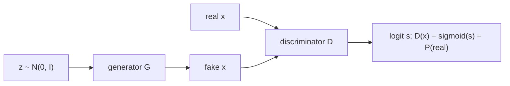

# A GAN from Scratch

> Train a forger and a detective against each other. The forger never sees a real example; it only learns from the detective's mistakes.

**Type:** Build
**Languages:** Python
**Prerequisites:** Phase 01 (Neural Networks: Loss Functions for Networks), Phase 02 (Training Deep Nets: SGD, Momentum and Adam), Phase 06 (Autoencoders and Self-Supervised: Variational Autoencoders)
**Time:** ~60 minutes

## Learning Objectives

- Write the GAN objective as two binary cross-entropy losses and implement them with `softplus` on raw logits
- Build a generator and a discriminator from raw weight tensors and train them with alternating updates
- Read the training log: why the losses settle near `log 4` and `log 2`, and why `D(real)` and `D(fake)` converge to 0.5
- Measure sample quality with the sliced Wasserstein distance against simple baselines

## The Problem

A VAE generates by maximizing a likelihood, and pays for it with blur: under a per-pixel Gaussian or Bernoulli likelihood, the safest answer for an uncertain pixel is the average. You would like a training signal that says "this does not look real" without writing down a likelihood at all.

Generative adversarial networks (Goodfellow et al., 2014) learn that signal. A second network, the discriminator, is trained to tell real samples from generated ones. The generator is trained to fool it. Whatever statistical difference remains between real and fake, a good enough discriminator will find it and the generator will get a gradient to fix it. There is no reconstruction, no likelihood, no encoder: just a game.

You build the whole thing here on the smallest possible example, a ring of 2D points, so you can watch the generator's samples move in real time.

## The Concept

### The two players



- The generator `G` maps noise `z` to a sample `G(z)`.
- The discriminator `D` maps a sample to a logit `s`; `sigmoid(s)` is its probability that the sample is real.

### The minimax game

```
min_G  max_D   E_x[ log D(x) ]  +  E_z[ log(1 - D(G(z))) ]
```

`D` maximizes the log-likelihood of labeling real as 1 and fake as 0, which is the same as minimizing binary cross-entropy. In logit form, using `-log sigmoid(s) = softplus(-s)` and `-log(1 - sigmoid(s)) = softplus(s)`:

```
loss_D = mean softplus(-s_real) + mean softplus(s_fake)
loss_G = mean softplus(-s_fake)                         (non-saturating version)
```

The generator loss above is not literally `-loss_D`. The original minimax generator loss `log(1 - D(G(z)))` has almost no gradient when the discriminator confidently rejects fakes, which is exactly the situation early in training. Goodfellow et al. proposed instead to maximize `log D(G(z))`, "make D say real", which has the same fixed point and strong gradients when the generator is bad. Lesson 02 measures the difference.

### What the optimum looks like

For a fixed generator, the best discriminator is

```
D*(x) = p_data(x) / (p_data(x) + p_G(x))
```

If the generator matches the data, `D*(x) = 1/2` everywhere, and the discriminator loss is `2 log 2 = 1.386`, the generator loss is `log 2 = 0.693`. Plugging `D*` into the game shows that the generator is minimizing the Jensen-Shannon divergence between `p_data` and `p_G`.

### Alternating updates

```
repeat:
    1. sample real x and fake G(z); update D on loss_D   (fake detached: do not update G)
    2. sample new z; update G on loss_G                    (gradients flow through D into G)
```

The `detach()` in step 1 matters: without it, the discriminator update would also push gradients into the generator in the wrong direction.

## Build It

### Step 1: The losses

```python
def discriminator_loss(real_logits, fake_logits):
    return F.softplus(-real_logits).mean() + F.softplus(fake_logits).mean()


def generator_loss(fake_logits):
    return F.softplus(-fake_logits).mean()
```

Working on logits with `softplus` is numerically safe; computing `torch.log(torch.sigmoid(s))` overflows to `-inf` for very negative `s`. The script checks the identity on a few logits and confirms `2 log 2 = 1.386` for a discriminator that outputs 0.5.

### Step 2: The networks

Both are MLPs from raw tensors with LeakyReLU (slope 0.2), the standard choice in GANs because it keeps gradients alive for negative inputs:

```
G: 2 -> 64 -> 64 -> 2         (noise to point)
D: 2 -> 64 -> 64 -> 1         (point to logit)
```

### Step 3: The training loop

```python
real = sample_ring(batch_size, rng)
fake = generator_net(torch.randn(batch_size, 2, generator=rng))
loss_d = discriminator_loss(discriminator_net(real), discriminator_net(fake.detach()))
opt_d.zero_grad()
loss_d.backward()
opt_d.step()

fake = generator_net(torch.randn(batch_size, 2, generator=rng))
loss_g = generator_loss(discriminator_net(fake))
opt_g.zero_grad()
loss_g.backward()
opt_g.step()
```

Both use Adam with learning rate `1e-3` and `beta1 = 0.5`. The lower momentum is a GAN folk rule from the DCGAN paper: the target keeps moving, so long momentum averages stale directions.

### Step 4: Read the log

```
step    0 | loss D 2.255 | loss G 0.362 | D(real) 0.56 | D(fake) 0.71 | sliced W 1.192
step 1000 | loss D 1.253 | loss G 0.793 | D(real) 0.56 | D(fake) 0.45 | sliced W 0.674
step 2000 | loss D 1.334 | loss G 0.713 | D(real) 0.52 | D(fake) 0.49 | sliced W 0.093
step 3000 | loss D 1.384 | loss G 0.701 | D(real) 0.50 | D(fake) 0.50 | sliced W 0.048
```

The losses end near 1.386 and 0.693, and `D` outputs 0.5 on both real and fake: the discriminator can no longer tell them apart. Notice that the losses say nothing reliable about quality in between: at step 1000 the losses look "good" while samples are still far off. Track a sample-quality metric, not the GAN losses.

`gan_ring.png` shows the samples at steps 0, 200, 600 and 3000: a random blob, a cloud drifting around, a stretched arc, and finally the ring.

### Step 5: Measure quality

The sliced Wasserstein distance projects both point sets onto 64 random directions, sorts each projection, and averages the absolute differences. It is zero for identical distributions and needs no training.

```
generated: radius mean 1.021 std 0.084
sliced Wasserstein to real: GAN 0.047 | a Gaussian blob 0.175 | a second real sample 0.020
```

The GAN is far better than a Gaussian blob and within a factor of about two of a fresh sample from the true distribution. The radius spread (0.084 vs 0.050) and the stray points inside the ring have a nice explanation: a continuous generator has to map the whole Gaussian plane onto a loop, which is topologically impossible without a seam, so a few samples fall along the cut.

## Use It

`nn.BCEWithLogitsLoss` is the same loss with labels 1 for real and 0 for fake; the generator uses label 1 for its fakes:

```python
bce = nn.BCEWithLogitsLoss()
loss_d = bce(real_logits, torch.ones(5)) + bce(fake_logits, torch.zeros(5))
loss_g = bce(fake_logits, torch.ones(5))
```

```
scratch D loss 1.67938 | BCEWithLogitsLoss 1.67938
scratch G loss 0.90431 | BCEWithLogitsLoss 0.90431
```

Rebuilt with `nn.Sequential`, the same training function gives `radius mean 0.979 std 0.053 | sliced W 0.038`: same recipe, same result up to initialization. Never put an `nn.Sigmoid` at the end of the discriminator and use `nn.BCELoss`; the logits version is fused and stable.

## Exercises

1. **Easy.** Make the discriminator much smaller (`2 -> 8 -> 1`). Does the generator still find the ring? What does that tell you about the generator's dependence on the discriminator?
2. **Medium.** Replace the ring with `sklearn.datasets.make_moons` (scaled to fit), retrain, and plot the samples. Where do the stray points appear?
3. **Hard.** Train with the original saturating loss `loss_G = -mean softplus(s_fake)` (that is, minimize `log(1 - D(G(z)))`) and log the norm of the generator's gradient during the first 200 steps. Compare it with the non-saturating loss.

## Key Terms

| Term | What people say | What it actually means |
|------|----------------|----------------------|
| GAN | "Two networks fighting" | A generator and a discriminator trained on opposite objectives in a minimax game |
| Generator | "The forger" | A network `G(z)` mapping noise to samples, trained only through the discriminator's gradients |
| Discriminator | "The detective" | A classifier that outputs the probability a sample is real |
| Non-saturating loss | "The trick in the GAN paper" | Training G to maximize `log D(G(z))` instead of minimizing `log(1 - D(G(z)))` |
| Optimal discriminator | "D at equilibrium" | `D*(x) = p_data / (p_data + p_G)`; it equals 1/2 everywhere when G matches the data |
| Jensen-Shannon divergence | "What a GAN minimizes" | A symmetric divergence between distributions; the original GAN game minimizes it at the optimal D |
| Sliced Wasserstein distance | "A cheap distribution distance" | The average 1D Wasserstein distance over random projections, computed by sorting |

## Further Reading

- [Goodfellow et al., Generative Adversarial Networks (arXiv:1406.2661)](https://arxiv.org/abs/1406.2661) - the original paper, with the optimal discriminator and the non-saturating trick
- [Goodfellow, NIPS 2016 Tutorial: Generative Adversarial Networks (arXiv:1701.00160)](https://arxiv.org/abs/1701.00160) - the inventor's long-form explanation of the game and its pitfalls
- [Dive into Deep Learning, Chapter 20: Generative Adversarial Networks](https://d2l.ai/chapter_generative-adversarial-networks/gan.html) - a GAN on a simple 2D distribution, step by step
- [PyTorch docs: BCEWithLogitsLoss](https://pytorch.org/docs/stable/generated/torch.nn.BCEWithLogitsLoss.html) - the stable logits form of the GAN losses
