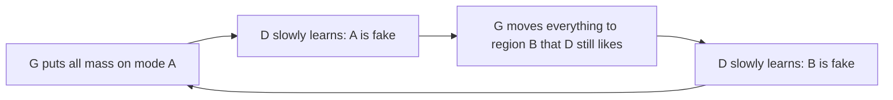

# Training Dynamics and Mode Collapse

> A GAN is not minimizing a loss, it is playing a game. Games can circle forever, and a forger can get rich copying a single banknote.

**Type:** Build
**Languages:** Python
**Prerequisites:** Phase 07 Lesson 01 (A GAN from Scratch), Phase 02 (Training Deep Nets: SGD, Momentum and Adam, Debugging Training)
**Time:** ~60 minutes

## Learning Objectives

- Show numerically why the original minimax generator loss saturates and the non-saturating loss does not
- Reproduce mode collapse on a mixture of 8 Gaussians and watch the collapsed generator hop from mode to mode
- Fix it by rebalancing the two players and by packing samples for the discriminator (PacGAN)
- Explain why GAN losses are poor progress signals and what to monitor instead

## The Problem

In lesson 01 the GAN found the ring, and it is tempting to think GANs simply work. Change one hyperparameter and they do not. The most famous failure is mode collapse: the data has many distinct kinds of examples (eight clusters here, ten digits, many faces), and the generator produces only one or a few of them, with very little variety. Each sample can look perfect, which makes collapse easy to miss if you only look at one image at a time.

Collapse is not a bug in the code. It comes from the structure of the game: the generator is rewarded for any output the current discriminator likes, and the cheapest way to get that reward is to put all its mass on the single point the discriminator currently likes most. The discriminator then learns to reject that point, the generator jumps to another, and the two chase each other around. To train GANs you need to recognize this behavior and know the levers that stop it.

## The Concept

### Saturation

The minimax generator loss is `log(1 - D(G(z)))`. Its derivative with respect to the fake logit `s` is

```
d/ds log(1 - sigmoid(s)) = -sigmoid(s) = -D
```

Early in training the discriminator easily rejects fakes, `D` is near 0, and the gradient is near 0: the generator learns nothing exactly when it is worst. The non-saturating loss `-log D(G(z))` has derivative `-(1 - D)`, close to `-1` in the same situation.

```
D(G(z)):          0.0003   0.018   0.5    0.98
log(1 - D) grad:  -0.0003  -0.018  -0.5   -0.98     tiny when G is bad
-log D grad:      -0.9997  -0.982  -0.5   -0.018    large when G is bad
```

### Why collapse happens

Training alternates small steps for each player. Consider what the generator's update really optimizes: for the current, fixed discriminator, move every sample uphill on `D`. If the discriminator is slow to change, every sample flows to the same maximum of `D`, so the generator's output contracts to a point.



The ideal game is `min_G max_D`: the discriminator should be (near) optimal for every generator. Simultaneous gradient steps are closer to `max_D min_G`, and for that order of play, collapsing to the discriminator's favorite point is a valid response. The more the discriminator lags behind the generator, the closer you get to that bad regime.

### Levers against collapse

| Lever | Idea |
|---|---|
| Balance the players | Give the discriminator enough learning rate or steps to stay near optimal (TTUR uses a *larger* D learning rate) |
| Show D several samples at once | Packing (PacGAN) or minibatch discrimination: a collapsed batch is obviously fake when D sees its lack of diversity |
| Change the divergence | Wasserstein GANs (lesson 04) give useful gradients even when distributions do not overlap |
| Unrolling, regularizers, EMA of G | Make G anticipate D's response, or smooth the trajectory |

### What to monitor

The losses of both players hover around the same values whether training is going well or the generator is collapsed and hopping. Monitor the samples instead: here, the number of modes covered and the fraction of samples landing on a mode. On images, people use FID, precision and recall, and sample grids.

## Build It

The data is 8 Gaussians with standard deviation 0.05 on a circle of radius 2. A sample counts as "on-mode" if it lands within 0.2 of a center; a mode counts as covered if it holds at least 2% of 2000 samples. The networks are 2-hidden-layer MLPs (128 units, ReLU), the noise is 16-dimensional, both optimizers are Adam with `beta1 = 0.5`.

### Step 1: Measure saturation

```python
fake_logits = torch.tensor([-8.0, -4.0, 0.0, 4.0], requires_grad=True)
saturating = -F.softplus(fake_logits).sum()
saturating_grad, = torch.autograd.grad(saturating, fake_logits)
non_saturating = F.softplus(-fake_logits).sum()
non_saturating_grad, = torch.autograd.grad(non_saturating, fake_logits)
```

`-softplus(s)` is `log(1 - sigmoid(s))`, the minimax loss. The printed table matches the formulas above: at logit -8 the minimax gradient is -0.0003, the non-saturating one is -0.9997.

### Step 2: Make it collapse

Use a discriminator learning rate ten times smaller than the generator's.

```
step  500 | loss D 1.416 | loss G 0.669 | modes 0/8 | on-mode 0.00 | sample mean (+1.72, +1.00) | spread 0.25
step 1000 | loss D 1.251 | loss G 0.683 | modes 0/8 | on-mode 0.00 | sample mean (+0.58, -0.16) | spread 0.14
step 1500 | loss D 1.473 | loss G 0.637 | modes 0/8 | on-mode 0.00 | sample mean (+1.04, +2.20) | spread 0.33
step 2000 | loss D 1.341 | loss G 0.808 | modes 1/8 | on-mode 0.03 | sample mean (-2.12, -0.33) | spread 0.29
step 3000 | loss D 1.348 | loss G 0.720 | modes 0/8 | on-mode 0.00 | sample mean (-1.17, -1.79) | spread 0.23
```

The spread (standard deviation of the samples, about 1.4 for the real data) stays around 0.2: all 2000 samples form one tight blob. The sample mean jumps around the circle: the blob hops from region to region as the discriminator catches up with each one. The losses look perfectly ordinary the whole time. The first row of `mode_collapse.png` shows the hopping blob.

### Step 3: Balance the players

Same everything, discriminator learning rate raised to `1e-3`:

```
step 1500 | loss D 1.192 | loss G 0.911 | modes 7/8 | on-mode 0.48 | sample mean (+0.03, +0.11) | spread 1.34
step 2000 | loss D 1.180 | loss G 0.890 | modes 8/8 | on-mode 0.70 | sample mean (-0.07, +0.10) | spread 1.41
step 3000 | loss D 1.316 | loss G 0.960 | modes 8/8 | on-mode 0.85 | sample mean (-0.09, +0.18) | spread 1.40
```

All eight modes, 85% of samples on a mode, and the spread matches the data's 1.4. A discriminator that keeps up punishes a collapsed generator before it can settle anywhere.

### Step 4: PacGAN

Keep the slow discriminator but let it judge 4 samples at a time: real and fake batches are reshaped to `(batch, 4 * 2)` before going into `D`.

```python
real = sample_mixture(batch_size * pack, rng).reshape(batch_size, 2 * pack)
fake = generator_net(torch.randn(batch_size * pack, NOISE_DIM, generator=rng)).reshape(batch_size, 2 * pack)
```

Four real samples are usually from different modes; four samples from a collapsed generator are all in the same place. The discriminator can see that difference immediately, even with a small learning rate.

```
step 2000 | loss D 1.383 | loss G 0.696 | modes 5/8 | on-mode 0.19 | sample mean (-0.05, +0.12) | spread 1.42
step 3000 | loss D 1.385 | loss G 0.689 | modes 8/8 | on-mode 0.33 | sample mean (-0.05, +0.07) | spread 1.39
```

The spread is right from step 500 on: packing removes the collapse. Precision is still low (33% on-mode) because the slow discriminator is slow at sharpening the modes too, but coverage is solved.

## Use It

PyTorch ships a popular discriminator regularizer, spectral normalization, which rescales each weight matrix by its largest singular value so the discriminator is 1-Lipschitz per layer:

```python
from torch.nn.utils.parametrizations import spectral_norm
discriminator_net = mlp(2, 1, wrap=spectral_norm)
```

It is in most modern GAN discriminators (SNGAN, BigGAN) because it stabilizes training. But on the slow-discriminator setup it does not fix collapse:

```
step 2000 | ... | modes 1/8 | on-mode 0.23 | sample mean (+2.02, -0.04) | spread 0.29
step 3000 | ... | modes 1/8 | on-mode 0.04 | sample mean (+1.78, +0.44) | spread 0.25
```

The blob still hops. Spectral normalization controls how sharp the discriminator can be, not how fast it reacts, and collapse here is a speed problem. The lesson: know which failure you are fighting before you reach for a fix. `mode_collapse.png` shows all four runs side by side.

## Exercises

1. **Easy.** Instead of raising the discriminator's learning rate, keep `1e-4` but take 5 discriminator steps per generator step. Does it fix collapse? Compare wall-clock time with Step 3.
2. **Medium.** Implement a minibatch standard deviation feature (as in ProGAN): append the mean standard deviation of the batch as an extra input to the discriminator's last layer. Does it fix the slow-D collapse like packing does?
3. **Hard.** Replace the mixture with 25 Gaussians on a 5x5 grid and find the smallest pack size that covers all modes in 5000 steps.

## Key Terms

| Term | What people say | What it actually means |
|------|----------------|----------------------|
| Mode collapse | "The GAN only makes one thing" | The generator covers only a few modes of the data distribution, often with little variety within them |
| Mode hopping | "It keeps changing its mind" | A collapsed generator moving between modes as the discriminator learns to reject each one |
| Saturating loss | "The original minimax loss" | `log(1 - D(G(z)))`, whose gradient vanishes when D confidently rejects fakes |
| Non-saturating loss | "The standard G loss" | `-log D(G(z))`, same fixed point, strong gradients early in training |
| TTUR | "Two learning rates" | Two time-scale update rule: separate learning rates for G and D, usually with a larger D rate |
| PacGAN | "Packing" | The discriminator classifies groups of samples jointly, which exposes lack of diversity |
| Spectral normalization | "Lipschitz D" | Dividing each weight matrix by its largest singular value to bound the discriminator's slope |

## Further Reading

- [Metz et al., Unrolled Generative Adversarial Networks (arXiv:1611.02163)](https://arxiv.org/abs/1611.02163) - the 8-Gaussians mode-hopping picture and a fix that lets G anticipate D
- [Lin et al., PacGAN: The power of two samples in generative adversarial networks (arXiv:1712.04086)](https://arxiv.org/abs/1712.04086) - packing and its analysis
- [Salimans et al., Improved Techniques for Training GANs (arXiv:1606.03498)](https://arxiv.org/abs/1606.03498) - minibatch discrimination, feature matching and other early stabilization tricks
- [Miyato et al., Spectral Normalization for Generative Adversarial Networks (arXiv:1802.05957)](https://arxiv.org/abs/1802.05957) - the regularizer used in the Use It section
