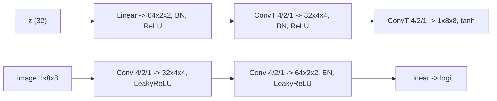

# DCGAN

> Give the forger a paintbrush that knows about space: transposed convolutions grow an image from a few numbers, a neighborhood at a time.

**Type:** Build
**Languages:** Python
**Prerequisites:** Phase 03 (CNNs: Convolution from Scratch, Padding, Stride and Pooling), Phase 02 (Training Deep Nets: Batch and Layer Normalization), Phase 07 Lessons 01-02
**Time:** ~60 minutes

## Learning Objectives

- Implement a transposed convolution from scratch as "insert zeros, pad, convolve with a flipped kernel" and match `F.conv_transpose2d`
- Compute output sizes of transposed convolutions and design a generator that upsamples 2x2 -> 4x4 -> 8x8
- Apply the DCGAN architecture rules: strided convolutions, batch norm, ReLU in G, LeakyReLU in D, tanh output, `N(0, 0.02)` init
- Compare a convolutional GAN with an MLP GAN of similar size on 8x8 digits using a classifier-based score

## The Problem

The GANs so far were MLPs. An MLP generator has to learn every output pixel separately: nothing tells it that pixel (3, 4) and pixel (3, 5) are neighbors, or that a stroke drawn at the top left should look like a stroke drawn at the bottom right. On real images that wastes parameters and makes training brittle. Early GANs on images were notoriously unstable.

Radford, Metz and Chintala (2015) found a set of architectural rules that made GANs train reliably on images: the DCGAN. The discriminator is a CNN (Phase 03). The generator is a CNN run backwards: it starts from a tiny spatial grid and doubles the resolution at each layer with transposed convolutions, so every layer reuses the same local filters everywhere in the image. Almost every image GAN since, including StyleGAN, follows this layout.

## The Concept

### Transposed convolution

A stride-2 convolution maps 8x8 to 4x4. A transposed convolution goes the other way, 4x4 to 8x8. The name comes from linear algebra: if you write a convolution as a matrix `C` acting on the flattened image, the transposed convolution is multiplication by `C^T`. In practice you can compute it with an ordinary convolution:

```
1. insert (stride - 1) zeros between input pixels
2. pad by (kernel - 1 - padding) on every side
3. convolve (stride 1) with the kernel flipped in both spatial axes, in/out channels swapped
```

```
input 2x2           zeros inserted          padded 7x7             conv 4x4 -> 4x4
a b                 a 0 b                   0 0 0 0 0 0 0
c d        ->       0 0 0          ->       0 0 0 0 0 0 0   ...
                    c 0 d                   0 0 a 0 b 0 0
```

Output size:

```
out = (in - 1) * stride - 2 * padding + kernel
```

With `kernel = 4, stride = 2, padding = 1`: `out = 2 * in`. That is the DCGAN upsampling block.

### The architecture



### The DCGAN rules

| Rule | Why |
|---|---|
| No pooling: strided convs in D, transposed convs in G | the network learns its own down- and upsampling |
| Batch norm in both (not on G's output or D's input) | keeps activations well scaled; stabilizes the game |
| ReLU in G, tanh on its output | data is scaled to `[-1, 1]` to match tanh |
| LeakyReLU (0.2) in D | gradients flow back to G even for negative activations |
| Weights from `N(0, 0.02)`, Adam with `beta1 = 0.5` | empirical settings from the paper |

The paper used learning rate `2e-4`. These models are tiny, so the script uses `1e-3`.

## Build It

### Step 1: Transposed convolution from scratch

```python
def conv_transpose2d_scratch(x, weight, stride, padding):
    batch, channels, height, width = x.shape
    kernel = weight.shape[-1]
    dilated = torch.zeros(batch, channels, (height - 1) * stride + 1, (width - 1) * stride + 1, dtype=x.dtype)
    dilated[:, :, ::stride, ::stride] = x
    border = kernel - 1 - padding
    dilated = F.pad(dilated, (border, border, border, border))
    flipped = weight.flip(-1, -2).transpose(0, 1)
    return F.conv2d(dilated, flipped)
```

`ConvTranspose2d` stores its weight as `(in_channels, out_channels, k, k)`, the opposite of `Conv2d`, which is why the channels are swapped before convolving.

```
input (2, 3, 2, 2) -> output (2, 5, 4, 4) | max diff vs F.conv_transpose2d 9.54e-07
```

### Step 2: Generator and discriminator

```python
class Generator(nn.Module):
    def forward(self, z):
        h = F.relu(self.norm0(self.project(z).view(-1, 64, 2, 2)))
        h = F.relu(self.norm1(self.up1(h)))
        return torch.tanh(self.up2(h))


class Discriminator(nn.Module):
    def forward(self, x):
        h = F.leaky_relu(self.down1(x), 0.2)
        h = F.leaky_relu(self.norm2(self.down2(h)), 0.2)
        return self.out(h.flatten(1)).squeeze(1)
```

`up1` and `up2` are `ConvTranspose2d(kernel_size=4, stride=2, padding=1)`, now that you know what they compute. The generator has 41,921 parameters, the discriminator 33,697. All weights are initialized with `dcgan_init`.

### Step 3: Train

The loop is the one from lesson 01 with the non-saturating loss, batch 128, 3000 steps, digits rescaled to `[-1, 1]`. It runs on the GPU when one is available (about 15 s) and on the CPU otherwise (about a minute). The script turns on `torch.use_deterministic_algorithms(True)` so GPU runs are repeatable; the numbers below are from a GPU run, and a CPU run lands within a few points.

### Step 4: An MLP baseline

An MLP GAN with 64 -> 128 -> 128 layers (28,992 + 24,961 parameters) trains with the identical loop.

### Step 5: Score the samples

Like in the VAE lesson, a logistic regression trained on real digits judges 1000 samples. It is more than 90% confident on 77% of real digits.

```
DCGAN   confident samples 0.55 | class counts [89, 124, 78, 133, 110, 85, 99, 82, 80, 120]
MLP GAN confident samples 0.39 | class counts [117, 86, 49, 132, 83, 109, 51, 49, 181, 143]
```

The DCGAN produces more convincing digits and spreads them more evenly over the ten classes; the MLP GAN over-produces 8s and 9s and rarely draws 2s, 6s and 7s. Compare `dcgan_samples.png` with the VAE samples from Phase 06: the GAN digits have crisp strokes, because the discriminator punishes the blur that a pixel likelihood tolerates. The price is a few malformed digits, which a likelihood-based model would have averaged into a blur instead.

## Use It

The official DCGAN code (and the PyTorch DCGAN tutorial) writes the generator as a pure stack of `ConvTranspose2d` layers, treating the noise as a `1x1` image with `NOISE_DIM` channels:

```python
sequential = nn.Sequential(
    nn.Unflatten(1, (NOISE_DIM, 1, 1)),
    nn.ConvTranspose2d(NOISE_DIM, 64, kernel_size=2, stride=1, padding=0, bias=False), nn.BatchNorm2d(64), nn.ReLU(),
    nn.ConvTranspose2d(64, 32, kernel_size=4, stride=2, padding=1, bias=False), nn.BatchNorm2d(32), nn.ReLU(),
    nn.ConvTranspose2d(32, 1, kernel_size=4, stride=2, padding=1), nn.Tanh(),
)
```

A transposed convolution on a `1x1` input with kernel 2 is exactly a linear layer reshaped to `2x2`, so this is the same model as the one you trained. For 64x64 images you add three more upsampling blocks (4 -> 8 -> 16 -> 32 -> 64).

Transposed convolutions with a kernel size not divisible by the stride produce checkerboard artifacts. Many modern generators use nearest-neighbor upsampling followed by a regular convolution instead (StyleGAN does).

## Exercises

1. **Easy.** Remove both `BatchNorm2d` layers from the generator and retrain. What happens to the confident-sample score and to the class counts?
2. **Medium.** Replace each `ConvTranspose2d` in the generator with `nn.Upsample(scale_factor=2)` followed by a `3x3` `Conv2d`. Compare scores and look for checkerboard patterns.
3. **Hard.** Write `conv2d` as an explicit matrix `C` (shape `16 x 64` for a stride-2 conv from 8x8 to 4x4 with one channel) and check that `C.T @ y.flatten()` equals `F.conv_transpose2d(y, w, stride=2, padding=1)`.

## Key Terms

| Term | What people say | What it actually means |
|------|----------------|----------------------|
| DCGAN | "The convolutional GAN" | A GAN whose generator and discriminator are CNNs following the Radford et al. architecture rules |
| Transposed convolution | "Deconvolution" | The adjoint of a convolution; upsamples by inserting zeros and convolving with a flipped kernel (not an inverse) |
| Fractionally strided convolution | "Same thing" | Another name for transposed convolution with stride greater than 1 |
| Upsampling block | "Double the resolution" | `ConvTranspose2d(k=4, s=2, p=1)`, BN and ReLU, mapping `HxW` to `2Hx2W` |
| Checkerboard artifact | "Grid pattern in samples" | Uneven overlap of transposed-conv kernels producing periodic artifacts |
| Classifier-based score | "Inception score, simplified" | Judging samples with a pretrained classifier's confidence and class balance |

## Further Reading

- [Radford, Metz and Chintala, Unsupervised Representation Learning with Deep Convolutional GANs (arXiv:1511.06434)](https://arxiv.org/abs/1511.06434) - the DCGAN paper and its architecture guidelines
- [Dumoulin and Visin, A guide to convolution arithmetic for deep learning (arXiv:1603.07285)](https://arxiv.org/abs/1603.07285) - pictures of every padding and stride case for transposed convolutions
- [Odena, Dumoulin and Olah, Deconvolution and Checkerboard Artifacts (Distill, 2016)](https://distill.pub/2016/deconv-checkerboard/) - why transposed convolutions produce grids and how to avoid them
- [PyTorch DCGAN tutorial](https://pytorch.org/tutorials/beginner/dcgan_faces_tutorial.html) - the same architecture on 64x64 faces
