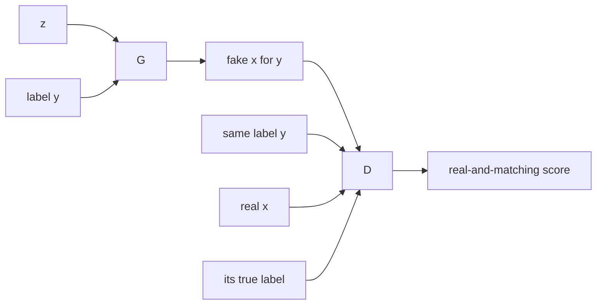

# Conditional GANs

> Tell both players what you want. The generator learns to draw a 7 on request; the discriminator learns to reject anything that is not a convincing 7.

**Type:** Build
**Languages:** Python
**Prerequisites:** Phase 07 Lessons 01-03 (A GAN from Scratch through DCGAN), Phase 06 (Autoencoders and Self-Supervised: Representation Learning and Embeddings)
**Time:** ~50 minutes

## Learning Objectives

- Condition a generator and a discriminator on a class label by concatenating one-hot vectors and label maps
- Explain why the discriminator must see the label too, and what it checks when it does
- Measure conditional samples with a classifier: label agreement per class and within-class diversity
- Use fixed noise with different labels to see that `z` controls style while the label controls content

## The Problem

An unconditional GAN draws a random digit. You cannot ask it for a 3. If you want a 3, you have to sample until you get one, and for rarer classes or richer conditions (a sentence, a sketch, a segmentation map) that is hopeless.

A conditional GAN (Mirza and Osindero, 2014) adds the condition `y` as an extra input to both networks. The generator learns `p(x | y)` instead of `p(x)`. This is the template for every controllable generator that followed: class-conditional ImageNet GANs (BigGAN), image-to-image translation (pix2pix, next lesson, where the condition is a whole image) and, with a text encoder, early text-to-image GANs.

## The Concept

### The conditional game

```
min_G max_D   E_{x, y ~ data}[ log D(x, y) ]  +  E_{z, y}[ log(1 - D(G(z, y), y)) ]
```



### Why D must see the label

If only the generator sees `y`, the discriminator only checks "is this a plausible digit?". The generator can then ignore `y` and draw any digit it likes, and nothing in the loss will complain. When the discriminator sees `(x, y)` pairs, a beautiful 4 labeled "7" is a fake pair. The discriminator implicitly learns two things: is `x` realistic, and does `x` match `y`.

### How to feed the label

| Where | How | Used in |
|---|---|---|
| Generator input | concatenate `one_hot(y)` (or an embedding) to `z` | cGAN, most class-conditional GANs |
| Generator hidden layers | concatenate label maps (one-hot broadcast over space) to feature maps | this lesson; also via conditional batch norm (BigGAN) |
| Discriminator input | concatenate label maps as extra input channels | cGAN, pix2pix (the condition is an image) |
| Discriminator output | projection: `score = w . h + embed(y) . h` | projection discriminator (Miyato and Koyama, 2018) |

A label map is the one-hot vector broadcast to an `H x W` grid, giving 10 extra channels that are constant across the image. Concatenating a one-hot vector into a linear layer is the same as adding a learned vector for that class: `W [z; one_hot(y)] = W_z z + W_y[:, y]`.

### Style and content

Once trained, the label decides which digit is drawn and the noise `z` decides everything else: thickness, slant, size. Fixing `z` and changing `y` should give "the same handwriting" across digits. This disentanglement is not forced by the loss; it emerges because the label already explains the class, so the generator uses `z` for the remaining variation.

## Build It

The networks are the DCGAN pair of lesson 03 with labels added. The data is all 1797 digits, scaled to `[-1, 1]`.

### Step 1: Conditioning the generator

```python
def forward(self, z, labels):
    one_hot = F.one_hot(labels, N_CLASSES).float()
    h = F.relu(self.norm0(self.project(torch.cat([z, one_hot], dim=1)).view(-1, 64, 2, 2)))
    label_maps = one_hot[:, :, None, None].expand(-1, -1, 2, 2)
    h = F.relu(self.norm1(self.up1(torch.cat([h, label_maps], dim=1))))
    return torch.tanh(self.up2(h))
```

The label enters twice: concatenated to `z`, and again as label maps at the 2x2 feature level so the upsampling layer cannot forget it.

### Step 2: Conditioning the discriminator

```python
def forward(self, x, labels):
    label_maps = F.one_hot(labels, N_CLASSES).float()[:, :, None, None].expand(-1, -1, 8, 8)
    h = F.leaky_relu(self.down1(torch.cat([x, label_maps], dim=1)), 0.2)
    h = F.leaky_relu(self.down2(h), 0.2)
    return self.out(h.flatten(1)).squeeze(1)
```

The input becomes `(batch, 11, 8, 8)`: 1 image channel plus 10 label channels.

### Step 3: Training

Real images are paired with their true labels. Fake images are generated for random labels, and the discriminator sees them with those same labels:

```python
fake_labels = torch.randint(N_CLASSES, (batch_size,), device=device)
fake = generator_net(torch.randn(batch_size, NOISE_DIM, device=device), fake_labels)
loss_d = (F.softplus(-discriminator_net(real, real_labels)).mean()
          + F.softplus(discriminator_net(fake.detach(), fake_labels)).mean())
loss_g = F.softplus(-discriminator_net(fake, fake_labels)).mean()
```

3000 steps, batch 128, Adam `1e-3` with `beta1 = 0.5`; about 10 s on a GPU (deterministic, thanks to `torch.use_deterministic_algorithms(True)`), about a minute on a CPU.

### Step 4: Ask and check

Generate 100 samples per digit and classify them with a logistic regression trained on the real digits:

```
classifier agrees with the requested label on 0.966 of 1000 samples
per digit: [0.98, 0.97, 1.0, 0.95, 0.97, 0.98, 1.0, 1.0, 0.92, 0.89]
mean per-pixel std within a class: generated 0.153 | real 0.165
```

97% of the samples are the digit you asked for. The weakest classes are 8 and 9, the two that look most alike at 8x8. The within-class pixel spread is close to the real data's, so the generator is not just drawing one template per class (a conditional version of mode collapse would push that number toward 0).

### Step 5: Same noise, different labels

```
10 noise vectors x 10 labels: classifier agrees on 0.97
```

`cgan_grid.png` shows the 10x10 grid: each row is a requested digit, each column a fixed `z`. Reading down a column, you see the same stroke thickness and slant applied to every digit: `z` encodes style, `y` encodes content.

## Use It

Most code bases use `nn.Embedding` for labels instead of one-hot vectors. It is the same thing written more efficiently:

```python
embedding = nn.Embedding(N_CLASSES, 16)
by_lookup = embedding(example_labels)
by_one_hot = one_hot @ embedding.weight
```

```
nn.Embedding(labels) == one_hot @ weight: True
a one-hot concat into a Linear layer is the same as adding a learned per-class vector: True
```

The second check builds a weight matrix whose first block passes `z` through and whose second block is the embedding table, and confirms that `[z; one_hot(y)] @ W` equals `z + embedding[y]`. That identity is why "concatenate the label" and "add a label embedding" are interchangeable for the first layer.

In larger models the label usually modulates the network rather than being concatenated: conditional batch norm predicts the scale and shift of each batch-norm layer from the label embedding (BigGAN), and the discriminator uses the projection form. AdaIN in StyleGAN (next lesson) is the same idea with a style vector in place of a label.

## Exercises

1. **Easy.** Remove the label maps from the discriminator (feed it only the image) and retrain. What happens to the label agreement in Step 4, and why?
2. **Medium.** Replace the discriminator's input concatenation with a projection discriminator: compute features `h` from the image only, then `score = linear(h) + (embedding(y) * h).sum(1)`. Compare agreement and within-class spread.
3. **Hard.** Interpolate between two labels by feeding a soft vector `(1 - t) * one_hot(3) + t * one_hot(8)` for `t` from 0 to 1 with fixed `z`. Does the output morph smoothly? Where does the classifier switch?

## Key Terms

| Term | What people say | What it actually means |
|------|----------------|----------------------|
| Conditional GAN | "A GAN you can steer" | A GAN whose generator and discriminator both receive a condition `y`, learning `p(x | y)` |
| Condition | "The prompt" | Side information such as a class label, a text embedding or an input image |
| Label map | "One-hot as channels" | A one-hot vector broadcast over the spatial grid and concatenated as extra channels |
| Projection discriminator | "Inner-product conditioning" | A discriminator whose score includes `embed(y) . h(x)` |
| Conditional batch norm | "Label-dependent BN" | Batch norm whose scale and shift are predicted from the condition |
| Style vs content | "z vs y" | With a label fixing the class, the noise ends up encoding the remaining variation |

## Further Reading

- [Mirza and Osindero, Conditional Generative Adversarial Nets (arXiv:1411.1784)](https://arxiv.org/abs/1411.1784) - the original conditional GAN on MNIST
- [Odena, Olah and Shlens, Conditional Image Synthesis with Auxiliary Classifier GANs (arXiv:1610.09585)](https://arxiv.org/abs/1610.09585) - AC-GAN, where the discriminator also predicts the class
- [Miyato and Koyama, cGANs with Projection Discriminator (arXiv:1802.05637)](https://arxiv.org/abs/1802.05637) - the projection form used in most later class-conditional GANs
- [Brock, Donahue and Simonyan, Large Scale GAN Training for High Fidelity Natural Image Synthesis (arXiv:1809.11096)](https://arxiv.org/abs/1809.11096) - BigGAN, conditional batch norm and class-conditional ImageNet at scale
