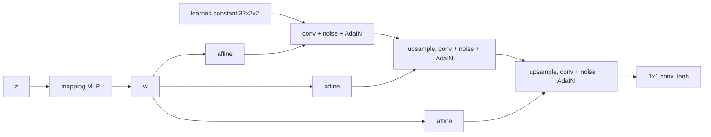

# StyleGAN and Image-to-Image Intuition

> Feed the noise in as a set of dials on every layer instead of as the first layer's input, and the coarse dials end up meaning "what" while the fine ones mean "how".

**Type:** Learn
**Languages:** Python
**Prerequisites:** Phase 07 Lessons 01-05 (A GAN from Scratch through Conditional GANs), Phase 02 (Training Deep Nets: Batch and Layer Normalization)
**Time:** ~60 minutes

## Learning Objectives

- Implement adaptive instance normalization (AdaIN) and verify it against `F.instance_norm`
- Explain the parts of a style-based generator: mapping network, learned constant input, per-layer styles, noise injection
- Run style mixing and the truncation trick on a tiny style generator and interpret what they show
- Explain how pix2pix turns a GAN into an image-to-image translator, and why it combines an L1 loss with an adversarial loss

## The Problem

By 2018 GANs could produce convincing faces, but you could not steer them. The noise vector `z` enters at the first layer and gets entangled with everything: moving one coordinate changes pose, hair and lighting at once. And many practical tasks are not "make a random image" but "turn this image into that kind of image": sketch to photo, day to night, low resolution to high resolution.

Two lines of work answered these. StyleGAN (Karras et al., 2018) redesigned the generator so the latent controls the image through per-layer "styles", which separates coarse attributes (identity, pose) from fine ones (texture, color) and made GAN images controllable. pix2pix (Isola et al., 2016) showed that a conditional GAN whose condition is an entire image, plus a plain L1 loss, is a general-purpose image translator. This lesson builds tiny versions of both on 8x8 digits, enough to see the ideas work and to see where they break at this scale.

## The Concept

### The style-based generator



- The **mapping network** turns `z ~ N(0, I)` into an intermediate latent `w`. The space of `w` does not have to be Gaussian, so it can unwarp the factors of variation.
- The synthesis network starts from a **learned constant**, not from `z`. All sample-to-sample variation comes in through the styles and the noise.
- Each block ends with **AdaIN**: normalize every channel of every sample to zero mean and unit variance over space, then apply a per-channel scale and bias predicted from `w` by a learned affine layer.
- **Noise injection** adds per-pixel random noise, scaled per channel, for stochastic detail (hair strands, freckles) that should not depend on `w`.

### AdaIN

```
AdaIN(x, w) = scale(w) * (x - mean_spatial(x)) / std_spatial(x) + bias(w)
```

Instance normalization erases the channel statistics produced by the previous layer; the style then writes new ones. Each block's style can therefore only control what that block adds, which is the root of the coarse/fine separation: low-resolution blocks decide the layout and identity, high-resolution blocks decide stroke texture.

### Style mixing and truncation

- **Style mixing:** feed `w_A` to the coarse blocks and `w_B` to the fine blocks. If the separation works, the image has A's identity with B's fine detail.
- **Truncation trick:** sample `w' = w_mean + psi * (w - w_mean)` with `psi < 1`. It pulls samples toward the average `w`, trading diversity for typicality. It helps when the average `w` decodes to a plausible image (an average face is still a face).

### Image-to-image translation (pix2pix)

```
loss_G = L1(G(x), y)  +  lambda_adv * adversarial(D(x, G(x)))
```

The condition `x` is an image (here a 4x4 downsampled digit), the target `y` the corresponding 8x8 digit. The discriminator sees `(input, output)` pairs, like the conditional GAN of lesson 05 with a whole image as label. The two losses split the work:

| Loss | Enforces | Alone gives |
|---|---|---|
| L1 | the output matches the target on average | correct but blurry outputs: the median of all plausible answers |
| Adversarial | the output looks like a real sample for this input | sharp but possibly wrong details |

pix2pix uses a U-Net generator and a PatchGAN discriminator that judges local patches; CycleGAN removes the need for paired data with a cycle-consistency loss.

## Build It

### Step 1: AdaIN

```python
def adain(x, style_scale, style_bias, eps=1e-5):
    mean = x.mean(dim=(2, 3), keepdim=True)
    std = (x.var(dim=(2, 3), keepdim=True, unbiased=False) + eps).sqrt()
    return style_scale[:, :, None, None] * (x - mean) / std + style_bias[:, :, None, None]
```

```
max diff vs F.instance_norm * scale + bias: 7.15e-07
per-channel mean after AdaIN equals the style bias: True
```

### Step 2: A tiny style generator

```python
class StyleBlock(nn.Module):
    def forward(self, x, w):
        if self.upsample:
            x = F.interpolate(x, scale_factor=2, mode="nearest")
        x = self.conv(x)
        x = x + self.noise_strength * torch.randn(x.shape[0], 1, x.shape[2], x.shape[3], device=x.device)
        x = F.leaky_relu(x, 0.2)
        scale, bias = self.style(w).chunk(2, dim=1)
        return adain(x, 1 + scale, bias)
```

Three blocks (2x2, 4x4, 8x8), a 3-layer mapping network, a learned `32x2x2` constant. `synthesize` takes one `w` per block, which is what makes mixing possible.

A first version of this lesson's generator collapsed completely: 999 of 1000 samples were the same blurry "0". The fix was the one StyleGAN itself uses: a **minibatch standard deviation** feature in the discriminator (the standard deviation of its features across the batch, appended as an extra channel). It is the same idea as PacGAN in lesson 02: let the discriminator see that a batch lacks diversity.

```
confident samples 0.64 | class counts [186, 89, 144, 99, 38, 117, 109, 60, 80, 78]
```

Most samples are confidently recognized, but the classes are uneven (186 zeros, 38 fours): some partial mode collapse persists in such a tiny model. The script enables `torch.use_deterministic_algorithms(True)`, so a GPU run reproduces these numbers; a CPU run gives different but similar ones.

### Step 3: Style mixing

32 pairs `(w_A, w_B)`. "Coarse" means the 2x2 and 4x4 blocks, "fine" the 8x8 block.

```
pairs where A and B are different digits: 27/32
'coarse from A, fine from B' classified as A's digit: 0.70 | as B's digit: 0.04
'coarse from B, fine from A' classified as B's digit: 0.59
```

When A and B are different digits, the mixed image takes the digit identity of whichever latent drove the coarse blocks (70% and 59%) and almost never that of the fine-block latent (4%). The rest are ambiguous blends that the classifier assigns to neither. `style_mixing.png` shows rows A, B and both mixes.

### Step 4: Truncation

```
psi 1.0 | confident samples 0.66 | per-pixel std across samples 0.236 | distinct predicted classes 10
psi 0.7 | confident samples 0.67 | per-pixel std across samples 0.228 | distinct predicted classes 10
psi 0.4 | confident samples 0.67 | per-pixel std across samples 0.211 | distinct predicted classes 10
```

Diversity drops as expected (the per-pixel spread shrinks), but quality barely moves (0.66 to 0.67). On faces the average `w` is an average-looking face, so pulling toward it makes samples more typical. On digits the average `w` is a blend of ten different classes, which is not a digit at all. Truncation is a statement about the geometry of `w` space, not a free quality knob.

### Step 5: pix2pix-style super-resolution

The input is the digit average-pooled to 4x4; the translator upsamples it (nearest neighbor), runs three 3x3 convolutions and adds the result as a residual. The discriminator sees the upsampled input and the 8x8 output as two channels. Both versions train for 800 steps on 1497 digits and are tested on 300 others.

```
method             | L1 to truth | sharpness | classifier accuracy
nearest upsample   |      0.1537 |    0.2527 | 0.753
truth              |      0.0000 |    0.4797 | 0.987
L1 only            |      0.0763 |    0.4231 | 0.883
L1 + adversarial   |      0.0922 |    0.4474 | 0.837
```

Sharpness is the mean absolute difference between neighboring pixels. The trade-off is exactly the one in the table above: L1 alone is closest to the truth pixel by pixel but smoother than real digits (0.423 vs 0.480). Adding the adversarial term makes outputs sharper (0.447) at the cost of a higher L1 error, because it commits to crisp strokes even where it is guessing. `super_resolution.png` shows inputs, both outputs and the truth.

## Use It

There is no StyleGAN or pix2pix in PyTorch itself, but every piece you used is a library call. `nn.InstanceNorm2d(affine=False)` is the normalization inside AdaIN. `F.interpolate(mode="nearest")` followed by a convolution is the upsampling that StyleGAN prefers over transposed convolutions. Official implementations: NVIDIA's `stylegan2-ada-pytorch` and `stylegan3` repositories, and `junyanz/pytorch-CycleGAN-and-pix2pix` for pix2pix and CycleGAN.

Where these ideas went next:

- StyleGAN2 replaced AdaIN with weight modulation and demodulation to remove "droplet" artifacts that instance normalization caused.
- GAN inversion finds the `w` of a real photo so you can edit it with the generator.
- AdaIN-style modulation is everywhere: diffusion U-Nets inject the timestep and class through the same scale-and-shift mechanism (Phase 08), and DiT calls it adaLN.
- Image-to-image translation is now mostly done with conditional diffusion models, which keep the "condition on an image" idea of pix2pix.

## Exercises

1. **Easy.** Remove the minibatch standard deviation feature and retrain the style generator. Print the class counts and explain them with lesson 02.
2. **Medium.** Change the mixing split so only the 2x2 block is "coarse". Does the coarse latent still decide the digit?
3. **Hard.** Turn the super-resolution translator into an inpainting model: input the digit with its bottom half set to -1 (blank), target the full digit. Compare L1-only and L1 + adversarial as in Step 5. Which one produces more classifiable digits?

## Key Terms

| Term | What people say | What it actually means |
|------|----------------|----------------------|
| Style-based generator | "StyleGAN" | A generator that starts from a constant and injects the latent at every layer through per-channel scale and bias |
| Mapping network | "z to w" | An MLP that maps Gaussian noise to an intermediate latent space |
| AdaIN | "Adaptive instance norm" | Instance normalization followed by a scale and bias predicted from a style vector |
| Noise injection | "Stochastic detail" | Per-pixel random noise added inside the generator, scaled by learned per-channel weights |
| Style mixing | "Coarse from one, fine from another" | Using different latents for different resolution blocks |
| Truncation trick | "psi" | Shrinking `w` toward its mean to trade diversity for typicality |
| Minibatch standard deviation | "Batch diversity feature" | A discriminator feature measuring variation across the batch, used to fight mode collapse |
| pix2pix | "Paired image translation" | A conditional GAN whose condition is an input image, trained with L1 plus an adversarial loss |

## Further Reading

- [Karras, Laine and Aila, A Style-Based Generator Architecture for GANs (arXiv:1812.04948)](https://arxiv.org/abs/1812.04948) - StyleGAN: mapping network, AdaIN, noise, style mixing, truncation
- [Huang and Belongie, Arbitrary Style Transfer in Real-time with Adaptive Instance Normalization (arXiv:1703.06868)](https://arxiv.org/abs/1703.06868) - where AdaIN comes from
- [Isola et al., Image-to-Image Translation with Conditional Adversarial Networks (arXiv:1611.07004)](https://arxiv.org/abs/1611.07004) - pix2pix, the L1 plus adversarial loss and the PatchGAN discriminator
- [Zhu et al., Unpaired Image-to-Image Translation using Cycle-Consistent Adversarial Networks (arXiv:1703.10593)](https://arxiv.org/abs/1703.10593) - CycleGAN, translation without paired data
