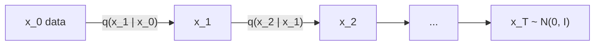

# Forward Noising

> Destroying data is easy and needs no learning. Do it slowly enough, and every small step becomes something a network can learn to undo.

**Type:** Learn
**Languages:** Python
**Prerequisites:** Phase 06 (Autoencoders and Self-Supervised: Denoising Autoencoders, Variational Autoencoders), Classic ML from Scratch Phase 03 (Probability and Statistics) for Gaussians
**Time:** ~45 minutes

## Learning Objectives

- Define the forward diffusion process `q(x_t | x_{t-1})` with a variance schedule `beta_t`
- Derive and verify the closed form `q(x_t | x_0) = N(sqrt(alpha_bar_t) x_0, (1 - alpha_bar_t) I)` against the step-by-step chain
- Compare linear and cosine schedules through `alpha_bar_t` and the signal-to-noise ratio
- Measure how quickly information is destroyed by testing a classifier on noised digits

## The Problem

GANs generate in one shot and pay for it with unstable training. VAEs are stable but blurry. Diffusion models take a third route: they define a fixed process that turns data into pure noise through many tiny Gaussian steps, then train a network to reverse one step at a time. Each reverse step is a small denoising problem, the kind lesson 02 of Phase 06 showed a network can solve, and chaining a thousand of them turns noise into data.

Before you can learn the reverse, you need to understand the forward process exactly: how much noise is added at each step, what `x_t` looks like for any `t`, and when the data is completely gone. All of it is closed-form arithmetic with Gaussians, with no parameters to learn. Getting it right matters more than it looks: the noise schedule is one of the most important hyperparameters of a diffusion model.

## The Concept

### One step

```
q(x_t | x_{t-1}) = N( sqrt(1 - beta_t) * x_{t-1},  beta_t * I )

x_t = sqrt(1 - beta_t) * x_{t-1} + sqrt(beta_t) * eps,     eps ~ N(0, I)
```

`beta_t` is small (0.0001 to 0.02 in the original DDPM). The `sqrt(1 - beta_t)` factor shrinks the signal slightly so that the total variance stays bounded: if `x_{t-1}` has unit variance, so does `x_t`.



### Jumping straight to step t

Define `alpha_t = 1 - beta_t` and `alpha_bar_t = alpha_1 * alpha_2 * ... * alpha_t`. Since each step is a linear map plus independent Gaussian noise, the composition is still Gaussian, and the noise variances add up:

```
q(x_t | x_0) = N( sqrt(alpha_bar_t) * x_0,  (1 - alpha_bar_t) * I )

x_t = sqrt(alpha_bar_t) * x_0 + sqrt(1 - alpha_bar_t) * eps
```

This is what makes training cheap: to get a noisy sample at a random `t` you do not run `t` steps, you do one multiply-add.

### Signal and noise

`sqrt(alpha_bar_t)` is how much of the data remains, `sqrt(1 - alpha_bar_t)` how much noise. Their squared ratio is the signal-to-noise ratio:

```
SNR(t) = alpha_bar_t / (1 - alpha_bar_t)
```

It starts very high (clean data), crosses 1 (0 dB) where signal and noise have equal power, and ends near 0. At `t = T` you want `alpha_bar_T` close to 0, so `x_T` is indistinguishable from `N(0, I)`: that is what lets you start generation from pure noise.

### Schedules

| Schedule | Definition | Behavior |
|---|---|---|
| Linear (DDPM) | `beta_t` linear from `1e-4` to `0.02` | destroys information quickly; the last few hundred steps are almost pure noise |
| Cosine (Nichol and Dhariwal) | `alpha_bar_t = cos^2( (t/T + s) / (1 + s) * pi/2 )` | SNR falls more evenly; more steps spent at useful noise levels |

## Build It

### Step 1: The schedules

```python
def linear_schedule(n_steps, beta_start=1e-4, beta_end=0.02):
    return torch.linspace(beta_start, beta_end, n_steps, dtype=torch.float64)


def cosine_schedule(n_steps, s=0.008):
    steps = torch.arange(n_steps + 1, dtype=torch.float64)
    f = torch.cos((steps / n_steps + s) / (1 + s) * np.pi / 2) ** 2
    alpha_bar = f / f[0]
    return (1 - alpha_bar[1:] / alpha_bar[:-1]).clamp(max=0.999)
```

The cosine schedule is defined through `alpha_bar`, and `beta_t = 1 - alpha_bar_t / alpha_bar_{t-1}` recovers the per-step variances (clipped at 0.999 so the last step is not exactly 1).

```
linear beta_1 0.00010 beta_T 0.0200 | alpha_bar at t=1 0.9999, t=250 0.5241, t=500 0.0786, t=750 0.0034, t=T 4.04e-05
cosine beta_1 0.00004 beta_T 0.9990 | alpha_bar at t=1 1.0000, t=250 0.8470, t=500 0.4938, t=750 0.1443, t=T 2.43e-09
```

With the linear schedule only 8% of the signal variance is left at the halfway point; with the cosine schedule it is still 49%.

### Step 2: Check the closed form

The data is a 2D swiss roll (5000 points). Noise it two ways: 100 or 400 sequential steps, and the one-shot formula.

```python
def noise_closed_form(x0, alpha_bar, t, generator):
    eps = torch.randn(x0.shape, generator=generator, dtype=x0.dtype)
    return torch.sqrt(alpha_bar[t - 1]) * x0 + torch.sqrt(1 - alpha_bar[t - 1]) * eps
```

```
t=100 chain  : mean (+0.176, +0.036) | var (0.488, 0.538) | cov +0.039
t=100 closed : mean (+0.188, +0.036) | var (0.482, 0.534) | cov +0.042
t=400 chain  : mean (+0.100, +0.034) | var (0.892, 0.899) | cov +0.021
t=400 closed : mean (+0.089, +0.018) | var (0.879, 0.865) | cov +0.006
```

The statistics agree up to sampling noise. (Index `t - 1` in the code because Python arrays start at 0 while the math numbers steps from 1.)

### Step 3: The end of the chain

```
x_T       : mean (-0.015, +0.012) | var (0.989, 1.010) | cov +0.038  (target N(0, I))
correlation between x_0 and x_T (first coordinate): +0.0017
```

At `t = 1000` the samples are a standard Gaussian and carry no information about where they started. `forward_2d.png` shows the roll dissolving at `t = 0, 50, 150, 300, 600, 1000`.

### Step 4: SNR

```
linear SNR (dB) at t=1 +40.0, t=250 +0.4, t=500 -10.7, t=750 -24.7, t=T -43.9 | signal and noise balance at t=260
cosine SNR (dB) at t=1 +43.8, t=250 +7.4, t=500 -0.1, t=750 -7.7, t=T -86.1 | signal and noise balance at t=497
```

The linear schedule crosses 0 dB at a quarter of the way and then spends hundreds of steps below -20 dB, where `x_t` is nearly pure noise. The cosine schedule crosses at the midpoint.

## Use It

Here is a direct measure of how fast each schedule erases content: train a logistic regression on clean digits (pixels scaled to `[-1, 1]`) and test it on noised test digits.

```
linear | t=100: 0.93 | t=300: 0.56 | t=500: 0.23 | t=700: 0.13 | t=900: 0.11
cosine | t=100: 0.96 | t=300: 0.89 | t=500: 0.63 | t=700: 0.35 | t=900: 0.21
```

With the linear schedule, digits are at chance (0.10) from about `t = 700` on: the model would spend 30% of its steps learning to denoise inputs that contain no information. This is the observation that motivated the cosine schedule, which matters most for small images like these (and like 32x32 CIFAR). `forward_digits.png` shows one digit under both schedules.

In libraries, this is the `add_noise` method of a scheduler (for example `DDPMScheduler` in Hugging Face diffusers, with `beta_schedule="linear"` or `"squaredcos_cap_v2"`): it computes exactly the closed form above.

## Exercises

1. **Easy.** Compute `alpha_bar_T` for the linear schedule with `T = 100` instead of 1000 (same `beta` range). Is `x_T` still close to `N(0, I)`? What would you change?
2. **Medium.** Implement a sigmoid schedule (`alpha_bar_t` given by a shifted, scaled sigmoid of `t`) and add it to the classifier table.
3. **Hard.** Show analytically that if `x_0` has covariance `S`, then `x_t` has covariance `alpha_bar_t S + (1 - alpha_bar_t) I`, and verify it with the swiss roll's covariance at `t = 400`.

## Key Terms

| Term | What people say | What it actually means |
|------|----------------|----------------------|
| Forward process | "Adding noise" | The fixed Markov chain `q(x_t | x_{t-1})` that gradually turns data into Gaussian noise |
| `beta_t` | "The noise schedule" | The variance of the noise added at step `t` |
| `alpha_bar_t` | "Cumulative alpha" | `prod_{s<=t} (1 - beta_s)`, the fraction of signal variance remaining at step `t` |
| Closed-form noising | "Jump to any t" | `x_t = sqrt(alpha_bar_t) x_0 + sqrt(1 - alpha_bar_t) eps` |
| SNR | "Signal-to-noise ratio" | `alpha_bar_t / (1 - alpha_bar_t)`, often quoted in decibels |
| Cosine schedule | "The improved schedule" | A schedule whose `alpha_bar_t` follows a squared cosine, spreading noise levels evenly |

## Further Reading

- [Ho, Jain and Abbeel, Denoising Diffusion Probabilistic Models (arXiv:2006.11239)](https://arxiv.org/abs/2006.11239) - the DDPM paper, with the linear schedule and the closed form
- [Nichol and Dhariwal, Improved Denoising Diffusion Probabilistic Models (arXiv:2102.09672)](https://arxiv.org/abs/2102.09672) - the cosine schedule and why the linear one wastes steps
- [Sohl-Dickstein et al., Deep Unsupervised Learning using Nonequilibrium Thermodynamics (arXiv:1503.03585)](https://arxiv.org/abs/1503.03585) - the original diffusion probabilistic model
- [Lilian Weng, What are Diffusion Models?](https://lilianweng.github.io/posts/2021-07-11-diffusion-models/) - a careful derivation of every formula in this phase
