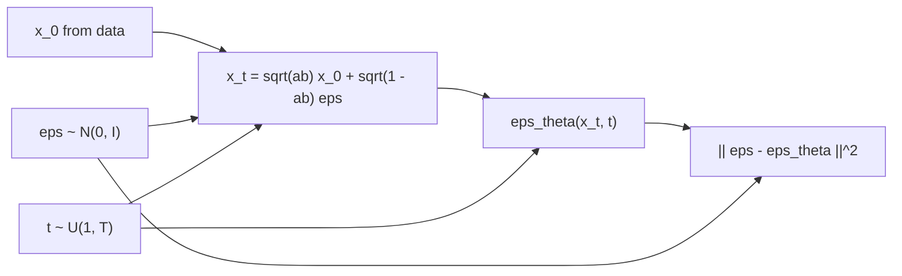

# DDPM from Scratch

> Teach a network one thing: look at a noisy point and guess the noise. Run that guess backward a thousand times and you have a generator.

**Type:** Build
**Languages:** Python
**Prerequisites:** Phase 08 Lesson 01 (Forward Noising), Phase 06 (Autoencoders and Self-Supervised: Denoising Autoencoders), Phase 05 (Transformers: Positional Encodings)
**Time:** ~75 minutes

## Learning Objectives

- Derive the simplified DDPM training objective: mean squared error between true and predicted noise
- Build a time-conditioned noise predictor with a sinusoidal timestep embedding
- Write the ancestral sampling loop by hand, from `x_T ~ N(0, I)` down to `x_0`
- Evaluate samples with the sliced Wasserstein distance and inspect what the network predicts at each noise level

## The Problem

The forward process of lesson 01 turns any distribution into `N(0, I)`. If you could run it backward, you could start from Gaussian noise and end up with data. The exact reverse step `q(x_{t-1} | x_t)` depends on the whole data distribution, so you cannot compute it. But when `beta_t` is small, the reverse step is approximately Gaussian, and all you need to know is its mean.

Ho, Jain and Abbeel (2020) showed that learning that mean comes down to one regression problem: given `x_t` and `t`, predict the noise `eps` that was added. No adversary, no encoder, no likelihood bound to tune by hand: sample a data point, a timestep and some noise, and regress. This lesson writes the whole DDPM, training and sampling, in about 60 lines of PyTorch.

## The Concept

### The reverse step

```
p_theta(x_{t-1} | x_t) = N( mu_theta(x_t, t),  sigma_t^2 I )
```

If you knew the clean `x_0`, the reverse step would be an exact Gaussian (the forward posterior):

```
q(x_{t-1} | x_t, x_0) = N( mu_tilde(x_t, x_0),  beta_tilde_t I ),     beta_tilde_t = beta_t (1 - alpha_bar_{t-1}) / (1 - alpha_bar_t)
```

You do not know `x_0`, but `x_t = sqrt(alpha_bar_t) x_0 + sqrt(1 - alpha_bar_t) eps`, so knowing `eps` is the same as knowing `x_0`. Plugging a predicted noise `eps_theta(x_t, t)` into `mu_tilde` gives

```
mu_theta(x_t, t) = 1 / sqrt(alpha_t) * ( x_t - beta_t / sqrt(1 - alpha_bar_t) * eps_theta(x_t, t) )
```

### The training objective

The variational bound on `log p(x_0)` breaks into one KL term per step, each between two Gaussians. Dropping the per-step weights (which the DDPM paper found works better), it becomes:

```
L_simple = E_{x_0, t, eps} [ || eps - eps_theta( sqrt(alpha_bar_t) x_0 + sqrt(1 - alpha_bar_t) eps,  t ) ||^2 ]
```



This is a denoising autoencoder (Phase 06) trained at a thousand noise levels at once, with the noise level given as an input.

### Ancestral sampling

```
x_T ~ N(0, I)
for t = T, ..., 1:
    z ~ N(0, I) if t > 1 else 0
    x_{t-1} = 1/sqrt(alpha_t) * (x_t - beta_t/sqrt(1 - alpha_bar_t) * eps_theta(x_t, t)) + sigma_t * z
return x_0
```

`sigma_t^2` can be `beta_t` or `beta_tilde_t`; the paper found both give similar results.

### Telling the network the time

The same network handles every `t`, so it needs `t` as input. As in transformer positional encodings (Phase 05), `t` is mapped to sines and cosines at geometrically spaced frequencies, then through a small MLP, and the result is added to the hidden features of every block.

## Build It

The data is a 2D swiss roll (10,000 points, scaled to roughly unit size). `T = 1000`, linear schedule.

### Step 1: Timestep embedding

```python
def timestep_embedding(t, dim=32):
    half = dim // 2
    frequencies = torch.exp(-np.log(10000.0) * torch.arange(half) / half)
    angles = t.float()[:, None] * frequencies[None, :]
    return torch.cat([torch.sin(angles), torch.cos(angles)], dim=1)
```

### Step 2: The noise predictor

A residual MLP with 128 hidden units: the point and the time features are added at the input, and the time features again in every block. 70,914 parameters.

```python
def forward(self, x, t):
    time_features = self.time_mlp(timestep_embedding(t, self.embed_dim))
    h = self.input(x) + time_features
    for block in self.blocks:
        h = h + block(torch.nn.functional.silu(h)) + time_features
    return self.output(torch.nn.functional.silu(h))
```

### Step 3: Training

```python
x0 = data[torch.randint(len(data), (batch_size,), generator=generator)]
t = torch.randint(1, T + 1, (batch_size,), generator=generator)
eps = torch.randn(x0.shape, generator=generator)
alpha_bar = schedule["alpha_bars"][t - 1][:, None]
x_t = alpha_bar.sqrt() * x0 + (1 - alpha_bar).sqrt() * eps
loss = ((model(x_t, t) - eps) ** 2).mean()
```

4000 steps, batch 512, Adam with a cosine-decayed learning rate from `2e-3`, about 25 s on one CPU thread. The loss drops from 1.0 (predicting zero) to about 0.19 and then plateaus. It cannot reach zero: at small `t` the noise is tiny compared to the data's own spread, so the network cannot tell which part of `x_t` is noise.

### Step 4: Sampling

```python
for t in range(T, 0, -1):
    eps = model(x, torch.full((n,), t))
    beta, alpha, alpha_bar = schedule["betas"][t - 1], schedule["alphas"][t - 1], schedule["alpha_bars"][t - 1]
    mean = (x - beta / (1 - alpha_bar).sqrt() * eps) / alpha.sqrt()
    if t > 1:
        x = mean + beta.sqrt() * torch.randn(x.shape, generator=generator)
    else:
        x = mean
```

1000 network calls for 2000 points take about 7 s.

```
sliced Wasserstein to held-out data: DDPM 0.0268 | Gaussian with the data's mean and std 0.1126 | another real sample 0.0321
```

The DDPM samples are as close to the held-out data as a fresh real sample is: at this metric's resolution, they are indistinguishable from data. `ddpm_trajectory.png` shows `x_1000, x_750, x_500, x_250, x_100, x_0`. The cloud only contracts slowly for most of the trajectory and the spiral appears in the last hundred steps, the same "the linear schedule spends most steps at near-pure noise" effect you measured in lesson 01.

### Step 5: Look inside the predictor

For held-out points noised to a given `t`, compare the predicted and true noise, and convert the prediction into an estimate of `x_0`:

```
t= 10 | eps MSE 0.661 | implied x0 error 0.043
t=100 | eps MSE 0.689 | implied x0 error 0.341
t=500 | eps MSE 0.039 | implied x0 error 0.900
t=900 | eps MSE 0.000 | implied x0 error 1.102
```

The two errors move in opposite directions. At `t = 900`, `x_t` is almost pure noise, so "predict the noise" is trivial (output `x_t` itself) but the implied `x_0` is just a guess near the data mean. At `t = 10` the noise is hard to identify, but even a rough guess gives an excellent `x_0`, because the noise is so small. The interesting learning happens in between, where both are moderately hard.

## Use It

There is no DDPM loop in PyTorch itself; libraries such as Hugging Face diffusers wrap exactly these formulas in a `DDPMScheduler` with a `step` method, and let you pick the reverse variance with `variance_type`. The script compares the two classic choices:

```
sigma_t^2 = beta      | sliced W 0.0268
sigma_t^2 = posterior | sliced W 0.0267
```

`beta_t` is an upper bound on the true reverse variance and `beta_tilde_t` a lower bound; with 1000 steps they give the same result, as the DDPM paper reported. With few steps the choice matters more, and Improved DDPM learns the variance instead. Lesson 04 shows how to sample in far fewer than 1000 steps.

## Exercises

1. **Easy.** Train with 500 and with 8000 steps and compare the sliced Wasserstein distance. Where does it stop improving?
2. **Medium.** Switch the forward process to the cosine schedule from lesson 01 (both in training and sampling) and plot the trajectory. Does the structure appear earlier?
3. **Hard.** Change the network to predict `x_0` directly instead of `eps` (the loss becomes `||x_0 - x0_theta||^2`), and rewrite the sampler using `mu_tilde(x_t, x0_theta)`. Compare sample quality with the `eps` version.

## Key Terms

| Term | What people say | What it actually means |
|------|----------------|----------------------|
| DDPM | "The diffusion model" | Denoising Diffusion Probabilistic Model: a fixed Gaussian noising chain and a learned Gaussian reverse chain |
| Reverse process | "Denoising" | `p_theta(x_{t-1} | x_t)`, a Gaussian whose mean comes from the noise predictor |
| `eps`-prediction | "Predict the noise" | Training the network to output the noise that was added to `x_0` to make `x_t` |
| `L_simple` | "The DDPM loss" | Unweighted MSE between true and predicted noise at uniformly sampled timesteps |
| Ancestral sampling | "The DDPM sampler" | Sampling `x_{t-1}` from the learned Gaussian at each of the `T` steps |
| Timestep embedding | "Telling the model t" | Sinusoidal features of `t`, passed through an MLP and added to hidden activations |
| Posterior variance | "beta tilde" | Variance of `q(x_{t-1} | x_t, x_0)`, one of two standard choices for `sigma_t^2` |

## Further Reading

- [Ho, Jain and Abbeel, Denoising Diffusion Probabilistic Models (arXiv:2006.11239)](https://arxiv.org/abs/2006.11239) - the paper this lesson implements, including `L_simple` and Algorithm 2 for sampling
- [Nichol and Dhariwal, Improved Denoising Diffusion Probabilistic Models (arXiv:2102.09672)](https://arxiv.org/abs/2102.09672) - learned variances and better schedules
- [Luo, Understanding Diffusion Models: A Unified Perspective (arXiv:2208.11970)](https://arxiv.org/abs/2208.11970) - a step-by-step derivation of the ELBO and the three equivalent parameterizations
- [Dive into Deep Learning](https://d2l.ai/) - background on the MLPs, embeddings and optimizers used here
