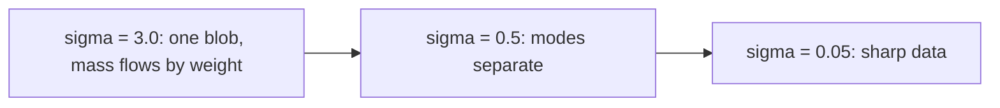

# Score Matching Intuition

> You do not need to know how likely a point is. It is enough to know which way is uphill.

**Type:** Learn
**Languages:** Python
**Prerequisites:** Phase 08 Lessons 01-02 (Forward Noising, DDPM from Scratch), Phase 06 Lesson 02 (Denoising Autoencoders)
**Time:** ~50 minutes

## Learning Objectives

- Define the score `grad_x log p(x)` and explain why it avoids the normalizing constant
- Sample with Langevin dynamics and see why plain Langevin gets mode weights wrong
- Fix it with annealed Langevin over a ladder of noise levels
- Train a noise-conditional score network with denoising score matching and connect it to DDPM's noise predictor: `eps = -sigma * score`

## The Problem

A density model has to output numbers that integrate to one over the whole space. For images, that normalizing constant is an integral over millions of dimensions, which nobody can compute. Energy-based models and normalizing flows spend a lot of effort working around it.

The score, the gradient of the log density, sidesteps the problem: the constant disappears when you differentiate a log. A model of the score is just a vector field, with no constraint to satisfy. And a vector field is enough to sample: start anywhere, walk uphill with some noise, and you end up distributed according to `p`. This view, developed by Song and Ermon (2019), explains why diffusion models work and gives a second derivation of DDPM that leads directly to the continuous-time samplers and to flow matching later in this phase.

## The Concept

### The score

```
s(x) = grad_x log p(x)
```

If `p(x) = exp(-E(x)) / Z`, then `log p = -E(x) - log Z` and `grad log p = -grad E(x)`: `Z` is gone. For a Gaussian `N(mu, s^2 I)`, the score is `-(x - mu) / s^2`, an arrow pointing back to the mean that grows with distance.

### Langevin dynamics

```
x_{k+1} = x_k + eta * s(x_k) + sqrt(2 eta) * z_k,      z_k ~ N(0, I)
```

The drift moves uphill in density, the noise keeps samples from collapsing onto the peaks. As `eta -> 0` and the number of steps grows, the samples follow `p` exactly.

### Two problems with plain score-based sampling

1. **Low-density regions.** You learn the score from data, so it is only accurate where data exists. Between modes there is no data and the learned score is garbage.
2. **Mode weights.** Far from a mode, the score of a mixture is dominated by the nearest component and ignores the mixture weights. Langevin started in the basin of the small mode stays there: the relative masses of separated modes are only corrected by rare jumps across the gap, which take forever.

### The fix: add noise

Convolve the data with Gaussian noise of scale `sigma`. The noisy density `p_sigma` covers the whole space, overlaps the modes, and its score is well defined everywhere. Large `sigma` gives a blurry density where the modes merge and the mixture weights decide which way points flow; small `sigma` gives back the sharp data. Annealed Langevin runs Langevin at a decreasing ladder of `sigma` values, using each level's result to start the next:



### Learning the score without knowing it: denoising score matching

You cannot regress onto `grad log p_sigma` because you do not have it. Vincent (2011) showed you can regress onto something you do have. If `x_tilde = x + sigma * eps`, the score of the conditional `q(x_tilde | x)` is `-(x_tilde - x)/sigma^2 = -eps/sigma`, and

```
E || s_theta(x_tilde, sigma) - (-eps / sigma) ||^2
```

has the same minimizer as regression onto the true noisy score. Weighting by `sigma^2` balances the noise levels:

```
L = E_{x, sigma, eps} || sigma * s_theta(x + sigma eps, sigma) + eps ||^2
```

Read it again: `sigma * s_theta` must predict `-eps`. That is DDPM's loss with `eps_theta = -sigma * s_theta`. A noise predictor is a scaled score model.

## Build It

The data is a mixture of two Gaussians (std 0.3) at `x = -2` with weight 0.8 and `x = +2` with weight 0.2, so 80% of samples should land on the left.

### Step 1: The exact score

```python
def true_score(x, extra_std=0.0):
    x = x.detach().requires_grad_(True)
    grad, = torch.autograd.grad(log_density(x, extra_std).sum(), x)
    return grad
```

`log_density` is the mixture's log density (a `logsumexp` over components); with `extra_std` it is the density of the data plus Gaussian noise of that scale, which for a Gaussian mixture is just another Gaussian mixture with wider components.

```
x = (-2.0, +0.0) -> score (  +0.000,   +0.000)
x = (-1.5, +0.5) -> score (  -5.556,   -5.556)
x = (+0.0, +0.0) -> score ( -13.333,   +0.000)
x = (+1.0, +0.0) -> score ( +11.111,   +0.000)
```

Zero at a peak, pointing back to the nearest mode everywhere else. At the origin the left mode wins because of its larger weight.

### Step 2: Plain Langevin

1000 steps of size 0.01 from 4000 uniform starting points in `[-4, 4]^2`:

```
1000 steps from uniform starts: left fraction 0.52 (target 0.80) | sliced W 0.768
```

Every point found a mode, but each one went to the mode of its own half of the box. The 80/20 weighting is lost: problem 2 above, with the exact score.

### Step 3: Annealed Langevin

Ten noise levels from 3.0 down to 0.05 (geometric), 100 steps each, step size proportional to `sigma^2`:

```python
for sigma in SIGMAS:
    step_size = base_step * sigma ** 2
    for _ in range(steps_per_level):
        x = x + step_size * score_fn(x, sigma) + torch.sqrt(2 * step_size) * torch.randn(x.shape, generator=generator)
```

```
10 noise levels x 100 steps: left fraction 0.78 | sliced W 0.074
```

At `sigma = 3` the two modes are one blob and points move freely between them in proportion to the weights. The ladder then sharpens the picture without letting points switch sides.

### Step 4: Learn the score

A small MLP takes `(x, log sigma)` and its output is divided by `sigma`, so the network only has to predict something of unit scale. Training:

```python
noisy = x + sigma[:, None] * eps
target = -eps / sigma[:, None]
loss = ((sigma[:, None] * (model(noisy, sigma) - target)) ** 2).sum(dim=1).mean()
```

The loss settles near 1.0, not 0, for the same reason as in DDPM: individual noise draws are not predictable, only their conditional average is. Compared to the exact noisy score:

```
sigma 3.000 | cosine(learned, true) 0.995 | median relative error 0.046
sigma 0.486 | cosine(learned, true) 0.996 | median relative error 0.074
sigma 0.050 | cosine(learned, true) 0.964 | median relative error 0.210
annealed Langevin with the learned score: left fraction 0.80 | sliced W 0.037
```

The network never saw the true score, yet it points the right way almost everywhere (the smallest `sigma` is hardest, the field is sharpest there). Sampling with it recovers the 80/20 split.

### Step 5: Score equals scaled noise

```
sigma 0.196: -sigma * score vs the true eps, MSE 0.721 (predicting zero gives 0.999)
```

The score model is used as a noise predictor without any change. `score_langevin.png` shows the learned vector field at one noise level and the three sets of samples.

## Use It

For distributions with a known density, `torch.distributions` plus autograd gives the exact score, which is how you build test cases like this one:

```python
mixture = MixtureSameFamily(Categorical(probs=WEIGHTS), Independent(Normal(MEANS, torch.full_like(MEANS, STD)), 1))
library_score, = torch.autograd.grad(mixture.log_prob(x).sum(), x)
```

```
log p matches: True | score matches: True
```

The score view connects the rest of the phase:

- DDPM's sampler is a discretization of a reverse-time stochastic differential equation driven by the score (Song et al., 2021).
- DDIM (lesson 04) and flow matching (lesson 07) follow the corresponding deterministic ODE.
- Classifier guidance adds `grad log p(y | x)` to the score; classifier-free guidance (lesson 05) estimates it with the model itself.

## Exercises

1. **Easy.** Run plain Langevin for 20,000 steps instead of 1000. Does the left fraction move toward 0.80? Estimate how long it would take.
2. **Medium.** Use 3 noise levels instead of 10 (keep 1000 total steps). How does the left fraction change? What about 30 levels?
3. **Hard.** Replace annealed Langevin with the DDPM sampler of lesson 02, using `eps_theta = -sigma * s_theta`. You will need to map each DDPM `t` to a `sigma` (hint: a DDPM `x_t` divided by `sqrt(alpha_bar_t)` is `x_0` plus noise of scale `sqrt((1 - alpha_bar_t) / alpha_bar_t)`).

## Key Terms

| Term | What people say | What it actually means |
|------|----------------|----------------------|
| Score | "The gradient of the data" | `grad_x log p(x)`, a vector field pointing toward higher density; independent of the normalizing constant |
| Langevin dynamics | "Noisy gradient ascent" | `x <- x + eta s(x) + sqrt(2 eta) z`, which samples from `p` in the small-step limit |
| Annealed Langevin | "Coarse to fine" | Langevin over a decreasing ladder of noise levels, each started from the previous one |
| Noise-conditional score network | "NCSN" | A network `s_theta(x, sigma)` estimating the score of the data convolved with noise of scale `sigma` |
| Denoising score matching | "Learn the score by denoising" | Regressing `s_theta(x + sigma eps)` onto `-eps / sigma`, which has the true noisy score as its minimizer |
| Tweedie's formula | "Denoiser equals score" | `E[x | x_tilde] = x_tilde + sigma^2 grad log p_sigma(x_tilde)` |

## Further Reading

- [Song and Ermon, Generative Modeling by Estimating Gradients of the Data Distribution (arXiv:1907.05600)](https://arxiv.org/abs/1907.05600) - NCSN, annealed Langevin and the two failure modes of plain score-based sampling
- [Song et al., Score-Based Generative Modeling through Stochastic Differential Equations (arXiv:2011.13456)](https://arxiv.org/abs/2011.13456) - unifies DDPM and score models as SDEs and their ODE counterparts
- [Vincent, A Connection Between Score Matching and Denoising Autoencoders (2011)](https://www.iro.umontreal.ca/~vincentp/Publications/smdae_techreport.pdf) - the denoising score matching identity
- [Yang Song, Generative Modeling by Estimating Gradients of the Data Distribution (blog)](https://yang-song.net/blog/2021/score/) - the author's long-form explanation with figures
