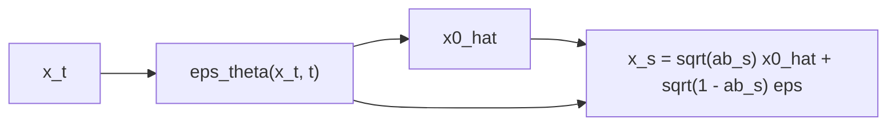

# Faster Sampling with DDIM

> The model you trained does not care how you walk back. Take big deterministic strides instead of a thousand random shuffles.

**Type:** Build
**Languages:** Python
**Prerequisites:** Phase 08 Lessons 01-03 (Forward Noising, DDPM from Scratch, Score Matching Intuition)
**Time:** ~60 minutes

## Learning Objectives

- Derive the DDIM update from the predicted `x_0` and the predicted noise, with the `eta` parameter controlling stochasticity
- Sample with 100, 50, 20, 10, 5 and 2 steps from a model trained with the plain DDPM loss, and measure the quality-speed trade-off
- Invert data to noise deterministically and reconstruct it, and explain why that requires `eta = 0`
- Explain the connection between DDIM and the probability-flow ODE

## The Problem

DDPM sampling is slow: one network evaluation per step, a thousand steps per sample. In lesson 02 that was 7 seconds for 2000 points in 2D; for a 512x512 image with a big U-Net it is minutes. Training is not the bottleneck anymore, sampling is.

Song, Meng and Ermon (2020) noticed that the DDPM training loss only depends on the marginals `q(x_t | x_0)`, never on the step-to-step chain. Many different forward processes share those marginals, including non-Markovian ones whose reverse is deterministic. A model trained with the DDPM loss is therefore already a valid model for all of them. Choose the deterministic one and you can skip timesteps: DDIM produces comparable samples in 50 steps instead of 1000, with no retraining. Every modern diffusion sampler (DPM-Solver, Euler, Heun samplers in image generation tools) builds on this observation.

## The Concept

### Predict x_0, then re-noise to a lower level

At step `t` with noise prediction `eps = eps_theta(x_t, t)`:

```
x0_hat = ( x_t - sqrt(1 - alpha_bar_t) * eps ) / sqrt(alpha_bar_t)          what the model thinks the clean point is
```

To land at an earlier step `s < t` (not necessarily `t - 1`), rebuild a sample with the right marginal `q(x_s | x_0)`, reusing the predicted noise as the direction:

```
x_s = sqrt(alpha_bar_s) * x0_hat  +  sqrt(1 - alpha_bar_s - sigma^2) * eps  +  sigma * z

sigma = eta * sqrt( (1 - alpha_bar_s) / (1 - alpha_bar_t) ) * sqrt( 1 - alpha_bar_t / alpha_bar_s )
```

- `eta = 0`: no fresh noise. The map from `x_T` to `x_0` is deterministic. This is DDIM.
- `eta = 1`: the fresh noise has the DDPM posterior variance, and with `s = t - 1` it reduces to DDPM ancestral sampling.



### Why big steps work

With `eta = 0`, DDIM is a first-order (Euler-like) discretization of an ordinary differential equation, the probability-flow ODE, whose solutions carry `N(0, I)` to the data distribution along smooth paths. Smooth paths can be followed with large steps. DDPM's stochastic steps, by contrast, inject fresh noise that only averages out over many small steps.

### Determinism buys invertibility

A deterministic ODE can be run in both directions. Running the DDIM update from `t = 0` up to `T` (using the noise prediction at the current point) maps a data point to a latent noise vector; sampling from that latent gives the point back. This "DDIM inversion" is the basis of many image editing methods: invert a real photo, change the prompt, sample again.

## Build It

The model is the residual MLP noise predictor from lesson 02, trained the same way (4000 steps on the 2D swiss roll). Nothing about training changes; only the sampler does.

### Step 1: The DDIM sampler

```python
timesteps = np.linspace(T, 0, n_steps + 1).round().astype(int)
for t, t_prev in zip(timesteps[:-1], timesteps[1:]):
    eps = model(x, torch.full((len(x),), int(t)))
    ab, ab_prev = alpha_bar_at(t), alpha_bar_at(t_prev)
    x0_hat = (x - (1 - ab).sqrt() * eps) / ab.sqrt()
    sigma = eta * ((1 - ab_prev) / (1 - ab) * (1 - ab / ab_prev)).sqrt()
    direction = (1 - ab_prev - sigma ** 2).clamp(min=0).sqrt() * eps
    x = ab_prev.sqrt() * x0_hat + direction
    if eta > 0 and t_prev > 0:
        x = x + sigma * torch.randn(x.shape, generator=generator)
```

`alpha_bar_at(0) = 1`, so the final step returns `x0_hat` itself. The timesteps are evenly spaced from 1000 down to 0.

### Step 2: Fewer steps, same model

Two real samples from the swiss roll are at sliced Wasserstein distance 0.0321 from each other, which is the noise floor of the metric.

```
DDPM  1000 network calls |  6.88s | sliced W 0.0239
DDIM   100 network calls |  0.67s | sliced W 0.0219
DDIM    50 network calls |  0.32s | sliced W 0.0252
DDIM    20 network calls |  0.13s | sliced W 0.0396
DDIM    10 network calls |  0.07s | sliced W 0.0930
DDIM     5 network calls |  0.04s | sliced W 0.2219
DDIM     2 network calls |  0.01s | sliced W 0.5047
```

100 and 50 DDIM steps are as good as 1000 DDPM steps, 10 to 20 times faster. At 20 steps quality starts to degrade, and at 5 or 2 steps the Euler-like discretization error is large: the spiral is recognizable but smeared (`ddim_steps.png`). Getting good samples in very few steps needs higher-order solvers (DPM-Solver), distillation, or straighter paths (flow matching, lesson 07).

### Step 3: Invert and reconstruct

```python
for t, t_next in zip(timesteps[:-1], timesteps[1:]):
    eps = model(x, torch.full((len(x),), int(max(t, 1))))
    ab, ab_next = alpha_bar_at(t), alpha_bar_at(t_next)
    x0_hat = (x - (1 - ab).sqrt() * eps) / ab.sqrt()
    x = ab_next.sqrt() * x0_hat + (1 - ab_next).sqrt() * eps
```

```
inverted latents: mean (+0.018, -0.027), std (0.955, 0.957)
reconstruction error after invert -> sample: 0.0195 (data spread 0.685)
same noise, sampled twice with DDIM: max difference 0.00e+00
```

500 held-out points are mapped to latents that look like `N(0, I)` and come back with an average error of 0.02, about 3% of the data's spread. The error is not zero because the inversion uses the noise prediction at the current point as an approximation of the one at the next point. Sampling the same noise twice gives bit-identical outputs.

## Use It

The `eta` parameter interpolates between DDIM and DDPM on any timestep subsequence:

```
100 steps, eta 0.0 | sliced W 0.0219
100 steps, eta 1.0 | sliced W 0.0332
 20 steps, eta 0.0 | sliced W 0.0396
 20 steps, eta 1.0 | sliced W 0.0708
 10 steps, eta 0.0 | sliced W 0.0930
 10 steps, eta 1.0 | sliced W 0.1293
```

With few steps the deterministic sampler wins clearly: fresh noise needs many steps to be "absorbed". With many steps the two converge. Some image models still prefer a little stochasticity at high step counts because it corrects accumulated errors.

In Hugging Face diffusers, swapping `DDPMScheduler` for `DDIMScheduler` (with `num_inference_steps=50` and `eta=0.0`) on a pipeline trained with DDPM is exactly what you did here. Image tools expose the same idea as "sampler" and "steps" settings.

## Exercises

1. **Easy.** Space the DDIM timesteps quadratically (dense near `t = 0`) instead of linearly and rerun the 10-step sampler. Does it help?
2. **Medium.** Implement a second-order (Heun) step: take a DDIM step, re-evaluate `eps` at the new point, and redo the step with the average of the two `eps` predictions. Compare 10 Heun steps (20 network calls) with 20 DDIM steps.
3. **Hard.** Interpolate between two inverted latents with spherical interpolation and decode 10 points along the path. Compare with interpolating the data points directly.

## Key Terms

| Term | What people say | What it actually means |
|------|----------------|----------------------|
| DDIM | "The fast sampler" | Denoising Diffusion Implicit Models: a deterministic sampler for DDPM-trained models that can skip timesteps |
| `x0_hat` | "Predicted clean sample" | The model's estimate of `x_0` implied by its noise prediction at step `t` |
| `eta` | "Stochasticity knob" | Scales the fresh noise per step: 0 is DDIM, 1 recovers DDPM |
| Timestep subsequence | "Number of steps" | The subset of timesteps the sampler visits; fewer means faster |
| Probability-flow ODE | "The deterministic version" | An ODE whose solutions have the same marginals as the diffusion process; DDIM discretizes it |
| DDIM inversion | "Noise from an image" | Running the deterministic update forward in `t` to find the latent that generates a given sample |

## Further Reading

- [Song, Meng and Ermon, Denoising Diffusion Implicit Models (arXiv:2010.02502)](https://arxiv.org/abs/2010.02502) - the DDIM paper, the non-Markovian forward processes and the `eta` family
- [Lu et al., DPM-Solver: A Fast ODE Solver for Diffusion Probabilistic Model Sampling (arXiv:2206.00927)](https://arxiv.org/abs/2206.00927) - higher-order solvers that need 10 to 20 steps
- [Karras et al., Elucidating the Design Space of Diffusion-Based Generative Models (arXiv:2206.00364)](https://arxiv.org/abs/2206.00364) - samplers, noise levels and the Heun method, clearly separated from training
- [Mokady et al., Null-text Inversion for Editing Real Images (arXiv:2211.09794)](https://arxiv.org/abs/2211.09794) - DDIM inversion used for image editing
