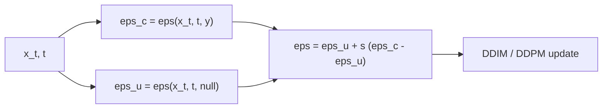

# Classifier-Free Guidance

> Ask the model twice, once with the prompt and once without, and step further in the direction where they disagree.

**Type:** Build
**Languages:** Python
**Prerequisites:** Phase 08 Lessons 02-04 (DDPM from Scratch, Score Matching Intuition, Faster Sampling with DDIM), Phase 07 Lesson 05 (Conditional GANs)
**Time:** ~50 minutes

## Learning Objectives

- Train a single noise predictor that is both conditional and unconditional by randomly replacing labels with a null token
- Implement the classifier-free guidance combination `eps_u + s * (eps_c - eps_u)` inside a DDIM sampler
- Measure the trade-off guidance makes: class adherence and confidence up, diversity and fidelity to the true conditional distribution down
- Explain guidance as sampling from a sharpened distribution `p(x) p(y | x)^s`, and batch both predictions in one forward pass

## The Problem

A conditional diffusion model learns `p(x | y)`. Sampled honestly, it reproduces the conditional distribution, including its ambiguous examples: if 5% of real "class 0" points look like class 1, so will 5% of its samples. For a text-to-image model that means images that only loosely follow the prompt. Users want the opposite: images that are unmistakably what they asked for, even at the cost of some variety.

Classifier guidance (Dhariwal and Nichol, 2021) pushed samples toward a class with the gradient of a separately trained classifier on noisy images. That works, but needs an extra network trained at every noise level. Ho and Salimans (2021) showed you can get the same effect with no classifier at all, from the diffusion model itself. Classifier-free guidance (CFG) is now in essentially every text-to-image and text-to-video model; the "guidance scale" slider in image tools is the `s` in this lesson.

## The Concept

### One network, two modes

During training, replace the label with a special null token some fraction of the time (here 20%). The network learns `eps(x_t, t, y)` and `eps(x_t, t, null)`, the conditional and unconditional noise predictions, with shared weights.



### Why it works: Bayes in score space

Recall that `eps = -sigma * score`. By Bayes' rule,

```
log p(x | y) = log p(x) + log p(y | x) - log p(y)
grad log p(x | y) = grad log p(x) + grad log p(y | x)
```

So `eps_c - eps_u` is proportional to `-grad_x log p(y | x)`: the gradient of an implicit classifier that the model learned for free. Guidance scales it up:

```
eps_guided = eps_u + s * (eps_c - eps_u)      corresponds to the score of   p(x) * p(y | x)^s
```

| scale `s` | Samples from (approximately) |
|---|---|
| 0 | `p(x)`, the unconditional model |
| 1 | `p(x | y)`, the honest conditional model |
| > 1 | `p(x) p(y | x)^s`: points where the class is very certain, a sharpened and narrower distribution |

### The trade-off

Raising `s` concentrates samples where `p(y | x)` is high: deep inside the class, far from the boundary. Adherence and "quality" (as judged by a classifier) go up; diversity goes down, and the samples drift away from the true conditional distribution. Image models typically use `s` between 3 and 8, deliberately trading fidelity for prompt adherence.

## Build It

The data is two overlapping moons (noise 0.25): a kNN "oracle" trained on real labeled points gets 94.5% accuracy on held-out data, so about 5% of points sit in the ambiguous overlap.

### Step 1: A label table with a null row

```python
self.label_table = nn.Parameter(torch.randn(N_CLASSES + 1, hidden) * 0.1)

def forward(self, x, t, labels):
    condition = self.time_mlp(timestep_embedding(t, self.embed_dim)) + self.label_table[labels]
    h = self.input(x) + condition
    for block in self.blocks:
        h = h + block(torch.nn.functional.silu(h)) + condition
    return self.output(torch.nn.functional.silu(h))
```

The table has one row per class plus row `NULL = 2` for "no label". The label vector is added to the time features, so it conditions every block.

### Step 2: Label dropout in training

```python
x0, y = data[index], labels[index].clone()
y[torch.rand(512, generator=generator) < drop_prob] = NULL
```

Everything else is the DDPM loss from lesson 02.

### Step 3: Guided sampling

```python
def guided_eps(model, x, t, labels, scale):
    eps_cond = model(x, t, labels)
    eps_uncond = model(x, t, torch.full_like(labels, NULL))
    return eps_uncond + scale * (eps_cond - eps_uncond)
```

The guided noise prediction drops into the deterministic DDIM sampler of lesson 04 (50 steps) unchanged.

### Step 4: Sweep the scale

2000 samples requested as class 0, judged by the oracle. Real class-0 points: the oracle says class 0 for 94.6% of them, and their spread (mean per-axis standard deviation) is 0.953.

```
scale | oracle says class 0 | mean P(class 0) | spread | sliced W to real class 0
  0.0 |               0.496 |           0.494 |  1.205 | 0.6684
  1.0 |               0.950 |           0.923 |  0.942 | 0.0379
  2.0 |               1.000 |           0.991 |  0.839 | 0.3766
  4.0 |               1.000 |           1.000 |  0.739 | 0.7291
  8.0 |               1.000 |           1.000 |  0.596 | 1.0312
scale 0 is the unconditional model: sliced W to all held-out data 0.0360
```

Every row tells part of the story:

- **Scale 0** ignores the label: half the samples are class 1, and they match the full two-moon data (sliced W 0.036). One network really did learn the unconditional model too.
- **Scale 1** is the honest conditional model: 95% class 0, the same as real class-0 data including its ambiguous 5%, with the right spread and the best fidelity (0.038).
- **Scale 2 and above**: every sample is unambiguous class 0 with near-certain oracle probability. The spread shrinks (0.84, 0.74, 0.60) and the distance to the real class-0 distribution grows: samples crowd into the part of the moon farthest from class 1. `cfg_scales.png` shows the red samples sliding away from the overlap region as the scale grows.

Guidance did not make the model better. It made it more confident, and you chose to pay for that with diversity.

## Use It

Calling the network twice per step doubles the cost. Implementations instead stack the conditional and unconditional inputs into one batch of twice the size:

```python
both = model(torch.cat([x, x]), torch.cat([t, t]), torch.cat([labels, torch.full_like(labels, NULL)]))
eps_cond, eps_uncond = both.chunk(2)
```

```
two forward passes vs one doubled batch: max difference 0.00e+00
```

Same numbers, one kernel launch per layer, which is how Hugging Face diffusers pipelines implement `guidance_scale`. In text-to-image models the null label is the embedding of an empty prompt, and "negative prompts" replace that unconditional branch with the embedding of a prompt describing what you do not want, so guidance pushes away from it.

Note on conventions: some papers write `eps_c + w (eps_c - eps_u)`, which is the same formula with `s = 1 + w`; `w = 0` is then the plain conditional model.

## Exercises

1. **Easy.** Train with `drop_prob = 0.05` and `0.5`. How does the quality of the unconditional model (scale 0 row) and of the guided samples change?
2. **Medium.** Apply guidance only for `t < 500` (use `s = 1` at higher noise levels). Does it keep the class adherence of `s = 4` while recovering some spread?
3. **Hard.** Train a small classifier on noisy points `p(y | x_t, t)` and implement classifier guidance: add `-sqrt(1 - alpha_bar_t) * s * grad_x log p(y | x_t)` to the conditional `eps`. Compare it with CFG at the same scale.

## Key Terms

| Term | What people say | What it actually means |
|------|----------------|----------------------|
| Classifier-free guidance | "CFG" | Combining conditional and unconditional predictions of one model as `eps_u + s (eps_c - eps_u)` |
| Guidance scale | "How strongly to follow the prompt" | The factor `s`; 1 is plain conditional sampling, larger values sharpen toward the condition |
| Null token | "Empty prompt" | A special condition value used for the unconditional branch, learned via label dropout |
| Label dropout | "Condition dropout" | Replacing the condition with the null token for a fraction of training examples |
| Implicit classifier | "The guidance direction" | `grad log p(y | x)`, recovered as the difference between conditional and unconditional scores |
| Classifier guidance | "The older method" | Adding the gradient of a separately trained noisy-input classifier to the score |
| Negative prompt | "What to avoid" | Using a different condition in place of the null token so guidance pushes away from it |

## Further Reading

- [Ho and Salimans, Classifier-Free Diffusion Guidance (arXiv:2207.12598)](https://arxiv.org/abs/2207.12598) - the method, label dropout, and the fidelity-diversity trade-off
- [Dhariwal and Nichol, Diffusion Models Beat GANs on Image Synthesis (arXiv:2105.05233)](https://arxiv.org/abs/2105.05233) - classifier guidance and the derivation via Bayes' rule
- [Nichol et al., GLIDE (arXiv:2112.10741)](https://arxiv.org/abs/2112.10741) - classifier-free guidance applied to text-to-image generation
- [Sander Dieleman, Guidance: a cheat code for diffusion models](https://sander.ai/2022/05/26/guidance.html) - an intuitive explanation of why guidance sharpens distributions
