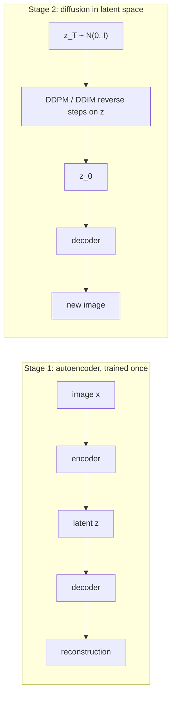

# Latent Diffusion

> Do not spend a thousand denoising steps on pixels. Compress first, diffuse in the small space, decode once at the end.

**Type:** Build
**Languages:** Python
**Prerequisites:** Phase 06 (Autoencoders and Self-Supervised: Autoencoders, Variational Autoencoders), Phase 08 Lessons 02 and 04 (DDPM from Scratch, Faster Sampling with DDIM)
**Time:** ~60 minutes

## Learning Objectives

- Split generation into two stages: an autoencoder for perceptual compression and a diffusion model for the latent distribution
- Train a DDPM on 8-dimensional autoencoder latents of 8x8 digits and decode DDIM samples back to pixels
- Compare latent diffusion with pixel-space diffusion and with naively decoding Gaussian latents
- Explain the latent scaling factor through its effect on the signal-to-noise ratio of the noise schedule

## The Problem

A diffusion model's cost is the size of its input times the number of steps. For a 512x512 RGB image that is 786,432 numbers, pushed through a large U-Net at every one of 50 or more steps, in training and in sampling. Most of those numbers encode imperceptible detail: high-frequency texture that a good decoder can fill in. Spending the diffusion model's capacity on it is wasteful.

Rombach et al. (2022) split the job in two. First train an autoencoder that compresses an image into a much smaller latent (Stable Diffusion: 512x512x3 down to 64x64x4, 48 times fewer numbers) while keeping everything that matters to a human. Then train the diffusion model on the latents. Sampling runs the whole denoising loop in the small space and calls the decoder once. That is Stable Diffusion, and the latent-plus-diffusion recipe is now standard for images, video and audio.

## The Concept



### What each stage is responsible for

| Stage | Learns | Trained with |
|---|---|---|
| Autoencoder | perceptual compression: what detail can be dropped and regenerated | reconstruction loss (Stable Diffusion adds perceptual and adversarial losses and a small KL) |
| Latent diffusion | the distribution of latents: which combinations are real images | the DDPM loss, unchanged, on `z` instead of `x` |

The decoder alone is not a generator: a plain autoencoder's latents occupy an irregular region (Phase 06), so decoding random Gaussian latents gives poor images. The diffusion model's job is precisely to learn that irregular region.

### The latent scaling factor

The noise schedule was designed for data with roughly unit variance. If the latents have standard deviation 3, then at every `t` the signal is 3 times stronger relative to the noise than intended:

```
SNR(t) = alpha_bar_t * var(z) / (1 - alpha_bar_t)
```

The forward process destroys the latents later than the schedule assumes, and at `t = T` there may still be signal left, so starting the reverse process from pure `N(0, I)` is slightly wrong. Stable Diffusion multiplies its latents by a fixed factor (0.18215) computed so they have unit variance; you divide by it before decoding.

### Quality ceiling

Latent diffusion can never produce better images than the decoder can reconstruct. The autoencoder's reconstruction quality is the ceiling, which is why the compression rate is a design choice: too aggressive and details are lost, too mild and the diffusion is expensive again.

## Build It

### Step 1: The autoencoder

An MLP autoencoder `64 -> 256 -> 128 -> 8 -> 128 -> 256 -> 64`, trained for 150 epochs on all 1797 digits (pixels in `[-1, 1]`).

```
reconstruction MSE 0.0214 | reconstructions judged confident: 0.77 (the ceiling for latent diffusion)
raw latent std 3.050 -> divide by it so the diffusion sees unit-scale data (scaling factor 0.328)
```

As in earlier lessons, a logistic regression trained on real digits judges images; it is confident (above 0.9) on 77% of real digits and on 77% of reconstructions, so the autoencoder loses nothing the classifier cares about.

### Step 2: The baseline: decode Gaussian latents

```python
gaussian_decoded = autoencoder.decoder(torch.randn(1000, LATENT, generator=torch.Generator().manual_seed(1)) * scale)
```

```
confident 0.19 | class counts [146, 53, 148, 114, 76, 116, 79, 108, 84, 76]
```

Matching the latents' overall scale is not enough: only 19% of decoded samples look like confident digits.

### Step 3: Diffusion on the latents

The noise predictor is the residual MLP from lesson 02, with input and output size equal to the data dimension, trained with the DDPM loss for 3000 steps. The only change for latent diffusion is the data you feed it:

```python
latent_model = train_diffusion(scaled_latents.to(device), steps=3000, seed=2)
latent_samples = autoencoder.decoder(ddim_sample(latent_model, 1000, LATENT, 50, seed=3) * scale)
```

For comparison, the identical network and training budget are applied directly to the 64 pixels:

```python
pixel_model = train_diffusion(X.to(device), steps=3000, seed=2)
pixel_samples = ddim_sample(pixel_model, 1000, 64, 50, seed=3).clamp(-1, 1)
```

```
latent diffusion | confident 0.57 | class counts [84, 96, 93, 121, 105, 94, 103, 106, 96, 102]
pixel diffusion  | confident 0.30 | class counts [91, 103, 70, 109, 125, 99, 100, 93, 112, 98]
```

Same network, same steps, same sampler: modeling 8 numbers instead of 64 nearly doubles the fraction of convincing digits, with all ten classes evenly covered. The diffusion model only had to learn which combinations of 8 latent factors are digits; the decoder takes care of turning those into pixel patterns. The script uses the GPU when one is available for these two trainings and the CPU otherwise; the numbers are the same either way because the random draws happen on the CPU.

### Step 4: Where the work goes

```
FLOPs per denoiser call (excluding time MLP): latent 227,328 | pixel 270,336
data dimension the diffusion must model: latent 8 | pixel 64 (8x larger)
```

With MLPs, the hidden layers dominate the cost, so the per-call savings here are small. With convolutional U-Nets, cost scales with the number of spatial positions, and Stable Diffusion's 64x64 latent instead of a 512x512 image cuts every step's cost by about 64 times. The bigger gain shown here is statistical: a smaller, smoother space is easier to model. `latent_diffusion.png` shows real digits, reconstructions, decoded Gaussian latents, latent diffusion samples and pixel diffusion samples.

## Use It

Why divide the latents by their standard deviation? Compare the effective SNR of the linear schedule on scaled and raw latents:

```
scaled latents (std 1.00) | SNR at t=250/500/750/1000: 1.1012 / 0.0853 / 0.0034 / 0.0000
raw latents    (std 3.05) | SNR at t=250/500/750/1000: 10.2413 / 0.7932 / 0.0313 / 0.0004
```

On raw latents the schedule behaves as if shifted: at `t = 500` the signal is still almost as strong as the noise, and the final step still holds measurable signal. Every hyperparameter tuned for unit-variance data (the schedule, the guidance scale, the sampler's step spacing) would have to be retuned. In Hugging Face diffusers, this is the `vae.config.scaling_factor` that pipelines multiply after `vae.encode` and divide before `vae.decode`.

Real latent diffusion models use a convolutional VAE so the latent keeps a spatial layout (64x64x4), a U-Net or transformer (DiT) as the denoiser, and text conditioning through cross-attention, combined with classifier-free guidance from lesson 05.

## Exercises

1. **Easy.** Retrain with a 4-number latent and with a 16-number latent. How do the reconstruction ceiling and the latent diffusion score move?
2. **Medium.** Replace the autoencoder with the VAE from Phase 06 (with a small KL weight such as 0.01). Are its latents easier for the diffusion model, given the same training steps?
3. **Hard.** Make the latent diffusion class-conditional with classifier-free guidance (lesson 05) and generate a 10x10 grid with one row per requested digit. Measure label agreement at scales 1 and 3.

## Key Terms

| Term | What people say | What it actually means |
|------|----------------|----------------------|
| Latent diffusion | "Stable Diffusion's trick" | Running the diffusion process on autoencoder latents instead of pixels |
| Perceptual compression | "The VAE stage" | Mapping images to a smaller latent that keeps what matters perceptually |
| First stage / second stage | "Autoencoder, then diffusion" | The two separately trained models of a latent diffusion system |
| Scaling factor | "0.18215" | A constant multiplying the latents so they have roughly unit variance before diffusion |
| Reconstruction ceiling | "The decoder limit" | Samples can be no better than what the decoder can reconstruct |
| DiT | "Diffusion transformer" | A transformer used as the denoiser over latent patches, replacing the U-Net |

## Further Reading

- [Rombach et al., High-Resolution Image Synthesis with Latent Diffusion Models (arXiv:2112.10752)](https://arxiv.org/abs/2112.10752) - the latent diffusion paper behind Stable Diffusion
- [Vahdat, Kreis and Kautz, Score-based Generative Modeling in Latent Space (arXiv:2106.05931)](https://arxiv.org/abs/2106.05931) - LSGM, training the autoencoder and the latent score model jointly
- [Peebles and Xie, Scalable Diffusion Models with Transformers (arXiv:2212.09748)](https://arxiv.org/abs/2212.09748) - DiT, the transformer denoiser used in many recent latent diffusion models
- [Esser et al., Taming Transformers for High-Resolution Image Synthesis (arXiv:2012.09841)](https://arxiv.org/abs/2012.09841) - the perceptual and adversarial autoencoder losses that latent diffusion reuses
