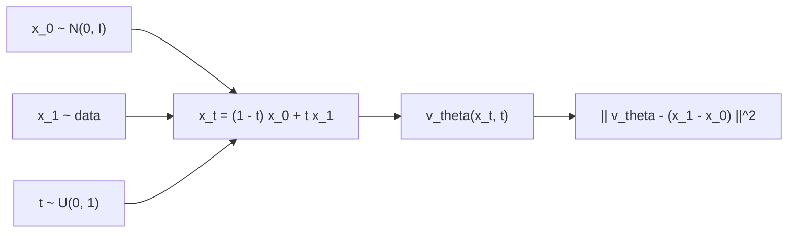

# Flow Matching

> Draw a straight line from each noise sample to a data point, and teach a network the velocity along it. Averaged over all the lines, those velocities carry noise to data.

**Type:** Build
**Languages:** Python
**Prerequisites:** Phase 08 Lessons 02-04 (DDPM from Scratch, Score Matching Intuition, Faster Sampling with DDIM)
**Time:** ~60 minutes

## Learning Objectives

- Define the linear interpolation path `x_t = (1 - t) x_0 + t x_1` and its conditional velocity `x_1 - x_0`
- Train a velocity field with the conditional flow matching loss and sample by integrating the ODE with Euler steps
- Measure how trajectory curvature limits few-step sampling, and straighten trajectories with one round of reflow
- Integrate the learned ODE with SciPy's adaptive `solve_ivp` and compare network calls with fixed-step Euler

## The Problem

DDIM showed that a diffusion model defines an ODE from noise to data, and that you can sample by following it. But that ODE inherits a curved path from the noise schedule, so following it accurately takes 20 to 50 steps. Why go through noise schedules, `alpha_bar`, and noise prediction at all, if what you want in the end is an ODE that transports a Gaussian into the data?

Flow matching (Lipman et al., 2022; Liu et al., 2022 as "rectified flow"; Albergo and Vanden-Eijnden, 2022 as "stochastic interpolants") asks for that ODE directly. Pick any path from a noise sample to a data sample, the simplest being a straight line; the network learns the velocity along it. Training is a plain regression, as simple as DDPM's, with no schedule to design. Stable Diffusion 3 and Flux are trained this way, and many recent video and audio generators too.

## The Concept

### An ODE that transports distributions

You want a velocity field `v(x, t)` such that solving

```
dx/dt = v(x, t),     x(0) ~ N(0, I)
```

from `t = 0` to `t = 1` gives `x(1)` distributed like the data. Sampling is then any ODE solver.

### Conditional paths

Take one noise sample `x_0` and one data sample `x_1`, and connect them with a straight line:

```
x_t = (1 - t) * x_0 + t * x_1,       d x_t / dt = x_1 - x_0
```

Along this one line the velocity is constant. The flow matching loss regresses the network onto it, at random `t` and random pairs:

```
L = E_{t ~ U(0,1), x_0 ~ N(0,I), x_1 ~ data} || v_theta(x_t, t) - (x_1 - x_0) ||^2
```



### Why the average is the right field

Many lines pass through the same point `x` at time `t`, each with a different direction. The squared-error minimizer is their average, `E[x_1 - x_0 | x_t = x]`. Lipman et al. proved that this averaged field generates exactly the marginal distributions of the mixture of lines: at `t = 0` the noise, at `t = 1` the data. Individual lines are straight, but the averaged trajectories bend where lines cross, which is why the loss never goes to zero and why few-step sampling still has some error.

### Relation to diffusion

Diffusion's `x_t = sqrt(alpha_bar_t) x_0 + sqrt(1 - alpha_bar_t) eps` is also an interpolation between data and noise, with a curved, schedule-dependent coefficient path. Flow matching with straight lines is a particular choice in the same family; the noise predictor, the score and the velocity are all linear transformations of each other for Gaussian paths. The practical difference is that straight paths are easier to integrate.

### Reflow: straightening by re-pairing

Independent random pairs `(x_0, x_1)` cross each other constantly. After training, the model's own ODE defines a deterministic coupling: each `x_0` goes to one specific `x_1`, and those trajectories never cross (ODE solutions cannot cross). Retraining on those pairs ("reflow", Liu et al.) gives conditional lines that do not intersect, so the averaged field is nearly straight and one or two Euler steps suffice.

## Build It

The data is the 2D swiss roll of lessons 02 and 04; the network is the same residual MLP, now outputting a velocity, with `t` in `[0, 1]` scaled by 1000 before the sinusoidal embedding.

### Step 1: The training loop

```python
x0, x1 = pair_sampler(512, generator)
t = torch.rand(512, generator=generator)
x_t = (1 - t[:, None]) * x0 + t[:, None] * x1
loss = ((model(x_t, t) - (x1 - x0)) ** 2).mean()
```

That is the whole method. `independent_pairs` draws `x_0` from `N(0, I)` and `x_1` from the data, independently. 3000 steps, about 20 s on one CPU thread. The loss plateaus near 0.95: the irreducible variance of crossing lines.

### Step 2: Euler sampling

```python
for k in range(n_steps):
    t = torch.full((len(x),), k / n_steps)
    x = x + model(x, t) / n_steps
```

```
  1 Euler steps | sliced W 0.5646
  2 Euler steps | sliced W 0.3093
  5 Euler steps | sliced W 0.1021
 10 Euler steps | sliced W 0.0462
 20 Euler steps | sliced W 0.0309
100 Euler steps | sliced W 0.0248
straightness of 100-step trajectories (chord / arc length, 1 = straight): 0.580
```

Two real samples are 0.0321 apart, so 20 steps is already at the noise floor and 100 steps is as good as DDPM with 1000. With one or two steps the sample is the average destination, a blur in the middle of the roll. The straightness score (straight-line distance divided by path length) explains why: the averaged trajectories are clearly curved.

### Step 3: Reflow

```python
coupled_noise = torch.randn(10000, 2, generator=torch.Generator().manual_seed(4))
coupled_data = euler(model, coupled_noise, 100)
reflowed = train_flow(coupled_pairs, steps=2000, seed=1)
```

```
straightness after reflow: 0.993
1 Euler steps | original 0.5646 | reflowed 0.0275
2 Euler steps | original 0.3093 | reflowed 0.0253
5 Euler steps | original 0.1021 | reflowed 0.0244
```

The reflowed model's trajectories are almost perfectly straight, and a single Euler step, one network call, now produces samples at the quality of 100 steps of the original model. The loss also falls close to zero, because the new pairs no longer cross. The cost is generating the coupled pairs once with the slow model. `flow_matching.png` shows 1, 5 and 100 steps of the original model next to 1 step of the reflowed one. (In 2D one reflow is enough; on images it helps a lot but does not reach one-step quality on its own, which is why it is often combined with distillation.)

## Use It

The learned velocity field is a plain ODE right-hand side, so any library solver works. `scipy.integrate.solve_ivp` with an adaptive Runge-Kutta method chooses its own step sizes from an error estimate:

```python
solution = solve_ivp(velocity, (0.0, 1.0), noise.numpy().ravel().astype(np.float64), method="RK45",
                     rtol=tolerance, atol=tolerance)
```

```
RK45 tolerance 1e-02 |  32 network calls | sliced W 0.0299
RK45 tolerance 1e-04 |  92 network calls | sliced W 0.0237
```

32 calls of a fifth-order method reach the quality of 20 to 100 Euler steps. The solver integrates all 2000 points as one flat state vector, so a single error estimate controls everything; for batches of images, per-sample fixed-step solvers (Euler, Heun, midpoint) are more common. `torchdiffeq` offers the same adaptive solvers on GPU tensors. In image models, the "sampler" and "steps" settings for flow-matching models such as Stable Diffusion 3 are exactly this choice of ODE solver and step count.

## Exercises

1. **Easy.** Replace Euler with the midpoint method (evaluate the velocity at a half step, then take the full step with it). Compare 5 midpoint steps (10 calls) with 10 Euler steps.
2. **Medium.** Train flow matching from a different source distribution: a uniform square instead of a Gaussian. Does anything in the code need to change besides `independent_pairs`?
3. **Hard.** Implement minibatch optimal-transport pairing: within each batch of 512, match noise to data samples with `scipy.optimize.linear_sum_assignment` on squared distances before computing `x_t`. Compare straightness and 2-step quality with independent pairs and with reflow.

## Key Terms

| Term | What people say | What it actually means |
|------|----------------|----------------------|
| Flow matching | "Train the ODE directly" | Regressing a velocity field onto the velocities of chosen conditional paths from noise to data |
| Rectified flow | "Straight-line flow matching" | Flow matching with linear interpolation paths, optionally followed by reflow |
| Velocity field | "The model output" | `v_theta(x, t)`, the right-hand side of the ODE `dx/dt = v` |
| Conditional path | "One line" | The path from a single noise sample to a single data sample, here a straight line |
| Euler step | "The simplest solver" | `x <- x + v(x, t) * dt` |
| Reflow | "Straightening" | Retraining on (noise, sample) pairs produced by the model's own ODE so paths stop crossing |
| Straightness | "How curved the trajectories are" | Ratio of endpoint distance to path length; 1 means a straight line |

## Further Reading

- [Lipman et al., Flow Matching for Generative Modeling (arXiv:2210.02747)](https://arxiv.org/abs/2210.02747) - conditional flow matching and the proof that the averaged field is correct
- [Liu, Gong and Liu, Flow Straight and Fast: Rectified Flow (arXiv:2209.03003)](https://arxiv.org/abs/2209.03003) - straight paths and reflow
- [Albergo and Vanden-Eijnden, Building Normalizing Flows with Stochastic Interpolants (arXiv:2209.15571)](https://arxiv.org/abs/2209.15571) - the interpolant view that unifies flows and diffusion
- [Esser et al., Scaling Rectified Flow Transformers for High-Resolution Image Synthesis (arXiv:2403.03206)](https://arxiv.org/abs/2403.03206) - Stable Diffusion 3, flow matching at scale
