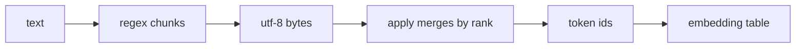

# Tokenization and BPE

> A language model never sees letters. It sees integers, and byte pair encoding decides which integers.

**Type:** Build
**Languages:** Python
**Prerequisites:** Phase 04 (Sequence Models: Word Embeddings), Phase 05 (Transformers)
**Time:** ~60 minutes

## Learning Objectives

- Compare character, word and byte-level tokenization by sequence length and vocabulary size
- Implement byte pair encoding (BPE) training: count adjacent pairs, merge the most frequent, repeat
- Encode new text by replaying merges in the order they were learned, and decode back losslessly
- Explain why byte-level BPE never produces an unknown token, and how vocabulary size trades off against sequence length

## The Problem

A transformer takes a sequence of integer ids, looks each one up in an embedding table, and predicts the next id. Before you can train anything you have to decide how to cut text into those ids, and every choice has a cost.

Characters give you a tiny vocabulary, but sequences become long. Attention cost grows with the square of the length, and the model has to spend capacity learning to spell. Whole words give you short sequences, but the vocabulary explodes, rare words are seen a handful of times, and any word not in the vocabulary ("lighthouses" when you only saw "lighthouse") becomes a useless `<unk>` token.

Byte pair encoding is the compromise every modern LLM uses in some form (GPT-2, GPT-4, Llama, and most others). It starts from bytes, so it can represent any string, and it learns to glue frequent byte sequences together, so common words become a single token while rare words fall back to pieces.

## The Concept

### Three ways to cut the same text

On the 3.5 kB story used in this phase:

| Unit | Tokens | Vocabulary | Unknown words? |
|------|--------|-----------|----------------|
| Characters | 3540 | 30 | No (until a new character appears) |
| Words | 680 | 249 | Yes |
| Bytes | 3540 | 256 | Never |
| BPE (305 merges) | ~944 | 561 | Never |

BPE sits between characters and words: it keeps the "never unknown" guarantee of bytes and gets most of the compression of words.

### The training loop

BPE is a greedy compression algorithm from 1994 that Sennrich et al. repurposed for neural machine translation in 2015:

```
ids = bytes of the text
repeat num_merges times:
    count every adjacent pair (a, b) in ids
    pick the most frequent pair
    give it a new id (256, 257, ...)
    replace every occurrence of (a, b) with the new id
```

Watch it on a toy string:

```
"the then the"     bytes: t h e _ t h e n _ t h e
merge (t,h)->256         256 e _ 256 e n _ 256 e
merge (256,e)->257       257 _ 257 n _ 257
merge (_,257)->258       257 258 n 258
```

Every merge shortens the sequence and adds one entry to the vocabulary. The merge list is the tokenizer; nothing else is stored.

### Pre-tokenization

If you let merges cross spaces and punctuation, you get tokens like `"e. the"` that mix two words. GPT-2 first splits text with a regex into chunks like `"the"`, `" keeper"`, `" 112"`, `","`, and only merges inside chunks. Notice the leading space stays attached to the word: `" the"` and `"the"` are different tokens, which is why LLMs care whether a prompt ends with a space.

### Encoding new text

To encode, you do not search for the best segmentation. You replay the merges in the order they were learned: at each step find the pair in the current sequence with the lowest merge rank, merge it, repeat until no learned pair is present. This reproduces exactly what training did to the same text.



### Decoding

Each token id maps to a byte string (the concatenation of its two parents). Decoding is concatenation followed by UTF-8 decoding. Non-ASCII characters like `é` are two bytes; if they were never merged they become two tokens, and a single token can be half of a character. That is fine as long as you decode the full byte string at once.

### The vocabulary size knob

More merges means fewer tokens per text (cheaper attention, longer effective context) but a bigger embedding table and output softmax, and rarer tokens with less training signal each. GPT-2 uses 50,257 tokens; Llama 3 uses about 128,000. Rule of thumb for English: one token is about 4 characters.

## Build It

The full script is `code/main.py`. Run it from the repo root:

```bash
uv run python phases/09-llms/01-tokenization-and-bpe/code/main.py
```

### Step 1: Pre-tokenize

```python
PRETOKENIZE_PATTERN = re.compile(r" ?[a-zA-Z]+| ?[0-9]+| ?[^\sa-zA-Z0-9]+|\s+")

def pretokenize(text):
    return PRETOKENIZE_PATTERN.findall(text)
```

`pretokenize("the keeper climbed 112 stairs, slowly.")` gives `['the', ' keeper', ' climbed', ' 112', ' stairs', ',', ' slowly', '.']`.

### Step 2: Merge one pair

```python
def merge_pair(ids, pair, new_id):
    merged = []
    i = 0
    while i < len(ids):
        if i < len(ids) - 1 and ids[i] == pair[0] and ids[i + 1] == pair[1]:
            merged.append(new_id)
            i += 2
        else:
            merged.append(ids[i])
            i += 1
    return merged
```

The scan is left to right and non-overlapping, so `aaa` with pair `(a, a)` becomes `[new, a]`.

### Step 3: Train

```python
def train_bpe(text, num_merges):
    chunks = [list(piece.encode("utf-8")) for piece in pretokenize(text)]
    merges = {}
    for step in range(num_merges):
        counts = count_pairs(chunks)
        if not counts:
            break
        best_pair = max(counts, key=lambda pair: (counts[pair], -pair[0], -pair[1]))
        if counts[best_pair] < 2:
            break
        new_id = 256 + step
        chunks = [merge_pair(chunk, best_pair, new_id) for chunk in chunks]
        merges[best_pair] = new_id
    return merges
```

Ties are broken by the smaller ids so training is deterministic. Training stops when no pair appears twice: on this small corpus that happens after 305 merges. The first merges are `'he'`, `' t'`, `' the'`, `' s'`, `' a'`: the most frequent English fragments. The last ones are whole words such as `' hundred'` and `' followed'`.

### Step 4: Encode and decode

```python
def encode_chunk(chunk_bytes, merges):
    ids = list(chunk_bytes)
    while len(ids) >= 2:
        pairs = set(zip(ids, ids[1:]))
        pair = min(pairs, key=lambda p: merges.get(p, float("inf")))
        if pair not in merges:
            break
        ids = merge_pair(ids, pair, merges[pair])
    return ids

def decode(ids, vocab):
    return b"".join(vocab[i] for i in ids).decode("utf-8", errors="replace")
```

Results:

```
'the keeper lit the lamp.'  -> the| keeper| lit| the| lamp|.
'lighthouses and harbors'   -> l|ight|ho|use|s| and| harbor|s
'a café in Zürich'          -> a| c|af|\xc3|\xa9| in| |Z|\xc3|\xbc|ri|c|h
```

`lighthouses` never appeared, yet it is encoded from known pieces. `é` and `ü` were never seen, so they fall back to raw UTF-8 bytes. All three decode back to the exact input.

### Step 5: Compression curve

```
merges   0 | vocab 256 | bytes/token train 1.00 held-out 1.00
merges 100 | vocab 356 | bytes/token train 2.24 held-out 2.41
merges 305 | vocab 561 | bytes/token train 3.75 held-out 4.67
```

The script saves `bpe_compression.png`. Each merge buys less than the previous one: the curve flattens.

## Use It

In production you would load a trained tokenizer instead of training one. With OpenAI's `tiktoken` (not a dependency of this repo):

```python
import tiktoken
enc = tiktoken.get_encoding("gpt2")
ids = enc.encode("the keeper lit the lamp.")
print(ids, enc.decode(ids))
```

The algorithm is the one you just wrote, with a bigger regex (contractions, Unicode letter classes) and 50,000 merges learned on a large web corpus. Hugging Face `tokenizers` and Google's SentencePiece implement the same idea in Rust and C++.

What happens next in the model is the part `main.py` checks with PyTorch: `nn.Embedding` is a lookup table, and `embedding(ids)` is exactly `embedding.weight[ids]`. The tokenizer decides the rows; training decides what is in them.

## Exercises

1. **Easy.** Remove pre-tokenization (train on the raw byte list of the whole text). Print the first 30 merges and find tokens that cross word boundaries.
2. **Medium.** Train BPE on the first half of the corpus and measure bytes per token on the second half for 50, 100 and 200 merges. Does a larger vocabulary still help on unseen text?
3. **Hard.** Implement WordPiece-style scoring: choose the pair maximizing `count(ab) / (count(a) * count(b))` instead of `count(ab)`. Compare the first 20 merges with BPE and explain the difference.

## Key Terms

| Term | What people say | What it actually means |
|------|----------------|----------------------|
| Token | "A word" | An integer id for a byte sequence; usually a word piece, sometimes a whole word or a single byte |
| BPE | "The GPT tokenizer" | Greedy algorithm that repeatedly merges the most frequent adjacent pair into a new symbol |
| Merge list | "The vocab file" | The ordered list of pair merges; replaying it encodes any text |
| Byte-level | "Handles emojis" | Base alphabet is the 256 byte values, so no input is ever out of vocabulary |
| Pre-tokenization | "Splitting on spaces" | A regex split applied before BPE so merges never cross word or punctuation boundaries |
| Vocabulary size | "How many words the model knows" | Number of distinct ids; trades sequence length against embedding and softmax size |
| Compression ratio | "Tokens per word" | Bytes (or characters) per token; higher means shorter sequences |

## Further Reading

- [Sennrich, Haddow, Birch (2015): Neural Machine Translation of Rare Words with Subword Units](https://arxiv.org/abs/1508.07909) - the paper that brought BPE to neural NLP
- [Radford et al. (2019): Language Models are Unsupervised Multitask Learners](https://cdn.openai.com/better-language-models/language_models_are_unsupervised_multitask_learners.pdf) - GPT-2, which introduced byte-level BPE with regex pre-tokenization
- [Andrej Karpathy: Let's build the GPT Tokenizer](https://www.youtube.com/watch?v=zduSFxRajkE) and [minbpe](https://github.com/karpathy/minbpe) - a two-hour build of the same algorithm
- [Hugging Face NLP Course: Byte-Pair Encoding tokenization](https://huggingface.co/learn/nlp-course/chapter6/5) - BPE alongside WordPiece and Unigram
