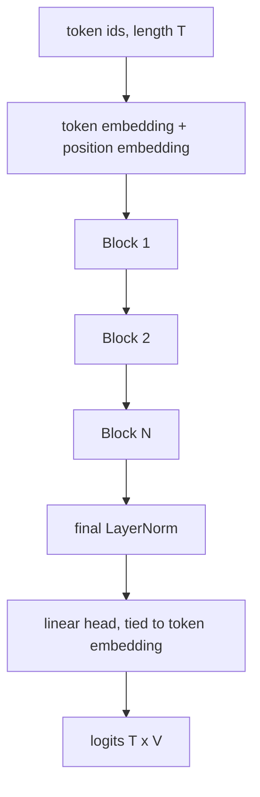

# GPT from Scratch

> A GPT is a stack of causal attention blocks trained to predict the next token. Everything else is scale.

**Type:** Build
**Languages:** Python
**Prerequisites:** Phase 05 (Transformers: Self-Attention, Multi-Head Attention, The Transformer Block, Encoders vs Decoders), Phase 09 (LLMs: Language Modeling and N-grams)
**Time:** ~90 minutes

## Learning Objectives

- Assemble a decoder-only transformer: token and position embeddings, causal multi-head attention, MLP, pre-LayerNorm residual blocks, tied output head
- Turn a text into (input, shifted target) batches and train with next-token cross-entropy
- Sanity-check training with the initial loss `ln(V)` and diagnose memorization from the train/val gap
- Verify your hand-written attention against `F.scaled_dot_product_attention` and `nn.MultiheadAttention`

## The Problem

The n-gram model of the previous lesson hit a wall: it counts each context separately, so it cannot generalize to contexts it never saw, and its context is a fixed handful of tokens. You need a model that reads an arbitrarily long prefix, compresses it into vectors, and lets similar prefixes share what they learned.

GPT (Generative Pre-trained Transformer) is that model. GPT-2, GPT-3, Llama and almost every chat model you use are the architecture in this lesson with more layers, wider vectors, more data, and a better tokenizer. If you can build and train the small one, you understand the large ones.

## The Concept

### The architecture



Each block is pre-LayerNorm:

```
x = x + Attention(LayerNorm(x))
x = x + MLP(LayerNorm(x))
```

The residual stream `x` carries information straight through; each sublayer reads a normalized copy and writes an update back.

### Causal self-attention

For each head, with `d` the head dimension:

```
Q = x W_q,   K = x W_k,   V = x W_v
scores = Q K^T / sqrt(d)                      (T x T)
scores[i, j] = -inf  for j > i                 (causal mask)
out = softmax(scores) V
```

The mask is a lower-triangular matrix:

```
        j=0  j=1  j=2  j=3
i=0      1    0    0    0
i=1      1    1    0    0
i=2      1    1    1    0
i=3      1    1    1    1
```

Position `i` can only attend to `0..i`. That is what makes the model a valid autoregressive language model: the prediction at position `i` never sees token `i + 1`.

### One chunk, T training examples

Take a chunk of `T + 1` characters. The input is the first `T`, the target is the last `T`:

```
input:   t  h  e  _  k  e  e  p
target:  h  e  _  k  e  e  p  e
```

Because of the mask, position 0 learns `P(h | t)`, position 3 learns `P(k | "the ")`, and so on. One forward pass gives `T` next-token losses, averaged into one cross-entropy.

### Initialization and the first sanity check

With small random weights (std 0.02, as in GPT-2), logits are close to zero, the softmax is nearly uniform, and the loss starts at `ln(V)`. For 30 characters that is 3.40. If your initial loss is 10, something is wrong before training even starts.

### Weight tying

The output head maps a hidden vector to `V` logits; the embedding maps a token to a hidden vector. GPT-2 uses the same matrix for both (`head.weight = token_embedding.weight`). It saves `V x d` parameters and works well because both layers encode "which token is this".

### Generation

```
repeat:
    logits = model(ids[-block_size:])
    p = softmax(logits[last] / temperature)
    next = sample(p)
    ids = ids + [next]
```

The next lesson studies the sampling step in depth; the lesson after that makes this loop fast.

## Build It

```bash
uv run python phases/09-llms/03-gpt-from-scratch/code/main.py
```

### Step 1: Data

A character tokenizer (BPE would also work, but characters keep the vocabulary tiny) and a batch sampler:

```python
def get_batch(data, block_size, batch_size, device, generator):
    starts = torch.randint(len(data) - block_size - 1, (batch_size,), generator=generator)
    x = torch.stack([data[s : s + block_size] for s in starts])
    y = torch.stack([data[s + 1 : s + block_size + 1] for s in starts])
    return x.to(device), y.to(device)
```

### Step 2: Causal attention by hand

```python
def forward(self, x):
    batch, length, embed_dim = x.shape
    q, k, v = self.qkv(x).split(embed_dim, dim=2)
    q, k, v = self.split_heads(q), self.split_heads(k), self.split_heads(v)
    scores = q @ k.transpose(-2, -1) / math.sqrt(self.head_dim)
    scores = scores.masked_fill(~self.mask[:length, :length], float("-inf"))
    weights = self.dropout(F.softmax(scores, dim=-1))
    out = (weights @ v).transpose(1, 2).reshape(batch, length, embed_dim)
    return self.dropout(self.proj(out))
```

One linear layer computes Q, K and V for all heads at once; `split_heads` reshapes `(B, T, C)` to `(B, heads, T, C / heads)` so every head runs in parallel.

### Step 3: Blocks and the model

```python
class Block(nn.Module):
    def forward(self, x):
        x = x + self.attn(self.ln1(x))
        return x + self.mlp(self.ln2(x))

class GPT(nn.Module):
    def forward(self, ids, targets=None):
        length = ids.shape[1]
        positions = torch.arange(length, device=ids.device)
        x = self.token_embedding(ids) + self.position_embedding(positions)
        for block in self.blocks:
            x = block(x)
        logits = self.head(self.ln_final(x))
        loss = None
        if targets is not None:
            loss = F.cross_entropy(logits.reshape(-1, logits.shape[-1]), targets.reshape(-1))
        return logits, loss
```

With `embed_dim=64`, 4 heads and 2 layers the model has about 106k parameters. The MLP uses the GPT-2 shape: expand to `4 x embed_dim`, GELU, project back.

### Step 4: Train

AdamW with learning rate `3e-3`, batch 32, block size 64, gradient clipping at norm 1, dropout 0.2. The script evaluates every 100 steps and keeps the checkpoint with the lowest validation loss:

```
step    0 | train loss 3.146 | val loss 3.138
step  100 | train loss 1.960 | val loss 2.012
step  200 | train loss 1.467 | val loss 1.696
step  300 | train loss 1.057 | val loss 1.534
step  400 | train loss 0.800 | val loss 1.605
step  600 | train loss 0.494 | val loss 1.639
```

Read this curve carefully. A 106k-parameter model and a 3.5 kB text: the network has far more capacity than the data has information, and after about 300 steps it starts memorizing. A bigger model (`embed_dim=96`, 3 layers, no dropout) trained for 1500 steps reaches train loss 0.12 and recites whole paragraphs of the story word for word, while validation loss climbs past 3. The best validation loss, around 1.5 nats per character (perplexity about 4.6), is in the same range as the interpolated n-gram from the previous lesson: on this little data a transformer has nothing extra to exploit. Its advantage only appears with orders of magnitude more text, which is the subject of the next lesson.

### Step 5: Generate

From the best checkpoint, with temperature 0.8, the samples are made of real words and fragments from the story (`"the boats in the"`, `"the stairs and storm"`, `"turned"`) mixed with misspellings like `"keeeperer"` and `"noteboook"`, arranged into new, mostly ungrammatical sentences.

## Use It

PyTorch ships fused attention kernels. `F.scaled_dot_product_attention(q, k, v, is_causal=True)` computes the same masked softmax attention, using FlashAttention or memory-efficient kernels when available. `nn.MultiheadAttention` wraps the projections too. The script copies your weights into both and compares:

```
max |ours - scaled_dot_product_attention| = 7e-08
max |ours - nn.MultiheadAttention|        = 6e-08
```

Note the mask conventions: your buffer is `True` where attention is allowed, while `nn.MultiheadAttention` takes `True` where it is forbidden (`torch.triu(..., diagonal=1)`). Getting this backwards is a classic bug that leaks the future into training and gives a suspiciously perfect loss.

In practice you would replace the body of `CausalSelfAttention.forward` with the fused call, keep everything else, and get the same model with less memory and more speed. That is exactly what nanoGPT does.

## Exercises

1. **Easy.** Remove the causal mask, train for 300 steps, and watch the training loss. Then generate. Explain why the loss looks great and the samples are terrible.
2. **Medium.** Replace the learned position embedding with the sinusoidal encoding from Phase 05 (Transformers: Positional Encodings) and compare the best validation loss.
3. **Hard.** Switch the tokenizer to the BPE from lesson 01 with about 150 merges. Compare validation loss per character (divide the per-token loss by the average characters per token) against the character model.

## Key Terms

| Term | What people say | What it actually means |
|------|----------------|----------------------|
| Decoder-only transformer | "GPT architecture" | A stack of causal self-attention blocks with no encoder and no cross-attention |
| Causal mask | "No peeking" | A lower-triangular mask so position i attends only to positions up to i |
| Block size | "Context window" | The maximum number of tokens the model attends over; set by the position embedding table |
| Residual stream | "Skip connections" | The vector each block reads from and adds its output to |
| Pre-LayerNorm | "Norm first" | LayerNorm on the sublayer input; trains more stably than normalizing after the residual add |
| Weight tying | "Shared embeddings" | Using the token embedding matrix as the output projection |
| Memorization | "Overfitting" | Training loss far below validation loss because the model stored the training text |

## Further Reading

- [Radford et al. (2018): Improving Language Understanding by Generative Pre-Training](https://cdn.openai.com/research-covers/language-unsupervised/language_understanding_paper.pdf) - the original GPT paper
- [Vaswani et al. (2017): Attention Is All You Need](https://arxiv.org/abs/1706.03762) - the transformer whose decoder half GPT keeps
- [Andrej Karpathy: Let's build GPT: from scratch, in code, spelled out](https://www.youtube.com/watch?v=kCc8FmEb1nY) and [nanoGPT](https://github.com/karpathy/nanoGPT) - the same build at a larger scale
- [PyTorch docs: scaled_dot_product_attention](https://pytorch.org/docs/stable/generated/torch.nn.functional.scaled_dot_product_attention.html) - the fused kernel and its mask semantics
